# The AI Engineering Master Story: From Neurons to Production Agent Ecosystems

Welcome to the master architectural index for `docs/AI/`. Rather than a collection of disconnected notes, this repository tells a **single, continuous engineering story across Seven Acts**—showing how each primitive in modern AI was invented to solve the specific failure mode of the layer before it.

---

## 1. The Grand Narrative: How All Primitives Fit Together

Every chapter in `docs/AI/` answers one question triggered by the limitations of the previous chapter:

```mermaid
flowchart TB
    Act1["ACT I: The Statistical Engine<br/>(Basics, LLM, Multimodal, FineTuning, LLMOps)<br/>Why models are probabilistic next-token generators—fast & fluent, but stateless & prone to hallucination."]
    Act2["ACT II: Structuring & Compiling Prompts<br/>(PromptEngineering, BAML, Pydantic, DSPy)<br/>How to turn loose natural language into type-safe schemas (BAML SAP) and compiled instructions (DSPy)."]
    Act3["ACT III: Grounding, Context & Memory Physics<br/>(ContextEngineering, RAG, RLM, Context_Graph, Memory)<br/>How to feed external truth without Context Rot or busting the GPU KV-Cache (4-Zone Layout & Bi-Temporal Graphs)."]
    Act4["ACT IV: The Actuation & Protocol Triad<br/>(Skills SEP-2640, MCP 2026-07-28, A2A, A2UI, UCP)<br/>How the brain acts safely: Vertical Tools/Skills (MCP), Horizontal Peers (A2A), Human UI (A2UI), & Commerce (UCP)."]
    Act5["ACT V: Production-Grade Agent Orchestration<br/>(Agents 01-10, LangGraph, Copilot SDK)<br/>Taming Unbounded Input + Generative Models via Step Verifiers (breaking p^N decay), Durable Sagas, & RFC 8693 Personas."]
    Act6["ACT VI: Trust, Security & The Eval Control Loop<br/>(Evals 00-05, Safety / Guardrails)<br/>4-Layer Contract Evals, Meta-Eval Mutation Testing, Rogan-Gladen Calibration, CaMeL XPIA Defense, & OTel Flywheel."]
    Act7["ACT VII: AI-Native SDLC & Spec-Driven Development<br/>(AINativeSDLC, SDD, .agents/skills)<br/>Applying the full agentic stack to software engineering: Refined Intent -> Multi-View Specs -> TDD -> Spec-Sync."]

    Act1 -->|"Problem: Output is unstructured prose"| Act2
    Act2 -->|"Problem: Model lacks private/live knowledge"| Act3
    Act3 -->|"Problem: Model can read, but cannot act"| Act4
    Act4 -->|"Problem: Multi-step decisions compound errors (p^N)"| Act5
    Act5 -->|"Problem: Who watches the watchmen & blocks XPIA?"| Act6
    Act6 -->|"Culmination: Autonomous Software Factory"| Act7
```

---

## 2. The Seven-Act Reading Curriculum

### Act I: The Statistical Engine (Foundation Models & Inference Physics)
* **The Core Lesson:** Neural networks only take numbers in and output probability distributions over tokens. Because an LLM is a **stateless, autoregressive next-token predictor** (*Axiom 2: The Generative Machine*), it has no built-in database, calculator, or state machine.
* **Chapters:**
  1. **[Neural Networks, Embeddings & Transformer Mechanics](./Basics.md)** — Tokens, embeddings, self-attention, softmax, residual connections, and pre-training vs. post-training.
  2. **[Large Language Models & Hallucination Taxonomy](./LLM.md)** — Transformers, in-context vs. extrinsic hallucinations, and the transition from reactive LLMs to goal-oriented workflows.
  3. **[Multimodal & Vision Transformers](./Multimodal/Vision_Transformers.md)** — Extending token sequences to images and cross-modal embeddings (`Multimodal/examples/simple_vision_rag.py`).
  4. **[Adapting Weights: Fine-Tuning & LoRA](./FineTuning/FineTuning_Basics.md)** & **[LoRA Adapter Guide](./FineTuning/LoRA_Adapter_Guide.md)** — When to update weights vs. when to use context/skills (`FineTuning/examples/fine_tune_tiny_llama.py`).
  5. **[LLMOps: Quantization, Edge SLMs & Inference Strategies](./LLMOps/Inference_Strategies.md)** — [Quantization Guide](./LLMOps/Quantization_Guide.md) & [Edge AI SLMs](./LLMOps/Edge_AI_SLMs.md) (KV-cache memory bounds, AWQ/GGUF, speculative decoding).

---

### Act II: Communicating with & Structuring the Engine
* **The Core Lesson:** Polite prose prompting is brittle. Production systems treat LLM calls as **typed functions** with constrained decoding, schema-aligned parsers, and metric-driven prompt compilers.
* **Chapters:**
  1. **[Prompt Engineering Foundations](./PromptEngineering.md)** — Sampling physics (`temperature`, `top_p`, frequency/presence penalties), zero/few-shot patterns, and Chain-of-Thought.
  2. **[Pydantic in AI (Runtime Data Validation)](./Pydantic/PydanticInAI.md)** — Enforcing typed schemas on LLM outputs (`Pydantic/src/`).
  3. **[BAML: Schema-Aligned Parsing & Type-Safe Prompts](./BAML/WhatIsBAML.md)** — Why "Format-First" JSON mode hurts reasoning, how **Think-Then-Parse** preserves scratchpad compute, and how BAML cuts schema token tax by 60–85% (`BAML/baml_client_usage.py`).
  4. **[DSPy: Programmatic Prompt Compilation](./Advanced/DSPy_Intro.md)** — Replacing manual prompt tweaking with `Signatures`, `Modules`, and `MIPROv2`/`BootstrapFewShot` optimizers (`Advanced/examples/dspy_optimization.py`).

---

### Act III: Grounding, Context Engineering, & Memory Physics
* **The Core Lesson:** A 1M-token context window does not mean you should dump 1M tokens into every turn (*"Lost in the Middle"*, *Context Rot*, and *KV-Cache Invalidation*). Production systems use prefix-stable context compilation, recursive retrieval, and bi-temporal memory stores.
* **Chapters:**
  1. **[Context Engineering & Transformer KV-Cache Physics](./ContextEngineering.md)** — Advertised vs. Effective context length, causal prefix caching, and the **4-Zone Prefix-Stable Context Compiler**.
  2. **[RAG Foundations](./RAG.md)** & **[RAG Deep-Dive Strategies](./RAG_Strategies/RetrievalStrategies.md)** — [Chunking Strategies](./RAG_Strategies/ChunkingStrategies.md), [Hybrid Search & Reranking](./RAG_Strategies/RetrievalStrategies.md), and [RAG Evaluation](./RAG_Strategies/RAGEvaluation.md) ([Tools](./RAG_Strategies/RAGEvaluationTools.md)).
  3. **[Vectorless & PageIndex RAG](./RAG/VectorlessRAG.md)** — Hierarchical reasoning-based retrieval without vector similarity drift.
  4. **[Recursive Language Models (RLM)](./RLM/RecursiveLanguageModels.md)** — Teaching models to navigate indexes and call sub-queries recursively (`RLM/rlm_simulation.py`).
  5. **[Context Graphs (GraphRAG)](./Context_Graph/ContextGraph.md)** — Multi-hop entity relationship traversal (`Context_Graph/advanced_retrieval.py`).
  6. **[AI Memory Systems (CoALA & Bi-Temporal Graphs)](./Memory.md)** — Partitioning **Working Memory**, **Episodic Run Receipts (`do_not_repeat`)**, **Bi-Temporal Semantic Graphs (`valid_from`/`valid_until`)**, and **Procedural Memory (`SKILL.md`)**.

---

### Act IV: The Actuation Layer & The Protocol Triad (`MCP`, `Skills`, `A2A`, `A2UI`, `UCP`)
* **The Core Lesson:** An LLM with knowledge is still just an advisor. To become an actor, it needs standardized protocols along three axes: **Vertical** (`MCP` + `Skills`), **Horizontal** (`A2A`), and **Human Surface** (`A2UI` / `MCP Apps`), plus domain commerce (`UCP`).
* **Chapters:**
  1. **[AI Agent Skills: Enterprise Architecture Guide](./Skills/skill.md)** *(Runnable Suite: `docs/AI/Skills/Makefile`)*
     * [01. Core Concepts & Granularity (Macro vs. Micro Skills)](./Skills/01_core_concepts.md)
     * [02. Execution Architecture, Token Economics ($\text{TAF}$, $\text{CAR}$) & Model Dependency](./Skills/02_execution_architecture.md)
     * [03. Skill Testing Lifecycle & Model-Agnostic Testing ($\text{Pass}^k$, Canonical AST)](./Skills/03_testing_lifecycle.md)
     * [04. Maintainability, Tombstoning & OTel Governance (`SEP-414`)](./Skills/04_maintainability_governance.md)
     * [05. Implementation, Progressive Disclosure & Skills Over MCP (`SEP-2640`)](./Skills/05_implementation_discovery.md)
     * [06. The 6-Stage Skill Delivery Factory (CI/CD Pipeline)](./Skills/06_skill_delivery_factory.md)
  2. **[Model Context Protocol (`MCP 2026-07-28`)](./MCP/00_overview.md)** & **[MCP Master Summary](./MCP.md)** *(Runnable Suite: `docs/AI/MCP/Makefile`)*
     * [01. Stateless Core, `server/discover`, `MRTR` & OTel (`SEP-414`)](./MCP/01_architecture.md)
     * [02. Primitives: Tools (`SEP-1303`), Resources, Prompts & Extensions](./MCP/02_primitives.md)
     * [03. Stateless HTTP, Header Routing & OAuth 2.1 / OIDC (`SEP-835`)](./MCP/03_transports.md)
     * [04. Building Enterprise Servers](./MCP/04_building_servers.md) · [05. Pros & Cons](./MCP/05_pros_and_cons.md) · [06. MCP Apps (`ui://`)](./MCP/06_mcp_app.md)
  3. **[A2A: Agent-to-Agent Protocol (Horizontal Delegation)](./A2A/00_overview.md)** — [Agent Cards](./A2A/01_agent_cards.md), [Tasks](./A2A/02_tasks.md), [Communication](./A2A/03_communication.md), [Security](./A2A/04_security.md), [Pros/Cons](./A2A/05_pros_and_cons.md).
  4. **[A2UI: Agent-to-User Interface Protocol (Human Surface)](./A2UI/00_overview.md)** — [Core Concepts](./A2UI/01_core_concepts.md), [Message Types](./A2UI/02_message_types.md), [Component Catalog](./A2UI/03_component_catalog.md), [Mobile](./A2UI/05_mobile_implementation.md).
  5. **[UCP: Universal Commerce Protocol](./UCP/00_overview.md)** — Agentic checkout, capabilities, and AP2 payment security ([01](./UCP/01_core_concepts.md)–[05](./UCP/05_pros_and_cons.md)).

---

### Act V: Orchestrating Production-Grade Agents
* **The Core Lesson:** Because **Input is Unbounded (Axiom 1)** and **The Model is a Generative Machine (Axiom 2)**, chaining $N$ unguarded decisions causes exponential reliability collapse ($\bar{p}^N$). Production agents wrap the model in a **Probabilistic-to-Deterministic Funnel** with step-level verifiers, durable checkpoints, compensating sagas, and dual-plane persona resolution.
* **Chapters:**
  1. **[AI Agents Learning Path (`00`–`10`)](./Agents/00_Learning_Path_Index.md)** & **[Conceptual Overview (`Agents.md`)](./Agents/Agents.md)** *(Runnable Suite: `docs/AI/Agents/examples/Makefile`)*
     * [01. Mental Models & Hardware Analogy](./Agents/01_Mental_Model_and_Concepts.md)
     * [02. Problem Selection, DAGs & `SEP-1303` Error Recovery](./Agents/02_Problem_Selection_and_Architecture.md)
     * [03. Evaluation & OpenTelemetry Observability](./Agents/03_Evaluation_and_Observability.md)
     * [04. Maintenance, Token GC & Feedback Loops](./Agents/04_Maintenance_and_Productionization.md)
     * [05. Practical Patterns: Single, Reflection, Multi-Agent & Swarm](./Agents/05_Practical_Implementation.md)
     * [06. Advanced Concepts: Episodic Reflection & DPO](./Agents/06_Advanced_Concepts.md)
     * [07. Modern Agentic Engineering: Graphs, Bounded Loops & Progressive Discovery](./Agents/07_Modern_Agentic_Engineering.md)
     * [08. Capstone: Production-Grade Agent Architecture (The 5-Layer Funnel)](./Agents/08_Production_Grade_Agent_Architecture.md)
     * [09. Deep-Dive: Decision Physics ($p^N$), Durable Sagas, CoALA Memory & RFC 8693 Personas](./Agents/09_Durable_State_Memory_and_Persona_Architecture.md)
     * [10. Deep-Dive: Companion Primitives — BAML, KV-Cache Physics, Protocol Triad, XPIA CaMeL & DSPy](./Agents/10_Companion_Primitives_BAML_KV_A2A_A2UI_Safety_DSPy.md)
  2. **[LangGraph Implementation Curriculum (`00`–`13`)](./LangGraph/LangGraph.md)** — [Setup](./LangGraph/00_setup.md), [Core](./LangGraph/01_core_concepts.md), [Routing](./LangGraph/02_conditional_logic.md), [Tools](./LangGraph/03_tool_calling.md), [Persistence & Time Travel](./LangGraph/04_persistence.md), [HITL](./LangGraph/05_human_in_the_loop.md), [Multi-Agent](./LangGraph/06_advanced_patterns.md), [Memory](./LangGraph/07_memory_management.md), [Context](./LangGraph/08_context_engineering.md), [Streaming](./LangGraph/09_streaming.md), [Config](./LangGraph/10_configuration.md), [Testing](./LangGraph/11_testing.md), [Eval](./LangGraph/12_evaluation.md), [Deep Research](./LangGraph/13_deep_research.md).
  3. **[GitHub Copilot SDK Agents](./GitHub_Copilot_SDK/Copilot_SDK.md)** — Building custom tool & streaming agents with the Copilot SDK (`GitHub_Copilot_SDK/examples/`).

---

### Act VI: Trust, Security Guardrails, & The Eval Control Loop
* **The Core Lesson:** You cannot improve or trust what you cannot measure—and an uncalibrated eval ("Vanity Eval") is worse than no eval at all.
* **Chapters:**
  1. **[AI Evals: The Foundation of Reliable Agents](./Evals/00_overview.md)** *(Runnable Suite: `docs/AI/Evals/Makefile`)*
     * [01. Types of Evals (Unit, Integration, E2E, Offline vs. Online)](./Evals/01_types_of_evals.md)
     * [02. Building & Running Evals (Datasets, Deterministic vs. Judge Metrics)](./Evals/02_building_evals.md)
     * [03. Meta-Evaluation (Mutation Testing, Judge Calibration $\text{TPR}/\text{TNR}/\kappa$, Rogan-Gladen) & Continuous OTel Flywheel](./Evals/03_maintaining_evals.md)
     * [04. Measuring Semantic & Intent Taxonomy Coverage](./Evals/04_measuring_coverage.md)
     * [05. The Unified Puzzle: Agent + Skill + MCP + Eval Pipeline](./Evals/05_unified_agent_mcp_skill_eval_pipeline.md)
  2. **[AI Safety, Guardrails & XPIA CaMeL Defense](./Safety/AI_Guardrails.md)** — Direct input/output rails, PII redaction, and the **3-Layer Indirect Prompt Injection (XPIA) Defense** (Cryptographic Spotlighting, CaMeL Quarantined Reader LLM, and Taint Tracking).

---

### Act VII: The AI-Native SDLC & Spec-Driven Development (SDD)
* **The Core Lesson:** When we apply all six acts above to the software engineering lifecycle itself, code becomes a deterministic side-effect of verified, multi-view specifications.
* **Chapters:**
  1. **[AI-Native SDLC & The V-Model](./AINativeSDLC.md)** & **[Step 1 Guide](./AINativeSDLC/Step1.md)**
  2. **[Spec-Driven Development (SDD) Implementation Framework](./SDD/SpecDrivenDevelopment.md)** — [Repo Spec Template](./SDD/templates/RepoSpecTemplate.md) & [Delta Spec Template](./SDD/templates/DeltaSpecTemplate.md), powered by our workspace skills:
     * [`refine-intent`](../../.agents/skills/refine-intent/SKILL.md) $\rightarrow$ [`generate-ba-view`](../../.agents/skills/generate-ba-view/SKILL.md) $\rightarrow$ [`generate-qa-view`](../../.agents/skills/generate-qa-view/SKILL.md) $\rightarrow$ [`generate-dev-view`](../../.agents/skills/generate-dev-view/SKILL.md) $\rightarrow$ [`spec-sync`](../../.agents/skills/spec-sync/SKILL.md).
  3. **[The 12 Architectural Principles (`ImpPoints.md`)](./ImpPoints.md)** — Executive cheat-sheet of non-negotiable production laws.
