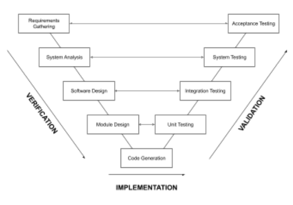

# AI Native SDLC

AI-Native SDLC, mean a software development lifecycle where AI is seamlessly integrated into every phase — from planning to maintenance — enhancing efficiency, accuracy, and innovation across the entire process.

- **Planning**: AI-powered project management tools can help to predict potential bottlenecks and resource constraints early, which helps with more proactive decision-making

- **Design**: By analyzing user interaction data, AI can suggest design improvements that enhance user experience and
  bridge the gap between user research and design implementation

- **Development**: AI-driven code generation tools can assist developers by suggesting code snippets, automating repetitive coding tasks, and even identifying potential bugs in real-time. AI-driven automation creates comprehensive test cases and simulates scenarios reducing the need for separate quality assurance stage, ensuring a more robust validation of
  the software.

- **Maintenance**: AI can predict and prevent potential failures by analyzing usage patterns and system performance metrics and ensuring higher reliability and uptime.

Areas where AI can be integrated into the SDLC:

- Automatically captures knowledge from various sources (code repositories, documentation, communication channels) without manual intervention.
- Organizes and connects disparate pieces of information to create a comprehensive knowledge graph of the entire SDLC process.
- Provides contextually relevant information to team members based on their current task, role, and project phase.
- Identifies knowledge gaps and suggest areas where more documentation or clarification is needed.
- Learns from past projects to provide insights and recommendations for current and future projects.
- Facilitates natural language queries, allowing team members to ask complex questions and receive accurate, context-aware responses.

## V-model

With AI integration, we all be following V model, where each phase of development is directly associated with a corresponding testing phase. This ensures that every aspect of the software is validated against its requirements, leading to higher quality and reliability.



In this diagram, you can see three phases:

1. Verfication phase on the left side of the V. The requirements are recorded/captured and converted into a system analysis. These requirements become increasingly specific according to the top-down principle.

2. Development phase at the bottom of the V. The actual coding takes place here, transforming the detailed design into executable code.

3. Validation phase on the right side of the V. Each level of testing corresponds to a level of requirements, ensuring that the final product meets the initial specifications.

Core principles of V-model:

- **Continuous Testing Integration**: Testing is integrated into every phase of the development process, ensuring that issues are identified and addressed early. Initial requirements gathering to final deployment. This ensures ongoing, iterative quality assurance rather than relegating testing to a final phase

- **Parallel Planning of Development and Testing**: Each development stage in the V-Model is associated with a
corresponding testing phase. This parallel structure enforces concurrent planning of both development and testing
activities and forces validation forethought throughout the process

- **Precise Requirement Definition**: A fundamental tenet of the V-Model is the establishment of clear, concise, and
unambiguous requirements. Precision is critical for developing effective test cases and ensuring the final product
aligns with stakeholder expectations

- **Integration of Development and Testing Teams**: The V-Model encourages close collaboration between development and testing teams. This integration fosters a shared understanding of project goals, requirements, and quality standards, leading to more effective communication and coordination.

## To Read

- <https://www.mdpi.com/2076-3417/15/3/1344>
- <https://www.irejournals.com/formatedpaper/1702368.pdf>
- <https://dspace.mit.edu/bitstream/handle/1721.1/154009/mridulaprakash-mridula-sm-sdm-2024-thesis.pdf?sequence=1&isAllowed=y>
- <https://codescene.com/hubfs/whitepapers/Refactoring-vs-Refuctoring-Advancing-the-state-of-AI-automated-code-improvements.pdf>

## Practical Toolkit for 2025

Moving from theory to practice, here is the modern AI-Native stack:

### 1. The IDE (Coding)

- **Cursor / Windsurf**: Not just autocomplete. These IDEs index your entire codebase.
  - *Feature*: "Composer" (Cmd+K) allows writing diffs across multiple files.
  - *Best Practice*: Use `@Codebase` context to ask high-level architectural questions.

### 2. The Code Review (CI/CD)

- **PR-Agent (Codium)**: Automatically reviews Pull Requests.
  - *Capabilities*: Summarizes changes, detects bugs, suggests documentation.
  - *Workflow*: GitHub Action runs on every PR -> Bot comments on lines of code.

### 3. The Prototyping (Design-to-Code)

- **v0 (Vercel)**: Text-to-React.
  - *Workflow*: Screenshot a drawing -> v0 generates Tailwind/Shadcn code -> Copy to Cursor.
- **Lovable**: Full-stack app generation.

### 4. The Testing

- **Codeium / Copilot**: Auto-generate unit tests from functions.
  - *Prompt*: "Generate pytest cases for this class, covering edge cases."

---

## 5. Evolution to 2026: Spec-Driven Development (SDD) & The Skill Delivery Factory

As AI coding agents matured from IDE autocomplete to autonomous multi-file execution, the V-Model evolved into **Spec-Driven Development (SDD)**—where human engineers own the left and right tops of the "V" (Intent Specification & Acceptance Verification) while specialized AI Skills execute the bottom of the "V":

```
Raw Requirement ──► [1. refine-intent] ──► [2. generate-ba-view] ──► [3. generate-qa-view] ──► [4. generate-dev-view] ──► Code & Tests
                        ▲                                                                                                      │
                        └────────────────────────────── [5. spec-sync (AST Drift Reconciler)] ◄────────────────────────────────┘
```

### Connected Architecture & Playbooks in This Repository
* **Master Narrative Index:** [00_Master_Story_and_Index.md](./00_Master_Story_and_Index.md)
* **Spec-Driven Development Deep-Dive:** [SDD/SpecDrivenDevelopment.md](./SDD/SpecDrivenDevelopment.md)
* **Executable Repository SDD Skills (`.agents/skills/`):**
  1. [`refine-intent`](../../.agents/skills/refine-intent/SKILL.md) — Clarifies business intent and flags ambiguities against `AGENTS.md`
  2. [`generate-ba-view`](../../.agents/skills/generate-ba-view/SKILL.md) — Produces state transitions and Mermaid diagrams
  3. [`generate-qa-view`](../../.agents/skills/generate-qa-view/SKILL.md) — Generates exhaustive BDD/Gherkin scenarios (Anti-Complacency Gate)
  4. [`generate-dev-view`](../../.agents/skills/generate-dev-view/SKILL.md) — Maps business rules to concrete codebase classes and signatures
  5. [`spec-sync`](../../.agents/skills/spec-sync/SKILL.md) — Reconciles AST code drift back into the specification
* **The CI/CD Factory for AI Primitives:**
  * [06_skill_delivery_factory.md](./Skills/06_skill_delivery_factory.md) — The 6-Stage testable delivery pipeline for Skills
  * [05_unified_agent_mcp_skill_eval_pipeline.md](./Evals/05_unified_agent_mcp_skill_eval_pipeline.md) — The Unified `Agent + MCP + Skill + Eval` Delivery & Observability Flywheel
