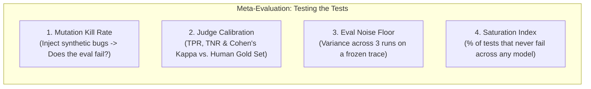
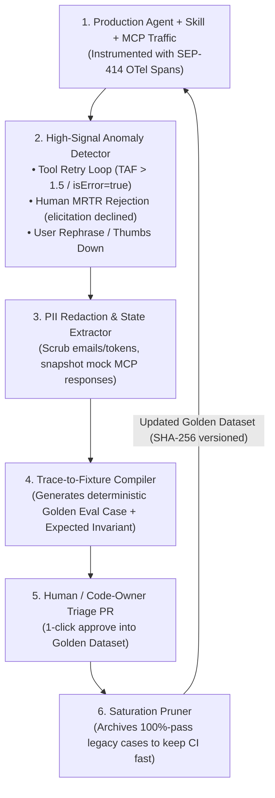

# Measuring Eval Quality & Continuous Eval Maintenance

The hardest question in AI engineering is not *"How do I write an eval?"*—it is:
1. **"Who watches the watchmen?"** (How do I measure the *quality* of my eval so I know a 98% pass rate is real and not a vanity metric?)
2. **"How do I keep evals alive?"** (How do I continuously update the eval suite as user behavior, skills, and models evolve without manual drudgery?)

---

## Part 1: How to Measure the Quality of an Eval (Meta-Evaluation)

An evaluation suite is itself a classifier that predicts whether an agent execution is **Good (Pass)** or **Bad (Fail)**. If your eval is poorly designed, it will happily report `100% PASS` while your agent fails in production.

You measure the quality of an Eval using **four quantitative Meta-Eval metrics** (implemented in [`src/03_meta_eval_quality_checker.py`](./src/03_meta_eval_quality_checker.py)):

### 1. Mutation Testing for Evals (The "Defect Injection" Score)
In software engineering, mutation testing checks test suite quality by deliberately injecting bugs into code and verifying that tests fail. For AI Evals, we inject **Synthetic Failure Mutants** into agent traces:
* **Mutant Type A (Skill Routing Mutant):** Agent activates the wrong skill (`cancel-account` instead of `refund-order`).
* **Mutant Type B (Hallucinated Argument Mutant):** Agent calls `issue_refund` with an invented `order_id` not present in the user prompt or lookup output.
* **Mutant Type C (Policy Violation Mutant):** Agent processes a refund for an order outside the 30-day window.
* **Mutant Type D (Ungrounded Prose Mutant):** Tool returns `status: "declined"`, but the agent tells the user *"Your refund has been approved!"*

$$\text{Eval Mutation Score} = \frac{\text{Number of Injected Mutants Caught (Marked FAIL)}}{\text{Total Injected Mutants}}$$

* **Vanity Eval ($\text{Mutation Score} < 50\%$):** Checks only superficial syntax (e.g., `"Is output valid JSON?"` or `"Is tone polite?"`) and misses actual business logic failures.
* **Enterprise Eval Gate:** Your eval suite MUST achieve an **Eval Mutation Score $\ge 90\%$** before it is trusted to gate deployments.

### 2. Judge Calibration ($\text{TPR}$, $\text{TNR}$, Cohen's $\kappa$, & Bias Correction)
Whenever you use an **LLM-as-a-Judge** (for synthesis faithfulness, rubric adherence, or spec quality), the Judge is an imperfect estimator with its own False Positive and False Negative rates.

#### Step A: Measure $\text{TPR}$ and $\text{TNR}$ Against a Human Gold Calibration Set
Maintain a small, frozen **Gold Calibration Dataset** of 50–100 historical agent traces graded by domain experts (50% true passes, 50% subtle failures):
* **True Positive Rate ($\text{TPR}$ / Sensitivity):** Probability the Judge marks a truly good trace as `PASS`.
* **True Negative Rate ($\text{TNR}$ / Specificity):** Probability the Judge marks a truly bad trace as `FAIL`.
* **Cohen's Kappa ($\kappa$):** Measures inter-rater agreement between the Judge and humans beyond chance:
  $$\kappa = \frac{p_o - p_e}{1 - p_e}$$
  (**Mandate:** Judge prompt must achieve $\text{TPR} \ge 0.90$, $\text{TNR} \ge 0.90$, and $\kappa \ge 0.80$).

#### Step B: Apply the Rogan-Gladen Bias Correction
If your Judge has known $\text{TPR}$ and $\text{TNR}$ from calibration, and observes a raw pass rate $\hat{p}_{\text{obs}}$ on a new test run, calculate the **True Corrected Pass Rate ($\hat{p}_{\text{true}}$)**:

$$\hat{p}_{\text{true}} = \text{clip}_{[0, 1]}\left(\frac{\hat{p}_{\text{obs}} + \text{TNR} - 1}{\text{TPR} + \text{TNR} - 1}\right)$$

> [!TIP]
> **Why Binary Checklist Rubrics Beat 1–5 Likert Scales:** LLM Judges are notorious for central-tendency bias on `1 to 5` scales (giving everything a `4/5`). Always decompose subjective evals into **atomic Boolean (`true`/`false`) rubric questions** (e.g., `did_cite_order_id: bool`, `respected_30_day_window: bool`). This cuts Judge variance by $>70\%$.

### 3. Eval Noise Floor (Repeatability on Frozen Traces)
Re-run your Evaluator 3 times on the **exact same frozen agent trace**.
* Deterministic code/state evaluators have **0.0% variance**.
* LLM-as-a-Judge evaluators must run at `temperature = 0` and exhibit a **Flip Rate $\le 2\%$**. If a judge flips between Pass and Fail on identical text, the rubric is ambiguous and must be rewritten.

### 4. Dataset Saturation Index (Pruning Dead Weight)
Track the historical fail rate of every test case $i$ across your last $N$ model/prompt runs:
* If a test case has passed `100%` of runs across Frontier, Flash, and SLM models for 60 days, it is **Saturated** (provides zero discriminative signal for hill-climbing).
* **Action:** Demote saturated tests to a lightweight pre-release smoke check and replace them with fresh production failure cases so your active Eval suite maintains high signal-to-cost density.

---

## Part 2: Keeping Evals Continuously Updated (The Closed-Loop OTel Flywheel)

Static evaluation datasets suffer from **Eval Rot**: the moment your product launches, real users ask questions and trigger MCP tool edge cases that your initial dataset never anticipated.

To keep evals continuously updated without manual copy-pasting, connect your **OpenTelemetry (`SEP-414`) production traces** directly to an automated **Trace-to-Fixture Compiler** (demonstrated in [`src/04_continuous_eval_flywheel.py`](./src/04_continuous_eval_flywheel.py)):

### The 4 Automated Triggers That Harvest New Eval Cases

Your observability collector inspects completed `gen_ai.agent.invoke` trace trees and automatically extracts candidate eval cases whenever any of these four signals fire:

| Trigger Signal | OTel Span / Attribute Signature | Why It Matters |
| :--- | :--- | :--- |
| **1. Tool Self-Correction Loop** | $\ge 1$ child span with `mcp.method.name = "tools/call"` and `isError = true` ($\text{TAF} > 1.3$) | Reveals that `SKILL.md` instructions or `inputSchema` descriptions were unclear on the first attempt. |
| **2. Human-in-the-Loop (`MRTR`) Rejection** | `resultType = "input_required"` followed by `elicitation` response `approved = false` | High-value signal: the Agent attempted an action that a human operator explicitly vetoed! |
| **3. Skill Discovery Miss / Fallback** | `skills/list` returned 0 matches or Agent switched skills mid-turn | Reveals a **Semantic Coverage Gap** in `SKILL.md` frontmatter tags/descriptions. |
| **4. Latency / Token Budget Spike** | Trace `gen_ai.client.token.usage` $> P_{95}$ for that `skill.digest` | Identifies multi-turn ping-pong loops that need Macro-Skill consolidation. |

### Automated Trace-to-Fixture Compilation

When an anomalous trace is captured, the compiler transforms the raw OTel JSON spans into a self-contained, deterministic test case:
1. **PII Sanitization:** Replaces emails, phone numbers, account IDs, and JWTs with deterministic synthetic tokens (`user_redact_01`, `ord_901`).
2. **Sandbox State Reconstruction:** Extracts the `structuredContent` returned by read-only MCP tools (`get_order`) during the trace and freezes it as the `initial_sandbox_state` of the test fixture.
3. **Invariant Generation:** Records the failure mode (e.g., `must_not_call_tool="issue_refund"` for an `MRTR`-rejected trace, or `expected_first_turn_valid_args=True` for a `SEP-1303` retry trace).
4. **Dataset Hygiene:** Versioning the Eval dataset alongside `SKILL.md` in Git ensures every bug discovered in production permanently immunizes the system against future regressions.
