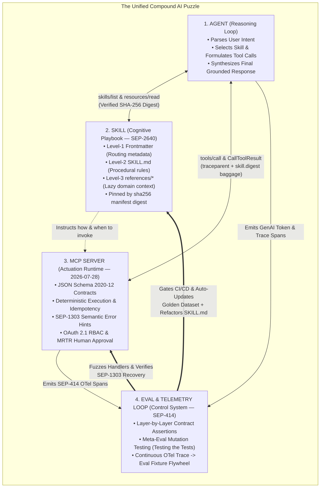
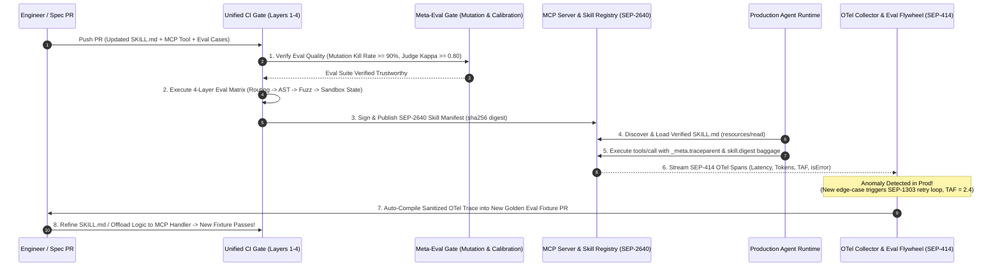

# The Unified Puzzle: Agent + Skill + MCP + Eval Pipeline

In many organizations, **Agents**, **Skills (`SKILL.md`)**, **MCP Servers**, and **Evals** are built by separate teams in silos. The result is brittle orchestration: when an agent fails in production, nobody knows whether the bug is in the LLM model, the `SKILL.md` prompt, the MCP tool schema, or the backend API—and the Eval suite doesn't catch it.

In a mature Enterprise AI Architecture, **Agent + Skill + MCP + Eval** are four interlocking pieces of a **single closed-loop control system**.

---

## 1. How the Four Pieces Fit Together (The 4-Layer Puzzle)

Think of a Compound AI System like a modern autonomous vehicle:
* **The Agent (LLM + Orchestrator)** is the **Driver / Reasoning Engine**—it perceives user intent and decides *what* goal to pursue.
* **The Skill (`SKILL.md` + `SEP-2640` Manifest)** is the **Navigation Playbook / SOP**—it teaches the Agent the domain rules, progressive context, and step-by-step procedures for a task.
* **The MCP Server (`2026-07-28` + `SEP-1303`)** is the **Mechanical Actuation Bus (Brakes, Steering, Sensors)**—it executes deterministic code, enforces OAuth 2.1 / RBAC boundaries, and returns structured state or semantic error hints.
* **The Eval Suite + OTel (`SEP-414`)** is the **Telemetry & Crash-Test Harness**—it verifies every boundary before deployment (Offline CI Evals) and monitors every turn in production (Online OTel Flywheel) to continuously refine the Skill and MCP Server.



---

## 2. Mapping Every Failure Mode to Its Exact Eval Layer

Why are Evals hard to understand? Because teams try to use **one giant End-to-End LLM-as-a-Judge score** to evaluate the entire stack. When that score drops from `0.88` to `0.79`, you have no idea what broke.

Instead, align your Eval architecture directly with the **four boundaries** of the `Agent + Skill + MCP` runtime (implemented in [`src/05_unified_agent_mcp_skill_eval_pipeline.py`](./src/05_unified_agent_mcp_skill_eval_pipeline.py)):

| Stack Layer | Component Under Test | What Can Go Wrong? | Exact Eval Type (Fastest to Slowest) | Metric & Gate Threshold |
| :--- | :--- | :--- | :--- | :--- |
| **Layer 1: Discovery & Routing** | `Agent` $\leftrightarrow$ `Skill Frontmatter` (`skills/list`) | Agent fails to discover the skill or confuses two overlapping skills (Semantic Shadowing). | **Deterministic Routing Confusion Matrix** (No backend execution needed) | Top-1 Recall $\ge 0.90$<br/>Top-3 Recall $\ge 0.98$<br/>False Positive $\le 0.05$ |
| **Layer 2: Cognitive Instruction & Schema** | `Agent` $\leftrightarrow$ `SKILL.md` + `MCP inputSchema` | Agent violates a business rule in `SKILL.md`, hallucinates a missing parameter, or formats JSON args poorly. | **Prompt-Isolation Canonical AST Eval** (Feed `SKILL.md` + Schema; inspect normalized `tools/call`) | Schema Validity $= 100\%$<br/>Zero Hallucinated IDs<br/>$\text{Pass}^3 \ge 0.95$ |
| **Layer 3: Actuation & Protocol Resilience** | `MCP Server` (`tools/call` + `SEP-1303`) | Tool crashes on edge-case inputs, leaks raw stack traces, mutates state non-idempotently, or exceeds token budget. | **Property-Based Fuzzing & `SEP-1303` Closed-Loop Recovery Eval** | Unhandled Exceptions $= 0$<br/>1-Turn Recovery $\ge 95\%$<br/>$\text{TAF} \le 1.25$ |
| **Layer 4: World-State & Grounded Synthesis** | `Full System` (`Agent + Skill + MCP Sandbox`) | Correct tool called, but wrong DB record mutated—or Agent misreports the tool output to the user. | **Stateful MCP Sandbox Post-Condition + Calibrated Boolean Rubric Judge** | World-State Match $= 100\%$<br/>Faithfulness $\hat{p}_{\text{true}} \ge 0.96$ |

---

## 3. The Unified Lineage Key (`traceparent` + Digests)

To tie Agent, Skill, MCP, and Eval into a single auditable pipeline, every execution—both in **Offline CI Evals** and **Online Production**—must record the **Unified Four-Part Lineage Key** inside OpenTelemetry (`SEP-414`) span attributes and `baggage`:

```json
{
  "gen_ai.agent.model": "gemini-flash-latest",
  "skill.uri": "skill://shop/refund-processing/SKILL.md",
  "skill.digest": "sha256:86b0b512da491a674e95017a3d55dd7d4dcb5306a39f66cc36b94fbc1b77fe05",
  "mcp.server.version": "2.1.0",
  "eval.dataset.digest": "sha256:4f91c08a..."
}
```

### Why This Lineage Key Changes Everything
When any single piece of the puzzle changes, your CI/CD pipeline knows **exactly which slice of the Eval Matrix to trigger**:
1. **Only MCP Python Handler Changed?** $\rightarrow$ Run **Layer 3 Property Fuzzing** + **Deterministic Sandbox Replay** ($< 10\text{s}$, $\$0$ LLM cost).
2. **Only `SKILL.md` Frontmatter Changed?** $\rightarrow$ Run **Layer 1 Token Linter + Catalog Routing Confusion Matrix** ($< 20\text{s}$).
3. **`SKILL.md` Body or Tool `inputSchema` Changed?** $\rightarrow$ Run **Layer 2 Canonical AST Eval + Layer 3 `SEP-1303` Recovery** across target model tiers ($< 90\text{s}$).
4. **Agent Model Upgraded (e.g., Model v1 $\rightarrow$ Model v2)?** $\rightarrow$ Run **Full 4-Layer Cross-Model Matrix + Calibrated Judge** against the pinned `skill.digest` and `eval.dataset.digest`.

---

## 4. End-to-End Unified Pipeline Architecture

Here is how a change flows through the complete **Agent + Skill + MCP + Eval** factory from local authoring to production self-healing:



---

## 5. Summary: The Golden Rules of the Unified Stack

1. **Never Write an Uncalibrated Eval:** Before trusting an Eval suite to block PRs, run **Meta-Eval Mutation Testing** ([`src/03_meta_eval_quality_checker.py`](./src/03_meta_eval_quality_checker.py)) to prove that injected bugs actually cause the Eval to fail.
2. **Push Assertions Down the Pyramid:** Never use an expensive, noisy Layer 4 LLM-as-a-Judge to check whether a tool was called with valid parameters or whether a database record changed—use deterministic Layer 2 **Canonical AST assertions** and Layer 3/4 **Stateful MCP Sandbox assertions**.
3. **Shift Cognitive Load from `SKILL.md` to MCP Code:** Whenever Layer 2/3 Evals show high Token Amplification ($\text{TAF} > 1.25$) or poor $\text{Pass}^3$ on Flash/SLM models, move branching rules and calculations out of `SKILL.md` prose and into the deterministic MCP tool handler.
4. **Close the OTel-to-Eval Loop:** Every production `SEP-1303` tool error loop or `MRTR` human rejection traced via OpenTelemetry (`SEP-414`) should automatically compile into tomorrow's regression test case ([`src/04_continuous_eval_flywheel.py`](./src/04_continuous_eval_flywheel.py)).
