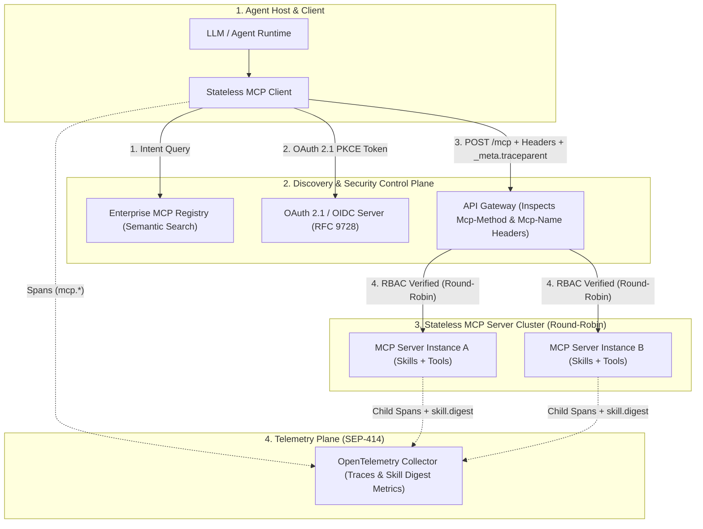
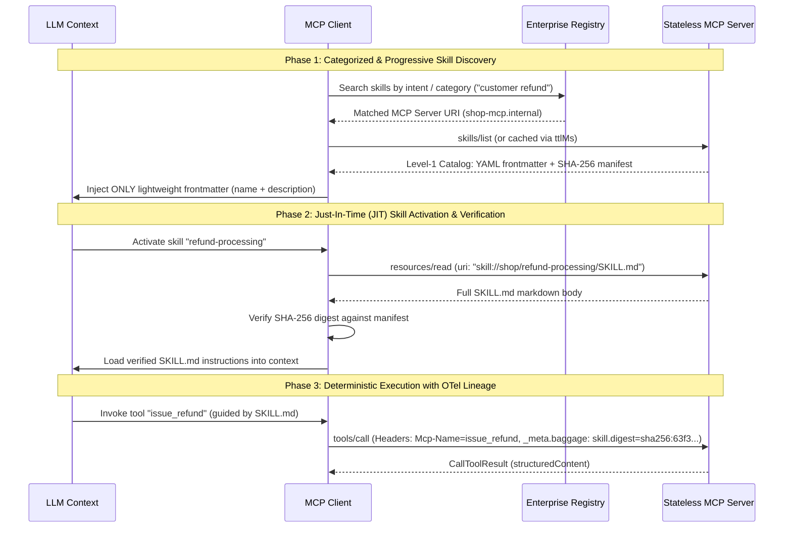
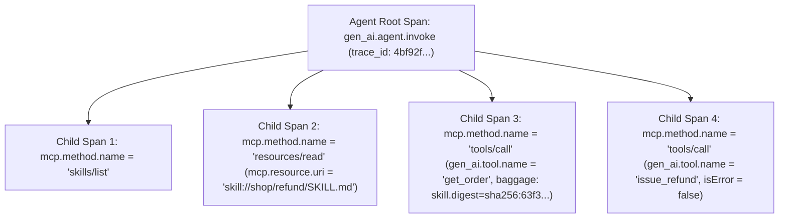
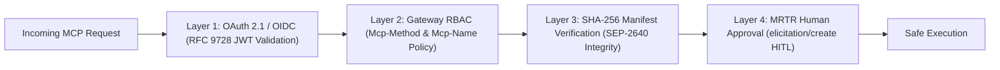

# MCP (Model Context Protocol)

An open protocol (originally created by Anthropic in late 2024 and now governed under the Linux Foundation / Agentic AI Foundation) that standardizes how applications provide context, tools, and interactive workflows to LLMs. MCP provides:

1. A growing list of pre-built integrations that your LLM can directly plug into.
2. The flexibility to switch between LLM providers and vendors.
3. Cloud-native, stateless scalability and enterprise-grade OAuth 2.1 / OIDC security.

MCP follows a client-server architecture where a host application can communicate with multiple MCP servers, each providing distinct capabilities. Following the **`2026-07-28` specification release**, MCP operates on a **fully stateless request/response core**, allowing servers to scale horizontally behind standard load balancers and API gateways.

---

## Specification Evolution Timeline

| Version | Release Date | Key Architectural Milestones |
|---------|--------------|------------------------------|
| `2024-11-05` | Nov 2024 | Initial specification: stateful sessions, `initialize` handshake, Stdio & HTTP+SSE transports. |
| `2025-03-26` | Mar 2025 | OAuth 2.1 authorization framework, Streamable HTTP transport, Tool Annotations, Audio content. |
| `2025-06-18` | Jun 2025 | Structured Tool Outputs (`outputSchema`, `structuredContent`), Elicitation, Resource Links, RFC 9728 metadata. |
| `2025-11-25` | Nov 2025 | OpenID Connect (OIDC) Discovery 1.0, Client ID Metadata Documents, Icons metadata, URL-mode Elicitation, Experimental Tasks. |
| `2026-07-28` | Jul 2026 | **Stateless Protocol Core** (no `initialize` or `Mcp-Session-Id`), Mandatory `server/discover`, Multi Round-Trip Requests (MRTR), Header-Based Routing (`Mcp-Method`, `Mcp-Name`), Cacheable List Results (`ttlMs`), Formal Extensions (`skills` SEP-2640, `tasks`, `MCP Apps`), OpenTelemetry `_meta` Trace Context (SEP-414), JSON Schema 2020-12, Deprecation of `Roots`/`Sampling`/`Logging`. |

---

## Different Components

### MCP Hosts

AI applications like Claude Desktop, Claude Code, IDEs (VS Code, Cursor), or enterprise agent platforms that coordinate LLM interactions and MCP clients.

### MCP Clients

Protocol clients embedded within the Host that discover server capabilities (`server/discover`) and dispatch self-describing, stateless JSON-RPC requests (carrying per-request `_meta`), often routed through enterprise gateways and registries.

### MCP Servers

Lightweight, stateless services (or local processes) that expose specific capabilities (**Tools**, **Resources**, **Prompts**) and optional extensions (**Skills**, **Tasks**, **MCP Apps**) through MCP.

### Local Data Sources

Your computer files, local databases, and CLI services that local MCP servers can securely access.

### Remote Services

External systems and enterprise APIs over the internet that remote MCP servers connect to using standard HTTP and OAuth 2.1 / OIDC authentication.

---

## MCP Server Capabilities

An MCP server exposes three core primitives plus optional first-class extensions:

1. **Resources**: File-like data, API responses, or skill instructions (`SKILL.md`) that can be read by clients (`resources/list`, `resources/read`, `resources/templates/list`).
2. **Tools**: Deterministic functions with **JSON Schema 2020-12** `inputSchema` and optional `outputSchema` that can be called by the LLM (`tools/list`, `tools/call`).
3. **Prompts**: Pre-written templates and workflows that help users accomplish specific tasks (`prompts/list`, `prompts/get`).
4. **Formal Extensions (`2026-07-28`)**:
   - **Skills Over MCP (`io.modelcontextprotocol/skills`, SEP-2640)**: Native discovery and distribution of Agent Skills (`SKILL.md` + companion files) via `skills/list` and `skills/get`, with YAML frontmatter progressive disclosure, `skill://` URIs, and SHA-256 file manifests.
   - **Tasks (`io.modelcontextprotocol/tasks`)**: Durable, asynchronous long-running operations (`resultType: "task"`, `tasks/get`, `tasks/cancel`).
   - **MCP Apps (`_meta.ui` / `ui://`)**: Server-rendered interactive HTML/JS UI components rendered in sandboxed host iframes.

## MCP Clients

In the stateless `2026-07-28` model, the client lifecycle is:

1. **Discover Capabilities**: Query `server/discover` to inspect supported protocol versions, capabilities, and cache TTLs (`ttlMs`).
2. **List & Cache Primitives**: Fetch available tools, resources, or prompts (caching responses according to `ttlMs` and `cacheScope`).
3. **Dispatch Self-Describing Requests**: Send stateless requests containing `_meta` (`io.modelcontextprotocol/protocolVersion`, `clientInfo`, `clientCapabilities`).
4. **Handle Multi Round-Trip Requests (MRTR)**: If a server returns `resultType: "input_required"` with a `requestState` token (e.g., for user confirmation via `elicitation/create`), collect the required input and re-invoke the request with `inputResponses` and the echoed `requestState`.

---

## Core Components

### Protocol Layer

Built on **JSON-RPC 2.0**, the protocol layer handles self-describing message framing, per-request `_meta` context, capability discovery (`server/discover`), response caching (`ttlMs`), and Multi Round-Trip Request (MRTR) state transitions.

### Transport Layer

Handles communication between clients and servers. Following the **`2026-07-28` specification release**, MCP transitioned to a **stateless request/response protocol**:

1. **Stateless HTTP Transport (Default)**
   - Deployed on standard scalable infrastructure (AWS Lambda, Cloudflare Workers, Kubernetes) behind plain round-robin load balancers.
   - Eliminates persistent sessions, initialization handshakes, and `Mcp-Session-Id` sticky routing.
   - Uses **Header-Based Routing** (`MCP-Protocol-Version`, `Mcp-Method`, and `Mcp-Name` HTTP headers) allowing API gateways to inspect, route, and enforce RBAC policies without parsing JSON bodies.

2. **Multi Round-Trip Requests (MRTR)**
   - Replaces legacy server-initiated bidirectional streams for complex interactions (like human-in-the-loop elicitation) using stateless `input_required` responses and signed/encrypted `requestState` tokens.

3. **Stdio Transport (Local)**
   - Uses standard input/output streams with newline-delimited JSON-RPC messages for local CLI subprocesses.

*(Note: Legacy stateful HTTP with Server-Sent Events (SSE) and stateful session handshakes from pre-2026 releases have been superseded by Stateless HTTP and MRTR).*

---

### Resources

Expose data and content from your servers to LLMs. Resources represent any kind of read-only data that an MCP server wants to make available to clients:

1. File contents & `SKILL.md` instructions
2. Database records
3. API responses
4. Live system data
5. Screenshots, images, and audio
6. Sandboxed UI bundles (`ui://` for MCP Apps)

Resources are identified using URIs (or RFC 6570 URI templates via `resources/templates/list`):

```text
[protocol]://[host]/[path]
```

### Prompts

Create reusable prompt templates and workflows. Prompts enable servers to define structured templates that clients and users can invoke (e.g., as `/` slash commands):

- Accept dynamic arguments.
- Embed context from resources.
- Guide specific multi-step workflows.
- Expose visual icons via metadata.

Prompt structure:

```json
{
  "name": "string",
  "title": "string",
  "description": "string",
  "arguments": [
    {
      "name": "string",
      "description": "string",
      "required": true
    }
  ]
}
```

### Tools

Enable LLMs to perform deterministic actions through your server.

Key aspects of tools in `2026-07-28`:

- **Discovery & Caching**: Clients discover tools via `tools/list`. Servers can attach `ttlMs` and `cacheScope` (`"public"` or `"private"`) so clients and gateways can safely cache tool catalogs.
- **Invocation**: Clients invoke tools via `tools/call` (with `Mcp-Method: tools/call` and `Mcp-Name: <tool_name>` headers over HTTP).
- **JSON Schema 2020-12**: Tool `inputSchema` and `outputSchema` adhere to full JSON Schema 2020-12.
- **Structured Outputs (`outputSchema` & `structuredContent`)**: Tools can declare an `outputSchema` and return typed, machine-verified JSON in `structuredContent` alongside human-readable `content` (`text`, `image`, `audio`, `resource`, `resource_link`).
- **Tool Annotations & Icons**: Tools can include behavioral hints (`readOnlyHint`, `destructiveHint`, `idempotentHint`, `openWorldHint`) and visual `icons` metadata.
- **Self-Correcting Execution Errors**: Input validation or runtime tool failures return a standard tool result with `isError: true` rather than a hard JSON-RPC protocol error, enabling the LLM to read the error and self-correct dynamically.

---

### Client Interaction & Multi Round-Trip Requests (MRTR)

> [!IMPORTANT]
> In the **`2026-07-28` specification**, legacy server-initiated bidirectional requests are replaced by **Multi Round-Trip Requests (MRTR)**, and older primitives (`Roots`, `Sampling`, and `Logging`) are marked for deprecation in favor of explicit context passing and structured Elicitation.

#### 1. Elicitation (`elicitation/create`)
Allows a server to request structured user input or confirmation mid-execution using either **`form` mode** (JSON Schema-driven UI forms with titled single/multi-select enums) or **`url` mode** (directing the user to an external URL for sensitive out-of-band flows).
- Under MRTR, the server responds to `tools/call` with `resultType: "input_required"`, an opaque `requestState` token, and an `inputRequests` map containing the `elicitation/create` specification.
- The client renders the prompt to the user, collects the response, and retries `tools/call` passing `requestState` and `inputResponses`.

#### 2. Sampling (`sampling/createMessage`) — *Deprecated in `2026-07-28`*
Allows a server to request an LLM completion (including tool-calling loops via `tools` and `toolChoice` added in `2025-11-25`) through the client with human-in-the-loop oversight. When used in `2026-07-28`, it operates over MRTR (`resultType: "input_required"`), though direct model/agent orchestration or subagent patterns are preferred going forward.

#### 3. Roots (`roots/list`) — *Deprecated in `2026-07-28`*
Previously used by clients to declare filesystem or URI boundaries (`file:///home/user/Documents`, `https://api.example.com/v1/`) at connection initialization. Formally deprecated in `2026-07-28` in favor of passing workspace context explicitly in request arguments or `_meta`.

---

## Enterprise Scale: Registries, Skills, & Discovery

As an enterprise scales, it may deploy hundreds of specialized MCP servers. Loading all their schemas simultaneously into an LLM context is an anti-pattern causing context blowout and security risks.

Modern Agentic systems solve this using **MCP Registries**, **Header-Based Gateway Routing**, **Skills Over MCP (`SEP-2640`)**, and **OpenTelemetry (`SEP-414`)**:



### 1. The MCP Registry (Service Catalog)
Enterprises maintain a central registry of all available MCP servers. The registry acts as the "Control Plane," enforcing Role-Based Access Control (RBAC), OAuth 2.1 / OIDC Discovery (RFC 9728 Protected Resource Metadata), and auditability. Because modern MCP is stateless, agents don't maintain active connection streams; they query the registry and dispatch stateless HTTP requests with `Mcp-Method` and `Mcp-Name` headers.

### 2. Semantic Discovery
Agents no longer need to know exact tool names upfront (e.g., `execute_sql_query`). They search the registry using **intent** (e.g., *"I need to update a Jira ticket"*). The registry uses semantic search to return the most relevant MCP server endpoints.

### 3. Progressive Discovery & Caching (`server/discover` & `ttlMs`)
To conserve context window tokens and network round-trips, clients query the mandatory `server/discover` endpoint to inspect capabilities on demand and cache list results (`tools/list`, `resources/list`) using server-provided `ttlMs` freshness hints.

### 4. Skills Over MCP Extension (`io.modelcontextprotocol/skills` — SEP-2640)

Previously, Agent Skills (`SKILL.md` directories) had to be copied onto local disks or git repositories. With the official **Skills Extension (`io.modelcontextprotocol/skills`, SEP-2640)**, MCP servers natively expose and distribute Agent Skills alongside their tools:



* **Capability Negotiation**: Servers declare `"io.modelcontextprotocol/skills": { "directoryRead": true }` under `capabilities.extensions` in `server/discover`.
* **Progressive Disclosure via `skills/list` & `skills/get`**:
  - Clients call `skills/list` to receive a lightweight catalog of skills (`uri: "skill://..."`), including the parsed YAML **`frontmatter`** (`name`, `description`) as JSON and a cryptographic **`manifest`** (`uri`, `size`, `digest: "sha256:..."`) of all files in the skill directory.
  - Only the lightweight `frontmatter` is injected into the LLM's initial context window.
* **On-Demand Loading & Integrity Verification (`resources/read`)**:
  - When the agent activates a skill, the client calls `skills/get` (if needed) and fetches the full `SKILL.md` body and companion files (`references/`, `scripts/`, `examples/`) on demand via `resources/read` (`skill://shop/refund-processing/SKILL.md`), verifying each file against its SHA-256 `digest`.
* **Categorization at Scale (100s of Skills)**:
  - Skills are organized via hierarchical `skill://<domain>/<skill-name>/SKILL.md` URIs and structured YAML `frontmatter` fields (`name`, `description`, `category`, `tags`).
  - Registries and client SDKs (`@modelcontextprotocol/client/ext/skills`) filter by URI prefix or run semantic search over cached `skills/list` metadata before injecting only the relevant skills into the LLM context.
* **Unified Cognitive + Execution Layer**:
  - **The Cognitive Interface (`io.modelcontextprotocol/skills`)**: Delivers the procedural `SKILL.md` instructions.
  - **The Execution Runtime (`tools/call` & `io.modelcontextprotocol/tasks`)**: Executes the deterministic actions on the same MCP server.

```json
// Example: skills/list Response (SEP-2640)
{
  "jsonrpc": "2.0",
  "id": 1,
  "result": {
    "skills": [
      {
        "uri": "skill://shop/refund-processing/SKILL.md",
        "frontmatter": {
          "name": "refund-processing",
          "description": "Use this skill when issuing customer refunds or verifying eligibility."
        },
        "manifest": [
          {
            "uri": "skill://shop/refund-processing/SKILL.md",
            "size": 878,
            "digest": "sha256:63f32c85a6f4..."
          },
          {
            "uri": "skill://shop/refund-processing/references/policy.md",
            "size": 272,
            "digest": "sha256:4238a74ced04..."
          }
        ]
      }
    ]
  }
}
```

### 5. Observability & OpenTelemetry (`SEP-414` & `mcp.*` Semantic Conventions)
MCP replaces legacy `logging/setLevel` with native **OpenTelemetry (OTel)** distributed tracing:



* **W3C Trace Context in `params._meta` (`SEP-414`)**: Clients inject unprefixed **`traceparent`**, **`tracestate`**, and **`baggage`** keys directly into `params._meta` on every JSON-RPC request (an explicit normative exception to DNS-prefixing so standard OTel propagators work across both HTTP and Stdio).
* **OpenTelemetry GenAI `mcp.*` Conventions**: Standardized span attributes (`mcp.method.name`, `mcp.protocol.version`, `mcp.resource.uri`, `gen_ai.tool.name`, `gen_ai.client.token.usage`) trace every operation.
* **End-to-End Skill Traceability**: By propagating `skill.uri` and `skill.digest` (`sha256:...`) inside `_meta.baggage`, observability platforms correlate **1. Skill Discovery (`skills/list`)** → **2. Skill Activation (`resources/read` on `skill://...`)** → **3. Downstream Tool Execution (`tools/call`)** under a single distributed trace.

### 6. Security, Access Control (RBAC), & Skill Integrity



* **Identity-Scoped Access (OAuth 2.1 / OIDC & Gateway RBAC)**: Remote MCP servers authenticate callers via **OAuth 2.1 + OIDC Discovery (RFC 9728)** and incremental scope consent (`WWW-Authenticate`, SEP-835). Both `skills/list` (`cacheScope: "private"`) and `tools/call` filter or authorize capabilities based on the caller's JWT claims and HTTP routing headers (`Mcp-Method`, `Mcp-Name`).
* **Cryptographic Tamper Protection (`sha256` Manifests)**: Clients verify every file read via `resources/read` against the `size` and `sha256` `digest` advertised in the skill's `manifest`, preventing prompt injection or transit tampering.
* **Non-Transitive Consent & HITL**: Approving a skill never grants implicit permission to nested skills (SEP-2640), and sensitive actions enforce human approval via **MRTR (`elicitation/create`)**.

