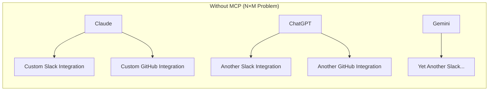
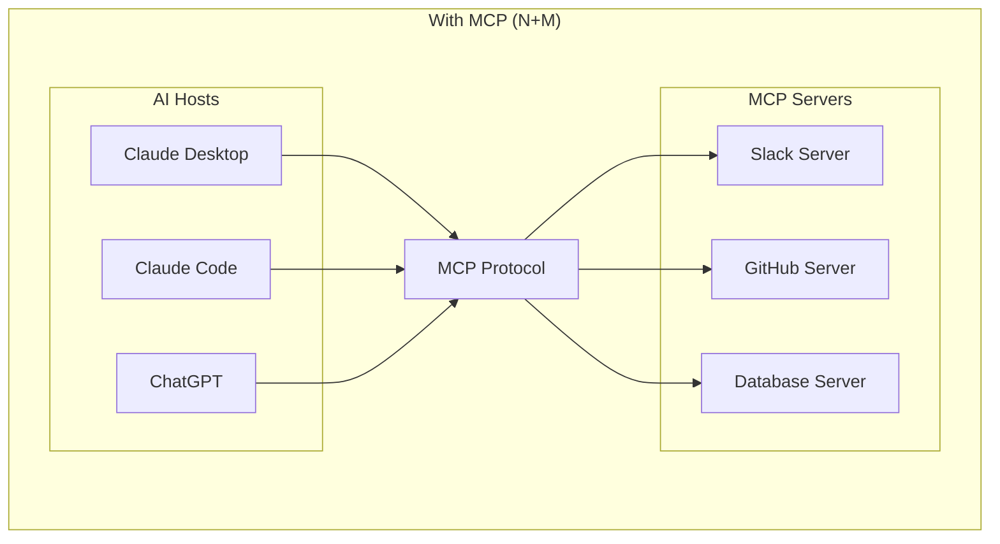
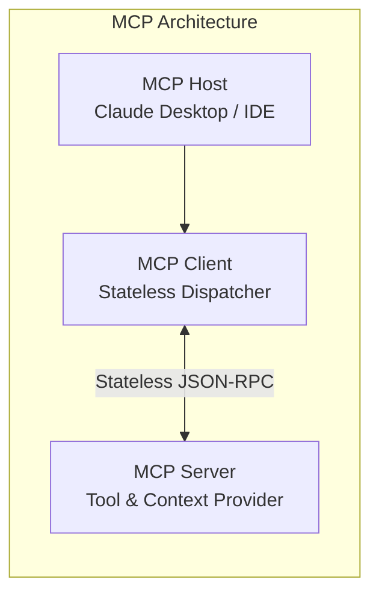
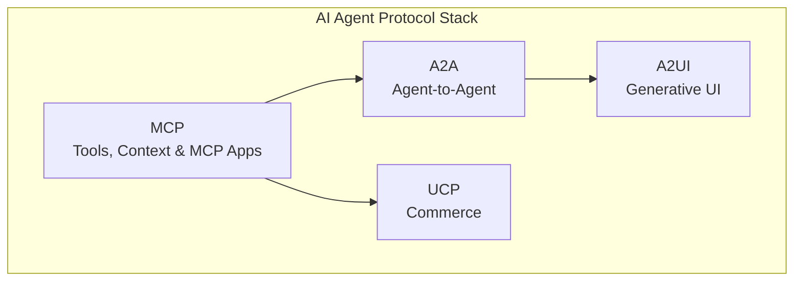

# MCP (Model Context Protocol)

MCP is an open protocol that standardizes how AI applications **connect to external data sources and tools**. It solves the "N×M integration problem" by providing a universal interface.

> [!NOTE]
> **Created by**: Anthropic (November 2024)  
> **Now**: Open-source under Agentic AI Foundation (AAIF)  
> **Adopted by**: OpenAI, Google DeepMind, and major AI platforms

## The Problem

Every AI application needs to connect to external systems:



**Result**: Every AI model needs custom integrations for every tool = exponential complexity.

## The Solution: MCP

MCP provides a **universal protocol** for AI-to-tool communication:



**Result**: Build one MCP server, connect to all AI applications.

## Key Characteristics

| Feature | Description |
|---------|-------------|
| **Open Standard** | Apache 2.0 license, Linux Foundation / AAIF governed |
| **JSON-RPC 2.0** | Self-describing stateless request/response protocol (`2026-07-28`) |
| **Three Core Primitives** | Tools, Resources, Prompts |
| **First-Class Extensions** | Skills (`io.modelcontextprotocol/skills`), Tasks (`io.modelcontextprotocol/tasks`), MCP Apps (`ui://`) |
| **Two Primary Transports** | Stateless HTTP (remote/enterprise), Stdio (local) |
| **Multi Round-Trip (MRTR)** | Stateless human-in-the-loop & client input via `input_required` + `requestState` |

## What MCP Enables

| Use Case | Example |
|----------|---------|
| **Personal AI** | Agent accesses Google Calendar + Notion |
| **Code Generation** | Claude Code uses Figma designs |
| **Enterprise** | Chatbots query multiple databases behind API gateways |
| **Creative** | AI creates 3D designs in Blender |

## Core Concepts at a Glance

### Participants



| Participant | Role | Example |
|-------------|------|---------|
| **Host** | AI application | Claude Desktop, VS Code, Cursor |
| **Client** | Discovery & request dispatcher | Built into host |
| **Server** | Tool/data/UI provider | Slack, GitHub, local files |

### Primitives & Extensions

| Capability | Purpose | Direction |
|------------|---------|-----------|
| **Tools** | Deterministic functions the AI can call | Server → AI |
| **Resources** | Data, files, or `SKILL.md` the AI can read | Server → AI |
| **Prompts** | Reusable templates for interaction | Server → AI |
| **Skills (Extension)** | Discover & load `SKILL.md` workflows (`skills/list`, `skills/get`, `skill://`) | Server → AI |
| **Tasks (Extension)** | Async long-running operations (`io.modelcontextprotocol/tasks`) | Server ↔ Client |
| **MCP Apps (Extension)** | Server-rendered interactive UIs (`ui://`) | Server → Host UI |

### Example: Stateless Tool Call (`2026-07-28`)

Every request in `2026-07-28` is self-describing via `_meta` (eliminating stateful session handshakes):

```json
{
    "jsonrpc": "2.0",
    "method": "tools/call",
    "params": {
        "name": "send_slack_message",
        "arguments": {
            "channel": "#general",
            "message": "Hello from AI!"
        },
        "_meta": {
            "io.modelcontextprotocol/protocolVersion": "2026-07-28",
            "io.modelcontextprotocol/clientInfo": {
                "name": "claude-desktop",
                "version": "2.0.0"
            },
            "io.modelcontextprotocol/clientCapabilities": {}
        }
    },
    "id": 1
}
```

## Transport Options

| Transport | Use Case | Characteristics |
|-----------|----------|-----------------|
| **Stateless HTTP** | Remote & Enterprise servers | Header-based routing (`Mcp-Method`, `Mcp-Name`), horizontally scalable, OAuth 2.1 / OIDC |
| **Stdio** | Local CLI subprocesses | Fast, process-isolated, newline-delimited JSON |
| **HTTP + SSE (Legacy)** | Pre-2026 remote servers | Superseded by Stateless HTTP & Multi Round-Trip Requests (MRTR) |

## Protocol Relationships



- **MCP**: Connect AI to tools, data, durable tasks, and server-provided UIs (MCP Apps)
- **A2A**: Connect AI agents to each other
- **A2UI**: Render generative UI from AI responses
- **UCP**: Commerce-specific operations

## Quick Start

```bash
# Install MCP SDK
pip install mcp

# Run a simple server
python my_mcp_server.py
```

## Next Steps

| Document | Description |
|----------|-------------|
| [01_architecture.md](./01_architecture.md) | Stateless Core, `server/discover`, MRTR, Host/Client/Server |
| [02_primitives.md](./02_primitives.md) | Tools (`outputSchema`, annotations), Resources, Prompts, Extensions |
| [03_transports.md](./03_transports.md) | Stateless HTTP (`Mcp-Method`, `Mcp-Name`), OAuth 2.1/OIDC, Stdio |
| [04_building_servers.md](./04_building_servers.md) | Server implementation guide |
| [05_pros_and_cons.md](./05_pros_and_cons.md) | Specification evolution & architectural trade-offs |
| [06_mcp_app.md](./06_mcp_app.md) | MCP Apps (`ui://` interactive UI extension) |
