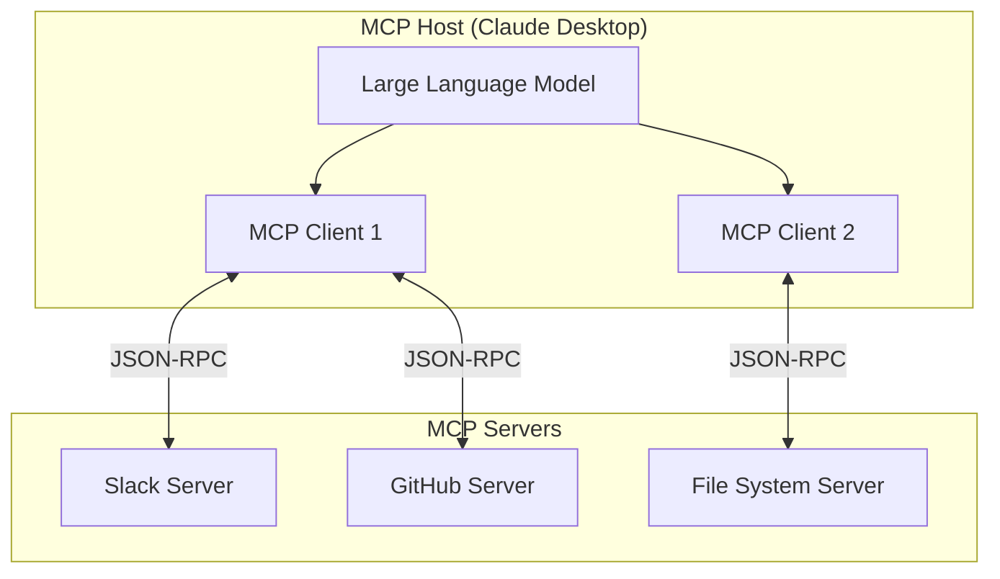
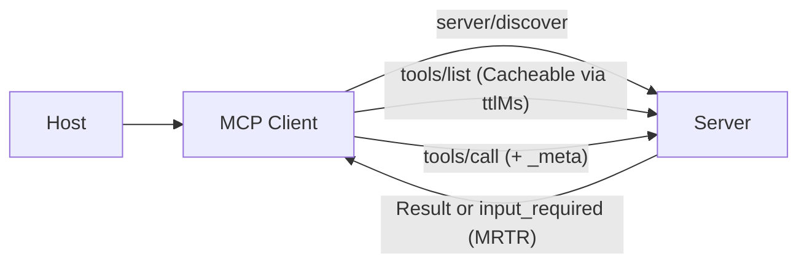
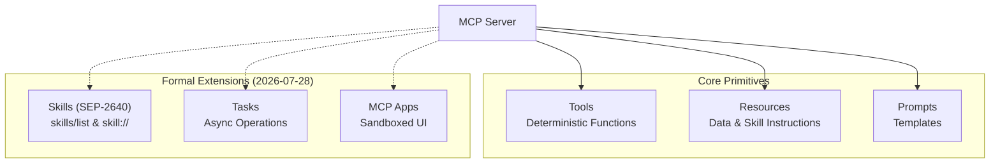
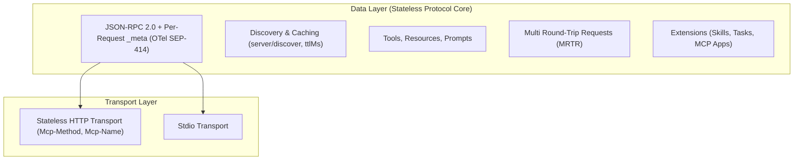
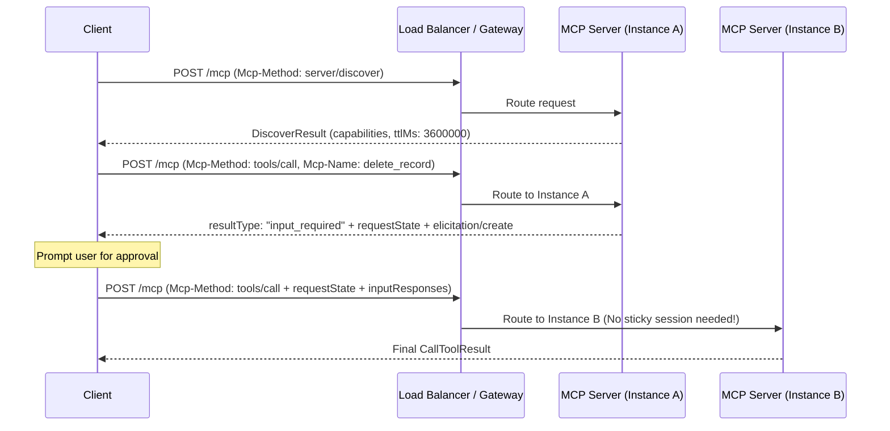
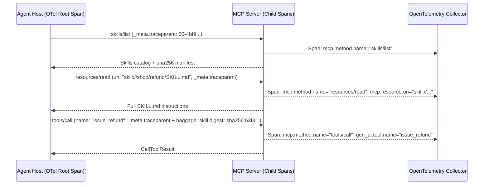
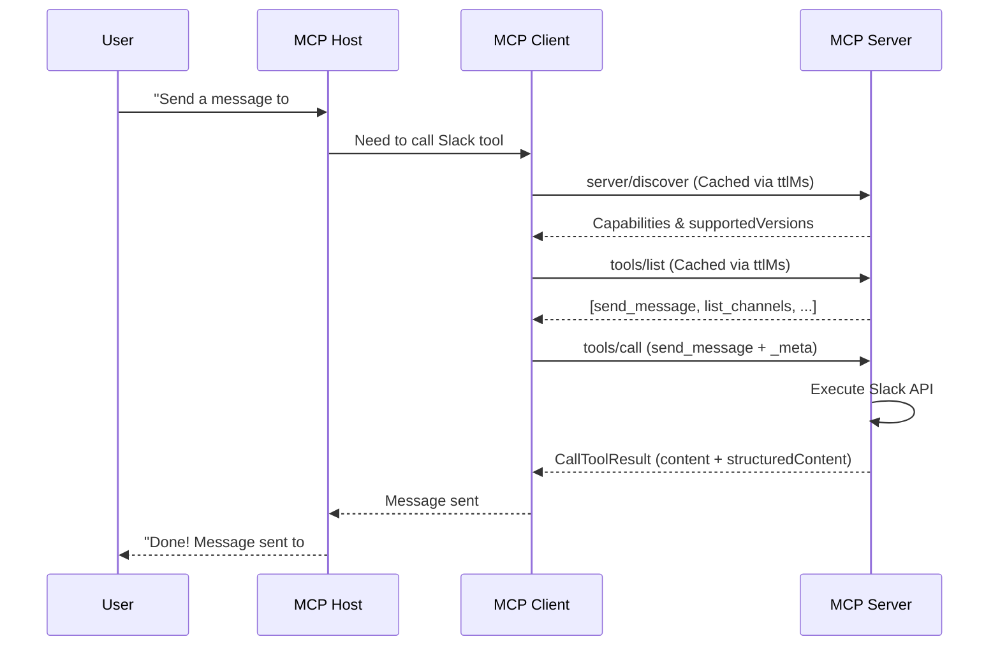

# MCP Architecture

MCP uses a **client-server architecture** organized into two layers: data and transport.

## Architecture Overview



---

## Participants

### MCP Host

The **Host** is the AI application that coordinates everything.

| Responsibility | Example |
|----------------|---------|
| Contains the LLM | Claude, GPT-4 |
| Manages MCP clients | Connection lifecycle |
| Routes tool calls | Decides which server to call |
| Presents results | Shows data to user |

**Examples**: Claude Desktop, Claude Code, VS Code with Copilot

### MCP Client

The **Client** dispatches stateless requests and manages capability discovery and caching with MCP servers.



| Responsibility | Description |
|----------------|-------------|
| **Capability Discovery** | Query `server/discover` for supported versions & capabilities |
| **Cache Management** | Cache list results (`tools/list`, `resources/list`) using `ttlMs` and `cacheScope` |
| **Self-Describing Dispatch** | Attach per-request `_meta` (`protocolVersion`, `clientInfo`, `clientCapabilities`) |
| **Multi Round-Trip (MRTR)** | Fulfill `input_required` responses (e.g., `elicitation/create`) and retry with `requestState` |
| **Error Handling** | Handle timeouts, retries, and pass `isError: true` tool results to the LLM |

### MCP Server

The **Server** provides tools, resources, prompts, and optional extensions.



**Examples**:

- [Sentry MCP Server](https://docs.sentry.io/product/sentry-mcp/)
- [Filesystem Server](https://github.com/modelcontextprotocol/servers/tree/main/src/filesystem)
- Custom enterprise serverless functions

---

## Layers

MCP has two protocol layers:



### Data Layer

Built on **JSON-RPC 2.0**, the data layer handles:

| Component | Purpose |
|-----------|---------|
| **Discovery & Metadata** | `server/discover`, per-request `_meta` (including OTel `traceparent`/`baggage`), response caching (`ttlMs`, `cacheScope`) |
| **Server Primitives** | Tools (JSON Schema 2020-12, `outputSchema`), Resources, Prompts |
| **Multi Round-Trip (MRTR)** | Stateless client interactions (`resultType: "input_required"`, `requestState`) for Elicitation |
| **First-Class Extensions** | Versioned capabilities: `io.modelcontextprotocol/skills` (SEP-2640), `io.modelcontextprotocol/tasks`, and MCP Apps (`ui://`) |
| **Deprecated Features** | Legacy `Roots`, `Sampling`, and `Logging` (superseded by MRTR, explicit context, and OpenTelemetry) |

#### Self-Describing Request Format & OpenTelemetry (`2026-07-28` & `SEP-414`)

Every request carries protocol version and client metadata inside `_meta`. Additionally, per **SEP-414**, MCP natively supports **OpenTelemetry W3C Trace Context propagation** inside `_meta` using the unprefixed keys `traceparent`, `tracestate`, and `baggage` (an explicit exception to the `io.modelcontextprotocol/*` prefix rule so standard OTel propagators work out of the box across both HTTP and Stdio):

```json
{
    "jsonrpc": "2.0",
    "method": "tools/call",
    "params": {
        "name": "send_email",
        "arguments": {
            "to": "user@example.com",
            "body": "Hello!"
        },
        "_meta": {
            "io.modelcontextprotocol/protocolVersion": "2026-07-28",
            "io.modelcontextprotocol/clientInfo": {
                "name": "ExampleClient",
                "version": "1.0.0"
            },
            "io.modelcontextprotocol/clientCapabilities": {},
            "traceparent": "00-4bf92f3577b34da6a3ce929d0e0e4736-00f067aa0ba902b7-01",
            "tracestate": "congo=t61rcWkgMzE",
            "baggage": "skill.uri=skill://comms/email-assistant/SKILL.md,skill.digest=sha256:63f32c"
        }
    },
    "id": 1
}
```

#### Cacheable Response Format (`2026-07-28`)

List operations can include `ttlMs` and `cacheScope` so clients and gateways can cache results without re-polling:

```json
{
    "jsonrpc": "2.0",
    "result": {
        "tools": [
            {
                "name": "send_email",
                "description": "Send an email",
                "inputSchema": {
                    "$schema": "https://json-schema.org/draft/2020-12/schema",
                    "type": "object",
                    "properties": {
                        "to": {"type": "string"},
                        "body": {"type": "string"}
                    },
                    "required": ["to", "body"]
                }
            }
        ],
        "ttlMs": 3600000,
        "cacheScope": "public"
    },
    "id": 1
}
```

### Transport Layer

| Transport | Description | Use Case |
|-----------|-------------|----------|
| **Stateless HTTP** | Standard HTTP POST with `MCP-Protocol-Version`, `Mcp-Method`, and `Mcp-Name` headers | Remote servers, API gateways, serverless |
| **Stdio** | Standard I/O streams (newline-delimited JSON) | Local CLI processes |
| **HTTP + SSE (Legacy)** | Pre-2026 stateful HTTP POST + Server-Sent Events | Legacy deployments only |

---

## Stateless Lifecycle, `server/discover`, and MRTR

> [!NOTE]  
> As of the **`2026-07-28` specification release**, MCP transitioned to a **fully stateless request/response core**. The legacy stateful handshake (`initialize`, `notifications/initialized`, `Mcp-Session-Id`) has been removed in favor of self-describing requests, mandatory `server/discover` capability discovery, and **Multi Round-Trip Requests (MRTR)**.

### 1. Capability Discovery via `server/discover`

Because connections are stateless, capability negotiation is no longer a stateful upfront handshake. Instead:

1. **Self-Describing Requests:** Every request carries `_meta["io.modelcontextprotocol/protocolVersion"]`.
2. **Mandatory `server/discover` Method:** Clients invoke the `server/discover` JSON-RPC method to query supported protocol versions, capabilities, extensions, and cache TTLs (`ttlMs`).

#### `server/discover` Request & Response

```json
// Request
{
  "jsonrpc": "2.0",
  "id": "discover-1",
  "method": "server/discover",
  "params": {},
  "_meta": {
    "io.modelcontextprotocol/protocolVersion": "2026-07-28",
    "io.modelcontextprotocol/clientInfo": { "name": "AgentHost", "version": "2.0.0" },
    "io.modelcontextprotocol/clientCapabilities": {}
  }
}

// Response
{
  "jsonrpc": "2.0",
  "id": "discover-1",
  "result": {
    "resultType": "complete",
    "supportedVersions": ["2026-07-28"],
    "capabilities": {
      "tools": {},
      "resources": {},
      "prompts": {},
      "extensions": {
        "io.modelcontextprotocol/skills": { "directoryRead": true },
        "io.modelcontextprotocol/tasks": {}
      }
    },
    "_meta": {
      "io.modelcontextprotocol/serverInfo": {
        "name": "EnterpriseSlackServer",
        "version": "1.4.0"
      }
    },
    "instructions": "Provides Slack messaging and channel search tools.",
    "ttlMs": 3600000,
    "cacheScope": "public"
  }
}
```

### 2. Multi Round-Trip Requests (MRTR)

In pre-2026 MCP, if a server needed user confirmation (`elicitation/create`) or client context mid-execution, it sent a server-initiated request over a persistent bidirectional stream. In `2026-07-28`, this is replaced by **MRTR**:

1. The server responds to the `tools/call` HTTP request immediately with `resultType: "input_required"`, an encrypted/signed `requestState` token, and an `inputRequests` map (e.g., an `elicitation/create` form).
2. The client collects the user's input and **re-invokes `tools/call`** with a new request ID, passing back the echoed `requestState` and `inputResponses`.
3. Any server instance behind a round-robin load balancer can verify `requestState` and complete the tool execution without sticky sessions.



### Server Capabilities (Discovered On-Demand)

When queried via `server/discover`, a server can reveal:

| Capability | Description |
|------------|-------------|
| `tools` | Server provides deterministic functions (`tools/list`, `tools/call`) |
| `resources` | Server provides data, URI templates, or skill files (`skill://...`) |
| `prompts` | Server provides reusable prompt templates |
| `extensions` | Optional versioned extensions (`io.modelcontextprotocol/skills`, `io.modelcontextprotocol/tasks`, MCP Apps) |

---

## Distributed Tracing & OpenTelemetry (`SEP-414` + `mcp.*` Conventions)

To provide end-to-end observability across agents, skills (`SEP-2640`), and remote tool executions, MCP integrates directly with **OpenTelemetry**:

1. **Unprefixed W3C Context in `params._meta` (`SEP-414`)**: Every JSON-RPC request can carry `traceparent`, `tracestate`, and `baggage` inside `params._meta`.
2. **OpenTelemetry GenAI Semantic Conventions (`mcp.*`)**: Standardized span attributes (`mcp.method.name`, `mcp.protocol.version`, `mcp.resource.uri`, `gen_ai.tool.name`) track every protocol call.
3. **Skill-to-Tool Correlation**: When an agent loads a skill via `resources/read`, it attaches `skill.uri` and `skill.digest` (`sha256:...`) to `_meta.baggage`, allowing downstream `tools/call` spans to be attributed to the exact skill version that guided the LLM.



---

## Message Flow Example



---

## Summary

| Component | Role |
|-----------|------|
| **Host** | AI app (Claude Desktop, IDE) |
| **Client** | Stateless dispatcher, cache manager, MRTR handler |
| **Server** | Stateless tool, resource, prompt, and extension provider |
| **Data Layer** | Self-describing JSON-RPC 2.0 messages with `_meta` |
| **Transport** | Stateless HTTP (`Mcp-Method`, `Mcp-Name`) or Stdio |

> [!TIP]
> For local CLI tools, use **Stdio transport**. For remote services, enterprise APIs, and serverless deployments, use **Stateless HTTP transport** with Header-Based Routing.
