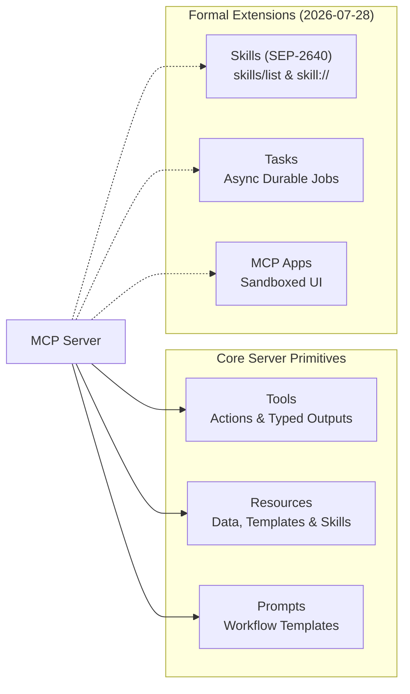
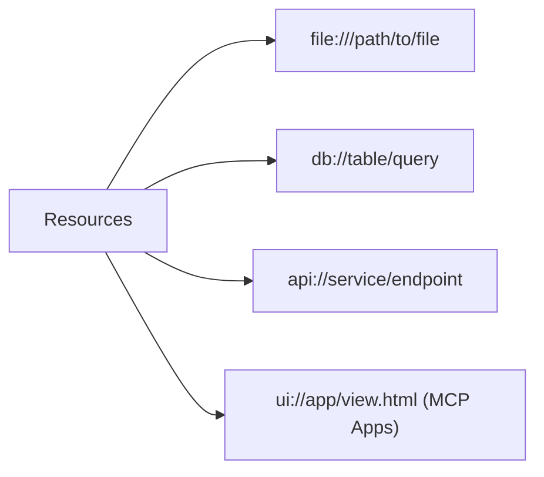
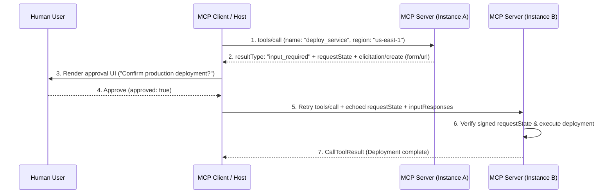
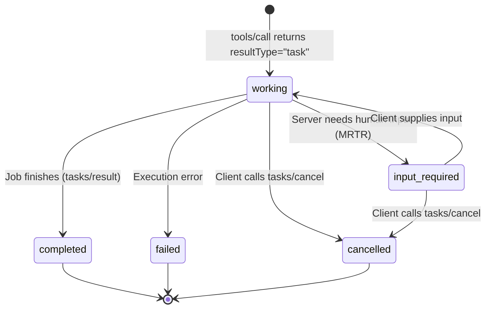

# MCP Primitives & Extensions

MCP servers expose three core primitives to AI applications—**Tools**, **Resources**, and **Prompts**—alongside client-side interactions (**Elicitation** via Multi Round-Trip Requests) and first-class extensions (**Skills**, **Tasks**, and **MCP Apps**).

## Overview



| Capability | Category | Purpose | Example |
|------------|----------|---------|---------|
| **Tools** | Core Primitive | Deterministic functions the AI can call | `send_email`, `query_database` |
| **Resources** | Core Primitive | Data, files, or `skill://` assets the AI can read | `file:///README.md`, `db://users` |
| **Prompts** | Core Primitive | Reusable interaction templates | `summarize_document`, `code_review` |
| **Elicitation (MRTR)** | Client Feature | Request user confirmation/input mid-call | `elicitation/create` (`form` / `url` mode) |
| **Skills (SEP-2640)** | Extension | Expose `SKILL.md` workflows & file manifests | `io.modelcontextprotocol/skills` (`skills/list`, `skills/get`) |
| **Tasks** | Extension | Track long-running async operations | `io.modelcontextprotocol/tasks` |
| **MCP Apps** | Extension | Server-rendered interactive UIs | `_meta.ui` with `ui://` resource |

---

## 1. Tools

**Tools** are functions that an AI model can call to perform actions. As of the **`2026-07-28` specification**, tool definitions use **JSON Schema 2020-12**, support typed **`outputSchema`** contracts, behavioral **`annotations`**, visual **`icons`**, and cacheable list responses (`ttlMs`).

### Tool Definition (`2026-07-28`)

```json
{
    "name": "send_slack_message",
    "title": "Send Slack Message",
    "description": "Send a message to a Slack channel",
    "icons": [
        {
            "src": "https://example.com/icons/slack.svg",
            "mimeType": "image/svg+xml"
        }
    ],
    "inputSchema": {
        "$schema": "https://json-schema.org/draft/2020-12/schema",
        "type": "object",
        "properties": {
            "channel": {
                "type": "string",
                "description": "Channel name (e.g., #general)"
            },
            "message": {
                "type": "string",
                "description": "Message content"
            }
        },
        "required": ["channel", "message"]
    },
    "outputSchema": {
        "$schema": "https://json-schema.org/draft/2020-12/schema",
        "type": "object",
        "properties": {
            "messageId": { "type": "string" },
            "timestamp": { "type": "string" }
        },
        "required": ["messageId", "timestamp"]
    },
    "annotations": {
        "title": "Send Slack Message",
        "readOnlyHint": false,
        "destructiveHint": false,
        "idempotentHint": false,
        "openWorldHint": true
    }
}
```

### Tool Annotations Reference

| Annotation | Type | Default | Description |
|------------|------|---------|-------------|
| `readOnlyHint` | `boolean` | `false` | If `true`, the tool does not modify its environment. |
| `destructiveHint` | `boolean` | `true` | If `true` (when not read-only), the tool may perform destructive updates/deletions. |
| `idempotentHint` | `boolean` | `false` | If `true`, calling the tool repeatedly with the same arguments has no additional effect. |
| `openWorldHint` | `boolean` | `true` | If `true`, the tool interacts with an external "open world" (e.g., web search, external APIs). |

> [!WARNING]
> Clients MUST treat tool `annotations` as untrusted hints unless the server is explicitly trusted or cryptographically verified.

### Listing Tools (with `ttlMs` Caching)

**Request:**

```json
{
    "jsonrpc": "2.0",
    "method": "tools/list",
    "params": {},
    "_meta": {
        "io.modelcontextprotocol/protocolVersion": "2026-07-28",
        "io.modelcontextprotocol/clientInfo": {"name": "AgentClient", "version": "1.0.0"},
        "io.modelcontextprotocol/clientCapabilities": {}
    },
    "id": 1
}
```

**Response:**

```json
{
    "jsonrpc": "2.0",
    "result": {
        "tools": [
            {
                "name": "send_slack_message",
                "description": "Send a message to Slack",
                "inputSchema": {...},
                "outputSchema": {...}
            }
        ],
        "ttlMs": 3600000,
        "cacheScope": "public"
    },
    "id": 1
}
```

### Calling Tools & Structured Content

When a tool defines an `outputSchema`, the server returns typed JSON inside `structuredContent` alongside the human/LLM-readable `content` array:

**Request:**

```json
{
    "jsonrpc": "2.0",
    "method": "tools/call",
    "params": {
        "name": "send_slack_message",
        "arguments": {
            "channel": "#general",
            "message": "Hello from AI!"
        },
        "_meta": {
            "io.modelcontextprotocol/protocolVersion": "2026-07-28"
        }
    },
    "id": 2
}
```

**Response:**

```json
{
    "jsonrpc": "2.0",
    "result": {
        "content": [
            {
                "type": "text",
                "text": "Message sent successfully to #general (ID: msg_981)"
            }
        ],
        "structuredContent": {
            "messageId": "msg_981",
            "timestamp": "2026-10-31T10:15:00Z"
        },
        "isError": false
    },
    "id": 2
}
```

### Tool Error Handling Alignment (`isError: true`)

Per the specification (SEP-1303), **input validation failures and business logic errors** MUST return a standard `CallToolResult` with `isError: true` rather than a hard JSON-RPC protocol error. This allows the LLM to inspect the error message and self-correct its arguments on the next turn:

```json
{
    "jsonrpc": "2.0",
    "result": {
        "content": [
            {
                "type": "text",
                "text": "Validation error: channel '#nonexistent' does not exist. Available channels: #general, #eng."
            }
        ],
        "isError": true
    },
    "id": 2
}
```

### Tool Result Content Types

| Type | Content |
|------|---------|
| `text` | Plain text or Markdown response |
| `image` | Base64-encoded image (`data`, `mimeType`) |
| `audio` | Base64-encoded audio (`data`, `mimeType`) |
| `resource` | Embedded resource content (`uri`, `mimeType`, `text`/`blob`) |
| `resource_link` | Lightweight URI pointer to a resource that the client can read on demand |
| `structuredContent` | Top-level JSON object validated against the tool's `outputSchema` |

---

## 2. Resources

**Resources** are read-only data that an AI model or host application can read. They are identified by URIs.

### Resource Types



### Listing Resources & Resource Templates

Servers can expose static resources via `resources/list` and parameterized dynamic URIs (following RFC 6570 URI Templates) via `resources/templates/list`. List responses support `ttlMs` and `cacheScope`.

**`resources/list` Response:**

```json
{
    "jsonrpc": "2.0",
    "result": {
        "resources": [
            {
                "uri": "file:///Users/me/project/README.md",
                "name": "Project README",
                "title": "Project Overview & Setup",
                "mimeType": "text/markdown"
            }
        ],
        "ttlMs": 600000,
        "cacheScope": "private"
    },
    "id": 1
}
```

**`resources/templates/list` Response:**

```json
{
    "jsonrpc": "2.0",
    "result": {
        "resourceTemplates": [
            {
                "uriTemplate": "db://users/{userId}/profile",
                "name": "User Profile by ID",
                "mimeType": "application/json"
            }
        ]
    },
    "id": 2
}
```

### Reading Resources

**Request:**

```json
{
    "jsonrpc": "2.0",
    "method": "resources/read",
    "params": {
        "uri": "file:///Users/me/project/README.md"
    },
    "id": 3
}
```

**Response:**

```json
{
    "jsonrpc": "2.0",
    "result": {
        "contents": [
            {
                "uri": "file:///Users/me/project/README.md",
                "mimeType": "text/markdown",
                "text": "# My Project\n\nThis is a..."
            }
        ]
    },
    "id": 3
}
```

> [!NOTE]
> In the stateless `2026-07-28` HTTP core, freshness is managed primarily via `ttlMs` caching hints rather than persistent `resources/subscribe` streams (which remain applicable only to stateful local transports).

---

## 3. Prompts

**Prompts** are reusable templates that guide AI interactions and can surface as slash commands or workflow starters in host UIs.

### Prompt Definition

```json
{
    "name": "summarize_document",
    "title": "Summarize Document",
    "description": "Summarize a document with configurable length",
    "arguments": [
        {
            "name": "document_uri",
            "description": "URI of document to summarize",
            "required": true
        },
        {
            "name": "length",
            "description": "Summary length: short, medium, long",
            "required": false
        }
    ]
}
```

### Getting a Prompt (`prompts/get`)

**Request:**

```json
{
    "jsonrpc": "2.0",
    "method": "prompts/get",
    "params": {
        "name": "summarize_document",
        "arguments": {
            "document_uri": "file:///report.pdf",
            "length": "short"
        }
    },
    "id": 2
}
```

**Response:**

```json
{
    "jsonrpc": "2.0",
    "result": {
        "messages": [
            {
                "role": "user",
                "content": {
                    "type": "text",
                    "text": "Please provide a short summary of the following document:"
                }
            },
            {
                "role": "user",
                "content": {
                    "type": "resource",
                    "resource": {
                        "uri": "file:///report.pdf",
                        "mimeType": "application/pdf"
                    }
                }
            }
        ]
    },
    "id": 2
}
```

---

## 4. Client Primitives & Multi Round-Trip Requests (MRTR)

In the **`2026-07-28` specification**, servers do not open reverse streams to call the client. Instead, when a server needs user input mid-execution, it uses **Multi Round-Trip Requests (MRTR)** by returning `resultType: "input_required"` and a stateless `requestState` token.

### Elicitation (`elicitation/create`)

Elicitation allows a server to ask the human user for structured confirmation or parameters mid-task. It supports two modes:
1. **`form` mode**: Requests structured data defined by a JSON Schema (supporting titled single-select and multi-select enums).
2. **`url` mode**: Directs the user to an external URL for out-of-band confirmation or sensitive credential entry.

#### MRTR Elicitation Flow



```json
// 1. Server returns input_required in response to tools/call
{
  "jsonrpc": "2.0",
  "id": 101,
  "result": {
    "resultType": "input_required",
    "requestState": "eyJhbGciOiJkaXIiLCJlbmMiOiJBMjU2R0NNIn0..opaque_token",
    "inputRequests": {
      "confirm_deploy": {
        "method": "elicitation/create",
        "params": {
          "mode": "form",
          "message": "Confirm production deployment to us-east-1?",
          "requestedSchema": {
            "type": "object",
            "properties": {
              "approved": { "type": "boolean", "description": "Approve deployment" }
            },
            "required": ["approved"]
          }
        }
      }
    }
  }
}

// 2. Client prompts user, then retries tools/call with requestState & inputResponses
{
  "jsonrpc": "2.0",
  "id": 102,
  "method": "tools/call",
  "params": {
    "name": "deploy_service",
    "arguments": { "region": "us-east-1" },
    "requestState": "eyJhbGciOiJkaXIiLCJlbmMiOiJBMjU2R0NNIn0..opaque_token",
    "inputResponses": {
      "confirm_deploy": {
        "action": "accept",
        "content": { "approved": true }
      }
    },
    "_meta": {
      "io.modelcontextprotocol/protocolVersion": "2026-07-28"
    }
  }
}
```

### Deprecations in `2026-07-28` (`Roots`, `Sampling`, `Logging`)

The `2026-07-28` specification introduced a formal deprecation policy and marked three legacy primitives for deprecation:
- **`Roots` (`roots/list`)**: Deprecated in favor of passing workspace/URI context explicitly via tool arguments or request `_meta`.
- **`Sampling` (`sampling/createMessage`)**: Deprecated in favor of host-level agent orchestration and subagents (where still used, it runs over MRTR).
- **`Logging` (`logging/setLevel`)**: Deprecated in favor of standard OpenTelemetry / cloud observability pipelines.

---

## 5. Formal Extensions (`2026-07-28`)

In `2026-07-28`, optional capabilities moved into a formal, versioned **Extensions Framework** negotiated via `capabilities.extensions`.

### A. Skills Over MCP Extension (`io.modelcontextprotocol/skills` — SEP-2640)

Standardized by the Skills Over MCP Working Group (SEP-2640), this extension allows MCP servers to directly host, index, and distribute **Agent Skills** (`SKILL.md` directories and companion files) so teams don't have to copy skill folders onto every local machine.

- **Capability Declaration**:
  ```json
  "extensions": {
    "io.modelcontextprotocol/skills": {
      "directoryRead": true
    }
  }
  ```
- **`skills/list` (Progressive Disclosure Catalog)**: Returns available skills using the `skill://` URI scheme, exposing each skill's YAML **`frontmatter`** (`name`, `description`, `license`) as a JSON object for Level-1 context discovery, plus a file **`manifest`** with sizes and `sha256` cryptographic digests.
- **`skills/get` (Single Skill Metadata & Manifest)**: Retrieves the full metadata and file manifest for a specific skill URI (e.g., `skill://shop/refund-processing/SKILL.md`).
- **Lazy Content Delivery via `resources/read`**: When the LLM activates a skill, the client reads `skill://shop/refund-processing/SKILL.md` (and any referenced `references/` or `scripts/` files) via standard `resources/read`, verifying the payload against the manifest's `sha256` digest.

```json
// 1. Request: skills/list
{
  "jsonrpc": "2.0",
  "id": 1,
  "method": "skills/list",
  "params": {
    "_meta": {
      "io.modelcontextprotocol/protocolVersion": "2026-07-28",
      "traceparent": "00-4bf92f3577b34da6a3ce929d0e0e4736-00f067aa0ba902b7-01"
    }
  }
}

// 2. Response: skills/list (Level-1 Frontmatter + SHA-256 File Manifest)
{
  "jsonrpc": "2.0",
  "id": 1,
  "result": {
    "skills": [
      {
        "uri": "skill://shop/refund-processing/SKILL.md",
        "frontmatter": {
          "name": "refund-processing",
          "description": "Use this skill when issuing customer refunds, verifying eligibility, or checking status.",
          "license": "Apache-2.0"
        },
        "manifest": [
          {
            "uri": "skill://shop/refund-processing/SKILL.md",
            "size": 878,
            "digest": "sha256:63f32c85a6f4..."
          },
          {
            "uri": "skill://shop/refund-processing/references/policy.md",
            "size": 272,
            "digest": "sha256:4238a74ced04..."
          }
        ]
      }
    ],
    "nextCursor": null
  }
}

// 3. Request: skills/get (Fetch single skill metadata & complete manifest by URI)
{
  "jsonrpc": "2.0",
  "id": 2,
  "method": "skills/get",
  "params": {
    "uri": "skill://shop/refund-processing/SKILL.md",
    "_meta": { "io.modelcontextprotocol/protocolVersion": "2026-07-28" }
  }
}

// 4. Request: resources/read (Lazy load SKILL.md body & verify SHA-256 digest)
{
  "jsonrpc": "2.0",
  "id": 3,
  "method": "resources/read",
  "params": {
    "uri": "skill://shop/refund-processing/SKILL.md",
    "_meta": {
      "io.modelcontextprotocol/protocolVersion": "2026-07-28",
      "traceparent": "00-4bf92f3577b34da6a3ce929d0e0e4736-00f067aa0ba902b7-01"
    }
  }
}
```

### B. Tasks Extension (`io.modelcontextprotocol/tasks`)

Graduated from experimental status in `2025-11-25` to an official standalone extension in `2026-07-28`, **Tasks** support long-running, asynchronous operations (e.g., batch data jobs, CI builds) using a "call-now, fetch-later" pattern:

- **Task Creation**: A tool call returns `resultType: "task"` with a `taskId`, `status`, `ttlMs`, and `pollIntervalMs`.
- **Task Lifecycle States**: `working` → `input_required` → `completed` | `failed` | `cancelled`.
- **Task Methods**: Clients poll or manage tasks using `tasks/get`, `tasks/result`, `tasks/cancel`, and `tasks/list`.



### C. MCP Apps Extension (`_meta.ui` & `ui://`)

MCP Apps allow servers to attach interactive HTML/JS user interfaces to tools using the `ui://` URI scheme (with MIME type `text/html;profile=mcp-app`) and `_meta.ui` tool metadata, including `visibility: ["app"]` for UI-only helper tools.

For full details, see [MCP Apps](./06_mcp_app.md).

---

## Primitive & Extension Comparison

| Aspect | Tools | Resources | Prompts | Skills (`SEP-2640`) | Tasks (Extension) |
|--------|-------|-----------|---------|---------------------|-------------------|
| **Purpose** | Execute actions | Read data / files | Guide interaction | Distribute `SKILL.md` workflows | Async durable operations |
| **Schema** | JSON Schema 2020-12 (`inputSchema`, `outputSchema`) | URI / RFC 6570 URI Template | Argument list | `skill://` URI + YAML `frontmatter` + SHA-256 `manifest` | `taskId`, `status`, `pollIntervalMs` |
| **Caching** | `tools/list` (`ttlMs`) | `resources/list` (`ttlMs`) | `prompts/list` (`ttlMs`) | `skills/list` + SHA-256 digest cache | Task `ttlMs` |
| **Statefulness** | Stateless (or MRTR `requestState`) | Stateless read-only | Stateless read-only | Stateless read-only | Durable task state |

> [!TIP]
> Use **Tools** (with `outputSchema`) for deterministic actions, **Resources** for data and `SKILL.md` context, **Prompts** for reusable templates, **MRTR Elicitation** for human approvals, and **Tasks** for long-running background jobs.
