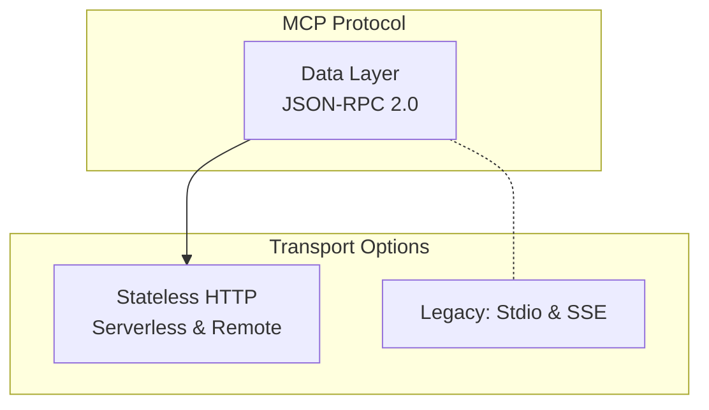
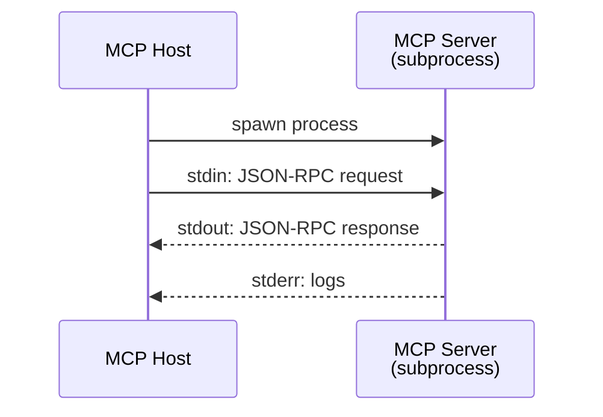
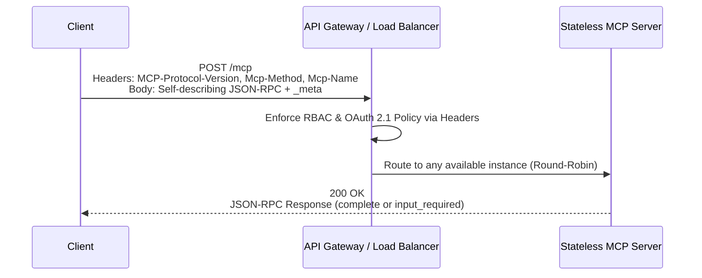
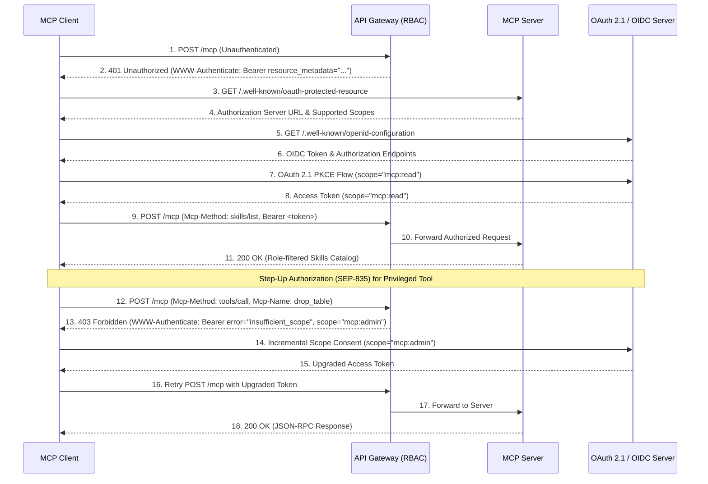
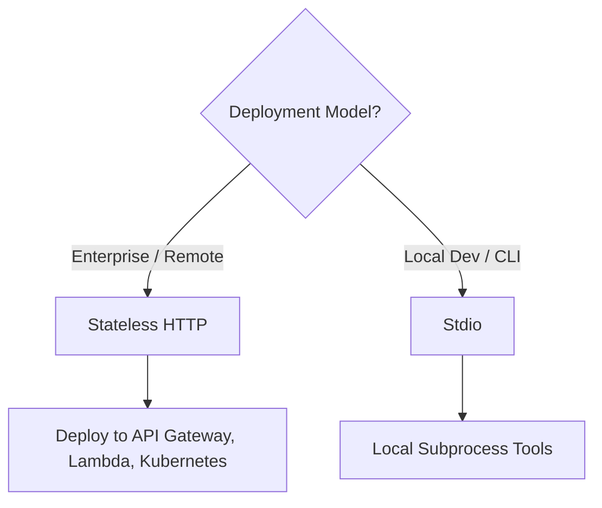

# MCP Transports

MCP supports multiple transport mechanisms for client-server communication.

## Overview

> [!IMPORTANT]  
> Following the **2026-07-28 specification release**, MCP shifted fundamentally to a **stateless request/response protocol**. The older, stateful transports (Stdio streams and HTTP with SSE) have been largely replaced by stateless HTTP utilizing Header-Based Routing.



| Transport | Use Case | Lifecycle |
|-----------|----------|-------------|
| **Stateless HTTP** | Default for enterprise, Serverless (Lambda, Cloudflare) | Request/Response (No session) |
| **Stdio** | Local CLI tools (Legacy/Specific) | Stateful Process Stream |
| **HTTP + SSE** | Streaming (Legacy) | Stateful Connection |

---

## 1. Stdio Transport

Standard input/output streams for **local process communication**.

### How It Works



### Characteristics

| Aspect | Value |
|--------|-------|
| **Latency** | Minimal (no network) |
| **Security** | Process isolation |
| **Use Case** | Local file access, CLI tools |
| **Message Framing** | Newline-delimited JSON |

### Configuration Example

```json
{
    "mcpServers": {
        "filesystem": {
            "command": "npx",
            "args": ["-y", "@modelcontextprotocol/server-filesystem", "/Users/me/projects"]
        },
        "git": {
            "command": "python",
            "args": ["/path/to/git_server.py"]
        }
    }
}
```

### Message Format

Messages are newline-delimited JSON:

```
{"jsonrpc":"2.0","method":"tools/list","params":{},"id":1}\n
{"jsonrpc":"2.0","result":{"tools":[...]},"id":1}\n
```

---

## 2. Stateless HTTP Transport (Modern Standard)

With the removal of persistent sessions, HTTP is utilized in a pure stateless request/response fashion. This is crucial for enterprise deployments, allowing MCP servers to run on auto-scaling infrastructure (like AWS Lambda or Kubernetes) without maintaining sticky sessions.

### Header-Based Routing

A key feature of the `2026-07-28` stateless transport is **Header-Based Routing**. Protocol version and target metadata are elevated to HTTP headers, allowing API Gateways and load balancers to inspect, route, and authorize traffic *before* parsing the JSON-RPC body:

* `MCP-Protocol-Version`: Declares the protocol revision (e.g., `2026-07-28`).
* `Mcp-Method`: Specifies the JSON-RPC method being invoked (e.g., `tools/call`, `server/discover`).
* `Mcp-Name`: Specifies the target primitive name (e.g., tool name `search_database` or prompt name).

### How It Works



### Characteristics

| Aspect | Value |
|--------|-------|
| **Lifecycle** | Stateless Request/Response (No `initialize` or `Mcp-Session-Id`) |
| **Complex Flows** | Uses **Multi Round-Trip Requests (MRTR)** (`input_required` + `requestState`) |
| **Caching** | List responses carry `ttlMs` and `cacheScope` |
| **Security** | TLS, OAuth 2.1 / OIDC Discovery, Header-based Gateway RBAC |
| **Use Case** | Enterprise standard, Serverless functions, Auto-scaling clusters |

### Stateless HTTP Request Example (`2026-07-28`)

```http
POST /mcp HTTP/1.1
Host: mcp.example.com
Content-Type: application/json
Authorization: Bearer <access_token>
MCP-Protocol-Version: 2026-07-28
Mcp-Method: tools/call
Mcp-Name: search_database

{
    "jsonrpc": "2.0",
    "method": "tools/call",
    "params": {
        "name": "search_database",
        "arguments": {"query": "users"},
        "_meta": {
            "io.modelcontextprotocol/protocolVersion": "2026-07-28",
            "io.modelcontextprotocol/clientInfo": {
                "name": "enterprise-host",
                "version": "2.1.0"
            },
            "io.modelcontextprotocol/clientCapabilities": {},
            "traceparent": "00-4bf92f3577b34da6a3ce929d0e0e4736-00f067aa0ba902b7-01",
            "baggage": "skill.name=user-support,userId=alice"
        }
    },
    "id": 1
}
```

### Multi Round-Trip Request (MRTR) Response Example

Instead of holding open an SSE stream when user input is needed, the HTTP response returns immediately with `resultType: "input_required"` and an opaque `requestState` token:

```http
HTTP/1.1 200 OK
Content-Type: application/json

{
    "jsonrpc": "2.0",
    "result": {
        "resultType": "input_required",
        "requestState": "eyJhbGciOiJkaXIiLCJlbmMiOiJBMjU2R0NNIn0..state_token",
        "inputRequests": {
            "approval": {
                "method": "elicitation/create",
                "params": {
                    "mode": "form",
                    "message": "Approve query on sensitive table 'users'?",
                    "requestedSchema": {
                        "type": "object",
                        "properties": {
                            "confirm": {"type": "boolean"}
                        },
                        "required": ["confirm"]
                    }
                }
            }
        }
    },
    "id": 1
}
```

---

## Authentication & Authorization (OAuth 2.1 & OIDC)

Following the **`2025-11-25`** and **`2026-07-28`** specifications, remote HTTP MCP servers standardize on **OAuth 2.1** and **OpenID Connect (OIDC) Discovery 1.0**:

| Standard / Mechanism | Specification Role |
|----------------------|--------------------|
| **Protected Resource Metadata (RFC 9728)** | MCP servers expose `/.well-known/oauth-protected-resource` so clients can discover the authorization server(s) and supported scopes. |
| **Authorization Server Discovery** | Supports both OAuth 2.0 Authorization Server Metadata (RFC 8414) and **OpenID Connect Discovery 1.0** (`/.well-known/openid-configuration`). |
| **Client ID Metadata Documents (SEP-991)** | Clients can use URL-based Client ID Metadata Documents for dynamic, zero-touch client registration. |
| **Incremental Scope Consent (SEP-835)** | Servers can return `401 Unauthorized` or `403 Forbidden` with a `WWW-Authenticate` header specifying required scopes for step-up authorization. |

### OAuth 2.1 + RFC 9728 Discovery & Step-Up Consent Flow (`SEP-835`)



---

## Transport Selection Guide



| Scenario | Recommended Transport |
|----------|----------------------|
| Enterprise Skills & Registries | Stateless HTTP (`Mcp-Method`, `Mcp-Name` headers) |
| Serverless / Auto-scaling environments | Stateless HTTP |
| Simple Local File Access / CLI | Stdio |
| Interactive Human-in-the-Loop Flows | Stateless HTTP with Multi Round-Trip Requests (MRTR) |
| Long-Running Async Jobs | Stateless HTTP with Tasks Extension (`io.modelcontextprotocol/tasks`) |

---

## Transport Comparison

| Feature | Stdio (Local) | Stateless HTTP (`2026-07-28`) | HTTP + SSE (Legacy Pre-2026) |
|---------|---------------|-------------------------------|------------------------------|
| **Setup** | Spawn subprocess | Standard HTTP POST client | Dual endpoints (`/sse` + `/message`) |
| **Session State** | Process-bound | **Fully Stateless** (No session ID) | Stateful (`Mcp-Session-Id`) |
| **Load Balancing** | N/A (1:1 local) | **Standard Round-Robin** | Required sticky sessions |
| **Gateway Routing** | N/A | Native via `Mcp-Method` & `Mcp-Name` | Required deep JSON body inspection |
| **Client Input (Elicitation)** | Bidirectional stdio | **Multi Round-Trip Requests (MRTR)** | Server-initiated SSE events |
| **Authentication** | OS process isolation | **OAuth 2.1 / OIDC (RFC 9728)** | Custom Bearer / API Key |

---

## Implementation Notes

### Stdio Server (Python)

```python
import sys
import json

def handle_request(request):
    # Process JSON-RPC request
    return {"jsonrpc": "2.0", "result": {...}, "id": request["id"]}

# Read from stdin, write to stdout
for line in sys.stdin:
    request = json.loads(line)
    response = handle_request(request)
    print(json.dumps(response), flush=True)
```

### Stateless HTTP Server (Python)

```python
from flask import Flask, request, jsonify

app = Flask(__name__)

@app.route("/mcp", methods=["POST"])
def mcp_endpoint():
    # Inspect 2026-07-28 routing headers
    protocol_version = request.headers.get("MCP-Protocol-Version", "2026-07-28")
    mcp_method = request.headers.get("Mcp-Method")
    mcp_name = request.headers.get("Mcp-Name")

    rpc_request = request.get_json()
    result = handle_stateless_request(
        rpc_request,
        protocol_version=protocol_version,
        mcp_method=mcp_method,
        mcp_name=mcp_name,
    )
    return jsonify(result)
```

---

## Summary

| Transport | Best For | Lifecycle |
|-----------|----------|-----------|
| **Stateless HTTP** | Enterprise, Serverless, Gateways, Agent Skill Delivery | Stateless (`2026-07-28`) |
| **Stdio** | Local, isolated CLI tools | Process-bound |

> [!TIP]
> Default to **Stateless HTTP** for all remote and enterprise MCP servers to take advantage of Header-Based Routing (`Mcp-Method`, `Mcp-Name`), `ttlMs` response caching, Multi Round-Trip Requests (MRTR), and standard round-robin load balancing.
