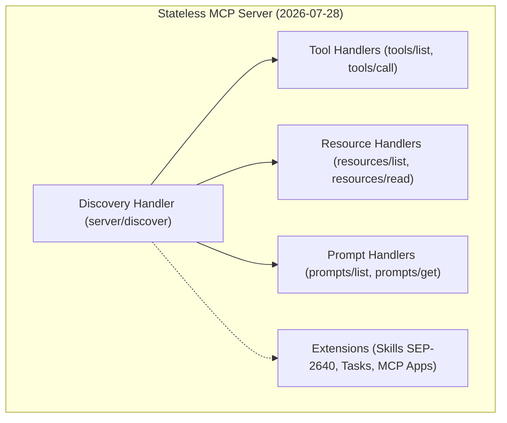

# Building MCP Servers

A practical guide to implementing MCP servers in Python.

## Quick Start

```python
from mcp.server import Server
from mcp.server.models import Tool
import mcp.types as types

# Create server
app = Server("my-server")

# Define a tool
@app.list_tools()
async def list_tools():
    return [
        Tool(
            name="hello",
            description="Say hello",
            inputSchema={
                "type": "object",
                "properties": {
                    "name": {"type": "string"}
                }
            }
        )
    ]

# Handle tool calls
@app.call_tool()
async def call_tool(name: str, arguments: dict):
    if name == "hello":
        return types.TextContent(
            type="text",
            text=f"Hello, {arguments.get('name', 'World')}!"
        )

# Run with stdio transport
if __name__ == "__main__":
    import mcp.server.stdio
    mcp.server.stdio.run(app)
```

---

## Server Structure



### Core Components

| Component | Purpose |
|-----------|---------|
| `Server` | Main stateless server instance |
| `server/discover` | Return `supportedVersions`, `capabilities` (including `extensions`), `instructions`, and `ttlMs` |
| `@list_tools` | Return available tools (`inputSchema`, `outputSchema`, `annotations`) |
| `@call_tool` | Execute tool calls (return `content`, `structuredContent`, or MRTR `input_required`) |
| `@list_resources` | Return available resources and `ttlMs` cache hints |
| `@read_resource` | Read resource content (including `skill://` and `ui://` URIs) |
| `@list_prompts` | Return available prompts |
| `@get_prompt` | Get prompt content |
| `skills/list` & `skills/get` | Expose hosted Agent Skills (`SKILL.md` frontmatter + SHA-256 manifests, SEP-2640) |

---

## Implementing Tools (`2026-07-28`)

### Tool with `outputSchema`, `structuredContent`, and `annotations`

```python
@app.list_tools()
async def list_tools():
    return [
        Tool(
            name="get_weather",
            title="Get City Weather",
            description="Get current weather for a city",
            inputSchema={
                "$schema": "https://json-schema.org/draft/2020-12/schema",
                "type": "object",
                "properties": {
                    "city": {
                        "type": "string",
                        "description": "City name"
                    },
                    "units": {
                        "type": "string",
                        "enum": ["celsius", "fahrenheit"],
                        "default": "celsius"
                    }
                },
                "required": ["city"]
            },
            outputSchema={
                "$schema": "https://json-schema.org/draft/2020-12/schema",
                "type": "object",
                "properties": {
                    "city": {"type": "string"},
                    "temperature": {"type": "number"},
                    "condition": {"type": "string"}
                },
                "required": ["city", "temperature", "condition"]
            },
            annotations={
                "readOnlyHint": True,
                "destructiveHint": False,
                "idempotentHint": True,
                "openWorldHint": True
            }
        )
    ]

@app.call_tool()
async def call_tool(name: str, arguments: dict):
    if name == "get_weather":
        city = arguments["city"]
        units = arguments.get("units", "celsius")
        
        # Simulate weather API call
        weather = fetch_weather(city, units)
        
        return types.CallToolResult(
            content=[
                types.TextContent(
                    type="text",
                    text=f"Weather in {city}: {weather['temp']}°, {weather['condition']}"
                )
            ],
            structuredContent={
                "city": city,
                "temperature": weather["temp"],
                "condition": weather["condition"]
            },
            isError=False
        )
```

### Tool with Multiple Result Types

```python
@app.call_tool()
async def call_tool(name: str, arguments: dict):
    if name == "generate_chart":
        # Return image
        image_data = generate_chart(arguments)
        return types.ImageContent(
            type="image",
            data=base64.b64encode(image_data).decode(),
            mimeType="image/png"
        )
    
    elif name == "list_files":
        # Return multiple text items
        files = list_directory(arguments["path"])
        return [
            types.TextContent(type="text", text=f)
            for f in files
        ]
```

---

## Implementing Resources

### File Resources

```python
@app.list_resources()
async def list_resources():
    return [
        types.Resource(
            uri="file:///project/config.json",
            name="Project Config",
            mimeType="application/json"
        ),
        types.Resource(
            uri="file:///project/README.md",
            name="README",
            mimeType="text/markdown"
        )
    ]

@app.read_resource()
async def read_resource(uri: str):
    if uri.startswith("file://"):
        path = uri[7:]  # Remove file://
        with open(path, "r") as f:
            content = f.read()
        
        return types.TextResourceContents(
            uri=uri,
            mimeType="text/plain",
            text=content
        )
```

### Dynamic Resources

```python
@app.list_resources()
async def list_resources():
    # List database tables as resources
    tables = get_database_tables()
    return [
        types.Resource(
            uri=f"db://table/{table}",
            name=f"Table: {table}",
            mimeType="application/json"
        )
        for table in tables
    ]

@app.read_resource()
async def read_resource(uri: str):
    if uri.startswith("db://table/"):
        table = uri.split("/")[-1]
        data = query_table(table)
        return types.TextResourceContents(
            uri=uri,
            mimeType="application/json",
            text=json.dumps(data)
        )
```

---

## Implementing Prompts

```python
@app.list_prompts()
async def list_prompts():
    return [
        types.Prompt(
            name="code_review",
            description="Review code for issues and improvements",
            arguments=[
                types.PromptArgument(
                    name="language",
                    description="Programming language",
                    required=True
                ),
                types.PromptArgument(
                    name="focus",
                    description="Review focus: security, performance, style",
                    required=False
                )
            ]
        )
    ]

@app.get_prompt()
async def get_prompt(name: str, arguments: dict):
    if name == "code_review":
        language = arguments["language"]
        focus = arguments.get("focus", "general")
        
        return types.GetPromptResult(
            messages=[
                types.PromptMessage(
                    role="user",
                    content=types.TextContent(
                        type="text",
                        text=f"Please review the following {language} code. "
                             f"Focus on {focus} aspects. "
                             f"Provide specific, actionable feedback."
                    )
                )
            ]
        )
```

---

## Error Handling (`isError: True` vs Protocol Errors)

Per the specification (SEP-1303), **tool input validation and execution errors** should return a standard `CallToolResult` with `isError=True` so the LLM can read the failure reason and self-correct its parameters, whereas `McpError` is reserved for JSON-RPC protocol-level errors (such as unknown methods):

```python
from mcp.server.models import McpError

@app.call_tool()
async def call_tool(name: str, arguments: dict):
    if name == "query_database":
        sql = arguments.get("sql", "")
        if not sql.strip().upper().startswith("SELECT"):
            # Return tool execution error so the LLM can self-correct
            return types.CallToolResult(
                content=[
                    types.TextContent(
                        type="text",
                        text="Validation Error: Only read-only SELECT queries are permitted."
                    )
                ],
                isError=True
            )
        
        try:
            result = execute_query(sql)
            return types.CallToolResult(
                content=[types.TextContent(type="text", text=json.dumps(result))],
                isError=False
            )
        except ConnectionError as e:
            return types.CallToolResult(
                content=[types.TextContent(type="text", text=f"Database unavailable: {e}")],
                isError=True
            )
```

---

## Multi Round-Trip Requests (MRTR) & Long-Running Tasks

In the **`2026-07-28` specification**, servers do not rely on persistent streams for intermediate prompts or long-running jobs:

### 1. Human-in-the-Loop via MRTR (`input_required`)

When a tool requires user confirmation (`elicitation/create`), return `resultType: "input_required"` with a signed `requestState` token:

```python
def handle_delete_table(params: dict) -> dict:
    # Step 1: If no inputResponses provided yet, request user approval via MRTR
    if "inputResponses" not in params:
        state_token = sign_state({"table": params["arguments"]["table"]})
        return {
            "resultType": "input_required",
            "requestState": state_token,
            "inputRequests": {
                "confirm_delete": {
                    "method": "elicitation/create",
                    "params": {
                        "mode": "form",
                        "message": f"Confirm deletion of table '{params['arguments']['table']}'?",
                        "requestedSchema": {
                            "type": "object",
                            "properties": {"approved": {"type": "boolean"}},
                            "required": ["approved"]
                        }
                    }
                }
            }
        }
    
    # Step 2: Client retried with requestState and inputResponses
    verified = verify_state(params["requestState"])
    approved = params["inputResponses"]["confirm_delete"]["content"].get("approved", False)
    if not approved:
        return {"content": [{"type": "text", "text": "Deletion cancelled by user."}], "isError": False}
    
    drop_table(verified["table"])
    return {"content": [{"type": "text", "text": f"Deleted {verified['table']}."}], "isError": False}
```

### 2. Long-Running Jobs via the Tasks Extension (`io.modelcontextprotocol/tasks`)

For slow operations (like batch exports or CI runs), return a durable task handle (`resultType: "task"`) that clients poll via `tasks/get` and `tasks/result`:

```json
{
  "jsonrpc": "2.0",
  "id": 42,
  "result": {
    "resultType": "task",
    "task": {
      "taskId": "task_8841",
      "status": "working",
      "ttlMs": 3600000,
      "pollIntervalMs": 2000
    }
  }
}
```

### 3. Exposing Agent Skills via MCP (`io.modelcontextprotocol/skills` — SEP-2640)

To publish Agent Skills directly from your MCP server, implement `skills/list` and `skills/get` (returning parsed YAML `frontmatter` and SHA-256 `manifest` digests) and serve the `skill://` files through `resources/read`:

```python
import hashlib

SKILL_MD = """---
name: refund-processing
description: Use this skill when issuing customer refunds or verifying eligibility.
---
# Refund Processing Skill
1. Verify order status using `get_order`.
2. Call `issue_refund` if within the 30-day window.
"""

def sha256_digest(content: str) -> str:
    return "sha256:" + hashlib.sha256(content.encode("utf-8")).hexdigest()

def handle_skills_list() -> dict:
    uri = "skill://shop/refund-processing/SKILL.md"
    return {
        "skills": [
            {
                "uri": uri,
                "frontmatter": {
                    "name": "refund-processing",
                    "description": "Use this skill when issuing customer refunds or verifying eligibility."
                },
                "manifest": [
                    {
                        "uri": uri,
                        "size": len(SKILL_MD.encode("utf-8")),
                        "digest": sha256_digest(SKILL_MD)
                    }
                ]
            }
        ],
        "nextCursor": None
    }
```

### 4. Extracting OpenTelemetry Trace Context (`SEP-414`)

Per **SEP-414**, clients pass unprefixed W3C `traceparent`, `tracestate`, and `baggage` inside `params._meta`. Extract them in your request handler to link server spans to the agent's root trace and active skill:

```python
from opentelemetry import trace
from opentelemetry.propagate import extract

tracer = trace.get_tracer("mcp.server")

def handle_jsonrpc_With_otel(request: dict) -> dict:
    params = request.get("params", {})
    meta = params.get("_meta", {})
    
    # Extract W3C traceparent, tracestate, and baggage from params._meta (SEP-414)
    ctx = extract(meta)
    method = request.get("method", "unknown")
    
    with tracer.start_as_current_span(
        f"mcp.{method}",
        context=ctx,
        attributes={
            "mcp.method.name": method,
            "mcp.protocol.version": meta.get("io.modelcontextprotocol/protocolVersion", "2026-07-28"),
        },
    ):
        return dispatch_request(request)
```

---

## Running the Server

### Stdio (Local)

```python
if __name__ == "__main__":
    import mcp.server.stdio
    mcp.server.stdio.run(app)
```

**Client configuration:**

```json
{
    "mcpServers": {
        "my-server": {
            "command": "python",
            "args": ["my_server.py"]
        }
    }
}
```

### HTTP (Remote)

```python
if __name__ == "__main__":
    from mcp.server.http import run_http
    run_http(app, host="0.0.0.0", port=8080)
```

---

## Complete Example

```python
"""
Complete MCP Server Example
Provides: Weather tools, file resources, prompts
"""

from mcp.server import Server
from mcp.server.models import Tool
import mcp.types as types
import json

app = Server("weather-files-server")

# ============= TOOLS =============

@app.list_tools()
async def list_tools():
    return [
        Tool(
            name="get_weather",
            description="Get weather for a city",
            inputSchema={
                "type": "object",
                "properties": {
                    "city": {"type": "string"}
                },
                "required": ["city"]
            }
        )
    ]

@app.call_tool()
async def call_tool(name: str, arguments: dict):
    if name == "get_weather":
        # Simulated weather
        return types.TextContent(
            type="text",
            text=f"Weather in {arguments['city']}: 22°C, Sunny"
        )

# ============= RESOURCES =============

@app.list_resources()
async def list_resources():
    return [
        types.Resource(
            uri="config://app",
            name="App Configuration",
            mimeType="application/json"
        )
    ]

@app.read_resource()
async def read_resource(uri: str):
    if uri == "config://app":
        config = {"debug": False, "version": "1.0.0"}
        return types.TextResourceContents(
            uri=uri,
            mimeType="application/json",
            text=json.dumps(config)
        )

# ============= PROMPTS =============

@app.list_prompts()
async def list_prompts():
    return [
        types.Prompt(
            name="travel_plan",
            description="Create a travel itinerary",
            arguments=[
                types.PromptArgument(name="destination", required=True)
            ]
        )
    ]

@app.get_prompt()
async def get_prompt(name: str, arguments: dict):
    if name == "travel_plan":
        return types.GetPromptResult(
            messages=[
                types.PromptMessage(
                    role="user",
                    content=types.TextContent(
                        type="text",
                        text=f"Plan a 3-day trip to {arguments['destination']}"
                    )
                )
            ]
        )

# ============= RUN =============

if __name__ == "__main__":
    import mcp.server.stdio
    mcp.server.stdio.run(app)
```

---

## Summary

| Step | Action |
|------|--------|
| 1 | Create `Server` instance |
| 2 | Define `@list_tools`, `@call_tool` |
| 3 | Define `@list_resources`, `@read_resource` |
| 4 | Define `@list_prompts`, `@get_prompt` |
| 5 | Run with stdio or HTTP |

> [!TIP]
> Use the [MCP Inspector](https://github.com/modelcontextprotocol/inspector) to test your server during development.
