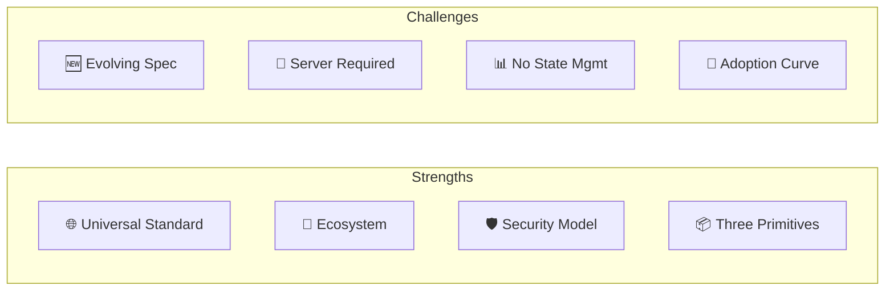
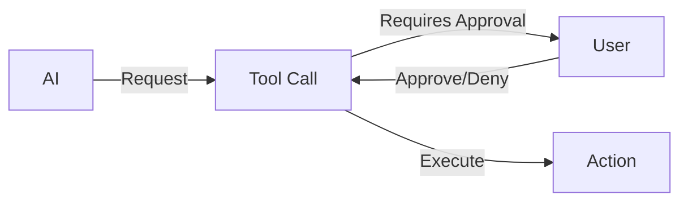
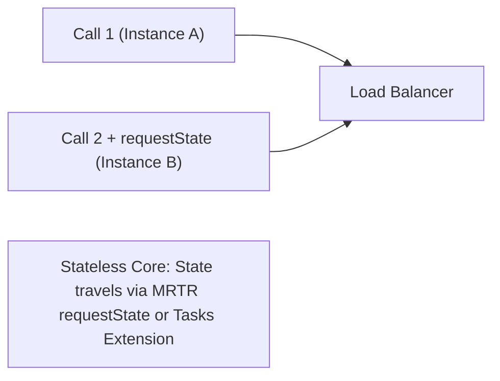
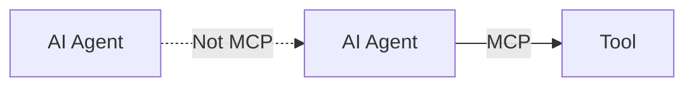
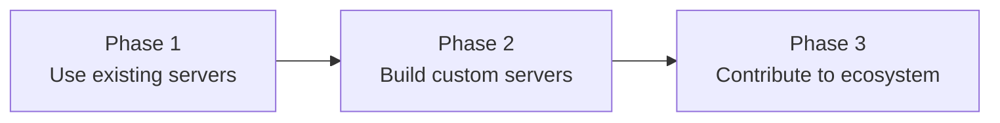

# MCP: Pros and Cons

A balanced analysis of MCP's strengths, limitations, and when to use it.

## At a Glance

---

## ✅ Pros (Advantages)

### 🌐 1. Universal Standard

MCP is **the emerging standard** for AI-to-tool integration.

| Adopters | Status |
|----------|--------|
| **Anthropic** | Creator, Claude Desktop |
| **OpenAI** | ChatGPT Desktop, API |
| **Google** | DeepMind integration |
| **VS Code** | Copilot support |

**Why it matters**: Build once, connect to all major AI platforms.

---

### 🔌 2. Growing Ecosystem

Large library of existing MCP servers.

| Category | Examples |
|----------|----------|
| **Dev Tools** | GitHub, Git, Sentry |
| **Productivity** | Slack, Notion, Google Drive |
| **Data** | PostgreSQL, MongoDB |
| **Cloud** | AWS, GCP, Azure |

**Official servers**: [github.com/modelcontextprotocol/servers](https://github.com/modelcontextprotocol/servers)

---

### 🛡️ 3. Strong Security Model

MCP enforces **user-in-the-loop** for dangerous operations.

| Security Feature | Description |
|------------------|-------------|
| Tool confirmation | User approves before execution |
| Resource scoping | Explicit access grants |
| OAuth support | Standard auth for HTTP |

---

### 📦 4. Three Clear Primitives

**Tools**, **Resources**, **Prompts** cover all integration needs.

| Need | Primitive |
|------|-----------|
| Execute actions | Tools |
| Read data | Resources |
| Guide interaction | Prompts |

Simple mental model, comprehensive coverage.

---

### ⚡ 5. Performance Options

Two transports for different needs.

| Transport | Latency | Use Case |
|-----------|---------|----------|
| Stdio | ~0ms | Local tools |
| HTTP | Network | Remote APIs |

---

### 🔧 6. Developer-Friendly

- **SDKs**: Official Tier-1 SDKs across Python, TypeScript, Go, Java, Kotlin, C#, and Rust (over 1B+ combined downloads)
- **Inspector**: Debug tool for development
- **JSON-RPC 2.0 & JSON Schema 2020-12**: Standard, well-understood contracts

---

## ❌ Cons (Disadvantages)

### 🆕 1. Rapidly Evolving Specification

MCP has evolved rapidly from stateful sessions in 2024 to a stateless request/response core in `2026-07-28`.

| Version | Date | Major Specification Changes |
|---------|------|-----------------------------|
| `2024-11-05` | Nov 2024 | Initial specification: stateful sessions, `initialize` handshake, Stdio & HTTP+SSE |
| `2025-03-26` | Mar 2025 | OAuth 2.1 authorization framework, Streamable HTTP, Tool Annotations, Audio content |
| `2025-06-18` | Jun 2025 | Structured Tool Outputs (`outputSchema`, `structuredContent`), Elicitation, Resource Links, RFC 9728 |
| `2025-11-25` | Nov 2025 | OIDC Discovery 1.0, Client ID Metadata Documents, Icons metadata, URL-mode Elicitation, Experimental Tasks |
| `2026-07-28` | Jul 2026 | **Stateless Protocol Core** (removed `initialize` & `Mcp-Session-Id`), Mandatory `server/discover`, Multi Round-Trip Requests (MRTR), Header-Based Routing (`Mcp-Method`, `Mcp-Name`), Cacheable List Results (`ttlMs`), Formal Extensions (`tasks`, `MCP Apps`), JSON Schema 2020-12, Deprecation of `Roots`/`Sampling`/`Logging` |

**Mitigation**: Declare `_meta["io.modelcontextprotocol/protocolVersion"]` and use `server/discover` to negotiate `supportedVersions`.

---

### 🔧 2. Server Implementation Required

You must build/deploy an MCP server for each integration.

| Option | Effort |
|--------|--------|
| Use existing server | Low |
| Build custom server | Medium-High |
| Maintain server | Ongoing |

**Mitigation**: Use community servers when available.

---

### 📊 3. Stateless Core Requires Explicit State Passing

As of `2026-07-28`, MCP is **stateless by design**—servers do not retain in-memory session state across requests so they can scale behind plain round-robin load balancers.

**Mitigation**: Use **Multi Round-Trip Requests (MRTR)** (`requestState` tokens) for multi-step interactive flows, the **Tasks Extension (`io.modelcontextprotocol/tasks`)** for durable async jobs, or external backing stores (Redis/DB).

---

### 🚀 4. Broad Platform Ecosystem & Version Alignment

While all major AI platforms now support MCP, different hosts may support different extension sets (`tasks`, `MCP Apps`) or protocol revisions.

| Platform | MCP Support |
|----------|-------------|
| **Claude (Desktop, Code, API)** | ✅ Full (`2026-07-28` + Extensions) |
| **OpenAI (ChatGPT, Agents SDK)** | ✅ Full |
| **Google DeepMind (Gemini, Antigravity)** | ✅ Full |
| **IDEs (VS Code, Cursor, Windsurf, JetBrains)** | ✅ Full |
| **Cloud Infrastructure (Cloudflare, AWS)** | ✅ Native Stateless HTTP & Gateways |

**Mitigation**: Check `capabilities` and `extensions` via `server/discover`.

---

### 🔄 5. No Agent-to-Agent

MCP connects **AI to tools**, not **AI to AI**.

**Solution**: Use A2A protocol for agent-to-agent communication.

---

### 📡 6. Transport Considerations

| Consideration | Impact |
|---------------|--------|
| **Stdio is local-only** | Cannot scale remotely; used for local CLI subprocesses |
| **Stateless HTTP requires OAuth 2.1 / Gateway** | Production deployments need RFC 9728 / OIDC auth configuration |
| **Legacy SSE deprecated** | Older pre-2026 SSE servers should be migrated to Stateless HTTP + MRTR |

---

## Decision Matrix

| Scenario | Use MCP? |
|----------|----------|
| AI needs to call APIs | ✅ Yes (`tools/call`) |
| AI needs file / DB access | ✅ Yes (`resources/read` & `tools/call`) |
| Long-running background job | ✅ Yes (`io.modelcontextprotocol/tasks` extension) |
| Server-rendered tool UI (forms/dashboards) | ✅ Yes (`MCP Apps` / `ui://` extension) |
| Agent-to-agent collaboration | ❌ Use A2A |
| Commerce checkout protocol | ❌ Use UCP |
| Generative agent-synthesized UI | ❌ Use A2UI |

---

## MCP vs Alternatives

| Approach | Pros | Cons |
|----------|------|------|
| **MCP** | Standard, ecosystem | Server needed |
| **Function calling** | Built-in | No standard |
| **Custom APIs** | Full control | N×M problem |
| **Plugins** | Easy for users | Platform-specific |

---

## Adoption Strategy

| Phase | Action | Timeline |
|-------|--------|----------|
| 1 | Use community servers | Week 1 |
| 2 | Build for your tools | Weeks 2-4 |
| 3 | Open-source, contribute | Ongoing |

---

## Summary

| Aspect | Assessment |
|--------|------------|
| **Maturity** | Production-ready |
| **Ecosystem** | Large and growing |
| **Security** | Strong |
| **Complexity** | Medium |
| **Adoption** | Major platforms |
| **Recommendation** | Use for AI-to-tool integration |

> [!TIP]
> MCP is the **de facto standard** for connecting AI to external tools. If you're building AI applications that need tool access, MCP should be your first choice.
