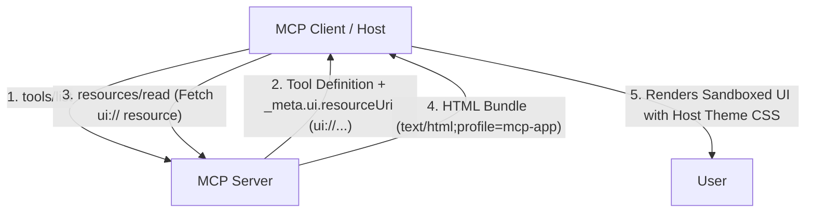

# MCP Apps (Interactive UI Extension)

**MCP Apps** (formalized as a first-class extension in the **`2026-07-28` specification**, evolving from MCP-UI) allows MCP servers to deliver rich, interactive, server-rendered User Interfaces (HTML/CSS/JS) directly inline within host applications. Instead of relying solely on text-based interactions, a tool can present a form, interactive dashboard, chart, or multi-step widget inside a sandboxed host iframe.

## Overview

A **Tool** declares an associated **UI Resource** using the standardized **`ui://` URI scheme** inside its `_meta.ui` property. The Host Application fetches the `ui://` resource (served with MIME type `text/html;profile=mcp-app`) and renders it inside a sandboxed iframe with synchronized host theme variables.



## How It Works (`2026-07-28` Specification)

### 1. The Tool Definition & Visibility Controls

When a server lists its tools, it includes a `_meta.ui` object specifying:
- `resourceUri`: A `ui://` URI pointing to the UI resource.
- `visibility`: Controls whether the tool is visible to the LLM (`"model"`), the UI iframe (`"app"`), or both (`["model", "app"]`). Setting `"visibility": ["app"]` allows servers to expose internal helper tools (e.g., UI state polling or form validation) that only the rendered UI can invoke, keeping the LLM's tool context clean.

```json
{
  "name": "create_ticket",
  "title": "Create Support Ticket",
  "description": "Create a new support ticket",
  "inputSchema": {
    "$schema": "https://json-schema.org/draft/2020-12/schema",
    "type": "object",
    "properties": {
      "category": { "type": "string", "enum": ["bug", "feature", "billing"] },
      "details": { "type": "string" }
    },
    "required": ["category", "details"]
  },
  "_meta": {
    "ui": {
      "resourceUri": "ui://tickets/create-ticket.html",
      "visibility": ["model", "app"]
    }
  }
}
```

#### App-Only Helper Tool Example (`visibility: ["app"]`)

```json
{
  "name": "validate_ticket_ draft",
  "description": "Internal UI helper to validate ticket fields before submission",
  "inputSchema": { ... },
  "_meta": {
    "ui": {
      "resourceUri": "ui://tickets/create-ticket.html",
      "visibility": ["app"]
    }
  }
}
```

### 2. The `ui://` Resource (`text/html;profile=mcp-app`)

The URI specified in `_meta.ui.resourceUri` uses the `ui://` scheme. When the client requests this resource via `resources/read`, the server returns the bundled HTML/JS content with `mimeType: "text/html;profile=mcp-app"`.

**Request:**

```json
{
  "jsonrpc": "2.0",
  "id": 3,
  "method": "resources/read",
  "params": {
    "uri": "ui://tickets/create-ticket.html"
  }
}
```

**Response:**

```json
{
  "jsonrpc": "2.0",
  "id": 3,
  "result": {
    "contents": [{
      "uri": "ui://tickets/create-ticket.html",
      "mimeType": "text/html;profile=mcp-app",
      "text": "<!DOCTYPE html><html><body><form>...</form></body></html>"
    }]
  }
}
```

### 3. Rendering, Host Theming, and Communication

The host application renders the returned HTML inside a sandboxed `iframe` and bridges communication via JSON-RPC `postMessage`:

* **Host Theme Integration**: The host injects standardized CSS custom properties (such as `--color-background-primary`, `--color-text-primary`, and typography variables) so the MCP App automatically adapts to light/dark mode and matches the host UI.
* **Trigger Actions**: The UI can call tools on the server (including `visibility: ["app"]` tools) through the host bridge.
* **Read State & Update Context**: The UI can inspect tool results (`structuredContent`) and push updated context back to the conversation.

## Security Model

Security is critical because the host is executing code provided by the server.

1. **Sandboxing**: UIs are typically rendered in an `iframe` with strict `sandbox` attributes to prevent access to the host's DOM or cookies.
2. **Permissions**: The UI cannot arbitrarily access the host's system. It must communicate through the standard MCP message passing bridge.
3. **Content Security Policy (CSP)**: Hosts often enforce strict CSPs to limit what the loaded UI can fetch (e.g., preventing external API calls unless whitelisted).

## Example Workflow: "Interactive Form"

1. **User**: "I need to open a refund ticket."
2. **LLM**: Decides to use the `open_refund_ticket` tool. It sees there is a `_meta.ui.resourceUri`.
3. **Host**: Instead of just calling the tool with JSON arguments, the Host fetches the UI resource.
4. **Host**: Renders a "Refund Request Form" to the user.
5. **User**: Fills out the form (Order ID, Reason) interactively.
6. **UI**: Javascript in the form sends the data back to the Host.
7. **Host**: Calls the actual `tools/call` method on the server with the user-provided data.

## Why Use MCP Apps?

* **Better UX**: Complex inputs (dates, colors, file uploads) are hard to specify in text. A UI is much better.
* **Safety**: Users can review structured data visually before an extensive action is taken.
* **Rich Output**: Tools can return data that is visualized as charts or tables, not just text.

---

> [!TIP]
> Use standard web technologies (HTML/CSS/JS) to build your UIs. Keep them lightweight and focused on the specific task of the tool.
