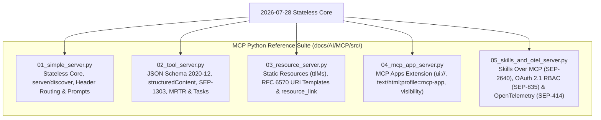

# MCP (`2026-07-28`) Python Reference Examples

This directory contains five self-contained, zero-dependency Python 3 reference implementations demonstrating the complete **Model Context Protocol (`2026-07-28` specification)**, including the **Stateless Protocol Core**, **Header-Based Routing**, **Multi Round-Trip Requests (MRTR)**, **Tasks Extension**, **MCP Apps (`ui://`)**, **Skills Over MCP (`SEP-2640`)**, **OAuth 2.1 Step-Up RBAC (`SEP-835`)**, and **OpenTelemetry Distributed Tracing (`SEP-414`)**.

---

## Architecture & Capability Map



| File | Specification Features Covered | Key Methods / Classes |
|------|--------------------------------|-----------------------|
| [`01_simple_server.py`](./01_simple_server.py) | Stateless `server/discover`, `ttlMs` caching, Header-Based Routing (`MCP-Protocol-Version`, `Mcp-Method`, `Mcp-Name`), Tools (`tools/list`, `tools/call`), Prompts (`prompts/list`, `prompts/get`) | `SimpleMCPServer`, `handle_http_request()`, `_handle_discover()` |
| [`02_tool_server.py`](./02_tool_server.py) | JSON Schema 2020-12 `inputSchema` & `outputSchema`, `structuredContent`, Tool `annotations` & `icons`, `SEP-1303` self-correcting `isError: True`, Stateless `MRTR` (`input_required` + `requestState` + `elicitation/create`), Tasks Extension (`io.modelcontextprotocol/tasks`) | `ToolServer`, `_handle_analyze_text()`, `_handle_query_orders()`, `_handle_delete_records_mrtr()`, `_handle_start_task()` |
| [`03_resource_server.py`](./03_resource_server.py) | Cacheable `resources/list` (`ttlMs`, `cacheScope`), RFC 6570 URI Templates (`resources/templates/list`), `resources/read`, `resource_link` tool results | `ResourceServer`, `list_resource_templates()`, `create_resource_link_result()` |
| [`04_mcp_app_server.py`](./04_mcp_app_server.py) | MCP Apps Extension (`_meta.ui`), `ui://` URI scheme, `text/html;profile=mcp-app`, App-Only Tool Visibility (`visibility: ["app"]` vs `["model", "app"]`), Host CSS custom property theming | `MCPServer`, `create_app_server()` |
| [`05_skills_and_otel_server.py`](./05_skills_and_otel_server.py) | Skills Over MCP (`io.modelcontextprotocol/skills`, `SEP-2640`), `skills/list` & `skills/get`, 3-tier categorization, SHA-256 `manifest` verification & tamper detection, OAuth 2.1 RBAC & Step-Up Scope Consent (`SEP-835`), OpenTelemetry W3C `traceparent` & `baggage` (`SEP-414`) | `EnterpriseSkillsMCPServer`, `OpenTelemetryCollector`, `verify_skill_digest()` |

---

## How to Run

All scripts use the Python 3 standard library only (`json`, `dataclasses`, `hashlib`, `base64`, `datetime`)—no `pip install` is required.

### Option 1: Using `make` (from `docs/AI/MCP/`)

```bash
cd docs/AI/MCP

# Show all available targets
make help

# Validate syntax of all 5 Python files
make validate

# Run all 5 examples sequentially
make all

# Run individual examples
make simple      # 01_simple_server.py
make tools       # 02_tool_server.py
make resources   # 03_resource_server.py
make app         # 04_mcp_app_server.py
make skills      # 05_skills_and_otel_server.py

# Clean __pycache__ directories
make clean
```

### Option 2: Running Directly with `python3` (from `docs/AI/MCP/src/`)

```bash
cd docs/AI/MCP/src

python3 01_simple_server.py
python3 02_tool_server.py
python3 03_resource_server.py
python3 04_mcp_app_server.py
python3 05_skills_and_otel_server.py
```

---

## Detailed Walkthrough of What Each File Does

### 1. [`01_simple_server.py`](./01_simple_server.py) — Stateless Core, Header Routing & Prompts
Demonstrates how MCP `2026-07-28` eliminates stateful `initialize` handshakes and `Mcp-Session-Id` sticky sessions:
- **Gateway Header Inspection (`handle_http_request`)**: Simulates an API Gateway reading `MCP-Protocol-Version: 2026-07-28`, `Mcp-Method`, and `Mcp-Name` HTTP headers before routing the JSON-RPC body.
- **Mandatory Discovery (`server/discover`)**: Returns `supportedVersions`, `capabilities`, server `instructions`, and cache freshness (`ttlMs: 3600000`, `cacheScope: "public"`).
- **Tools & Prompts**: Registers `greet` and `calculate` tools alongside a parameterized `code_review` prompt template (`prompts/list`, `prompts/get`).

### 2. [`02_tool_server.py`](./02_tool_server.py) — Structured Outputs, `SEP-1303`, MRTR & Tasks
Demonstrates advanced tool execution patterns introduced across `2025-06-18`, `2025-11-25`, and `2026-07-28`:
1. **Typed Outputs (`outputSchema` + `structuredContent`)**: `analyze_text` declares a JSON Schema 2020-12 `outputSchema` and behavioral `annotations` (`readOnlyHint: True`), returning both human-readable `content` and machine-verified `structuredContent`.
2. **Failing Forward (`SEP-1303` Self-Correction)**: `query_orders_by_date` is called first with an invalid date (`"10/31/2026"`). Instead of throwing a hard JSON-RPC protocol error, it returns a tool result with `isError: True` and a semantic hint (`Expected YYYY-MM-DD`). The demo then shows the LLM self-correcting on the second call (`"2026-10-31"`).
3. **Stateless Multi Round-Trip Requests (`MRTR`)**: `delete_production_records` is called on **`server-instance-A`**, which returns `resultType: "input_required"`, an `elicitation/create` confirmation form, and a base64-encoded `requestState` token. The client collects user approval and sends the retry to **`server-instance-B`**, which decodes `requestState` and completes the deletion without any shared session memory.
4. **Tasks Extension (`io.modelcontextprotocol/tasks`)**: `run_batch_migration` immediately returns `resultType: "task"` (`status: "working"`, `pollIntervalMs: 1000`), and polling `get_task_status()` transitions the task to `completed`.

### 3. [`03_resource_server.py`](./03_resource_server.py) — Resources, URI Templates & `resource_link`
Demonstrates read-only context delivery:
- **Static Resources (`resources/list`)**: Exposes `config://app` and `api://status` with `ttlMs: 600000` caching hints.
- **RFC 6570 Dynamic URI Templates (`resources/templates/list`)**: Exposes `db://users/{userId}/profile` and resolves `db://users/1/profile` dynamically via `resources/read`.
- **Resource Links (`resource_link`)**: Shows how a tool can return a lightweight `resource_link` URI pointer instead of dumping a large payload directly into the LLM context.

### 4. [`04_mcp_app_server.py`](./04_mcp_app_server.py) — MCP Apps (`ui://` Interactive UI Extension)
Demonstrates server-rendered user interfaces in MCP `2026-07-28`:
- Links the `submit_feedback` tool to `ui://feedback/feedback-form.html` via `_meta.ui.resourceUri`.
- Exposes an app-only helper tool (`validate_feedback_draft`) with `"visibility": ["app"]` so only the sandboxed UI iframe can invoke it without cluttering the LLM's tool catalog.
- Serves the HTML bundle via `resources/read` with `mimeType: "text/html;profile=mcp-app"` and host CSS custom property variables (`--color-background-primary`, `--color-text-primary`).

### 5. [`05_skills_and_otel_server.py`](./05_skills_and_otel_server.py) — Skills Over MCP (`SEP-2640`), RBAC & OpenTelemetry (`SEP-414`)
Demonstrates how enterprise Agent Skills, security, and observability work together over MCP:
1. **Role-Scoped & Categorized Discovery (`skills/list`)**: Hosts skills across `skill://shop/...`, `skill://devops/...`, and `skill://finance/...`. When a `support` agent calls `skills/list` with `category="customer-support"`, the server filters by both OAuth 2.1 role and category (`cacheScope: "private"`), returning the Level-1 YAML `frontmatter` and `sha256` file `manifest`.
2. **JIT Loading & SHA-256 Tamper Detection (`resources/read`)**: The client lazily fetches `skill://shop/refund-processing/SKILL.md` via `resources/read` and runs `verify_skill_digest()` against the manifest's `sha256` hash—passing for the authentic skill and blocking a simulated prompt-injection modification.
3. **OAuth 2.1 Step-Up Scope Consent (`SEP-835`)**: When the agent calls `issue_refund` for `$250`, the first attempt fails with `403 Forbidden` and a `WWW-Authenticate: Bearer error="insufficient_scope", scope="mcp:read refund:high_value"` challenge. After upgrading the token scope, the second attempt succeeds.
4. **OpenTelemetry Distributed Tracing (`SEP-414` + `mcp.*` Conventions)**: Propagates unprefixed `traceparent` and `baggage` (`skill.name`, `skill.digest`) inside `params._meta` across every call and prints the resulting hierarchical span tree (`gen_ai.agent.invoke` → `skills/list` → `resources/read` → `tools/call`).
