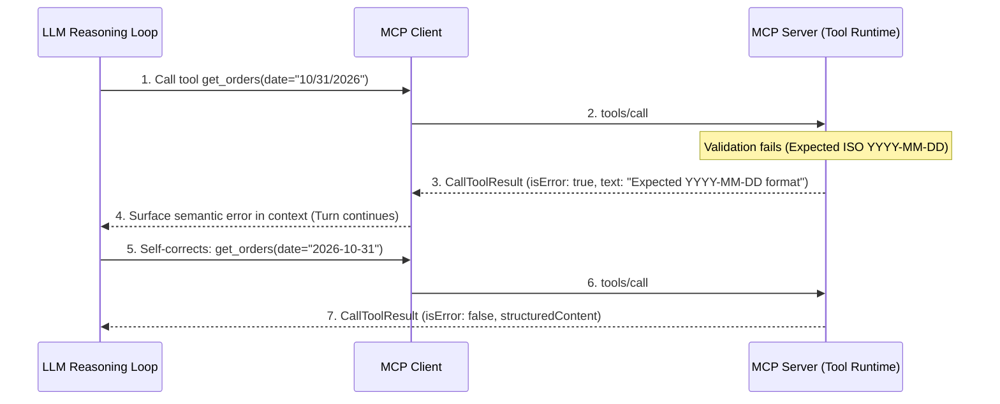
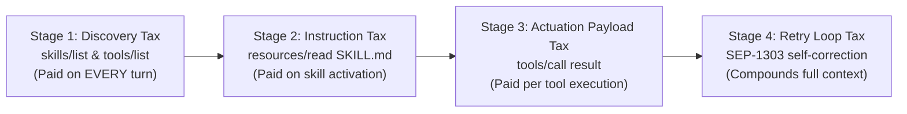
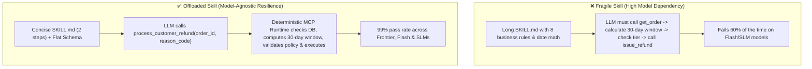

# Execution Architecture (NFRs)

Skills that survive in production must strictly adhere to these architectural mandates.

## Context Compression

**Rule:** A skill MUST NEVER return raw, unpaginated JSON dumps or raw HTML to the agent.

* **Why:** Returning a 50MB database payload will immediately blow out the LLM's context window.
* **Implementation:** The execution runtime must implement **Context Compression**. The script must parse, filter, and extract *only the semantic delta* needed by the agent before returning the payload.

## Failing Forward (Semantic Error Hints — MCP `SEP-1303`)

**Rule:** A skill MUST NEVER return raw system stack traces (e.g., `NullPointerException at line 42`) or hard JSON-RPC protocol errors for input validation failures.

* **Why:** LLMs cannot debug your backend code. Raw errors or protocol-level exceptions abort the turn or cause infinite loops.
* **Implementation:** Per MCP **SEP-1303**, tool handlers must catch validation/execution exceptions and return a standard `CallToolResult` with **`isError: true`** and a **Semantic Error Hint** (e.g., `{"content": [{"type": "text", "text": "Invalid date format. Expected YYYY-MM-DD. Please try again."}], "isError": true}`). This teaches the LLM *how* to self-correct on the next turn.



## Idempotency, Tool Annotations, & The "Dry-Run" Pattern

**Rule:** Any skill that mutates state (Write, Update, Delete) MUST be strictly idempotent and declare accurate MCP **Tool Annotations**.

* **Why:** LLMs are non-deterministic and may invoke the same payload twice due to retries or reasoning loops.
* **Implementation:**
  * Declare MCP Tool `annotations` (`readOnlyHint`, `destructiveHint`, `idempotentHint`, `openWorldHint`) and `outputSchema` (JSON Schema 2020-12).
  * High-risk skills should support a `dry_run: boolean` parameter so the Agent can simulate the mutation and observe the blast radius before committing.

## Cryptographic Boundaries, OAuth 2.1, & HITL (`MRTR` & `SEP-2640`)

**Rule:** Skills must operate on the Principle of Least Privilege and verify file integrity.

* **Why:** Prompt injection or tampered skill files allow external actors to hijack the LLM's tool-calling engine.
* **Implementation:**
  * **Scoped OAuth 2.1 / OIDC Tokens (`RFC 9728` & `SEP-835`):** Never give the Agent global admin credentials. Remote MCP servers enforce scoped Bearer tokens and step-up authorization via `WWW-Authenticate`.
  * **Cryptographic Skill Manifests (`SEP-2640`):** When loading skills via `io.modelcontextprotocol/skills`, the host runtime MUST verify every `SKILL.md` and companion file against the `sha256` `digest` and byte `size` in the skill's `manifest`.
  * **Human-in-the-Loop via Multi Round-Trip Requests (`MRTR`):** High-risk skills (e.g., `drop_table`, `deploy_prod`) must pause execution by returning `resultType: "input_required"` with a signed `requestState` token and an `elicitation/create` prompt (`form` or `url` mode), requiring explicit human approval before executing.

---

## Token Economics & Efficiency Engineering

Every skill imposes a **Token Tax** across four distinct stages of an agent's lifecycle. Understanding where tokens are burned—and how to audit them both statically in CI and dynamically in production—is mandatory for enterprise scale.

### 1. Where Skills Consume Tokens (The 4-Stage Token Tax)



| Lifecycle Stage | MCP Primitive | What Consumes Tokens | Enterprise Token Budget |
| :--- | :--- | :--- | :--- |
| **1. Discovery Tax** | `skills/list` / `tools/list` | Level-1 YAML `frontmatter` (`name`, `description`, `tags`) and active JSON Schema `inputSchema` definitions injected into the system prompt on every turn. | **$\le 60$ tokens** per skill frontmatter<br/>**$\le 250$ tokens** per tool `inputSchema` |
| **2. Instruction Load Tax** | `resources/read` (`skill://.../SKILL.md`) | The full procedural Markdown instructions (`SKILL.md` body) plus any eagerly loaded examples or policy tables. | **$\le 1,200$ tokens** for `SKILL.md` body<br/>Move reference tables to lazy `references/*` |
| **3. Actuation Payload Tax** | `tools/call` response | The `content` text returned to the LLM reasoning loop after the deterministic script executes. | **$\le 500$ tokens** in `content`<br/>Offload bulk data to `structuredContent` or `resource_link` |
| **4. Retry / Loop Tax** | `CallToolResult (isError: true)` | Every failed validation or misunderstood instruction forces an extra LLM turn, re-billing the **entire** accumulated conversation history. | **$\le 1.20\times$** Token Amplification Factor ($\text{TAF}$) |

### 2. Five Architectural Techniques to Make Skills Token-Efficient

1. **Strict 3-Tier Progressive Disclosure (`SEP-2640`):**
   * **Tier 1 (Frontmatter):** Write crisp, routing-optimized descriptions ($\le 40$ words) stating *when* to trigger the skill and *what* domain it covers. Never put procedural steps or edge-case rules in `frontmatter.description`.
   * **Tier 2 (`SKILL.md` Core):** Keep only the happy-path workflow and critical invariants in `SKILL.md`.
   * **Tier 3 (`references/` Lazy Resources):** Extract lengthy domain tables, error code catalogs, and few-shot JSON payloads into `skill://<domain>/<name>/references/*.md`. Instruct the agent to call `resources/read` on those URIs *only* when encountering that specific edge case.
2. **Schema Flattening & Concise Property Descriptions:**
   * Deeply nested JSON Schemas (`anyOf`, `oneOf`, 4+ object levels, verbose `description` paragraphs on self-explanatory fields like `user_id`) inflate token usage and confuse smaller models.
   * Flatten tool inputs to $\le 6$ top-level scalar/enum properties and rely on JSON Schema keywords (`enum`, `pattern`, `minimum`, `format`) rather than prose descriptions.
3. **Dual-Channel Tool Outputs (`content` vs. `structuredContent` & `resource_link`):**
   * In MCP `2026-07-28`, `CallToolResult` separates what the **LLM** reads (`content`) from what the **host application/UI** consumes (`structuredContent`).
   * Return a compact 2-sentence semantic summary in `content` (e.g., `"Found 42 matching orders totaling $18,400. Top 3 anomalies listed below; full dataset attached as resource."`) and return the raw records via `structuredContent` or a分页 `resource_link` URI (`mcp://orders/query-result-882`).
4. **Macro-Skill Consolidation (Eliminating Multi-Turn Ping-Pong):**
   * If an agent routinely calls `get_user` $\rightarrow$ `get_orders` $\rightarrow$ `check_refund_policy` in sequence, each round-trip re-sends the entire prompt context. Consolidating those 3 micro-tools into a single deterministic macro-tool (`evaluate_refund_eligibility`) cuts cumulative input tokens by **60–75%**.
5. **Deterministic Pre-Validation & Default Injection:**
   * Never ask the LLM to compute defaults (like current ISO timestamps, UUIDs, or tenant IDs from session context). Inject them inside the MCP server handler automatically.

### 3. How to Check & Measure Skill Token Efficiency

You must verify token efficiency at two checkpoints: **Static Build-Time Linting** (before merge) and **Runtime Telemetry Auditing** (via OpenTelemetry `SEP-414`).

#### A. Static Build-Time Checks (CI Token Linter)
Run a deterministic token analyzer (see [`src/01_token_efficiency_analyzer.py`](./src/01_token_efficiency_analyzer.py)) on every PR that computes:
* **Frontmatter Token Count ($T_{\text{front}}$):** Must be $\le 60$ tokens.
* **Instruction Body Token Count ($T_{\text{body}}$):** Must be $\le 1,200$ tokens.
* **Schema Token Overhead ($T_{\text{schema}}$):** Serialized JSON Schema token count across tools bound to the skill ($\le 250$ tokens/tool).
* **Static Instruction-to-Schema Ratio:** Flags skills where >50% of `SKILL.md` duplicates constraints that belong in JSON Schema (`enum`/`pattern`) or deterministic Python validation.

#### B. Runtime Efficiency Metrics (OpenTelemetry `SEP-414` + `gen_ai.client.token.usage`)
By propagating `baggage: skill.name=...,skill.digest=sha256:...` across `resources/read` and `tools/call` spans, your observability pipeline computes three core efficiency KPIs per skill version (`sha256` digest):

1. **Tokens-per-Successful-Actuation ($T_{\text{success}}$):**
   $$T_{\text{success}} = \frac{\sum (\text{Input Tokens} + \text{Output Tokens across skill trace})}{\text{Number of Completed Tasks with } \texttt{isError=false}}$$
2. **Token Amplification Factor ($\text{TAF}$):**
   Measures how much token waste is caused by retries, `SEP-1303` validation errors, or unnecessary companion file reads:
   $$\text{TAF} = \frac{T_{\text{actual\_trace}}}{T_{\text{ideal\_single\_pass}}}$$
   * **$\text{TAF} = 1.00$:** Ideal single-pass execution (zero retries).
   * **$1.00 < \text{TAF} \le 1.25$:** Healthy production skill.
   * **$\text{TAF} > 1.50$:** **Inefficient skill.** Indicates the LLM is misunderstanding `SKILL.md` or failing `inputSchema` validation and looping.
3. **Context-to-Action Ratio ($\text{CAR}$):**
   $$\text{CAR} = \frac{T_{\text{front}} + T_{\text{body}} + T_{\text{schema}} + T_{\text{tool\_response}}}{T_{\text{tool\_arguments}}}$$
   A high $\text{CAR}$ ($> 40:1$) reveals that the skill injects massive instructions or returns bloated payloads just to produce a tiny 15-token tool call.

---

## Model Quality Dependency & Cognitive Offloading

A common enterprise failure mode is authoring a skill against a frontier reasoning model (e.g., Gemini Pro / Claude Opus / GPT-4.5) and discovering that it completely breaks when routed to a faster, cheaper model tier (e.g., Flash / Haiku / 8B SLMs) for high-volume production traffic.

### 1. How Much Does a Skill Depend on Model Quality?

A skill's sensitivity to model quality is governed by the **Cognitive Load Equation**:

$$\text{Model Dependency} \propto (\text{Instruction Branching Depth}) \times (\text{Schema Nesting Complexity}) \times (\text{Unvalidated State Steps})$$

| Skill Characteristic | High Model Dependency (Requires Frontier Model) | Low Model Dependency (Works on Flash / Haiku / SLMs) |
| :--- | :--- | :--- |
| **Orchestration Logic** | `SKILL.md` asks the LLM to execute `if/else` business rules across 4+ micro-tools in sequence. | Deterministic Python/Java code inside the MCP server executes the workflow; LLM calls 1 macro-tool. |
| **Calculations & Parsing** | LLM is asked to calculate date windows, prorated refunds, or regex transformations in-prompt. | Deterministic runtime computes math/dates and returns boolean flags (`eligible: true`). |
| **JSON Schema Design** | Deeply nested objects (3+ levels), polymorphic `oneOf`/`anyOf`, 12+ optional parameters. | Flat key-value schema ($\le 5$ top-level fields) with strict `enum` and `pattern` constraints. |
| **Error Recovery** | Generic HTTP 400 error; relies on frontier reasoning to deduce what went wrong. | Explicit `SEP-1303` hint with exact fix example (`"Expected ISO date '2026-10-31', got '10/31/26'"`). |

### 2. What Breaks First as Model Capability Drops?

Empirical benchmarking (demonstrated in [`src/02_model_dependency_benchmark.py`](./src/02_model_dependency_benchmark.py)) shows a predictable degradation curve across model tiers:

1. **Small / Edge SLMs (7B–14B):** Fail first on **nested JSON Schemas**, **implicit type coercion** (passing `"true"` instead of `true`), and **multi-constraint filtering** buried in long `SKILL.md` prose.
2. **Mid-Tier / Flash Models:** Handle flat tool calls reliably, but degrade when `SKILL.md` requires **3+ sequential state-dependent tool calls** or **mental arithmetic/date math** between tool outputs.
3. **Frontier Models:** Mask bad skill architecture by brute-forcing through ambiguous prompts and complex schemas—at the cost of **5–10$\times$ higher latency and token spend**.

### 3. Architectural Pattern: Cognitive Offloading (Shifting Left to Code)

To make a skill **model-resilient** (achieving >95% reliability even on fast/cheap models), apply **Cognitive Offloading**:



* **Rule of Thumb:** If a rule in `SKILL.md` can be expressed as an `if` statement, a mathematical formula, or a schema validation in Python/Java, **delete it from `SKILL.md` and put it in the MCP tool handler.**
* **Declare Model Tier Capabilities in Frontmatter:** When a skill genuinely requires frontier reasoning (e.g., `refine-intent` analyzing ambiguous architectural contradictions), declare its minimum model requirements explicitly in `SKILL.md` frontmatter so the MCP Gateway/Router can enforce model routing:
  ```yaml
  ---
  name: refine-intent
  description: Analyzes raw feature requests against AGENTS.md to extract pure business intent.
  min_model_tier: frontier          # e.g., frontier | standard | flash | slm
  requires_capabilities:
    - structured_outputs
    - extended_thinking
  token_budget:
    max_frontmatter_tokens: 50
    max_body_tokens: 900
  ---
  ```
