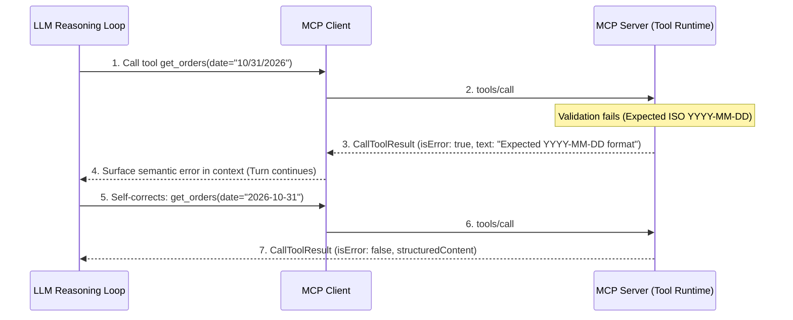

# Execution Architecture (NFRs)

Skills that survive in production must strictly adhere to these architectural mandates.

## Context Compression

**Rule:** A skill MUST NEVER return raw, unpaginated JSON dumps or raw HTML to the agent.

* **Why:** Returning a 50MB database payload will immediately blow out the LLM's context window.
* **Implementation:** The execution runtime must implement **Context Compression**. The script must parse, filter, and extract *only the semantic delta* needed by the agent before returning the payload.

## Failing Forward (Semantic Error Hints — MCP `SEP-1303`)

**Rule:** A skill MUST NEVER return raw system stack traces (e.g., `NullPointerException at line 42`) or hard JSON-RPC protocol errors for input validation failures.

* **Why:** LLMs cannot debug your backend code. Raw errors or protocol-level exceptions abort the turn or cause infinite loops.
* **Implementation:** Per MCP **SEP-1303**, tool handlers must catch validation/execution exceptions and return a standard `CallToolResult` with **`isError: true`** and a **Semantic Error Hint** (e.g., `{"content": [{"type": "text", "text": "Invalid date format. Expected YYYY-MM-DD. Please try again."}], "isError": true}`). This teaches the LLM *how* to self-correct on the next turn.

## Idempotency, Tool Annotations, & The "Dry-Run" Pattern

**Rule:** Any skill that mutates state (Write, Update, Delete) MUST be strictly idempotent and declare accurate MCP **Tool Annotations**.

* **Why:** LLMs are non-deterministic and may invoke the same payload twice due to retries or reasoning loops.
* **Implementation:**
  * Declare MCP Tool `annotations` (`readOnlyHint`, `destructiveHint`, `idempotentHint`, `openWorldHint`) and `outputSchema` (JSON Schema 2020-12).
  * High-risk skills should support a `dry_run: boolean` parameter so the Agent can simulate the mutation and observe the blast radius before committing.

## Cryptographic Boundaries, OAuth 2.1, & HITL (`MRTR` & `SEP-2640`)

**Rule:** Skills must operate on the Principle of Least Privilege and verify file integrity.

* **Why:** Prompt injection or tampered skill files allow external actors to hijack the LLM's tool-calling engine.
* **Implementation:**
  * **Scoped OAuth 2.1 / OIDC Tokens (`RFC 9728` & `SEP-835`):** Never give the Agent global admin credentials. Remote MCP servers enforce scoped Bearer tokens and step-up authorization via `WWW-Authenticate`.
  * **Cryptographic Skill Manifests (`SEP-2640`):** When loading skills via `io.modelcontextprotocol/skills`, the host runtime MUST verify every `SKILL.md` and companion file against the `sha256` `digest` and byte `size` in the skill's `manifest`.
  * **Human-in-the-Loop via Multi Round-Trip Requests (`MRTR`):** High-risk skills (e.g., `drop_table`, `deploy_prod`) must pause execution by returning `resultType: "input_required"` with a signed `requestState` token and an `elicitation/create` prompt (`form` or `url` mode), requiring explicit human approval before executing.
