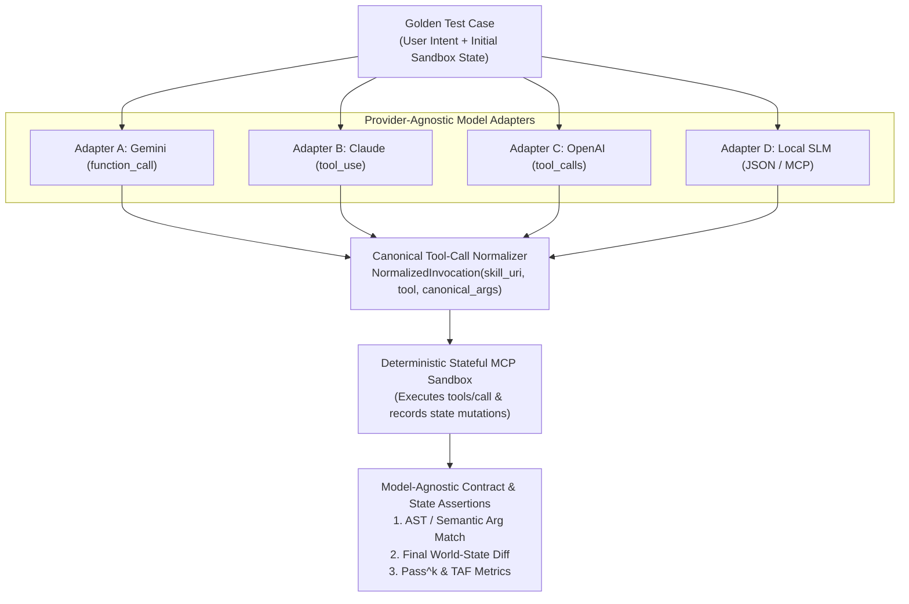

# The Skill Testing Lifecycle & Model-Agnostic Testing

Testing AI Agent Skills requires bifurcating the **deterministic execution runtime** from the **non-deterministic cognitive interface (`SKILL.md` + JSON Schema)**, and ensuring tests remain completely **model-agnostic** so your enterprise is never locked into a single LLM vendor or model snapshot.

---

## 1. Prompt-Isolation & Semantic Routing Testing

You must test the skill's *Cognitive Interface* (`SKILL.md` frontmatter, body instructions, and tool JSON Schemas) independently of backend infrastructure.

* **Positive Routing (Recall):** Given a Golden Dataset of user intents that *should* trigger the skill, does the router/model select `skill://<domain>/<name>/SKILL.md` in Top-$K$ and invoke the right MCP tool?
* **Negative / Distractor Routing (Precision & Anti-Shadowing):** Inject 20–50 sibling enterprise skill frontmatters (`skills/list`) alongside the target skill. Verify that closely related skills (e.g., `cancel-subscription` vs. `refund-order`) do not suffer from **Semantic Collision**.
* **Abstention / Missing-Parameter Gate:** When a user prompt omits a required parameter (e.g., `"Refund my last order"` without `orderId`), assert that the model either calls a lookup tool first or asks for clarification—**never** hallucinating a placeholder ID like `"12345"` or `"ORD-001"`.

## 2. Property-Based Fuzzing & `SEP-1303` Self-Correction Testing

Because LLMs generate unpredictable parameters, standard happy-path unit tests are insufficient for the MCP execution runtime.

* **Property-Based Fuzzing:** Fuzz the deterministic MCP tool handler (e.g., via Python's `Hypothesis` or custom fuzz generators) with malformed dates, negative amounts, SQL/shell injection payloads, Unicode edge cases, and boundary numbers.
  * **Invariant:** The tool handler MUST **never** raise an unhandled exception or return raw stack traces. Every rejected input must return a structured MCP `CallToolResult` with `isError: true` and an actionable hint.
* **`SEP-1303` Closed-Loop Self-Correction Test:**
  A critical test that most teams miss: deliberately feed the LLM a synthetic `CallToolResult(isError=True, text="...")` from your MCP tool and assert that the model uses the semantic error hint to **self-correct on the very next turn** (Single-Turn Recovery Rate $\ge 95\%$).

---

## 3. Model-Agnostic Skill Testing Architecture

When enterprises upgrade models (e.g., moving from Claude Sonnet to Gemini Flash or GPT-4o, or running local open-weights models), naive test suites break because they assert on **model-specific artifacts** (e.g., exact conversational phrasing, `<thinking>` block formatting, or provider-specific tool call wrappers).

To build truly **Model-Agnostic Tests** (demonstrated in [`src/03_model_agnostic_test_harness.py`](./src/03_model_agnostic_test_harness.py)), enforce the following four architectural layers:



### Pillar A: The Canonical Tool-Call Normalizer (Zero Provider Coupling)
Different model APIs emit tool invocations in incompatible wire formats:
* **OpenAI:** `choices[0].message.tool_calls[].function.{name, arguments (JSON string)}`
* **Anthropic:** `content[]` blocks with `type: "tool_use"`, `name`, `input (dict)`
* **Google Gemini:** `candidates[0].content.parts[].function_call.{name, args}`
* **Native MCP Sampling / Agent Loop:** JSON-RPC `method: "tools/call"`, `params: {name, arguments, _meta}`

**Mandate:** Never write test assertions against raw provider responses. Pass every model output through a **Canonical Normalizer** that strips conversational prose and reasoning tokens, producing a uniform sequence of `CanonicalInvocation`:

```python
@dataclass(frozen=True)
class CanonicalInvocation:
    skill_uri: str               # e.g., "skill://shop/refund-processing/SKILL.md"
    tool_name: str               # e.g., "issue_refund"
    canonical_args: dict         # Normalized types, sorted keys, ISO-normalized dates
```

### Pillar B: Behavioral World-State Assertions (Testing *Outcomes*, Not *Paths*)
Two different models might solve a multi-step skill via slightly different valid trajectories:
* *Model A* calls `get_order(id="ord_901")` and then `issue_refund(id="ord_901", amount=250.0)`.
* *Model B* calls `list_customer_orders(customer="alice")` first, finds `"ord_901"`, and then calls `issue_refund(id="ord_901", amount=250.0)`.

If your test asserts `assert tool_calls == [get_order, issue_refund]`, Model B fails despite solving the user's task safely.
* **Mandate:** Execute tool calls against a **Stateful In-Memory MCP Sandbox** and assert on **World-State Invariants** after the turn completes:
  1. **Final State Post-Condition:** `sandbox.db["orders"]["ord_901"]["status"] == "refunded"`
  2. **Safety / Guardrail Invariant:** No destructive tool was called on unauthorized records (`sandbox.audit_log.unauthorized_mutations == 0`).
  3. **Efficiency Bound:** Total tool calls $\le \text{max\_allowed\_steps}$ and Token Amplification Factor $\text{TAF} \le 1.25$.

### Pillar C: Measuring Reliability with $\text{Pass}^k$ Instead of $\text{Pass}@k$
In coding benchmarks, $\text{Pass}@k$ measures the probability that *at least one* of $k$ attempts succeeds. For enterprise agent skills that mutate state, $\text{Pass}@k$ is dangerous—you do not get 5 tries in production to roll back a Kubernetes cluster.

Use **$\text{Pass}^k$ (Pass-to-the-Power-of-$k$)**: the probability that **all $k$ independent trials** succeed across temperature $>0$:

$$\text{Pass}^k = \left(\frac{c}{n}\right)^k$$

where $c$ is the number of passing runs out of $n$ trials.
* A skill with an 80% single-run pass rate has a **$\text{Pass}^5 = (0.8)^5 = 32.8\%$** consistency score—unacceptable for production actuation.
* **Enterprise Release Threshold:** Critical skills must achieve **$\text{Pass}^3 \ge 95\%$** across all supported model tiers.

### Pillar D: Cross-Model Compatibility Matrix & Jury-of-Judges
Run your skill evaluation suite against a **Model Tier Matrix** on every release candidate:

| Model Tier | Representative Models | Purpose in Matrix | Target $\text{Pass}^3$ | Max $\text{TAF}$ |
| :--- | :--- | :--- | :--- | :--- |
| **Tier 1: Frontier** | Gemini Pro, Claude Opus/Sonnet, GPT-4.5 | Baseline ceiling; verifies complex ambiguity resolution | $\ge 98\%$ | $\le 1.10$ |
| **Tier 2: Workhorse / Flash** | Gemini Flash, Claude Haiku, GPT-4o-mini | Primary production tier; verifies cost/latency efficiency | $\ge 95\%$ | $\le 1.20$ |
| **Tier 3: Edge / Open SLM** | Llama-3 8B/70B, Qwen-2.5, Gemma | Stress-tests schema simplicity & cognitive offloading | $\ge 85\%$ | $\le 1.35$ |

> [!IMPORTANT]
> **Eliminating Judge Bias in Free-Text Skill Outputs:** When a skill generates structured Markdown or architectural specs (like `generate-ba-view`), never use a single LLM from the same model family as both generator and judge. Prefer **deterministic structural assertions** (e.g., regex/AST parsing of required Markdown headings and Mermaid syntax validation) combined with a **Boolean Rubric Checklist** evaluated across a lightweight cross-family judge panel.

---

## 4. Fast CI vs. Merge Queue vs. Nightly Evals

| Pipeline Tier | Trigger | What Runs | Latency Target | Cost |
| :--- | :--- | :--- | :--- | :--- |
| **Tier 1: Fast Static & Fuzz CI** | Every commit / PR | Token Budget Linter, JSON Schema validation, `SEP-2640` SHA-256 digest check, Property-Based Fuzzing (`SEP-1303`), Deterministic Mock Agent Contract Tests | **$< 15$ seconds** | **$0.00** (Zero LLM calls) |
| **Tier 2: Prompt-Isolation & Routing Gate** | PR Merge Queue | Embedding/Router Confusion Matrix against catalog + Canonical Tool-Call evals on `Flash` model tier | **$< 2$ minutes** | **$< \$0.05$** per PR |
| **Tier 3: Full Cross-Model Matrix** | Nightly / Release Tag | End-to-End stateful sandbox scenarios across Frontier, Flash, and SLM tiers computing $\text{Pass}^3$ and $\text{TAF}$ | **10–15 minutes** | **$\sim \$1$–$\$3$** per release |

See **[06. The Skill Delivery Factory](./06_skill_delivery_factory.md)** for the complete end-to-end CI/CD factory pipeline and executable implementation.
