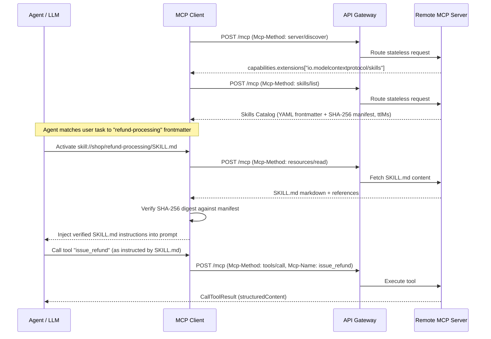
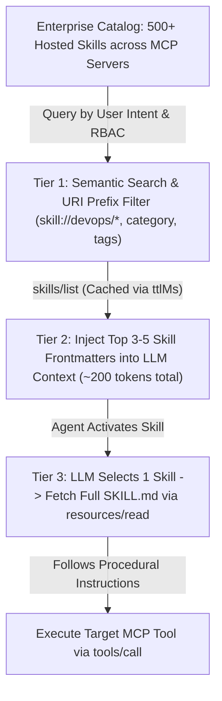
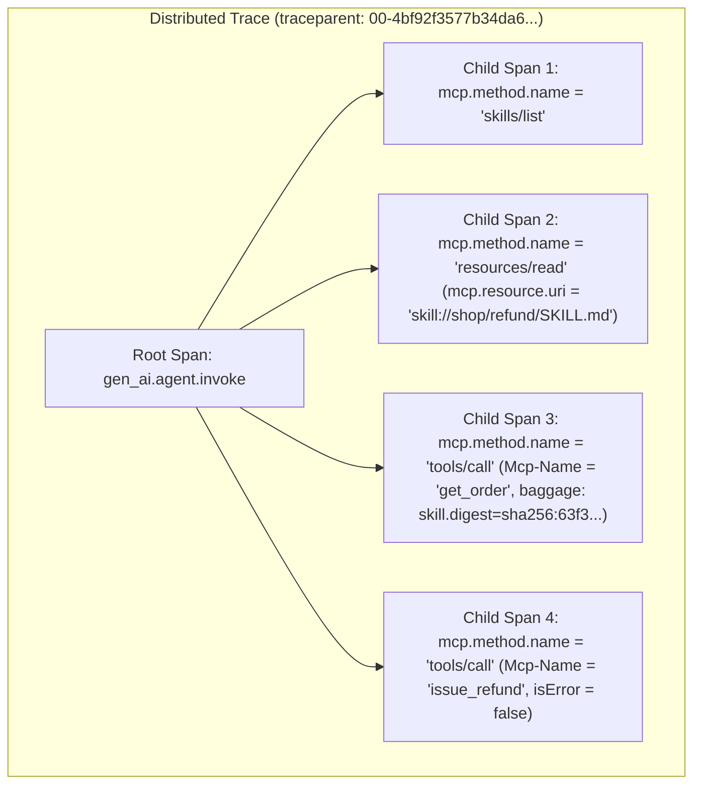
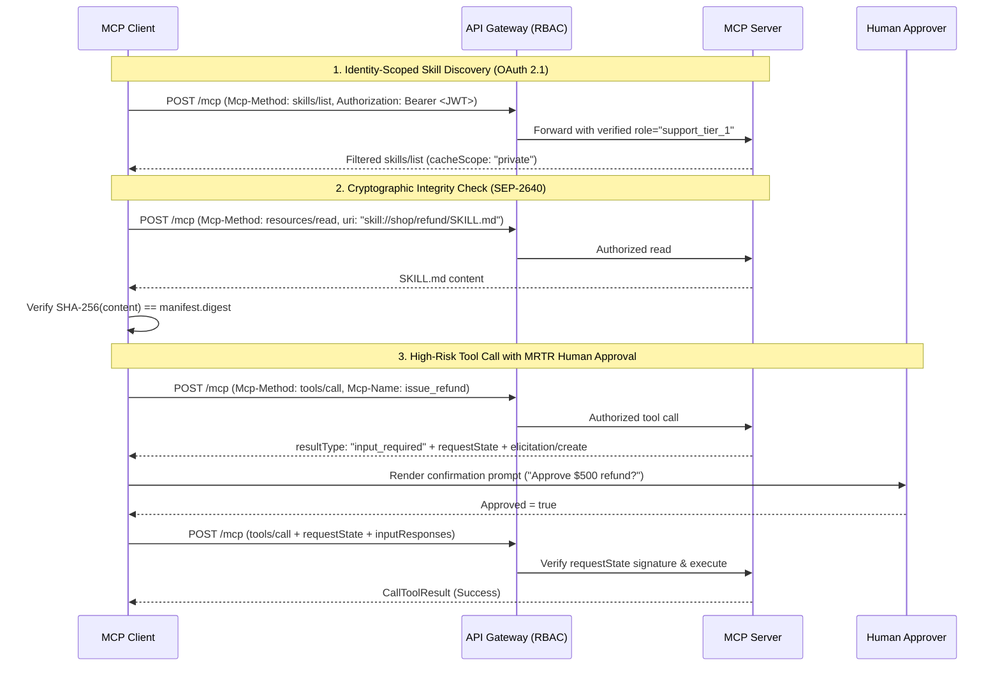

# Implementation, Structure, & Discovery

While architectural guidelines dictate *how* a skill should behave, this section covers *where* skills live, how they are structured, and how they are shared across the enterprise to prevent duplication.

## Anatomy of a Skill Directory

A skill is not a single file, but a directory containing instructions and execution logic. 

**Directory Structure:**
```text
.agents/skills/
└── my-enterprise-skill/
    ├── SKILL.md       # The cognitive interface (instructions & metadata)
    ├── scripts/       # The execution runtime
    └── examples/      # Examples of usage
```

### YAML Frontmatter & Progressive Disclosure

Every skill's cognitive interface (`SKILL.md`) should contain YAML frontmatter at the top:
```yaml
---
name: my-enterprise-skill
description: Used to query enterprise user data and order history.
---
```
**Progressive Disclosure:** Modern AI platforms do not load the entire skill into the AI's context window by default. They only load the `name` and `description` to save context space. The full execution logic and instructions are only injected on-demand when the AI decides to activate the tool.

---

## Discovery & Sharing Mechanisms

To prevent hundreds of developers from copy-pasting skills into their local environments, enterprise orchestration layers should provide native discovery mechanisms.

### 1. The Workspace Root (Version Control)
The agent runtime should automatically traverse the directory tree to find a designated configuration folder (e.g., `.agents/` or `.skills/`) at the root of the project/repository.
* **How it works:** Place project-specific skills in `<repo_root>/.agents/skills/`.
* **Benefit:** When developers clone or pull the repository, the orchestration layer automatically discovers and loads the skills contextually for that project. Zero manual setup is required.

### 2. Plugins for Reusability Across Projects
For enterprise-wide skills that aren't tied to a specific project (e.g., standard internal deployment workflows or internal tooling integrations), package them as **Plugins** or Modules.
* **How it works:** A plugin bundles skills, rules, and connection configurations together under a standardized structure (e.g., `plugins/<name>/`).
* **Benefit:** You can maintain a central "Enterprise AI Plugins" repository. Developers pull this repository once and configure their global configuration to reference these centralized paths.

### 3. Explicit Registration (Configuration Files)
For skills located in non-standard network drives, shared volumes, or submodules, developers can use a centralized configuration file (like a `skills.json` or `config.yaml`) in their workspace or global config to explicitly point the AI runtime to the shared network path.

### 4. Dynamic Centralized Registry & Skills Over MCP (`io.modelcontextprotocol/skills` — SEP-2640)
Instead of relying on local `.agents/skills/` folders or git submodules, modern MCP servers natively host, index, and distribute Agent Skills over the network via the official **Skills Over MCP Extension (`io.modelcontextprotocol/skills`, SEP-2640)**.

Together with the **`2026-07-28` MCP specification**, this directly solves the four biggest enterprise challenges with local skills:

#### A. Zero-Install Remote Discovery & Network Flow (No Local Files Needed)
* **How it works:** An MCP server advertises `"io.modelcontextprotocol/skills": { "directoryRead": true }` via `server/discover`. Clients call `skills/list` or `skills/get` over Stateless HTTP to discover skills hosted remotely (`skill://<domain>/<skill-name>/SKILL.md`), and fetch the actual `SKILL.md` and companion files (`references/`, `scripts/`) Just-In-Time (JIT) via `resources/read`.
* **Benefit:** Developers never have to clone or sync skill folders locally; updating a skill on the central MCP server immediately updates it for all connected agents.



#### B. Categorization & Scaling to 100s of Skills (3-Tier Funnel)
* **Hierarchical `skill://` Namespaces & Frontmatter Tags:** Skills are organized by URI prefix/domain (e.g., `skill://finance/tax-audit/SKILL.md`, `skill://devops/k8s-rollback/SKILL.md`) and arbitrary YAML `frontmatter` fields (`name`, `description`, `category`, `tags`), which `skills/list` exposes as structured JSON.
* **Three-Tier Progressive Disclosure Funnel:**
  1. **Tier 1 — Semantic Registry & Category Filtering (500+ skills → ~5 skills):** For massive catalogs, an Enterprise MCP Registry indexes the `skills/list` frontmatter and uses semantic search or URI prefix filtering (`skill://devops/*`) to select only relevant skills.
  2. **Tier 2 — Level-1 Frontmatter Injection (~5 skills in prompt):** Only the lightweight `frontmatter` (`name` + `description`, ~50 tokens each) enters the LLM context window initially.
  3. **Tier 3 — Lazy Body & Companion File Loading (1 active skill):** The full `SKILL.md` instructions and `references/` are fetched via `resources/read` *only* for the single skill the LLM activates.



#### C. OpenTelemetry Support & Observability on Skills (`SEP-414` + OTel GenAI Conventions)
MCP has first-class **OpenTelemetry (OTel)** support that replaces legacy `logging/setLevel` primitives and allows end-to-end distributed tracing across the entire Skill lifecycle:



* **W3C Trace Context in `params._meta` (`SEP-414`):**
  * MCP standardized an explicit exception to the DNS-prefixing rule in `_meta` so that **`traceparent`**, **`tracestate`**, and **`baggage`** are passed unprefixed inside `params._meta` on every JSON-RPC call (working identically across Stateless HTTP and local Stdio).
  * When an agent activates a skill (`skill://shop/refund-processing/SKILL.md`), the host injects the active `traceparent` and attaches `baggage` (such as `skill.name`, `skill.uri`, and the manifest's `skill.digest=sha256:...`) into all subsequent `resources/read` and `tools/call` requests.
* **OpenTelemetry GenAI `mcp.*` Semantic Conventions:**
  * Official OTel semantic conventions (`open-telemetry/semantic-conventions-genai`) record standardized attributes on client and server spans:
    * `mcp.method.name` (`skills/list`, `skills/get`, `resources/read`, `tools/call`)
    * `mcp.protocol.version` (`2026-07-28`)
    * `mcp.resource.uri` (e.g., `skill://shop/refund-processing/SKILL.md`)
    * `gen_ai.tool.name` & `gen_ai.client.token.usage`
* **Header-Based Gateway Telemetry (`2026-07-28`):**
  * Combined with HTTP headers (`Mcp-Method`, `Mcp-Name`), your OTel collector can trace a single parent agent span across: **1. Skill Discovery (`skills/list`)** → **2. Skill Instruction Load (`resources/read` on `skill://...`)** → **3. Downstream Tool Calls (`tools/call`)**, correlating latency, token consumption, and `isError: true` rates to the exact `sha256` version of the `SKILL.md` used.

#### D. Security, Access Control (RBAC), & Integrity



* **Who Can Access What (OAuth 2.1 / OIDC & Gateway RBAC):**
  * Remote MCP servers enforce **OAuth 2.1 + OIDC Discovery (RFC 9728)** and incremental scope consent (`WWW-Authenticate`).
  * `skills/list` and `resources/read` are dynamically scoped to the caller's Bearer token (`cacheScope: "private"`)—an engineer only sees `skill://devops/*`, while finance agents only see `skill://finance/*`.
  * API gateways can enforce path-level RBAC directly on `Mcp-Method` and `Mcp-Name` headers before requests even reach the server.
* **Cryptographic Tamper Protection (`manifest` SHA-256 Digests):**
  * Every skill entry in `skills/list` and `skills/get` includes a `manifest` with exact byte `size` and `"digest": "sha256:..."` for `SKILL.md` and every companion file. Clients verify the hash on `resources/read` to prevent prompt-injection tampering or MITM modification.
* **Non-Transitive Consent Gates:**
  * Per SEP-2640, user approval for a skill applies strictly to that skill and **never** automatically grants permission to nested or chained skills; high-risk actions still trigger **Multi Round-Trip Request (MRTR)** `elicitation/create` human approval gates.
