# The Skill Delivery Factory (CI/CD for Enterprise Skills)

Treating AI Agent Skills as ad-hoc Markdown files edited in production is the #1 cause of enterprise agent regressions. Because a skill combines **natural language instructions (`SKILL.md`)**, **strict data contracts (JSON Schema)**, and **deterministic actuation code (`scripts/` / MCP Tool Handlers)**, it requires a specialized software delivery pipeline: **The Skill Delivery Factory**.

---

## 1. The 6-Stage Skill Delivery Factory Architecture

```mermaid
flowchart TD
    Commit["Developer / Spec PR<br/>(SKILL.md + Schema + MCP Handler)"]

    subgraph Stage1["Gate 1: Static Contract & Token Budget (< 5s)"]
        S1A["YAML Frontmatter & Required Metadata Check"]
        S1B["Token Budget Linter (Frontmatter <= 60, Body <= 1200)"]
        S1C["JSON Schema Depth (<= 2) & Annotation Check"]
    end

    subgraph Stage2["Gate 2: Deterministic Runtime & Fuzzing (< 15s)"]
        S2A["Unit Tests on MCP Tool Handler"]
        S2B["Property-Based Fuzzing (Zero Unhandled Exceptions)"]
        S2C["SEP-1303 Error Hint & Idempotency Verification"]
    end

    subgraph Stage3["Gate 3: Catalog Routing & Anti-Shadowing (< 30s)"]
        S3A["Index against Enterprise skills/list Catalog"]
        S3B["Semantic Confusion Matrix (Precision & Recall >= 0.92)"]
    end

    subgraph Stage4["Gate 4: Model-Agnostic Behavioral Matrix (< 2m)"]
        S4A["Canonical Tool-Call AST Evaluation"]
        S4B["SEP-1303 Closed-Loop Recovery Test"]
        S4C["Cross-Model Tier Matrix (Frontier, Flash, SLM Pass^3 & TAF)"]
    end

    subgraph Stage5["Gate 5: Cryptographic Packaging (SEP-2640)"]
        S5A["Compute SHA-256 Digests & Byte Sizes"]
        S5B["Sign Immutable Manifest & Publish to MCP Registry"]
    end

    subgraph Stage6["Gate 6: Canary Rollout & OTel Auto-Rollback (SEP-414)"]
        S6A["Route 5% Traffic with baggage: skill.digest=sha256:..."]
        S6B["Monitor OTel isError Rate & Token Amplification (TAF)"]
        S6C["Promote to 100% or Auto-Rollback to Previous Digest"]
    end

    Commit --> Stage1 --> Stage2 --> Stage3 --> Stage4 --> Stage5 --> Stage6
```

Every skill package (`skill://<domain>/<name>/SKILL.md` + companion resources + MCP tool handlers) must pass six automated quality gates before reaching production agents:



---

## 2. Deep Dive into the 6 Factory Gates

### Gate 1: Static Contract, Security & Token Budget Linter
Runs on every `git push` in milliseconds with zero LLM cost.
* **Frontmatter Contract Check:** Verifies `name`, `description`, `category`, `min_model_tier`, and `allowed_roles` exist and follow naming conventions (`kebab-case`).
* **Token Budget Enforcement:**
  * `frontmatter` tokens $\le 60$
  * `SKILL.md` body tokens $\le 1,200$
  * Each tool `inputSchema` tokens $\le 250$ and nesting depth $\le 2$
* **MCP Tool Annotation Check:** If the tool name or description implies state mutation (`create`, `update`, `delete`, `issue`, `deploy`, `rollback`), asserts that `annotations.idempotentHint == True` and `annotations.readOnlyHint == False` are explicitly declared.
* **Prompt-Injection & Secret Scanner:** Scans `SKILL.md` and `references/` for hardcoded credentials, hidden Unicode control characters, or unauthorized external domain links.

### Gate 2: Deterministic Runtime & Property-Based Fuzzing Gate
Tests the system-facing execution code in complete isolation from any LLM.
* **Boundary & Chaos Fuzzing:** Generates hundreds of adversarial payloads (null fields, wrong types, SQL/command injection strings, negative monetary values, out-of-range dates, missing required arguments).
* **The `SEP-1303` Invariant:** Asserts that **100% of invalid inputs** return a valid MCP `CallToolResult` with:
  1. `isError: True`
  2. A non-empty `content[0].text` containing an actionable correction pattern (e.g., `"Expected ..."` or `"Valid values are ..."`), **never** a Python `Traceback` or `KeyError`.
* **Payload Compression Invariant:** Asserts that no tool execution returns `len(content_tokens) > 500` to the LLM context window.

### Gate 3: Semantic Routing & Catalog Confusion Matrix Gate
A skill does not live in a vacuum; it competes for attention against 50–500 other skills in your Enterprise MCP Registry (`skills/list`).
* **How It Works:** The gate loads the candidate skill's `frontmatter` alongside the existing production catalog and runs a **Routing Confusion Matrix** against a bank of positive user queries and negative "near-neighbor" distractor queries.
* **Failure Condition (Semantic Shadowing):**
  * If adding `skill://shop/refund-processing/SKILL.md` causes queries meant for `skill://shop/dispute-chargeback/SKILL.md` to misroute, the build fails with a **Collision Report** showing the overlapping keywords in `frontmatter.description`.
* **Thresholds:**
  * Top-1 Routing Recall $\ge 0.90$
  * Top-3 Routing Recall $\ge 0.98$
  * Cross-Skill False Positive Rate $\le 0.05$

### Gate 4: Model-Agnostic Behavioral Matrix Gate
Executes the Golden Evaluation Dataset against the **Model-Agnostic Test Harness** (see [03. The Skill Testing Lifecycle](./03_testing_lifecycle.md)).
* **Test Suite Categories:**
  1. **Happy-Path Actuation:** User intent $\rightarrow$ skill activation $\rightarrow$ canonical tool call $\rightarrow$ expected sandbox state mutation.
  2. **Policy Guardrail / Refusal:** User asks for an out-of-policy action (e.g., refunding an order placed 90 days ago when policy is 30 days) $\rightarrow$ verifies no mutation occurs in the sandbox.
  3. **`SEP-1303` Self-Correction Loop:** Injects a simulated format error on Turn 1 and verifies the model self-corrects on Turn 2 (`TAF <= 1.50` for recovery scenarios).
  4. **Missing-Context Abstention:** User omits required identifier $\rightarrow$ verifies model does not hallucinate fake arguments.
* **Cross-Model Matrix Thresholds:** Evaluates across `frontier`, `flash`, and `slm` adapters (respecting the skill's declared `min_model_tier`), asserting **$\text{Pass}^3 \ge 95\%$** and **$\text{TAF} \le 1.25$**.

### Gate 5: Cryptographic Packaging & `SEP-2640` Manifest Signing
Once Gates 1–4 pass, the factory packages the skill into an immutable, tamper-proof release artifact:
* Computes exact UTF-8 byte `size` and `sha256` `digest` for `SKILL.md` and every companion file in `references/` and `scripts/`.
* Generates the signed `SEP-2640` skill manifest JSON:
  ```json
  {
    "uri": "skill://shop/refund-processing/SKILL.md",
    "version": "2.1.0",
    "qualityGates": {
      "tokenBudgetPassed": true,
      "fuzzZeroExceptions": true,
      "routingF1": 0.96,
      "passPower3": {"frontier": 1.0, "flash": 1.0}
    },
    "manifest": [
      {
        "uri": "skill://shop/refund-processing/SKILL.md",
        "size": 612,
        "digest": "sha256:8f434346648f6b96df89dda901c5176b10a6d83961dd3c1ac88b59b2dc327aa4"
      }
    ]
  }
  ```

### Gate 6: Canary Rollout & OpenTelemetry (`SEP-414`) Auto-Rollback
Deploying a new `SKILL.md` version to 100% of enterprise agents immediately is high-risk.
* **Digest-Pinned Canary Routing:** The MCP Server serves the new `sha256` manifest to **5% of sessions** (or shadow-runs it), while 95% remain on the previous known-good digest.
* **Real-Time OTel Health Check (`SEP-414`):** The observability pipeline groups incoming `tools/call` spans by `baggage["skill.digest"]` and compares the canary against the baseline over the first 200 invocations:
  * **Auto-Rollback Trigger 1:** `isError: true` validation failure rate increases by $> 3\%$.
  * **Auto-Rollback Trigger 2:** Runtime Token Amplification Factor ($\text{TAF}$) exceeds $1.30$.
  * **Auto-Rollback Trigger 3:** `MRTR` human-in-the-loop rejection rate spikes.
* If any trigger fires, the MCP Registry atomically reverts `skills/list` to the previous `sha256` digest in milliseconds—zero code redeploy required.

---

## 3. Summary Checklist: The Skill Factory Quality Scorecard

| Gate | Metric / Invariant | Target Threshold | Enforced By |
| :--- | :--- | :--- | :--- |
| **1. Token Efficiency** | Frontmatter / Body / Schema Tokens | $\le 60$ / $\le 1,200$ / $\le 250$ | Static Token Linter |
| **2. Runtime Safety** | Unhandled Exceptions on 500 Fuzz Inputs | **$0$** (`100%` `SEP-1303` compliant) | Property Fuzz Runner |
| **3. Catalog Routing** | Routing F1 & Anti-Shadowing | $\text{F1} \ge 0.92$, False Positive $\le 5\%$ | Confusion Matrix Evaluator |
| **4. Model Independence** | $\text{Pass}^3$ & Token Amplification ($\text{TAF}$) | $\text{Pass}^3 \ge 95\%$, $\text{TAF} \le 1.25$ | Model-Agnostic Test Harness |
| **5. Supply Chain Integrity** | `SEP-2640` SHA-256 Digest Verification | `100%` match on `resources/read` | Manifest Signer & Client Gate |
| **6. Production Health** | Canary `isError` Rate & Runtime $\text{TAF}$ | Error rate $\le 2\%$, $\text{TAF} \le 1.25$ | OTel `SEP-414` Canary Monitor |

---

## 4. Hands-On Runnable Examples (`docs/AI/Skills/src/`)

This repository includes a complete, runnable implementation of all four architectural pillars in [`src/`](./src/README.md). Run them from `docs/AI/Skills/`:

```bash
make all          # Run all 4 Skill Engineering & Delivery Factory demos
make efficiency   # Q1: Static Token Linter + Runtime OTel Token Efficiency (TAF & CAR)
make dependency   # Q2: Model Quality Dependency Benchmark & Cognitive Offloading
make agnostic     # Q3: Model-Agnostic Test Harness (Canonical AST + Stateful Sandbox + Pass^k)
make factory      # Q4: End-to-End 6-Stage Skill Delivery Factory CI/CD Pipeline
```
