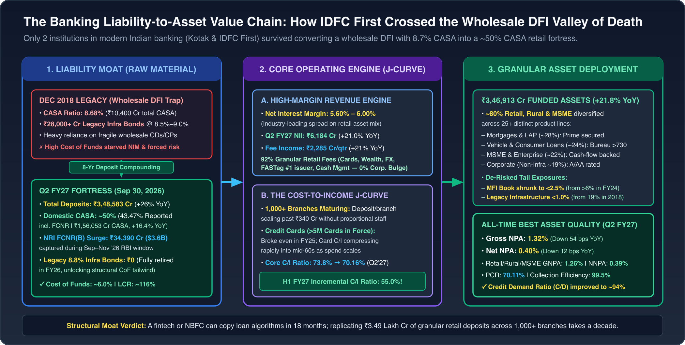
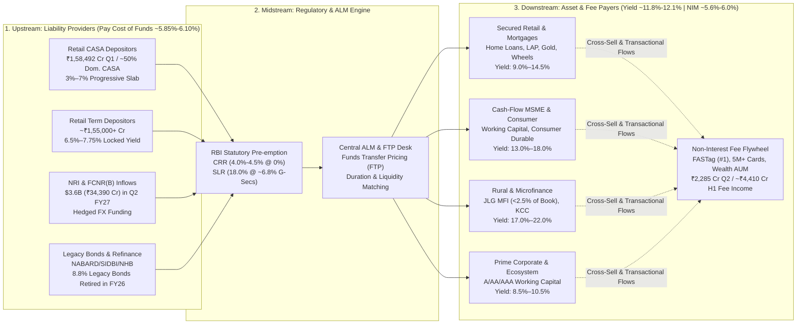

# **Strategic Value Chain Analysis: IDFC First Bank Ltd (`NSE: IDFCFIRSTB` | `BSE: 539437`)**

**Report Suite Navigation:**  
📍 **[1. Master Summary](./Summary.md)** | 📊 **[2. Forensic, Valuation & Timing Upgrade](./Forensic-Valuation-And-Timing-Upgrade.md)** | ⚙️ **[3. Financial & Unit Economics Framework](./Financial%20Analysis%20Framework%20For%20IDFC%20First%20Bank.md)** | 🔗 **[4. Banking Value Chain & Liability Moat (You Are Here)](./Banking%20Value%20Chain%20And%20Liability%20Moat%20Analysis.md)** | 🚀 **[5. Vision 2030 Strategy & Operating Leverage Roadmap](./Vision%202030%20Strategy%20And%20Operating%20Leverage%20Roadmap.md)**

---

## **Executive Summary: The Mechanism of Banking Value Capture**

In the Indian financial services ecosystem, money is the raw material, risk pricing is the manufacturing process, and regulatory trust is the distribution license. Unlike product or software industries where value chains are linear, the banking value chain is a two-sided balance-sheet converter: **upstream liabilities (deposits and borrowings)** are ingested, maturity-transformed through an **Asset-Liability Management (ALM) and Treasury desk**, and deployed into **downstream risk assets (loans) and fee-generating transactional rails**.

Within this architecture, **IDFC First Bank Ltd (`NSE: IDFCFIRSTB` | `BSE: 539437`)** represents one of the rarest structural transformations in modern Indian banking history. Born in 2015 as a wholesale Development Finance Institution (DFI) burdened with ₹29,000+ Cr of concentrated infrastructure loans, an 8.68% CASA ratio, and wholesale bond funding exceeding 8.5%, the institution faced the classic **"DFI Valley of Death"**—a structural trap where wholesale cost of funds makes prime corporate lending unprofitable while lack of a branch network prevents low-cost deposit gathering. Following the December 2018 merger with **Capital First** (founded by MD & CEO V. Vaidyanathan), the bank executed a complete balance-sheet inversion over eight years.

As of **Q2 & H1 FY27 (Ended September 30, 2026)**, IDFC First Bank commands a **₹3,48,583 Cr total deposit base** (+25.9% YoY, +11.8% QoQ, including **~US$3.6 Billion / ₹34,390 Cr in FCNR(B) deposits**), a **48.4% average CASA ratio (~50% domestic CASA; Q1 FY27: 50.8% / ₹1,58,492 Cr)**, and a **₹3,46,913 Cr funded asset book** (+30.1% YoY total; +22.2% YoY organic ex-FCNR IBU loans) where retail, rural, and MSME finance constitute ~80% of lending while legacy infrastructure exposure has shrunk below **1.0% of funded assets**, driving **Gross NPA down to an all-time low of 1.32% and Net NPA to 0.40%**. *(See **[Master Summary](./Summary.md)** and **[Financial & Unit Economics Framework](./Financial%20Analysis%20Framework%20For%20IDFC%20First%20Bank.md)** for the full Q2/H1 FY27 financial bridge).*

This report dissects the Indian banking value chain from first principles—mapping who pays whom, why **90% of Non-Banking Financial Companies (NBFCs) fail to transition into Universal Banks**, where Net Interest Margin (NIM) and Return on Equity (ROE) concentrate, how switching costs are engineered at the retail level, and what lessons emerge from both the bank's **100% public ownership structure** (post-October 2024 IDFC Ltd merger) and the **February 2026 Chandigarh Sector-32 branch manual cheque fraud (₹646 Cr pre-tax / ₹483 Cr post-tax)**.

*📊 [Click to Open Crisp Vector SVG](./charts/03_banking_value_chain_liability_moat.svg)*

---

## **1. The Indian Banking Value Chain Architecture: The "DFI Valley of Death" vs. The Granular Retail Moat**

To understand why IDFC First Bank's liability franchise is its true competitive moat, one must examine the structural dichotomy at the heart of Indian credit markets: **anyone with equity capital can originate a loan in India, but almost no one can gather ₹3.48 Lakh Crore of granular retail deposits at a ~6.15%–6.35% cost of funds.**

### **1.1 Why 90% of NBFCs Fail to Become Universal Banks**

Over the past three decades, India has witnessed hundreds of NBFCs scale asset books to ₹20,000–₹1,00,000 Cr by borrowing wholesale from banks and debt mutual funds and lending to underserved retail or MSME segments. Yet, aside from Kotak Mahindra Bank (2003), Yes Bank (2004, later reconstructed), Bandhan Bank (2015), IDFC Bank (2015), and select Small Finance Banks (AU SFB), the Reserve Bank of India (RBI) rarely grants Universal Banking licenses—and when a wholesale lender or NBFC converts into a bank, it immediately hits the **Statutory Pre-emption Wall**:

1. **The CRR & SLR Drag (22%+ Zero/Low-Yield Lockup):** The day an NBFC converts into a Scheduled Commercial Bank, it must park **4.0%–4.5% of Net Demand and Time Liabilities (NDTL) in Cash Reserve Ratio (CRR)** with the RBI (earning **0% interest**) and **18.0% of NDTL in Statutory Liquidity Ratio (SLR)** government securities (earning ~6.7%–7.0%, below wholesale borrowing costs). An NBFC replacing wholesale bonds with bank status suffers an immediate **150–220 bps ROA collapse** until it replaces wholesale borrowings with low-cost Current and Savings Account (CASA) deposits.
2. **Priority Sector Lending (PSL) Mandates (40% of ANBC):** Universal banks must direct **40% of Adjusted Net Bank Credit (ANBC)** to Priority Sectors (18% Agriculture, 10% Small & Marginal Farmers, 12% Weaker Sections, 7.5% Micro Enterprises). Monoline urban NBFCs lack the rural branch infrastructure and collection machinery to originate compliant PSL assets without suffering elevated credit losses or buying expensive PSL Certificates (PSLCs).
3. **The Opex J-Curve of Liability Gathering:** A lending branch requires 4–6 sales officers in a second-floor commercial office. A deposit-gathering universal bank branch requires prime ground-floor high-street real estate, currency chests, ATMs, clearing operations, compliance officers, and 8–12 years of brand trust before local households move their life savings into it.

### **1.2 Escaping the "DFI Valley of Death" (FY19 $\rightarrow$ H1 FY27)**

When IDFC Bank merged with Capital First in December 2018, the combined entity inherited a fragile funding structure: **₹70,479 Cr in total deposits**, of which **only ₹10,400 Cr were retail deposits** and **₹60,000+ Cr were institutional Certificate of Deposits (CDs) and bulk wholesale term deposits**, alongside ₹57,000+ Cr in high-cost legacy infrastructure bonds carrying 8.6%–9.2% coupons.

| Structural Transformation Metric | Dec 31, 2018 (Merger Baseline) | FY24 (Mar 2024) | FY26 (Mar 2026) | H1 FY27 (Sep 30, 2026) | 8-Year Structural Shift |
| :--- | :--- | :--- | :--- | :--- | :--- |
| **Total Deposits** | ₹70,479 Cr | ₹2,00,570 Cr | ₹2,94,475 Cr | **₹3,48,583 Cr** *(+25.9% YoY)* | **4.95x Scale Expansion** |
| **Customer Deposits** | ₹38,455 Cr | ₹1,93,753 Cr | ₹2,84,453 Cr | **₹3,33,000+ Cr** *(incl. $3.6B FCNR)* | **8.66x Granular Scale** |
| **CASA Deposits** | ₹6,119 Cr | ₹94,768 Cr | ₹1,46,650 Cr | **₹1,58,492 Cr (Q1) / ~₹1.60L Cr** | **26.0x+ CASA Compounding** |
| **CASA Ratio (%)** | **8.68%** | **47.27%** | **49.80%** | **48.4% Avg (~50.0% Dom. / 50.8% Q1)** | **+4,100+ bps Transformation** |
| **Retail Deposits % of Customer Deposits** | **27.0%** | **78.0%** | **79.5%** | **~80.0%+** *(Dom. CD Ratio: 89.9%)* | **Institutional $\rightarrow$ Household** |
| **Physical Branch Network** | 206 Branches | 944 Branches | 1,000+ Branches | **1,050+ Branches** | **>5.0x Distribution Reach** |
| **Legacy High-Cost Infra Bonds** | ₹26,852 Cr | ₹10,435 Cr | Final Maturity | **Retired in FY26** | **100% Runoff Completed** |
| **Infrastructure Loans (% of Assets)** | **21.7%** (₹22,710 Cr) | **1.4%** (₹2,830 Cr) | **<1.0%** | **<1.0%** | **De-risked to Near Zero** |

By deliberately accepting an elevated **Cost-to-Income (C/I) ratio of 72%–77% during FY20–FY26** to build 1,105+ branches, top-tier mobile banking apps, and nationwide ATMs, IDFC First crossed the "DFI Valley of Death." It now stands as only the fourth private bank in India (alongside HDFC Bank, ICICI Bank, and Kotak Mahindra Bank) to sustain a **~50% CASA ratio** at a deposit scale exceeding ₹3.4 Lakh Crore.

---

## **2. Who Pays Whom & Money Flow Architecture**

The money flow across IDFC First Bank's balance sheet operates as a synchronized three-stage pipeline: **Upstream Liability Ingestion $\rightarrow$ Midstream ALM & Treasury Transformation $\rightarrow$ Downstream Credit & Fee Monetization**.

### **2.1 Upstream: Who Supplies the Capital and What They Are Paid**

1. **Retail Savings & Current Account Holders (CASA — ₹1,73,316 Cr):**
   * **Who They Are:** Salaried professionals, affluent urban households, self-employed merchants, and corporate current account ecosystems.
   * **How Money Flows:** Customers deposit idle cash in exchange for instant liquidity, zero-fee digital banking services (free IMPS/NEFT/RTGS, ATM withdrawals, debit cards), and **monthly interest credits** on progressive savings slabs (3.00% up to ₹5 Lakh; up to 7.00%–7.25% on higher slabs). Blended CASA cost sits at **~4.8%–5.1%**, well below wholesale term funding (~7.5%–7.8%).
2. **Retail Term Depositors & Senior Citizens (~₹1,59,364 Cr):**
   * **Who They Are:** Household savers locking in 1-to-5 year fixed deposits at 6.50%–7.75% (with +50 bps for senior citizens and zero penalty on premature withdrawal for senior citizens).
3. **NRI Depositors & FCNR(B) Global Flows ($3.6 Billion Raised in Q2 FY27):**
   * **Who They Are:** Non-Resident Indians across the GCC, US, UK, and Singapore utilizing NRE, NRO, and Foreign Currency Non-Resident (`FCNR(B)`) deposits, bolstered by the bank's GIFT City International Banking Unit (IBU). In **Q2 FY27 alone, IDFC First mobilized ~$3.6 billion in FCNR(B) deposits**, tapping global liquidity pools at competitive fully-hedged rupee rates.

### **2.2 Midstream: The Funds Transfer Pricing (FTP) Clearinghouse**

The bank's Central Treasury and Asset-Liability Committee (ALCO) acts as an internal market maker using **Funds Transfer Pricing (FTP)**:
* **Liability Branches** sell the deposits they gather to the central Treasury desk at the internal FTP rate (e.g., ~6.5% for 1-year sticky CASA/TD), earning an internal liability spread that pays for branch rent and staff.
* **Lending Verticals** buy funds from the central Treasury desk at duration-matched FTP rates (e.g., ~7.2%–7.5%) and must price borrower loans high enough to cover FTP + Operating Expense (Opex) + Expected Credit Loss (ECL) + Target Return on Risk-Weighted Assets (RoRWA).

### **2.3 Downstream: Who Pays the Bank (Interest & Fee Payers)**

1. **25+ Diversified Lending Engines (₹3,46,913 Cr Funded Assets):**
   * Borrowers pay contractual Equated Monthly Installments (EMIs) via NACH/e-Mandates linked directly to their primary bank accounts. The blended asset yield across mortgages (9.0%–10.2%), vehicle loans (11%–15%), MSME LAP (11%–14%), consumer durables/digital loans (15%–19%), and corporate loans (8.5%–10.0%) generates a **Net Interest Margin (NIM) of 5.96% in Q1 FY27 and 5.58% in Q2 FY27 (~5.77% in H1 FY27; guided back to ~5.80% by Q4 FY27 as $3.6B FCNR liquidity is deployed)**—the highest NIM among all large universal banks in India.
2. **The Non-Interest Fee Payers (₹2,285 Cr Fee & Other Income in Q2 FY27 [+24.5% YoY]; ~₹4,410 Cr in H1 FY27):**
   * **Toll Road Operators & Fleet Owners (FASTag #1 Issuer):** IDFC First is India's **#1 FASTag issuer and acquirer**, commanding over **18 million active tags** and dominant market share in National Electronic Toll Collection (NETC) and fuel payments at HPCL/BPCL/IOCL outlets, earning interchange and float fees on every highway transit.
   * **5 Million+ Credit Cardholders & Merchants:** Generates MDR (Merchant Discount Rate) interchange (1.2%–1.8%), revolver interest, and EMI conversion fees.
   * **Affluent & HNI Clients (Wealth Management AUM >₹42,000+ Cr):** Pays trail commissions and advisory fees on mutual funds, PMS, AIFs, and bancassurance policies (**92% of total fee income is granular retail fees**).

---

## **3. Player Archetypes Across Each Layer of Indian BFSI**

The Indian credit and banking value chain is segmented into five distinct strategic layers. Power and valuation multiples accrue disproportionately to institutions that control **both** low-cost retail liabilities and high-ROA multi-product origination.

### **3.1 Master Value Chain Layer Table**

| Layer | Player Type & Indian BFSI Examples | Revenue Model | Primary Moat | Power Trend |
| :--- | :--- | :--- | :--- | :--- |
| **1. Sovereign & Digital Public Infrastructure (DPI)** | **RBI, NPCI** (UPI, NACH, RuPay, NETC FASTag), **Account Aggregator (Sahamati)**, **Credit Bureaus** (TransUnion CIBIL, Experian, CRIF) | Zero/utility fee on UPI; per-pull inquiry fees on bureau scores (₹5–₹25/pull); settlement rail tolls | Statutory monopoly, sovereign mandate, network ubiquity across 1.4B citizens | **Strengthening** (Commoditizes basic payments & bureau data; forces banks to compete on cash-flow underwriting) |
| **2. Tier-1 Universal Bank Fortresses** | **HDFC Bank, ICICI Bank, State Bank of India (SBI)** | Net Interest Spread (NIM 3.4%–4.3%) + Massive Fee Cross-Sell (Cards, FX, Cash Management, Wealth) | 30-year salary account lock-in, sub-4.8% cost of funds, lowest credit cost (40–60 bps), AAA corporate relationships | **Stable / Defending** (Dominant scale, though HDFC Bank faces post-merger LDR normalization & slower deposit growth) |
| **3. Emerging Universal Challengers** | **IDFC First Bank, Kotak Mahindra Bank, Axis Bank, IndusInd Bank** | High-Spread Retail/MSME NIM (4.0%–5.85%) + Granular Retail Fee Ecosystems | Differentiated savings propositions, agile cloud-native digital stack, specialized niche lending DNA (Capital First cash-flow engine) | **Rising for IDFC First** (Capturing incremental CASA market share as branch vintage matures and C/I bends down) |
| **4. Monoline & Diversified NBFC Giants** | **Bajaj Finance, Cholamandalam Investment, Shriram Finance, Muthoot Finance** | Pure Asset Spread (Borrow wholesale @ 7.5%–8.2% $\rightarrow$ Lend @ 13%–22%) + Loan Processing Fees | Hyper-efficient point-of-sale distribution, lean Opex (30%–35% C/I), deep vertical domain underwriting (Gold, Used CV, Consumer Durable) | **Squeezed by Regulation** (Lack CASA access; vulnerable to RBI risk-weight hikes on bank lending to NBFCs and wholesale liquidity crunches) |
| **5. Small Finance Banks (SFBs) & MFI Lenders** | **AU Small Finance Bank, Equitas SFB, Ujjivan SFB, CreditAccess Grameen** | High-Yield Inclusion Spread (NIM 6.5%–9.0%) offset by high Opex and cyclical credit costs | Deep semi-urban/rural touchpoints, high-yield asset books | **Consolidating / Bifurcating** (Pure MFI players suffer severe credit cycles every 3–4 years; AU SFB applied for Universal Bank license to escape SFB stigma) |
| **6. Fintech Aggregators, DSAs & UPI Apps** | **PhonePe, Google Pay, Paytm, CRED, Paisabazaar, Andromeda (DSA)** | Origination commissions (1.0%–3.5% of loan disbursed), FLDG partnerships, bill-pay/merchant subscriptions | Top-of-funnel consumer attention, UI/UX velocity, 300M+ monthly active payment users | **Weakening / Subjugated** (RBI Digital Lending Guidelines & FLDG 5% cap turned fintechs into regulated distribution agents for licensed banks) |

### **3.2 Strategic Archetype Comparison: IDFC First vs. Bajaj Finance vs. ICICI/HDFC**

* **Why Bajaj Finance Envies IDFC First's License:** Bajaj Finance is arguably India's finest lending machine, deriving a ~4.0%+ ROA through a 33%–34% C/I ratio. However, Bajaj cannot open a checking or savings account, cannot issue credit cards on its own balance sheet (following RBI's clampdown on co-branded RBL/DBS cards), and must rely on wholesale bonds, bank credit lines, and public fixed deposits. By contrast, IDFC First already possesses what Capital First originally merged to acquire: **a perpetual Universal Banking License, ₹1.73 Lakh Cr in CASA, an in-house 5M+ credit card book, and #1 FASTag payments infrastructure.**
* **Why HDFC/ICICI Cannot Easily Replicate IDFC First's 5.82% NIM:** Tier-1 private banks carry ₹18–₹28 Lakh Crore asset books heavily weighted toward AAA/AA corporate loans (yielding 8.0%–8.8%) and prime mortgages (yielding 8.6%–9.0%), capping their NIMs at **3.45%–4.35%**. IDFC First's asset book is engineered around granular cash-flow MSME loans, consumer durables, two-wheelers, loan against property (LAP), and prime retail—delivering a **5.82% NIM** (~150–230 bps higher than Tier-1 peers) while keeping Gross NPA at **1.86%** and Net NPA at **0.53%** (as of Q2 FY27).

---

## **4. Where Margin & ROE Concentrate in Indian Banking**

In banking, profitability is governed by the **DuPont ROA Decomposition**:

$$\text{ROA} = \text{Net Interest Margin (NIM)} + \text{Non-Interest Fee Income (\% Assets)} - \text{Operating Expense (\% Assets)} - \text{Credit Cost (\% Assets)} - \text{Tax}$$

$$\text{ROE} = \text{ROA} \times \text{Equity Multiplier } \left(\frac{\text{Total Assets}}{\text{Shareholders' Equity}}\right)$$

### **4.1 Comparative Economic Profile Across Indian Banking Verticals**

| Banking Vertical / Business Model | Gross Asset Yield | Cost of Funds (CoF) | Net Interest Margin (NIM) | Fee Income (% Assets) | Opex (% Assets / C/I Ratio) | Through-Cycle Credit Cost | Steady-State ROA | Steady-State ROE | Why Margin Concentrates or Evaporates Here |
| :--- | :--- | :--- | :--- | :--- | :--- | :--- | :--- | :--- | :--- |
| **1. Wholesale / Corporate DFI Banking** *(Legacy IDFC Bank 2015–18, PSU Corporate Books)* | 8.2% – 9.2% | 6.5% – 7.8% | **1.8% – 2.5%** | 0.4% – 0.7% | 0.8% – 1.2% *(C/I: 35%–45%)* | **1.0% – 3.5%** *(Lumpy defaults)* | **0.2% – 0.8%** | **2% – 8%** | **Value Trap:** Corporates have ruthless bargaining power; a single ₹2,000 Cr default (e.g., IL&FS, DHFL, Vodafone) wipes out 3 years of thin spread. |
| **2. Unsecured Microfinance (MFI / JLG)** *(Bandhan, Pure MFI NBFCs)* | 19.0% – 24.0% | 7.5% – 9.0% | **9.0% – 12.5%** | 0.5% – 1.0% | 4.5% – 5.5% *(C/I: 42%–50%)* | **3.5% – 7.0%** *(Cyclical spikes)* | **0.5% – 3.5%** *(Highly Volatile)* | **5% – 22%** *(Boom/Bust)* | **Mirage Margin:** Optical 10%+ NIM is periodically destroyed by political debt waivers, floods, or borrower over-leveraging (as seen in FY25–FY26 MFI cycle). |
| **3. Prime Retail & MSME Universal Banking** *(ICICI, HDFC, Kotak, Target IDFC First FY29)* | 10.2% – 12.2% | 4.8% – 6.1% | **4.2% – 5.8%** | 1.8% – 2.3% | 2.4% – 3.4% *(C/I: 40%–55%)* | **0.6% – 1.4%** *(Granular & predictable)* | **1.6% – 2.2%** | **15% – 19%** | **The Sweet Spot:** Sticky CASA keeps CoF low; granular collateralized + cash-flow loans cap credit losses; multi-product cross-sell drives high-ROE fee income. |
| **4. Transactional Fee, Wealth & Cards Vertical** *(Embedded inside Universal Banks)* | 14.0% – 36.0% *(Revolver/Float)* | 0.0% – 5.0% *(Float/CASA)* | **8.0% – 15.0%** | **4.0% – 8.0%** *(Interchange/Trail)* | 4.5% – 6.5% *(Upfront Tech/Rewards)* | **2.0% – 3.5%** *(Cards only; 0% in Wealth)* | **2.8% – 5.0%+** | **25% – 40%+** | **Highest ROE Density:** Wealth Management and FASTag tolling consume near-zero Risk-Weighted Assets (RWA), generating pure capital-light fee compounding. |
| **5. IDFC First Bank Current Position (H1 FY27 Actual)** | **~11.95%** | **~6.32%** | **5.82%** | **~2.15%** | **~5.45%** *(C/I: 70.4%)* | **~1.72%** *(Ex-MFI ~1.35%)* | **0.99%** *(H1 PAT ₹2,120 Cr)* | **~9.2% – 9.6%** | **Coiled Spring:** Revenue engine (NIM + Fees = ~8.0% of Assets) is *already* best-in-class; ROA is temporarily suppressed solely by the 70.4% build-out C/I ratio. |

> [!IMPORTANT]
> **The Forensic Insight on IDFC First's Margin Structure:**  
> Most low-ROA banks suffer from a **broken revenue engine** (low NIM of 2.5%–3.0% or poor asset quality). IDFC First Bank has the **exact opposite profile**: its **Net Total Income (NII + Fees) as a percentage of average assets is ~7.9%–8.1%**, which is **higher than both HDFC Bank (~5.6%) and ICICI Bank (~6.2%)**. The only reason IDFC First's H1 FY27 ROA is **0.99%** rather than **1.80%+** is that Operating Expenses currently consume **~5.45% of assets (70.4% C/I ratio)** due to the front-loaded build-out of 1,105+ branches, 5M+ credit cards, and IT infrastructure. As incremental C/I has already dropped to **~55% in H1 FY27**, every 500 bps reduction in the C/I ratio mechanically adds **~30–35 bps to pre-tax ROA**. *(See **[Vision 2030 Strategy & Operating Leverage Roadmap](./Vision%202030%20Strategy%20And%20Operating%20Leverage%20Roadmap.md)** for the complete J-Curve math).*

---

## **5. Switching Costs & Customer Lock-In Mechanisms**

How did a challenger bank with only 206 branches in December 2018 convince millions of Indian households to move ₹3.32 Lakh Crore of deposits away from century-old PSU banks and entrenched Tier-1 incumbents? By dismantling the hidden fee friction of Indian retail banking and engineering a **multi-rail digital lock-in**.

### **5.1 The "Zero-Fee" Trust Wedge & Monthly Interest Compaction**

Traditional private banks in India historically extracted ₹500–₹2,500 per year from retail customers via nuisance charges: SMS alert fees, debit card annual fees, IMPS/NEFT charges, cheque book charges, and non-maintenance penalties. IDFC First Bank weaponized customer frustration through two structural product hooks:
1. **Zero-Fee Banking Guarantee across 28+ Core Savings Account Services:** Customers with an average monthly balance of just ₹10,000–₹25,000 pay **₹0** for IMPS, NEFT, RTGS, ATM transactions, debit card issuance, SMS alerts, DD issuance, and branch cash deposits/withdrawals.
2. **Monthly Interest Credits (Compounding Advantage):** While RBI deregulated savings account interest rates in 2011, almost all Indian banks continued paying interest **quarterly**. IDFC First pioneered **monthly interest credits** on savings accounts alongside progressive rate tiers, creating an immediate psychological behavioral reward on the 1st of every month.

### **5.2 The 5-Layer Ecosystem Lock-In Architecture**

Once a customer opens an IDFC First Savings or Corporate Salary account, switching away becomes progressively harder as additional product hooks attach to the primary account:

| Lock-In Layer | Operational Mechanism | Customer Friction to Switch | Impact on Bank Economics |
| :--- | :--- | :--- | :--- |
| **Layer 1: Top-Rated Mobile Banking App** | #1 rated banking app in India (4.8–4.9★ on Google Play / iOS; ranked #1 in Forrester Indian Mobile Banking Wave) with built-in cash-flow categorization, one-swipe MF investment, and UPI credit links. | Moving back to clunky legacy banking interfaces feels like a technological downgrade. | Drives **>96% digital transaction share**, slashing per-transaction branch teller cost by 85%. |
| **Layer 2: Corporate Salary & NACH Mandate Anchoring** | Corporate salary account tie-ups + automated e-NACH/UPI Autopay mandates for home loans, SIPs, utility bills, and insurance premiums. | Re-papering 6–10 NACH mandates, brokerage links (Zerodha/Groww primary bank), and HR payroll records takes weeks of administrative hassle. | Generates **0%–3.5% low-cost float** and provides real-time salary credit visibility for pre-approved lending. |
| **Layer 3: Mobility & Highway Ecosystem (#1 FASTag)** | 18M+ active FASTags linked to IDFC First wallets/accounts + HPCL fuel payment integration + RuPay UPI Credit Card on mobile. | Commercial fleet operators and daily highway commuters rely on unified toll + fuel ledger reconciliations. | Captures high-frequency transaction data and zero-cost wallet float across Indian highways. |
| **Layer 4: Wealth & Sweep-In FD Integration** | ₹42,000+ Cr Wealth AUM with unified portfolio tracking, auto-sweep FDs, and zero-penalty senior citizen premature FD withdrawals. | Liquidating or transferring demat/MF distributor codes and losing relationship manager continuity disrupts tax planning. | Generates capital-light trail commission income and anchors high-ticket ₹25L–₹5Cr+ HNI deposit balances. |
| **Layer 5: MSME Cash-Flow Operating Accounts** | Current accounts bundled with POS machines, GST payment portals, working capital overdrafts, and trade FX rails. | Switching a working capital overdraft bank requires re-mortgaging collateral (property deeds) and paying stamp duty (~0.5%–1.0% of loan value). | Drives **Current Account (0% interest cost)** float and locks in high-yield secured MSME relationships for 5–8 years. |

---

## **6. Control Points: Licenses, Regulatory Barriers & Proprietary Data Engines**

In the Indian banking value chain, competitive advantage is protected by three non-replicable **Control Points**:

### **6.1 Control Point 1: The RBI Universal Banking License (Regulatory Fortress)**
The Reserve Bank of India operates one of the strictest licensing regimes globally under the **"On-Tap" Universal Bank Licensing Guidelines (2016)**. Industrial houses and large conglomerates (Tata, Birla, Reliance, Bajaj, Mahindra) are structurally barred or heavily restricted from holding Universal Bank licenses to prevent connected-lending systemic risks. In the last 11 years (2015–2026), **zero new greenfield Universal Banking licenses** have been granted (outside the 2014 in-principle approvals for IDFC and Bandhan, and AU SFB's recent transition path). IDFC First's license is an irreplaceable sovereign asset.

### **6.2 Control Point 2: The Capital First Cash-Flow Underwriting Engine (Data Moat)**
When V. Vaidyanathan built Capital First (2012–2018), traditional banks only lent to borrowers with formal salary slips, 3 years of audited ITRs, and CIBIL scores >750. Capital First pioneered **Cash-Flow & Surrogate Underwriting** for India's 60 million informal and semi-formal micro-entrepreneurs (kirana stores, small manufacturers, self-employed professionals):
* **Beyond CIBIL:** Instead of relying solely on backward-looking bureau scores, IDFC First's proprietary credit engine ingests **Account Aggregator (AA) bank statement cash flows, GST filing velocity, UPI merchant QR settlement volumes, electricity bill patterns, and physical PD (Personal Discussion) cash-flow triangulation**.
* **15+ Years of Proprietary Default Training Data:** Having disbursed and collected across **>30 million cumulative retail and MSME loans** through Demonetization (2016), GST rollout (2017), IL&FS crisis (2018), COVID-19 waves (2020–21), and the FY25–FY26 MFI cycle, the bank's machine-learning scorecards possess ground-truth loss-given-default (LGD) data across 1,000+ Indian pin codes that new entrants cannot buy off the shelf.
* **99.5%+ Collection Efficiency Architecture:** Excluding the ring-fenced MFI portfolio, IDFC First's retail and commercial collection efficiency consistently operates at **99.5%**, translating into a decade-long track record where Retail & Commercial Gross NPA has stayed tightly anchored around **~1.45%–1.65%** and Net NPA around **~0.45%–0.55%**.

### **6.3 Control Point 3: Physical-Digital ("Phygital") Clearing Infrastructure**
While fintech apps own smartphone screen time, RBI mandates **Video-KYC / Biometric KYC**, physical branch adherence, and direct core banking system (CBS) settlement for deposits and high-value clearing (RTGS/Cheque Truncation System/Government Agency Business). IDFC First's 1,105+ physical branches act as regulated trust anchors that pure digital apps cannot legally replicate.

---

## **7. Control Structures, Agency Risks & Incentive Misalignments**

A forensic value chain analysis must examine how ownership governance, origination channels, and branch-level human incentives create agency risks—and how IDFC First has responded to real-world stress tests.

### **7.1 The 100% Public Ownership Structure (Post-Oct 2024 IDFC Ltd Merger)**

On **October 1, 2024**, the reverse merger of **IDFC Limited** (the legacy promoter holding company) into **IDFC First Bank** became effective, collapsing the two-tier holding structure, eliminating the holding-company discount, and cancelling net ~16.64 Cr shares (a 2.2% net share count reduction at merger).

* **Zero Promoter Overhang:** Following the merger and subsequent **₹7,500 Cr preferential capital raise in 2025** (anchored by **Warburg Pincus [Currant Sea Investments]** and **Abu Dhabi Investment Authority [ADIA]** at ₹60/share), IDFC First Bank operates as a **100% publicly held, board-driven institution with 0.0% promoter holding**— structurally identical to **HDFC Bank, ICICI Bank, Axis Bank, and Larsen & Toubro**.
* **CEO Alignment vs. Key-Man Risk:** MD & CEO V. Vaidyanathan (re-appointed by RBI through December 2027) holds an exceptionally high personal skin-in-the-game reputation (famously gifting over 40% of his personal stock holdings to staff, drivers, trainers, and charitable trusts while retaining substantial ESOP/equity exposure). However, a 100% public bank requires deep institutionalization of the second-line leadership bench (COO, CFO Sudhanshu Jain, Head of Retail Liabilities, CRO) so that the underwriting and liability culture transcends any single individual by 2028–2030.

### **7.2 Origination Agency Risk: Direct Sales Agents (DSAs) vs. In-House Architecture**

In Indian retail lending, a classic agency misalignment exists between **Third-Party DSAs / Fintech Aggregators** and the **Bank's Balance Sheet**:
* **The Misalignment:** A DSA is paid an upfront commission (**1.0% to 2.5% of disbursement**) on Day 1 based on volume, whereas the bank bears the credit default risk over Months 6 to 60. If unchecked, DSAs adverse-select over-leveraged borrowers or game documentation.
* **IDFC First's Structural Defense:**
  1. **100% In-House Credit & Collections Separation:** Sales officers and DSAs have **zero authority** over credit sanctioning, property valuation, or collections. Centralized AI scorecards reject ~45%–55% of top-of-funnel applications automatically before human underwriting.
  2. **Clawback & Portfolio-Quality Scorecards:** DSA payouts and branch manager bonuses are tied to **First EMI Bounce (FEMI) rates and 90+ DPD vintage curves** rather than raw disbursement volume.

### **7.3 Forensic Case Study: The Feb 2026 Chandigarh Sector-32 Branch Fraud (₹646 Cr Pre-Tax)**

> [!WARNING]
> **Operational Agency Failure & Remediation: What Happened in Chandigarh (Q4 FY26)?**  
> In **February 2026 (Q4 FY26)**, IDFC First Bank disclosed a localized operational fraud at its **Chandigarh Sector-32 branch** involving certain Haryana State Government entity accounts, resulting in a **100% upfront provision of ₹646 Crore pre-tax (₹483 Crore post-tax)** in Q4 FY26.
>
> * **The Mechanism of the Breakdown:** The incident was **not a credit underwriting failure or a cyber hack of the Core Banking System**. Instead, it was a **classic physical-branch collusion and manual maker-checker bypass**. A small group of rogue branch employees colluded with external fraudsters to process unauthorized manual cheque/RTGS debit instructions on government-linked deposit accounts by falsifying physical mandate verifications and bypassing standard dual-custody callback protocols.
> * **Immediate Financial Absorption:** Rather than amortizing the hit over multiple quarters (which RBI regulations sometimes permit for fraud provisioning), management took **100% of the ₹646 Cr hit immediately in Q4 FY26**, ensuring **zero carry-forward P&L drag into FY27**. (Indeed, in H1 FY27, PAT rebounded sharply to **₹2,120 Cr**, up +69% YoY).
> * **Systemic Control Hardening Implemented Post-Feb 2026:**
>   1. **Elimination of Local Branch Override on High-Value Manual Debits:** All non-digital/manual RTGS, NEFT, and cheque clearing instructions above threshold limits on institutional, government, and TASC (Trust, Association, Society, Club) accounts were stripped from local branch maker-checker authority and routed to a **Centralized Operations Verification Hub** with mandatory out-of-band biometric/video confirmation.
>   2. **Mandatory Automated CBS Reconciliation Alerts:** Real-time SMS/email/API webhook alerts directly to the nodal finance officers of government/institutional depositors whenever account signatories, mobile numbers, or high-value debit patterns change.
>   3. **Mandatory Job Rotation & Dormant/High-Value Account Surveillance:** AI-driven internal audit flags on branch staff who fail to take mandatory consecutive annual leave or repeatedly handle manual instruments for the same institutional client.
>
> *(See **[Forensic, Valuation & Timing Upgrade — Section 2](./Forensic-Valuation-And-Timing-Upgrade.md)** for full forensic audit details and recovery tracking).*

---

## **8. Single Points of Failure (SPOF) & What Layer Holds Durable Power**

### **8.1 Single Points of Failure in the Banking Value Chain**

Even with a fortified balance sheet, four structural Single Points of Failure (SPOFs) require continuous vigilance across the value chain:

1. **SPOF #1: Retail Unsecured & Microfinance Over-Leveraging Cycles**
   * *Mechanism:* When 4–5 lenders simultaneously issue unsecured personal loans or JLG microfinance loans to the same household, borrower debt-to-income ratios breach 60%+, triggering industry-wide contagion (as witnessed across Indian MFI in FY25–H1 FY26).
   * *IDFC First Mitigation:* Pre-emptively throttled MFI disbursements in FY25–FY26 (applying strict MFIN guardrails—max 3–4 lenders per borrower), shrinking **MFI exposure from ~6.5% of funded assets down to <2.5% by Q2 FY27**, while keeping overall portfolio Gross NPA Ex-MFI at just **1.56%**.
2. **SPOF #2: Digital Core Banking & UPI Rail Outages**
   * *Mechanism:* With >96% of customer transactions occurring digitally, a prolonged Core Banking System (CBS) outage or cybersecurity breach could trigger RBI supervisory restrictions (similar to the temporary digital/card embargo imposed on HDFC Bank in 2020–21 or Kotak Mahindra Bank in 2024).
   * *IDFC First Mitigation:* Cloud-native, microservices-decoupled API middleware separating mobile/UPI traffic from the legacy core ledger, backed by active-active disaster recovery data centers.
3. **SPOF #3: Granular Deposit Pricing Sensitivity During Tight Liquidity**
   * *Mechanism:* If systemic liquidity tightens and Tier-1 incumbents (HDFC/SBI) hike peak retail FD rates to 7.50%+, challenger banks face pressure to keep peak savings slabs elevated, delaying Cost of Funds (CoF) compression.
   * *IDFC First Mitigation:* As brand trust and branch vintage mature (branches >5 years old gather 3x the deposits of new branches), IDFC First has already demonstrated pricing power by rationalizing lower-slab savings rates (3.00% up to ₹5 Lakh) without losing CASA momentum (**49.79% CASA in Q2 FY27**).
4. **SPOF #4: Branch-Level Manual Process Vulnerability**
   * *Mechanism:* Rapid expansion from 206 to 1,105+ branches creates operational spans of control where manual paper-based processes (cheques, TASC/government mandates) can be exploited by local collusion (the Chandigarh lesson).
   * *IDFC First Mitigation:* Centralizing maker-checker clearance away from physical branches and pushing 99%+ of institutional/government workflows onto encrypted API/host-to-host rails.

### **8.2 Final Verdict: Which Layer Holds Ultimate Durable Power?**

In the Indian financial services value chain, **durable economic power does NOT reside in loan origination**. Loan origination is periodically commoditized by DSAs, fintech apps, price competition, and public digital infrastructure (UPI/Account Aggregator).

**Ultimate Durable Power resides in the intersection of two layers:**
1. **The Granular Retail Liability & Primary Operating Account Layer (Sticky ~50% CASA):** Because a Universal Banking License cannot be replicated by fintechs or NBFCs, and building a trusted 1,100+ branch + #1 digital app ecosystem takes a decade and ₹15,000+ Cr of cumulative Opex investment, the owner of the customer's primary salary/savings account controls the **lowest-cost raw material in the economy**.
2. **The Multi-Product Cash-Flow Underwriting & Cross-Sell Flywheel:** Once IDFC First Bank owns a customer's primary account, highway FASTag, credit card, and wealth portfolio, it sees the customer's cash flows in real time—allowing it to underwrite mortgages, MSME working capital, and consumer loans at **zero incremental customer acquisition cost (CAC)** and **superior risk-adjusted spreads (5.82% NIM)**.

Having spent FY19–FY26 paying the heavy upfront capital and operating cost to build this liability and underwriting fortress, IDFC First Bank has crossed the moat. The next phase of its institutional lifecycle is no longer about survival or balance-sheet repair—it is about **harvesting operating leverage** as revenue compounds faster than fixed branch and technology costs. *(Proceed to **[Module 1C: Vision 2030 Strategy & Operating Leverage Roadmap](./Vision%202030%20Strategy%20And%20Operating%20Leverage%20Roadmap.md)** for the complete 5-year execution blueprint).*

---

**Report Suite Navigation:**  
📍 **[1. Master Summary](./Summary.md)** | 📊 **[2. Forensic, Valuation & Timing Upgrade](./Forensic-Valuation-And-Timing-Upgrade.md)** | ⚙️ **[3. Financial & Unit Economics Framework](./Financial%20Analysis%20Framework%20For%20IDFC%20First%20Bank.md)** | 🔗 **[4. Banking Value Chain & Liability Moat (You Are Here)](./Banking%20Value%20Chain%20And%20Liability%20Moat%20Analysis.md)** | 🚀 **[5. Vision 2030 Strategy & Operating Leverage Roadmap](./Vision%202030%20Strategy%20And%20Operating%20Leverage%20Roadmap.md)**
