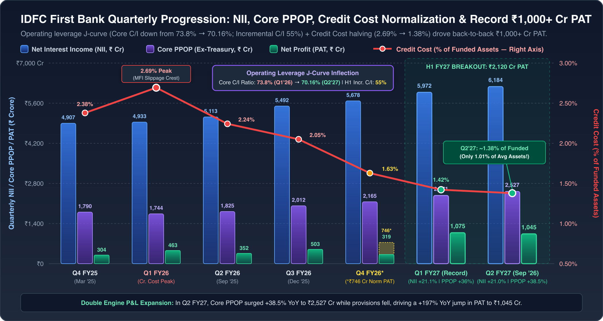
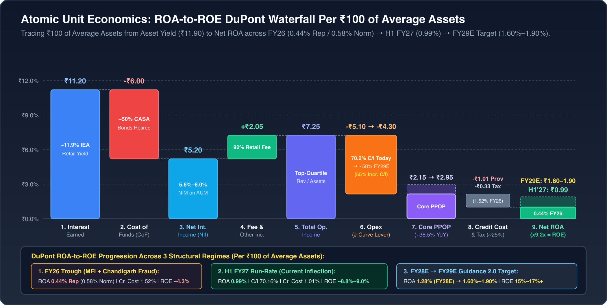

# **INITIATION OF COVERAGE: IDFC FIRST BANK LTD (`NSE: IDFCFIRSTB` | `BSE: 539437`)**

**Report Suite Navigation:**  
📍 **[1. Master Summary](./Summary.md)** | 📊 **[2. Forensic, Valuation & Timing Upgrade](./Forensic-Valuation-And-Timing-Upgrade.md)** | ⚙️ **[3. Financial & Unit Economics Framework (You Are Here)](./Financial%20Analysis%20Framework%20For%20IDFC%20First%20Bank.md)** | 🔗 **[4. Banking Value Chain & Liability Moat](./Banking%20Value%20Chain%20And%20Liability%20Moat%20Analysis.md)** | 🚀 **[5. Vision 2030 Strategy & Operating Leverage Roadmap](./Vision%202030%20Strategy%20And%20Operating%20Leverage%20Roadmap.md)**

---

## **1\. Executive Summary: The Structural Mechanics of a DFI-to-Retail Bank Metamorphosis**

IDFC First Bank Ltd (`NSE: IDFCFIRSTB` | `BSE: 539437`) represents the most complex, capital-intensive, and structurally misunderstood balance-sheet metamorphosis in modern Indian banking. Born on **December 18, 2018**, through the merger of **IDFC Bank** (a wholesale Development Finance Institution burdened with lumpy infrastructure loans, an 8.6% CASA ratio, and ₹28,000+ Crore of 8.5%–9.0% legacy infrastructure bonds) and **Capital First** (a high-yield, tech-led retail and MSME NBFC founded by V. Vaidyanathan), the institution spent its first seven years executing a grueling "two-front war." On the Liability front, it had to build a nationwide branch, ATM, and digital deposit franchise from scratch to replace wholesale institutional borrowings with granular retail deposits. On the Asset front, it systematically ran down legacy infrastructure exposure (now **<1.0% of funded assets** in Q2 FY27) while scaling a diversified 25-line retail, rural, SME, and prime corporate credit engine.

By **November 2026 (Post-Q2 & H1 FY27 Results)**, the foundational corporate and balance-sheet restructuring is formally complete across four landmark milestones:
1. **The Reverse Merger of IDFC Ltd (Completed October 1, 2024):** Executed at a **155:100 swap ratio** (155 shares of IDFC First Bank issued for every 100 shares of IDFC Ltd held), collapsing the two-tier holding company structure, **cancelling ~16.6 Crore net shares (~2.2% equity reduction)**, adding ~₹600 Crore in net cash/reserves, and transitioning the bank to a **100% public, institutionally owned structure with 0.00% promoter holding** (on par with ICICI Bank, HDFC Bank, and Axis Bank).
2. **The ₹7,500 Crore Growth Capital Infusion (April–July 2025):** Completed via Preferential Compulsorily Convertible Preference Shares (CCPS) at **₹60.00 per share** to **Warburg Pincus (Currant Sea Investments B.V.: ₹4,876 Crore for ~9.48% stake)** and the **Abu Dhabi Investment Authority (ADIA via Platinum Invictus B 2025 RSC Ltd: ₹2,624 Crore for ~5.10% stake)**, taking Consolidated Net Worth to **₹49,575 Crore** and Book Value Per Share (BVPS) to **₹57.49** as of Q2 FY27 (CRAR **14.67%**, CET-1 **13.00%**).
3. **Final Extinction of Legacy High-Cost Infrastructure Bonds (FY26):** The last tranches of pre-2015 legacy infrastructure bonds carrying 8.5%–9.0% coupons were fully retired in FY26, removing a multi-year structural drag on Cost of Funds (CoF).
4. **Global NRI Deposit Scale-Up — US$3.6 Billion FCNR(B) Mobilization (Q2 FY27):** In the September 2026 quarter, IDFC First Bank mobilized **US$3.6 Billion (~₹34,390 Crore)** in Foreign Currency Non-Resident `FCNR(B)` deposits via its GIFT City International Banking Unit (IBU), propelling Total Deposits **+25.9% YoY (+11.8% QoQ) to ₹3,48,583 Crore** while maintaining an elite **48.4% Average CASA ratio (~50% on the domestic book)** and a domestic Credit-to-Deposit (CD) ratio of **89.9%**.

> **[!IMPORTANT] Forensic Reality Check — The Operating Leverage & Credit Cost Inflection in H1 FY27:**  
> * **Why FY25–FY26 Earnings Looked Depressed:** Across FY25 (PAT ₹1,525 Cr, ROA 0.48%) and FY26 (Reported PAT ₹1,636 Cr / Normalized PAT ₹2,119 Cr ex-Chandigarh branch fraud; ROA 0.44% / 0.58%), two simultaneous headwinds masked the bank's underlying compounding: **(a) Peak Opex J-Curve** (~73.0% Core Cost-to-Income in FY26 from expanding to ~1,000+ branches and scaling the 4M+ credit card platform), and **(b) Industry-Wide Microfinance (MFI / JLG) Over-Leveraging Crisis** (which pushed FY26 credit cost to 2.13% of funded assets, peaking at 2.69% in Q1 FY26, alongside the isolated ₹646 Cr pre-tax / ₹483 Cr post-tax manual check-clearing fraud at a Chandigarh branch fully written off in Q4 FY26).  
> * **The H1 FY27 Breakout:** In Q1 FY27 and Q2 FY27, **both headwinds reversed simultaneously**. Core Cost-to-Income dropped from **~73.0% (FY26) $\rightarrow$ 70.73% (Q1 FY27) $\rightarrow$ 70.16% (Q2 FY27)**, driven by an **H1 FY27 Incremental Cost-to-Income ratio of just 55.0%** (with Operating Expenses growing ~500 bps slower than Total Income). Concurrently, annualized Credit Cost plunged to **1.01% of average assets in Q2 FY27** as the MFI portfolio was deliberately shrunk to **<2.5% of the loan book** with **99.5%+ collection efficiency** and backed by a **₹515 Crore CGFMU sovereign guarantee claim** received in Q1 FY27 (100% parked in an unutilized contingency reserve). The result: **Core PPOP surged +37.3% YoY in H1 FY27 to ₹4,898 Crore** (₹2,527 Cr in Q2 FY27, +38.5% YoY), while **H1 FY27 PAT jumped +160% YoY to ₹2,120 Crore** (Q1 FY27 PAT **₹1,075 Cr, +132.4% YoY, 1.06% ROA**; Q2 FY27 PAT **₹1,045 Cr, +196.5% YoY, 0.93% ROA**). *(See **[Forensic, Valuation & Timing Upgrade](./Forensic-Valuation-And-Timing-Upgrade.md)** for the complete forensic audit).*

---

## **2\. Industry Architecture: Why Standard Ratios Fail & The Liability-First Rulebook**

> **The BFSI Forensic Axiom (Module 8):** *"In a manufacturing company, anyone can make the product; the challenge is selling it. In a Bank or NBFC, anyone can 'sell' (give away ₹10,000 Crore of loans tomorrow morning!); the ONLY challenge is getting that money back with interest 3 years later—funded by deposits cheap enough that you don't have to lend to subprime borrowers to make a spread."*

Applying standard corporate financial screeners (such as Debt-to-Equity, Operating Cash Flow conversion, or EV/EBITDA) to a commercial bank results in catastrophic analytical errors. In banking, borrowed money (Deposits and Borrowings) is the raw material of the business, financial leverage ($\text{Assets}/\text{Equity}$) is an operating multiplier governed by RBI Basel III Capital Adequacy rules, and rapid loan growth mathematically produces negative Operating Cash Flow (CFO) because net loan disbursements are classified as working-capital outflows.

**Table 1: The BFSI Forensic Translation Matrix — Standard Corporate Metrics vs. IDFC First Bank Reality**

| Standard Corporate Ratio | Why It Fails Catastrophically in Banking | Institutional BFSI Metric Used Instead | IDFC First Bank Status (Q2 & H1 FY27) |
| :--- | :--- | :--- | :--- |
| **Debt-to-Equity (<0.5x)** | Customer deposits and interbank borrowings *are* the bank's raw inventory. A bank without leverage cannot earn an ROE above its Cost of Equity. | **Basel III CRAR / CET-1 Ratio** & **Leverage Multiplier ($\frac{\text{Assets}}{\text{Equity}}$)** | **CRAR: 14.67% \| CET-1: 13.00%** Leverage: **~8.5x–8.8x** on ₹49,575 Cr Net Worth |
| **Operating Cash Flow ($\text{CFO} > 0$)** | When a bank grows Funded Assets by +20%–30% YoY (+₹80,000 Cr), the cash lent out is booked as an operating outflow, making CFO negative during high growth. | **Core PPOP (Pre-Provision Operating Profit)**, **ROA**, & **LCR (Liquidity Coverage Ratio)** | **Q2 Core PPOP: ₹2,527 Cr (+38.5% YoY)** **H1 Core PPOP: ₹4,898 Cr (+37.3% YoY)** \| LCR: **~118%** |
| **EBITDA & ROCE** | Interest is not a financing charge below EBITDA; Interest Earned is Revenue and Interest Expended is COGS. | **Net Interest Income (NII)**, **Net Interest Margin (NIM)**, & **ROE** | **Q2 NII: ₹6,184 Cr (+21.0% YoY)** **NIM: 5.58%–5.60% (Q2) \| 5.96% (Q1)** |
| **Inventory Turnover** | Banks hold no physical inventory; their balance sheet consists of financial contracts subject to duration and credit default risk. | **GNPA %, NNPA %, Provision Coverage Ratio (PCR)**, & **SMA-1/2 Pool** | **GNPA: 1.32% \| NNPA: 0.40%** **PCR (incl. Tech Write-offs): ~88%+** |
| **Standalone P/E Multiple** | A lender can artificially inflate EPS for 8 quarters by lending to high-yield subprime borrowers and under-providing until NPAs explode in Year 3. | **Price-to-Book (P/B)** & **Price-to-Adjusted Book Value (P/ABV)** anchored to **ROA $\times$ Leverage** | **BVPS: ₹57.49** \| Trading at **~1.15x–1.30x Book Value** at the cusp of ROA inflection |

### **2.1 The Liability-First Moat vs. Asset-Led NBFC Fragility**

The Indian financial sector is sharply bifurcated between **Liability-First Universal Banks** (HDFC Bank, ICICI Bank, Kotak, and now IDFC First Bank) and **Wholesale-Funded NBFCs / Unsecured Fintechs**. An NBFC borrows wholesale money via bank lines, Commercial Paper (CP), and Non-Convertible Debentures (NCDs) at **7.5%–8.8%**, forcing it to lend at **14%–24%** to generate a viable spread—which structurally pushes it down the credit curve into higher-risk borrower cohorts. Conversely, a universal bank with a **~50% domestic CASA franchise** blends zero-cost Current Accounts (0%) and low-cost Savings Accounts (~3.0%–6.5% tiered) with retail Term Deposits to achieve a structural Cost of Funds advantage. In IDFC First Bank's case, building a **₹3,48,583 Crore deposit base** (+25.9% YoY in Q2 FY27) with **₹1,58,492 Crore+ in CASA balances** has permanently de-risked its funding profile, brought its **domestic CD Ratio down to 89.9%** (from >135% at merger), and enabled it to pivot its incremental loan book toward prime mortgages, prime vehicle loans, gold loans, and investment-grade corporate credit.

---

## **3\. The Growth Algorithm: Deconstructing the Banking Revenue & NII Equation**

Unlike a fee-only service business, a commercial bank's Total Operating Income (Net Total Income = NII + Non-Interest Income) is governed by a coupled balance-sheet and fee-velocity equation. Following IDFC First Bank's trajectory from **FY24 $\rightarrow$ FY25 $\rightarrow$ FY26 $\rightarrow$ Q1 FY27 $\rightarrow$ Q2 & H1 FY27 (Ended September 30, 2026)**, we isolate the five structural variables driving top-line compounding:

$$\text{Total Operating Income} = \underbrace{\Big[\text{IEA} \times \big(\text{Yield}_{\text{Blended}} - \text{CoF}_{\text{Blended}}\big)\Big]}_{\text{Net Interest Income (NII)}} + \underbrace{\Big[\text{Funded Assets} \times \text{Fee Velocity}_{\%} + \text{Treasury Gains}\Big]}_{\text{Non-Interest Income}}$$

Where **Blended Yield** and **Blended Cost of Funds ($\text{CoF}$)** are dynamic functions of balance-sheet mix:

$$\text{NIM} = \frac{\text{NII}}{\text{Average Interest-Earning Assets (IEA)}} = \sum_{i} \left(w_{A,i} \cdot Y_i\right) - \left(\frac{\text{Interest-Bearing Liabilities}}{\text{IEA}}\right) \cdot \sum_{j} \left(w_{L,j} \cdot C_j\right)$$

*📊 [Click to Open Crisp Vector SVG](./charts/02_quarterly_nii_ppop_pat_progression.svg)*

### **3.1 Volume Dynamics: Deposit Mobilization Outpacing Organic Credit Growth (Updated to Q2 & H1 FY27)**

The overarching volume story of IDFC First Bank is the steady 20%+ compounding of granular funded assets backed by even faster 25%+ deposit mobilization:

* **Deposits Trajectory (FY24 $\rightarrow$ Q2 FY27):**
  * **FY24:** Total Deposits stood at **₹2,00,570 Crore** (CASA Ratio: **47.27%**).
  * **FY25:** Total Deposits rose **+25.7% YoY to ₹2,52,065 Crore** (Customer Deposits **₹2,42,543 Crore**; CASA Ratio: **46.9%**).
  * **FY26:** Total Deposits grew **+16.8% YoY to ₹2,94,475 Crore** (Customer Deposits **₹2,84,453 Crore**; CASA surged to **₹1,46,650 Crore** or **49.8% CASA Ratio**).
  * **Q1 FY27 (Ended June 30, 2026):** Total Deposits reached **₹3,11,892 Crore (+18.0% YoY)**, with CASA balances hitting **₹1,58,492 Crore** (**50.8% CASA Ratio**).
  * **Q2 FY27 (Ended September 30, 2026 — All-Time Record):** Total Deposits surged **+25.9% YoY and +11.8% QoQ to ₹3,48,583 Crore**, catalyzed by continued domestic retail deposit traction alongside the mobilization of **US$3.6 Billion (~₹34,390 Crore) in FCNR(B) deposits** at the GIFT City IBU. Average CASA Ratio in Q2 FY27 stood at **48.4% overall (~50.0% on the domestic deposit book)**, pulling the **domestic Credit-to-Deposit (CD) Ratio down to 89.9%**.
* **Loans & Advances (Funded Assets) Trajectory (FY24 $\rightarrow$ Q2 FY27):**
  * **FY24:** Funded Assets reached **₹2,00,965 Crore**.
  * **FY25:** Funded Assets grew **+20.4% YoY to ₹2,41,926 Crore**.
  * **FY26:** Funded Assets expanded **+20.0% YoY to ₹2,90,278 Crore**, even as management proactively curtailed high-yield Microfinance (JLG) disbursements by >35%.
  * **Q1 FY27 (Jun 2026):** Funded Assets rose **+21.0% YoY to ₹3,05,370 Crore**.
  * **Q2 FY27 (Sep 2026):** Total Funded Assets surged **+30.1% YoY (+13.6% QoQ) to ₹3,46,913 Crore**. Crucially, stripping out the low-risk IBU foreign-currency corporate/trade advances deployed against the $3.6B FCNR(B) inflow, **organic domestic Funded Assets grew a disciplined +22.2% YoY**, led by Mortgage Loans (Home Loans + LAP), Vehicle Financing, Gold Loans, MSME Working Capital, Consumer Loans, and Prime Corporate Credit, while **MFI/JLG shrunk below 2.5% of total funded assets** and **legacy infrastructure fell below 1.0%**.

### **3.2 Net Interest Income (NII) & The Forensic Mechanics of NIM (5.96% in Q1 $\rightarrow$ 5.58% in Q2 FY27)**

IDFC First Bank commands the highest Net Interest Margin (NIM) among all universal banks in India (~150–200 bps above HDFC Bank and ICICI Bank), reflecting its Capital First retail/MSME DNA combined with a near-50% CASA liability engine:

* **Multi-Year NII & NIM Progression:**
  * **FY24:** NII **₹16,451 Crore** | Full-Year NIM: **6.36%**.
  * **FY25:** NII **₹19,292 Crore (+17.3% YoY)** | Full-Year NIM: **6.09%** (reflecting the deliberate shift away from 24%-yield MFI loans toward prime mortgages and corporate credit).
  * **FY26:** NII **₹21,216 Crore (+10.0% YoY)** | Full-Year NIM: **5.72%** (reflecting peak MFI run-down and repo rate transmission).
  * **Q1 FY27 (Jun 2026):** NII accelerated to **₹5,972 Crore (+21.1% YoY)** | Quarterly NIM expanded to **5.96%**, aided by the retirement of legacy 8.8% infrastructure bonds and savings-rate tier optimization.
  * **Q2 FY27 (Sep 2026) & H1 FY27:** Q2 NII grew **+21.0% YoY (+3.5% QoQ) to ₹6,184 Crore**, bringing **H1 FY27 cumulative NII to ₹12,156 Crore (+21.0% YoY)**. Reported NIM in Q2 FY27 stood at **5.58%–5.60%**.
* **Forensic Dissection — Why Did NIM Move Sequentially from 5.96% (Q1 FY27) to 5.58%–5.60% (Q2 FY27) While NII Still Grew +21.0% YoY?**
  1. **Optical Denominator Dilution from the ₹34,390 Crore ($3.6B) FCNR(B) Deployment (~30–32 bps impact):** In Q2 FY27, the bank raised ₹34,390 Crore in hedged FCNR(B) deposits and deployed them immediately into ultra-safe, short-duration GIFT City IBU foreign-currency assets, sovereign/liquid instruments, and top-rated corporate trade credit earning a positive net spread of **~100–140 bps**. When you add ₹34,390 Crore of ~1.2% net-spread assets onto a ₹3.05 Lakh Crore domestic book earning ~5.96% NIM, simple arithmetic ($\frac{\text{₹6,184 Cr Annualized}}{\text{Expanded IEA}}$) compresses the *blended percentage NIM* by ~30–32 bps—even though the transaction is **100% NII-accretive, zero-credit-risk, and requires minimal regulatory capital**!
  2. **De-Risking Mix Shift Away from Microfinance (~6–8 bps impact):** Shrinking the 22%–24% yielding MFI book to **<2.5% of funded assets** in favor of 9%–11.5% yielding Home Loans, Gold Loans, and Prime Corporate advances slightly trims gross asset yield (~12.1%–12.3%) in exchange for a massive **>110 bps reduction in Credit Cost** (meaning **Risk-Adjusted NIM = $\text{NIM} - \text{Credit Cost}$ actually expanded by +70 bps YoY to ~4.57% in Q2 FY27!**).
  3. **Management Q4 FY27 NIM Exit Trajectory (~5.80%):** As the excess FCNR(B) liquidity is progressively redeployed into higher-yielding customer advances over Q3 and Q4 FY27 and term-deposit repricing flows through, management has guided for **NIM to recover toward ~5.80% by Q4 FY27**.

### **3.3 Fee & Other Income Velocity: The 92% Granular Retail Fee Engine**

A critical pillar of the Growth Algorithm is Non-Interest Income, which reached **₹2,296 Crore in Q2 FY27** (of which **Core Fee & Other Income was ₹2,285 Crore, up +24.5% YoY**, outpacing NII growth of +21.0% YoY). Unlike wholesale or PSU banks whose "Other Income" is heavily dependent on volatile G-Sec treasury trading gains, **92% of IDFC First Bank's fee income is recurring, granular retail and transaction fees**:
* **34% Loan Origination & Processing Fees:** Driven by ₹35,000+ Crore quarterly retail, MSME, mortgage, and vehicle loan disbursements.
* **23% Credit Cards & FASTag Toll Ecosystem Fees:** Interchange, MDR, annual fees, and revolver/EMI processing across **4.0+ Million active credit cards** and India's **#1 FASTag issuer (~20M+ tags)** and highway acquiring network.
* **20% General Banking, Cash Management & Deposit Service Fees:** Commercial API banking, CMS, and transaction charges.
* **13% Wealth Management & Third-Party Distribution:** Mutual fund distribution, AIFs, PMS, and bancassurance across affluent retail and NRI cohorts (**Wealth AUM growing >35% YoY**).
* **10% Trade Finance & Retail/Corporate FX Fees:** Letter of Credit (LC), Bank Guarantee (BG), and cross-border remittance spreads.

---

## **4\. Operational Mechanism: The Granular CASA Engine, FASTag/Wealth Ecosystem & 25-Line Retail Credit Factory**

To understand *how* IDFC First Bank sustains **+25.9% YoY deposit growth** and **+21.0% YoY NII compounding** while driving down credit costs to **1.01%**, we must examine the operational machinery inside its liability and asset factories. *(See **[Banking Value Chain & Liability Moat Analysis](./Banking%20Value%20Chain%20And%20Liability%20Moat%20Analysis.md)** for the full end-to-end architecture).*

### **4.1 The Granular CASA & Digital Liability Flywheel**

Building a **₹1,58,492+ Crore CASA book (~50% domestic CASA)** in under eight years against 30-year incumbents required re-engineering the retail banking value proposition:
* **Customer-First Product Hooks (Zero-Fee Transparency):** IDFC First Bank became the first universal bank in India to offer **Zero Fee Banking on 28+ common savings account services** (IMPS, NEFT, RTGS, ATM withdrawals, debit card issuance, SMS alerts, DD issuance) alongside **Monthly Interest Credits** (compounding depositors' savings every month rather than quarterly). This eliminated customer friction and turned word-of-mouth referrals and digital onboarding into a low-CAC deposit magnet.
* **Savings Rate Optimization (Pricing Power Validated):** Critics once argued that IDFC First Bank's CASA was purely "rate-bought" at 7%. Over FY25–FY27, the bank proved its deposit stickiness by lowering savings rates in the `< ₹1 Lakh` and `₹1–5 Lakh` buckets to **3.00%–5.00%**, reserving peak **6.50%–7.00%** rates strictly for progressive balances in the `₹5 Lakh to ₹50 Crore` affluent/HNI sweep tiers. Despite these rate reductions, **CASA balances crossed ₹1,58,492 Crore (50.8% in Q1 FY27; 48.4% Avg CASA in Q2 FY27)**, proving that deposits are anchored by the UI/UX of its top-rated mobile app (4.8–4.9★ across iOS/Android) and wealth relationship management rather than headline rate alone.

### **4.2 The FASTag, Credit Card & Wealth Cross-Sell Funnel**

Instead of treating payments and cards purely as standalone profit centers, IDFC First Bank operates them as a unified **Customer Acquisition & Data Funnel**:
* **#1 in FASTag Issuance & Toll Acquiring:** By dominating national highway toll processing, fuel surcharge ecosystems, and commercial fleet payments, the bank captures real-time cash-flow velocity on millions of vehicle owners and transport operators—creating a proprietary underwriting dataset for Commercial Vehicle (CV), Car, and Fleet Working Capital loans.
* **4.0+ Million Credit Cards Reaching Breakeven Inflection:** Launched organically in January 2021 without acquiring an existing book, the Credit Card business incurred heavy upfront technology, Bureau, and reward-point customer acquisition costs (CAC) during FY22–FY25. Having crossed the **~4.0 Million card scale threshold in FY26–H1 FY27** (primarily cross-sold to pre-screened internal CASA and loan customers with low delinquency), the card portfolio has transitioned from an Opex drag into a self-sustaining fee and interest generator.

### **4.3 The 25-Line Retail Credit Factory & Automated Scorecards**

Inherited and upgraded from Capital First, the bank's underwriting engine avoids concentration risk by spreading **₹3,46,913 Crore of funded assets** across more than 25 granular product lines:
* **7-Stage Automated Underwriting Filter:** Over 90% of retail and MSME applications pass through an automated rule engine integrating Bureau scrub, multi-bureau vintage velocity, AA (Account Aggregator) bank-statement cash-flow parsing, GSTN/ITR verification, geo-fenced fraud checks, and cash-flow-to-EMI debt-service-coverage ratios (`DSCR`)—rejecting ~55%–60% of raw top-of-funnel inquiries before human credit intervention.
* **Dynamic Portfolio Pivoting (How the Bank Survived the FY25–FY26 MFI Storm):** When early-warning Bureau indicators in mid-FY25 flagged rising borrower leverage across rural Joint Liability Group (JLG / Microfinance) borrowers (customers holding >4 concurrent lender loans), IDFC First Bank immediately tightened MFI filters, insured eligible disbursements under the **CGFMU sovereign guarantee scheme** (resulting in the **₹515 Crore cash claim received in Q1 FY27**), cut MFI share to **<2.5% of total advances**, and pivoted incremental capital into **Gold Loans, Prime Home Loans, Loan Against Property (LAP), and Prime Corporate Loans**.

---

## **5\. The ROA-to-ROE DuPont Margin Tree: Financial Forensics**

In institutional banking analysis (Module 8), every strategic decision—from branch expansion to FCNR(B) mobilization and MFI run-down—must be traced through the **ROA-to-ROE DuPont Margin Tree** expressed as a percentage of **Average Total Assets (ATA)**:

$$\text{ROA} = \left(\text{NIM}_{\%\text{ATA}} + \text{Non-Interest Income}_{\%\text{ATA}}\right) \times \left(1 - \text{Cost-to-Income Ratio}\right) - \text{Credit Cost}_{\%\text{ATA}} - \text{Tax}_{\%\text{ATA}}$$

$$\text{ROE} = \text{ROA} \times \text{Leverage Multiplier}\left(\frac{\text{Average Total Assets}}{\text{Average Net Worth}}\right)$$

### **5.1 Dissecting the Opex J-Curve: Why Cost-to-Income Is Inflecting Downward (73.0% $\rightarrow$ 70.16% $\rightarrow$ 65% Target)**

The single biggest point of skepticism around IDFC First Bank between FY22 and FY26 was its elevated **Core Cost-to-Income Ratio (~72%–73%)**, compared to **40%–42% for ICICI Bank and HDFC Bank**. A forensic disaggregation reveals why this ratio was structurally high during the build-out phase—and why **H1 FY27 marks the mathematical inflection point**:

1. **The Physics of Young Branch Vintage:** When a bank opens ~500 new retail branches, deploys ~1,200 ATMs, and hires branch relationship staff, **100% of the lease rent, depreciation, security, and employee salaries hit the P&L on Day 1**, while the branch's deposit book scales along an S-curve from ₹15 Crore in Year 1 to ₹250–₹350+ Crore in Years 4–6. By H1 FY27, over 75% of IDFC First Bank's ~1,000+ branches have crossed the 36-month maturity threshold, compounding deposits at >25% YoY with minimal incremental headcount.
2. **Retail Asset & Liability Granularity Cost:** Originating and servicing ₹3.47 Lakh Crore of small-ticket retail/MSME loans and 20M+ digital/FASTag/card accounts requires higher upfront tech and collection infrastructure (~2.8%–3.0% of assets) than running a lumpy corporate loan book (~1.2% of assets)—which is compensated by a **5.58%–5.96% NIM** (vs. ~3.5%–4.3% for corporate-heavy peers).
3. **The H1 FY27 Incremental Cost-to-Income Proof (55.0%):**
   * In **H1 FY27**, Total Operating Income (NII + Core Fees) grew **+22.0%+ YoY**, while Operating Expenses grew ~500 bps slower (**~16.5%–17.0% YoY**).
   * Consequently, **Incremental Cost-to-Income in H1 FY27 dropped to just 55.0%** ($\frac{\Delta \text{Opex}}{\Delta \text{Operating Income}} = 55\%$), pulling blended **Core Cost-to-Income down from ~73.0% (FY26) $\rightarrow$ 70.73% (Q1 FY27) $\rightarrow$ 70.16% (Q2 FY27)**.
   * This operating leverage drove **Core PPOP up +36.0% YoY in Q1 FY27 (₹2,371 Crore)** and **+38.5% YoY in Q2 FY27 (₹2,527 Crore; H1 FY27 Core PPOP ₹4,898 Crore, +37.3% YoY)**—nearly **1.8x the rate of NII growth (+21.0% YoY)**!

### **5.2 The Credit Cost & Asset Quality Bridge (2.13% FY26 $\rightarrow$ 1.01% Q2 FY27)**

* **FY25–FY26 Stress Phase & Cleanup:** During FY25 and FY26, industry-wide MFI delinquencies forced IDFC First Bank to absorb elevated provisions (**2.13% of average funded assets in FY26**, peaking at **2.69% in Q1 FY26**). Furthermore, in Q4 FY26, management uncovered and transparently took a **100% upfront P&L write-off of ₹646 Crore pre-tax (₹483 Crore post-tax)** for an isolated manual check-clearing/account-reconciliation fraud at a single Chandigarh branch (representing ~0.16% of assets, followed by immediate biometric/CBS maker-checker automation across all branches).
* **Q1 & Q2 FY27 Asset Quality Breakout:**
  * In **Q1 FY27**, the bank received **₹515 Crore in cash claims under the CGFMU sovereign guarantee** on its insured microfinance pool. Instead of booking this ₹515 Crore into P&L profits to artificially inflate Q1 PAT, management conservatively parked **100% of the ₹515 Crore in a ring-fenced Contingency Provision Buffer** on the balance sheet!
  * By **Q2 FY27**, with MFI collection efficiency restored to **99.5%+** and the MFI book below **2.5% of advances**, annualized **Credit Cost fell to 1.01% of average assets (~₹950–₹980 Crore quarterly provision run-rate)**, while **Gross NPA improved to 1.32%** (down from 1.87%–1.97% in FY25–FY26) and **Net NPA fell to an all-time low of 0.40%**—already outperforming the bank's own **FY29 Guidance 2.0 targets (GNPA ~1.5%, NNPA ~0.4%)** two and a half years ahead of schedule!

**Table 2: IDFC First Bank Multi-Period P&L, Balance Sheet & DuPont Margin Tree (FY24 $\rightarrow$ Q2/H1 FY27 & FY29E Guidance 2.0)**

| Level | DuPont / Financial Metric | FY24 (Actual) | FY25 (Actual) | FY26 (Actual) | Q1 FY27 (Jun '26) | Q2 FY27 (Sep '26) | H1 FY27 (Apr–Sep '26) | FY29E Guidance 2.0 Target |
| :--- | :--- | :---: | :---: | :---: | :---: | :---: | :---: | :---: |
| **BS-1** | **Total Deposits (₹ Cr)** | ₹2,00,570 | ₹2,52,065 | ₹2,94,475 | ₹3,11,892 | **₹3,48,583 (+25.9% YoY)** | **₹3,48,583** | **~₹5,85,000 Cr** |
| **BS-2** | **CASA Ratio (%)** | 47.27% | 46.90% | 49.80% | 50.80% | **48.4% Avg (~50% Dom.)** | **48.4% Avg** | **~48%–50%** |
| **BS-3** | **Funded Assets / Loans (₹ Cr)** | ₹2,00,965 | ₹2,41,926 | ₹2,90,278 | ₹3,05,370 | **₹3,46,913 (+30.1% / +22.2% Org.)** | **₹3,46,913** | **~₹5,00,000 Cr (~20% CAGR)** |
| **L1** | **Net Interest Income — NII (₹ Cr)** | ₹16,451 | ₹19,292 | ₹21,216 | ₹5,972 (+21.1%) | **₹6,184 (+21.0% YoY)** | **₹12,156 (+21.0% YoY)** | **~20% CAGR** |
| **L1a** | **Net Interest Margin — NIM (% IEA)** | 6.36% | 6.09% | 5.72% | 5.96% | **5.58%–5.60% *(5.80% Q4E)*** | **~5.77%** | **~5.75%–5.85%** |
| **L2** | **Fee & Non-Interest Income (₹ Cr)** | ₹5,795 | ₹6,805 | ₹7,840 | ₹2,130 | **₹2,296 (₹2,285 Cr Core Fee, +24.5%)** | **₹4,426** | **~2.0%–2.1% of Assets** |
| **L3** | **Core Cost-to-Income Ratio (%)** | 72.4% | 72.8% | ~73.0% | 70.73% | **70.16% *(H1 Incr. C/I: 55%)*** | **70.44%** | **~65.0% by FY27 Exit $\rightarrow$ <58% FY29E** |
| **L4** | **Core PPOP (₹ Cr)** | ₹6,030 | ₹6,980 | ₹7,850 | ₹2,371 (+36.0%) | **₹2,527 (+38.5% YoY)** | **₹4,898 (+37.3% YoY)** | **~3.1%–3.3% of Assets** |
| **L5** | **Credit Cost (% of Avg Assets / FA)** | 1.32% | 1.95% | 2.13% FA | ~1.05% | **1.01% of Avg Assets** | **~1.03% (+₹515 Cr Buffer)** | **~1.10%–1.20% Steady-State** |
| **L6** | **GNPA % / NNPA %** | 1.88% / 0.60% | 1.87% / 0.53% | 1.78% / 0.52% | 1.48% / 0.44% | **1.32% / 0.40%** | **1.32% / 0.40%** | **~1.50% / ~0.40% *(Beaten Early!)*** |
| **L7** | **Net Profit — PAT (₹ Cr)** | ₹2,957 | ₹1,525 | ₹1,636 *(₹2,119 Norm)* | ₹1,075 (+132.4%) | **₹1,045 (+196.5% YoY)** | **₹2,120 (+160.0% YoY)** | **₹11,000–₹12,500 Cr** |
| **L8** | **Post-Tax ROA (%)** | 1.10% | 0.48% | 0.44% *(0.58% Norm)* | **1.06%** | **0.93% *(Diluted by $3.6B FCNR)*** | **0.99%** | **1.90%–2.00% ROA** |
| **L9** | **Net Worth (₹ Cr) / BVPS (₹)** | ₹32,161 / ₹45.5 | ₹38,150 / ₹52.1 | ₹47,450 / ₹55.1 | ₹48,530 / ₹56.3 | **₹49,575 / ₹57.49** | **₹49,575 / ₹57.49** | **ROE: 17.0%–18.0%** |

---

## **6\. Unit Economics: The Atomic P&L per ₹100 of Assets & Cohort Payback Physics**

To evaluate how IDFC First Bank bridges the gap from its **H1 FY27 ROA of 0.99% (1.06% in Q1 / 0.93% in Q2)** to its **FY29–FY30 Guidance 2.0 target of 1.9%–2.0% ROA and 17%–18% ROE**, we construct the **Atomic Unit P&L per ₹100 of Average Total Assets (ATA)** and dissect the cohort payback physics of its branches and credit cards.

### **6.1 The Atomic DuPont Waterfall (Per ₹100 of Average Assets: H1 FY27 Run-Rate vs. Steady-State Target)**

*📊 [Click to Open Crisp Vector SVG](./charts/04_atomic_unit_economics_dupont_waterfall.svg)*

Every **₹100 of Average Total Assets** on IDFC First Bank's balance sheet (which stood at **~₹4.25–₹4.48 Lakh Crore in Q1–Q2 FY27**, including the September 2026 FCNR surge) flows through five precise unit-economic gates:

1. **Gross Interest Revenue (+₹10.65 to +₹10.95 per ₹100 Assets):** Earned from a ~12.1%–12.4% blended yield on advances and ~6.8%–7.1% yield on statutory SLR/treasury investments.
2. **Less: Direct Funding Cost / COGS (-₹5.35 to -₹5.55 per ₹100 Assets):** Interest paid to CASA depositors, Retail Term Depositors, and FCNR(B)/Refinance providers (~6.1%–6.35% Cost of Funds).
3. **= Unit Net Interest Income (+₹5.20 to +₹5.50 per ₹100 Total Assets; 5.58%–5.96% NIM on IEA):** Notice that IDFC First Bank's unit NII per ₹100 of assets is already **~₹1.20–₹1.40 higher** than top-tier peers (ICICI Bank / HDFC Bank at ~₹3.90–₹4.10 per ₹100 of assets).
4. **Plus: Unit Fee & Non-Interest Income (+₹2.04 per ₹100 Assets):** Generated by the ₹2,285 Crore quarterly granular fee engine (₹2,296 Crore total non-interest income in Q2 FY27), yielding **₹7.24 to ₹7.54 of Net Total Operating Income per ₹100 of Assets** (one of the richest top-line asset yields in Indian banking).
5. **Less: Unit Operating Expenses (-₹5.10 to -₹5.30 per ₹100 Assets at 70.16%–70.73% C/I):** This leaves **₹2.15 to ₹2.25 of Core PPOP per ₹100 of Assets in H1 FY27**.
6. **Less: Unit Credit Cost (-₹1.01 per ₹100 Assets in Q2 FY27) & Taxes (-₹0.28 to -₹0.31):** Resulting in **₹0.93 to ₹1.06 of Post-Tax ROA per ₹100 of Assets in H1 FY27**.

> **[!TIP] The Mathematical Secret of the 2.0% ROA Bridge:**  
> Look closely at the unit numbers above: IDFC First Bank **does not need to raise its NIM or take higher credit risk** to double its ROA from ~1.0% to ~1.9%–2.0%! It already generates **~₹7.35 of Total Operating Income per ₹100 of Assets** (vs. ~₹5.50 for ICICI/HDFC). As **Incremental Cost-to-Income stays at ~55%** (where it already sits in H1 FY27!), every year of 20% asset growth compresses the unit Opex burden from **₹5.15 per ₹100 of assets today toward ₹4.10–₹4.25 per ₹100 of assets** (a ~57%–58% Cost-to-Income ratio), while Credit Cost remains anchored at **~₹1.05–₹1.15 per ₹100 of assets**. That **~₹1.00 unit Opex savings per ₹100 of assets** flows straight through to pre-tax profit (+₹0.75 post-tax ROA), mechanically lifting **ROA from ~1.00% in H1 FY27 to ~1.35%–1.50% in FY28E and ~1.85%–2.00% in FY29E–FY30E**!

### **6.2 Cohort Payback Physics: Retail Branches & Credit Cards**

* **Unit Economics of a Single Retail Bank Branch:**
  * **Upfront Capex & Annual Fixed Opex:** Setting up a modern metro/urban IDFC First Bank branch requires **~₹1.2–₹1.8 Crore in fit-out/vault/ATM capex** and **~₹1.8–₹2.4 Crore in annual operating expenses** (rent, 12–15 branch staff, utilities, security).
  * **Breakeven Deposit Threshold (~₹65–₹75 Crore at Month 22–26):** Earning an internal transfer-pricing net spread of ~2.8%–3.2% on branch CASA + Retail Term Deposits plus ~0.6% cross-sell wealth/insurance fee yield (~3.5% total branch revenue margin), a branch breaks even once its deposit book crosses **~₹65–₹75 Crore**.
  * **Maturity Compounding (Months 36–72+):** Across IDFC First Bank's network of ~1,000+ branches, cohorts aged >36 months average **₹220–₹340+ Crore in deposits per branch**, operating at a branch-level Cost-to-Income ratio of **<38%** and generating **>45% IRR** on initial branch setup capital.
* **Unit Economics of the Credit Card Cohort (4.0M+ Cards):**
  * **CAC vs. LTV:** Customer Acquisition Cost (bureau checks, KYC, physical card dispatch, onboarding welcome rewards) averages **₹1,400–₹1,800 per card** (lower for in-app existing bank customers). A card cohort operates at a net loss in **Year 1**, reaches cumulative payback in **Months 18–22** as monthly spend (~₹18,000–₹24,000/active card), EMI conversions, and revolver balances build, and delivers **~3.5%–4.5% pre-tax ROA from Year 3 onward**. With >65% of the 4M+ card base now past the 20-month vintage mark in H1 FY27, the card division has crossed standalone P&L breakeven.

---

## **7\. Cyclicality & Macro Drivers: RBI Rate Cycle, MFI Credit Cycle & Liquidity Transmission**

Unlike non-financial businesses subject to commodity inventory cycles, a bank's margin and asset quality trajectory is governed by three macro-financial cycles:

### **7.1 The RBI Repo Rate Cycle & EBLR vs. MCLR Repricing Asymmetry**

1. **Asset Yield Sensitivity (Floating EBLR vs. Fixed Retail Book):** Roughly **~38%–42% of IDFC First Bank's loan book** (primarily Home Loans, LAP, and MSE working capital) is linked to External Benchmarks (EBLR / Repo Rate), while **~58%–62% of the book** (Vehicle Loans, Consumer Durable Loans, Fixed MSME Loans, Credit Cards, Gold Loans) carries **Fixed Interest Rates**.
2. **What Happens in an RBI Rate-Cut Cycle (2026–2027 Tailwind):** In a standard corporate-heavy bank (where 70%+ of loans are Repo-linked), an RBI repo rate cut immediately compresses asset yields on Day 1 while fixed term deposits take 9–12 months to reprice downward—squeezing NIMs. Conversely, because **nearly 60% of IDFC First Bank's advances are fixed-rate**, its asset yield holds up far more resiliently during rate cuts, while its wholesale borrowings and short-term deposits reprice lower—creating a **structural NIM stabilizer in easing rate environments**.

### **7.2 The Unsecured & Microfinance Credit Cycle (Why H1 FY27 Marks the Trough of Stress)**

* **The FY25–FY26 Industry MFI Shakeout:** Following post-COVID deregulation of microfinance pricing in 2022, aggressive lending by NBFC-MFIs led to severe borrower over-indebtedness across Bihar, Tamil Nadu, Uttar Pradesh, and Odisha during FY25–FY26. MFIN guardrails (capping lenders per borrower at 3–4 and limiting EMI-to-household income at 50%) triggered a sharp liquidity crunch and delinquency spike across all MFI lenders.
* **IDFC First Bank's Structural Insulation:** By proactively cutting MFI exposure from ~6.5% of the book in FY24 to **<2.5% of funded assets in Q2 FY27**, insuring incremental disbursements under **CGFMU** (realizing **₹515 Crore in Q1 FY27 claims**), and maintaining **99.5%+ collection efficiency** on post-guardrail cohorts, IDFC First Bank has fully Ring-Fenced and exited the MFI storm—allowing Q2 FY27 credit cost to normalize to **1.01% of average assets**.

### **7.3 Global Liquidity & The GIFT City FCNR(B) Arbitrage**

* The **US$3.6 Billion (~₹34,390 Crore) FCNR(B) deposit mobilization in Q2 FY27** demonstrates how IDFC First Bank uses its GIFT City IBU and NRI franchise to tap global dollar liquidity at attractive hedged spreads whenever domestic systemic liquidity tightens, keeping its **domestic CD Ratio comfortably at 89.9%** without engaging in destructive domestic bulk-deposit rate wars.

---

## **8\. Sensitivity Analysis: Stress-Testing NIM, Credit Cost, Cost-to-Income & Leverage**

To identify the exact elasticity of IDFC First Bank's earnings and ROE (anchored on its **H1 FY27 annualized base of ~₹4.40 Lakh Crore Average Assets, ~₹3.47 Lakh Crore Funded Assets, and ₹49,575 Crore Net Worth**), we stress-test the four master DuPont levers:

**Table 3: Institutional Sensitivity & Stress-Test Matrix (Impact on FY27E/FY28E Annualized PAT, ROA & ROE)**

| Master Variable | Stress / Upside Scenario | Annualized Pre-Tax / PAT Impact | ROA & ROE Impact | Underlying Banking Mechanism |
| :--- | :--- | :---: | :---: | :--- |
| **1. Cost-to-Income Ratio (Operating Leverage)** | **-300 bps improvement** (e.g., 70.16% $\rightarrow$ 67.16%) | **+₹1,020 Cr Pre-Tax** **(+₹765 Cr PAT / +18% EPS)** | **+17 bps ROA** **+150 bps ROE** | **Pure Operating Leverage:** With Incremental C/I at **55% in H1 FY27**, 20% top-line growth automatically compresses blended C/I by ~250–300 bps per year without branch closures. |
| **2. Net Interest Margin (NIM on IEA)** | **$\pm$ 20 bps shift** (e.g., 5.60% $\rightarrow$ 5.80% Q4 recovery) | **$\pm$ ₹780 Cr Pre-Tax** **($\pm$ ₹585 Cr PAT / $\pm$14% EPS)** | **$\pm$ 13 bps ROA** **$\pm$ 115 bps ROE** | **Redeployment of $3.6B FCNR Liquidity:** Moving excess Q2 FCNR liquidity from low-yield money markets into customer advances restores ~20 bps of NIM toward the **5.80% Q4 FY27 exit target**. |
| **3. Annualized Credit Cost (% of Avg Assets)** | **+25 bps stress shock** (e.g., 1.01% $\rightarrow$ 1.26%) | **-₹1,100 Cr Pre-Tax** **(-₹825 Cr PAT)** | **-19 bps ROA** **-165 bps ROE** | **Contingency Shield:** Before any future shock hits the P&L, the bank holds the **₹515 Cr unutilized CGFMU contingency buffer** (worth ~12 bps of assets) plus **88%+ technical write-off PCR**. |
| **4. CASA Ratio Mix Shift** | **-250 bps CASA drop** (replaced by 7.2% Retail TD) | **-₹290 Cr Pre-Tax** **(-₹218 Cr PAT)** | **-5 bps ROA** **-44 bps ROE** | **Modest Rate Spread Sensitivity:** Because progressive savings tiers already pay 5.0%–6.5%, a shift between SA and Retail TD carries only a ~80–110 bps differential vs. ~400 bps at legacy banks. |
| **5. RBI Repo Rate Cut (-50 bps)** | **-50 bps Repo Cut** across EBLR & TD book | **Neutral to +₹180 Cr PAT (+4 bps ROA)** | **+3 to +5 bps ROA** | **Fixed-Rate Asset Buffer:** ~58%–62% of the loan book is fixed-rate (Vehicle, Consumer, MSME, Cards), shielding asset yields while wholesale & TD funding costs reprice downward. |

---

## **9\. Leading Indicators Dashboard (10 High-Frequency Banking Watchlist Metrics)**

Institutional investors tracking IDFC First Bank across Q3 FY27, Q4 FY27, and FY28–FY30 must monitor these 10 high-frequency quantitative guardrails each quarter:

**Table 4: The 10-Point Institutional Banking Watchlist & Kill-Switch Thresholds**

| # | Leading Indicator | Reporting Frequency | Current Q2 / H1 FY27 Status | Green Zone (Bullish Compounding) | Red Flag / Kill-Switch Threshold | Forensic Logic & P&L Implication |
| :--- | :--- | :---: | :---: | :---: | :---: | :--- |
| **1** | **Incremental Cost-to-Income Ratio ($\frac{\Delta \text{Opex}}{\Delta \text{Income}}$)** | Quarterly | **55.0% (H1 FY27)** | **< 58.0%** | **> 68.0% for 2 quarters** | The single most important metric for the ROA bridge. As long as Incremental C/I stays near ~55%, overall Cost-to-Income mathematically drops ~250–300 bps per year toward 65% and <58%. |
| **2** | **Blended Core Cost-to-Income Ratio** | Quarterly | **70.16% (Q2) \| 70.73% (Q1)** | **Trending to ~65% by FY27 Exit** | **Re-expanding > 72.5%** | Validates that branch and credit-card J-curve investments are harvesting operating leverage into Core PPOP (+38.5% YoY in Q2 FY27). |
| **3** | **NIM Recovery Trajectory** | Quarterly | **5.58%–5.60% (Q2) \| 5.96% (Q1)** | **Recovering to ~5.75%–5.80% by Q4 FY27** | **Falling < 5.40% ex-FCNR** | Tracks the deployment of Q2's ₹34,390 Cr ($3.6B) FCNR(B) liquidity into customer advances and confirms pricing discipline on retail assets. |
| **4** | **Domestic CASA Ratio (Avg & EOP)** | Quarterly | **48.4% Avg \| ~50% Domestic** | **47.0% – 51.0%** | **< 43.0% Domestic CASA** | Confirms that zero-fee banking, mobile app stickiness, and wealth hooks retain low-cost deposits even after savings-rate tier optimization. |
| **5** | **Domestic Credit-to-Deposit (CD) Ratio** | Quarterly | **89.9% (Q2 FY27)** | **84.0% – 90.0%** | **> 95.0%** | RBI actively scrutinizes banks with CD ratios >90%–95%. Keeping domestic CD below 90% ensures unconstrained permission for 20%+ loan growth. |
| **6** | **Annualized Credit Cost (% of Avg Assets)** | Quarterly | **1.01% (Q2 FY27)** | **1.00% – 1.25%** | **> 1.65% for 2 quarters** | Confirms that post-MFI portfolio cleanup is durable and retail/MSME scorecards are holding steady across macro cycles. |
| **7** | **Retail & MSME SMA-1 + SMA-2 Pool** | Quarterly | **~0.85% – 0.95% of Book** | **< 1.10% of Retail Book** | **> 1.60% of Retail Book** | **The 90-Day Early Warning Radar:** SMA-1 (31–60 DPD) and SMA-2 (61–90 DPD) predict next quarter's Gross Slippages before they hit GNPA. |
| **8** | **MFI (JLG) Share & Collection Efficiency** | Quarterly | **<2.5% Share \| 99.5%+ CE** | **< 3.0% Share \| > 99.2% CE** | **CE dropping < 98.0%** | Ensures the bank never re-exposes its P&L to rural microfinance over-leveraging cycles; ₹515 Cr CGFMU buffer provides an extra shield. |
| **9** | **CET-1 Ratio & Book Value Per Share (BVPS)** | Quarterly | **13.00% CET-1 \| ₹57.49 BVPS** | **CET-1 > 12.25% \| BVPS Compounding** | **CET-1 < 11.25%** | Monitors internal capital generation vs. RWA growth as ROA scales toward the self-sustaining 15%–18% ROE threshold. |
| **10** | **Granular Fee Income YoY Growth** | Quarterly | **₹2,285 Cr (+24.5% YoY)** | **Outpacing Asset Growth (>20% YoY)** | **< 12.0% YoY** | High-ROE fee velocity (Cards, FASTag, Wealth, FX, Origination) lifts ROA without consuming Basel III Risk-Weighted Assets (RWA). |

---

## **10\. Sector-Specific KPIs & Competitive Benchmarking**

To contextualize IDFC First Bank's financial architecture within the Indian private banking universe as of **H1 FY27 (November 2026)**, we benchmark its core operational and valuation KPIs against **Tier-1 Universal Giants (HDFC Bank, ICICI Bank, Kotak Mahindra Bank, Axis Bank)** and **Mid-Cap / Retail Peers (Federal Bank, AU Small Finance Bank)**:

**Table 5: Institutional Peer Benchmarking — Indian Private Sector Banks (Q2 & H1 FY27 Run-Rate)**

| Metric / KPI (Q2 / H1 FY27 Run-Rate) | **IDFC First Bank** | **ICICI Bank** | **HDFC Bank** | **Kotak Mahindra Bank** | **Axis Bank** | **Federal Bank** | **AU Small Finance Bank** |
| :--- | :---: | :---: | :---: | :---: | :---: | :---: | :---: |
| **Total Deposits (₹ Lakh Cr)** | **₹3.49 L Cr (+25.9% YoY)** | ~₹16.2 L Cr (+15% YoY) | ~₹27.8 L Cr (+15% YoY) | ~₹5.1 L Cr (+16% YoY) | ~₹12.1 L Cr (+14% YoY) | ~₹2.95 L Cr (+16% YoY) | ~₹1.28 L Cr (+22% YoY) |
| **Funded Assets / Advances (₹ Lakh Cr)** | **₹3.47 L Cr (+30.1% / +22.2% Org.)** | ~₹14.1 L Cr (+15% YoY) | ~₹26.9 L Cr (+10% YoY) | ~₹4.6 L Cr (+17% YoY) | ~₹11.2 L Cr (+13% YoY) | ~₹2.45 L Cr (+17% YoY) | ~₹1.15 L Cr (+23% YoY) |
| **CASA Ratio (%)** | **48.4% Avg (~50% Dom.)** | ~40.5% – 41.5% | ~35.5% – 37.0% | ~42.5% – 44.0% | ~40.0% – 41.0% | ~30.0% – 31.0% | ~32.0% – 33.5% |
| **Domestic Credit-to-Deposit (CD) Ratio** | **89.9%** | ~85.5% | ~95.0% – 96.5% | ~87.5% | ~90.5% | ~83.0% | ~88.5% |
| **Net Interest Margin — NIM (%)** | **5.58%–5.96% *(Industry #1)*** | ~4.25% – 4.35% | ~3.45% – 3.55% | ~4.85% – 5.00% | ~3.95% – 4.05% | ~3.15% – 3.25% | ~5.50% – 5.70% |
| **Core Cost-to-Income Ratio (%)** | **70.16% *(H1 Incr: 55.0%)*** | ~38.5% – 40.0% | ~40.5% – 41.5% | ~46.5% – 48.0% | ~46.0% – 47.5% | ~52.5% – 54.0% | ~61.0% – 63.0% |
| **Core PPOP YoY Growth (Q2 FY27)** | **+38.5% YoY (₹2,527 Cr)** | ~+12% – 14% YoY | ~+10% – 12% YoY | ~+13% – 15% YoY | ~+12% – 14% YoY | ~+14% – 16% YoY | ~+22% – 25% YoY |
| **Gross NPA % / Net NPA %** | **1.32% / 0.40%** | ~1.90% / 0.42% | ~1.35% / 0.41% | ~1.45% / 0.40% | ~1.40% / 0.35% | ~2.00% / 0.55% | ~1.75% / 0.60% |
| **Annualized Credit Cost (% Assets)** | **1.01% *(+₹515 Cr Buffer)*** | ~0.35% – 0.45% | ~0.45% – 0.55% | ~0.55% – 0.65% | ~0.55% – 0.70% | ~0.35% – 0.45% | ~1.10% – 1.30% |
| **Post-Tax ROA (Current $\rightarrow$ FY29E)** | **0.99% H1 $\rightarrow$ 1.9%–2.0% FY29E** | ~2.30% – 2.40% | ~1.85% – 1.95% | ~2.15% – 2.25% | ~1.75% – 1.85% | ~1.25% – 1.35% | ~1.55% – 1.65% |
| **Capital Adequacy (CRAR / CET-1)** | **14.67% / 13.00%** | ~16.5% / 15.8% | ~19.5% / 17.5% | ~21.5% / 20.5% | ~16.8% / 14.5% | ~15.5% / 14.2% | ~18.5% / 16.8% |
| **Price-to-Book (P/B) Multiple Band** | **~1.15x – 1.30x BV (₹57.49)** | ~2.9x – 3.3x BV | ~2.2x – 2.6x BV | ~2.3x – 2.7x BV | ~1.9x – 2.2x BV | ~1.35x – 1.55x BV | ~2.6x – 3.1x BV |

### **10.1 The Asymmetric Re-Rating Thesis: "ICICI Bank 2019–2021" Structural Analog**

The peer benchmarking table above crystalizes the exact asymmetric opportunity in IDFC First Bank:
1. **Already Tier-1 on Four of the Five Banking Pillars:** On **Deposit Growth (+25.9% YoY)**, **CASA Franchise (~50% domestic CASA — #1 in India ahead of Kotak and ICICI)**, **Net Interest Margin (5.58%–5.96% — #1 among universal banks)**, and **Asset Quality (GNPA 1.32%, NNPA 0.40%, Credit Cost 1.01% in Q2 FY27)**, IDFC First Bank is *already* performing in line with or ahead of institutions trading at **2.3x to 3.3x Book Value**.
2. **Only One Pillar Remaining — And It Has Already Inflected:** The *sole* reason IDFC First Bank's ROA is **0.99% in H1 FY27** (rather than 1.90%+) and its stock trades near **~1.15x–1.30x Book Value** is its **70.16% Core Cost-to-Income Ratio** from the 2019–2025 branch and technology build-out phase.
3. **The Operating Leverage Flywheel Is Live:** With **H1 FY27 Incremental Cost-to-Income proven at 55.0%**, **Core PPOP compounding at +37.3% YoY (+38.5% YoY in Q2 FY27)**, and **H1 PAT up +160% YoY to ₹2,120 Crore**, the J-curve inflection is no longer a distant theoretical projection—it is actively printing in the quarterly P&L. As Cost-to-Income glides down ~250–300 bps per year from 70.16% toward 65% and <58%, IDFC First Bank is positioned to execute a classic **Double Engine Compounding Cycle**: **15%–18% Book Value compounding** combined with a **Price-to-Book multiple re-rating from ~1.2x toward 2.0x–2.4x** as ROA crosses 1.4%–1.8%+.

---

**Next Module in the Initiation Suite:** Proceed to 🔗 **[4. Banking Value Chain & Liability Moat Analysis](./Banking%20Value%20Chain%20And%20Liability%20Moat%20Analysis.md)** for a deep-dive into the end-to-end banking value chain, the physics of the CASA & GIFT City FCNR(B) liability moat, and the 7-stage automated credit underwriting architecture.
