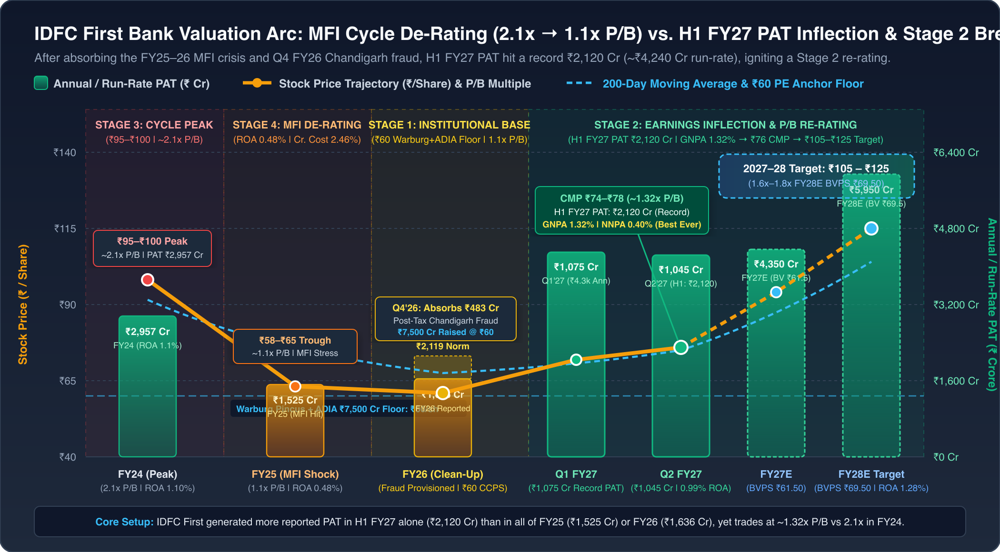
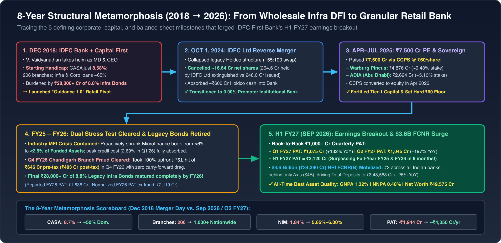
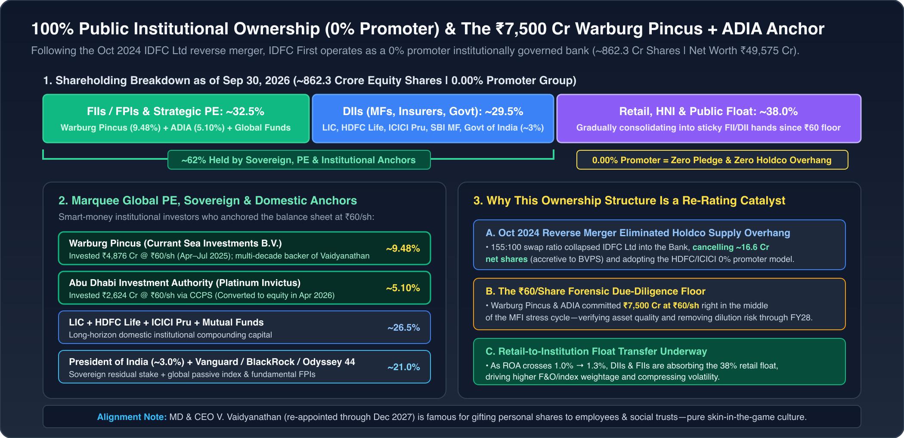
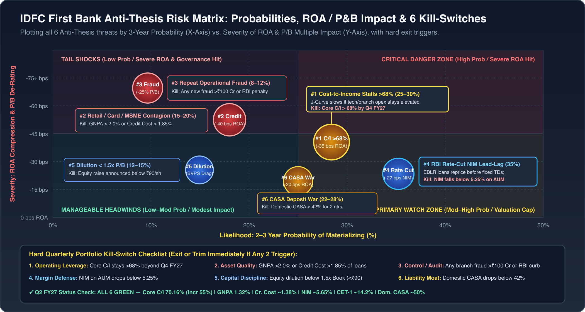
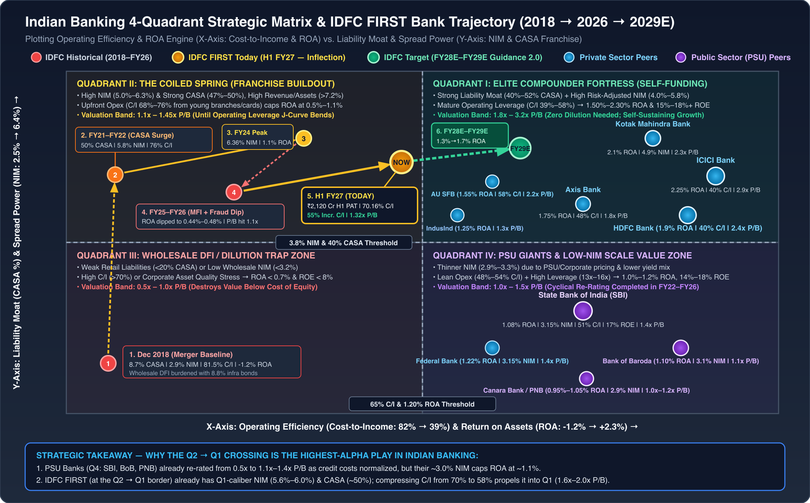

# Forensic, Valuation & Institutional Timing Upgrade: IDFC FIRST Bank Ltd

**Report Suite Navigation:**  
📍 **[1. Master Summary](./Summary.md)** | 📊 **[2. Forensic, Valuation & Timing Upgrade (You Are Here)](./Forensic-Valuation-And-Timing-Upgrade.md)** | ⚙️ **[3. Financial & Unit Economics Framework](./Financial%20Analysis%20Framework%20For%20IDFC%20First%20Bank.md)** | 🔗 **[4. Banking Value Chain & Liability Moat](./Banking%20Value%20Chain%20And%20Liability%20Moat%20Analysis.md)** | 🚀 **[5. Vision 2030 Strategy & Operating Leverage Roadmap](./Vision%202030%20Strategy%20And%20Operating%20Leverage%20Roadmap.md)**

> [!NOTE]
> **Purpose of This Document (Modules 2–6 & Module 8 BFSI Forensics):**  
> Our foundational reports—**[Financial Analysis Framework](./Financial%20Analysis%20Framework%20For%20IDFC%20First%20Bank.md)**, **[Banking Value Chain & Liability Moat](./Banking%20Value%20Chain%20And%20Liability%20Moat%20Analysis.md)**, and **[Vision 2030 Strategy](./Vision%202030%20Strategy%20And%20Operating%20Leverage%20Roadmap.md)**—establish **Module 1 (Banking Business Model, Liability Moat & DuPont Unit Economics)**. This document completes the 360-degree institutional thesis by applying **Module 8 (BFSI Forensic Rulebook)**: auditing **Asset Quality & MFI Stress Normalization**, **Corporate Restructuring & The ₹7,500 Cr Warburg/ADIA Infusion**, **The Q4 FY26 Chandigarh Branch Fraud Write-Off**, **The Operating Leverage J-Curve vs. Dilution Debate**, **Price-to-Book (P/B) Re-Rating Math**, and **Six Anti-Thesis Kill-Switches**.

---

## 1. The Real-World Lesson: Why IDFC FIRST Bank De-Rated from 2.1x to 1.1x P/B in FY25–FY26, Then Inflected to ₹2,120 Cr PAT in H1 FY27

*📊 [Click to Open Crisp Vector SVG](./charts/01_valuation_de_rating_vs_earnings_inflection.svg)*

### A. Complete Multi-Year Performance & Valuation Arc (FY24 $\rightarrow$ Nov 2026)

| Metric | FY24 Peak Optimism (Ended Mar '24) | FY25 Actual (MFI Downcycle) | FY26 Actual (MFI Peak + Fraud Hit) | Q1 FY27 (Ended Jun 30, 2026) | **Q2 FY27 (Ended Sep 30, 2026)** | **H1 FY27 Cumulative (Apr–Sep 2026)** | Key Structural Shift |
| :--- | :---: | :---: | :---: | :---: | :---: | :---: | :--- |
| **Total Deposits** | ₹2,00,570 Cr | ₹2,52,065 Cr *(+25.7% YoY)* | ₹2,94,475 Cr *(+16.8% YoY)* | ₹3,11,892 Cr *(+18.0% YoY)* | **₹3,48,583 Cr** *(+25.9% YoY, +11.8% QoQ)* | **₹3,48,583 Cr** *(+18.4% in 6M)* | Mobilized **$3.6B (₹34,390 Cr) FCNR(B)** in Q2 FY27; ~50% Domestic CASA |
| **Funded Assets (Loans)** | ₹2,00,965 Cr | ₹2,41,926 Cr *(+20.4% YoY)* | ₹2,90,278 Cr *(+20.0% YoY)* | ₹3,05,370 Cr *(+21.0% YoY)* | **₹3,46,913 Cr** *(+30.1% YoY / +22.2% org)* | **₹3,46,913 Cr** *(89.9% Dom. CD)* | MFI shrunk from ~6% to **<2.5%**; Infra <1%; ~80% granular retail/MSME |
| **Net Interest Income (NII)** | ₹16,451 Cr *(6.36% NIM)* | ₹19,292 Cr *(6.09% NIM)* | ₹21,216 Cr *(5.72% NIM)* | **₹5,972 Cr** *(+21.1% YoY; 5.96% NIM)* | **₹6,184 Cr** *(+21.0% YoY; 5.58% NIM)* | **₹12,156 Cr** *(+21.0% YoY; ~5.77% NIM)* | NII compounding at 21% YoY; high-cost 8.8% legacy bonds retired in FY26 |
| **Core PPOP (Ex-Trading)** | ₹6,030 Cr *(72.9% C/I)* | ₹7,009 Cr *(72.8% C/I)* | ₹7,186 Cr *(73.0% Core C/I)* | **₹2,371 Cr** *(+36.0% YoY; 70.73% C/I)* | **₹2,527 Cr** *(+38.5% YoY; 70.16% C/I)* | **₹4,898 Cr** *(+37.3% YoY; 70.44% C/I)* | **H1 Incremental Cost-to-Income dropped to 55%** (Opex +500 bps slower than Income!) |
| **Credit Cost (% Assets)** | ~1.32% *(Funded)* | ~1.73% *(Funded)* | 2.13% Funded *(1.52% Tot)* | ~1.25% *(₹515 Cr CGFMU buffer)* | **1.01% Avg Assets** *(~1.38% Funded)* | **~1.12% Avg Assets** | Intra-FY26 peak passed: 2.69% (Q1) $\rightarrow$ 2.24% (Q2) $\rightarrow$ 2.05% (Q3) $\rightarrow$ 1.63% (Q4) $\rightarrow$ **1.01% Avg Assets (Q2 FY27)** |
| **Profit After Tax (PAT)** | **₹2,957 Cr** *(1.10% ROA)* | **₹1,525 Cr** *(0.48% ROA)* | **₹1,636 Cr Rep** *(₹2,119 Cr Norm)* | **₹1,075 Cr** *(+132.4% YoY; 1.06% ROA)* | **₹1,045 Cr** *(+196.5% YoY; 0.93% ROA)* | **₹2,120 Cr** *(+160% YoY; 0.99% ROA)* | **6-month H1 FY27 PAT (₹2,120 Cr) exceeds full-year FY25 (₹1,525 Cr) & FY26 (₹1,636 Cr)!** |
| **GNPA (%) / NNPA (%)** | 1.88% / 0.60% | 1.87% / 0.53% | 1.61% / 0.48% | 1.51% / 0.44% | **1.32% / 0.40%** *(All-Time Best)* | **1.32% / 0.40%** | Already achieved FY29 Guidance 2.0 target (<1.5% GNPA, <0.4% NNPA) |
| **Book Value (BVPS) & P/B** | ₹45.50 *(~1.7x–2.1x P/B)* | ₹51.80 *(~1.1x–1.3x P/B)* | ₹55.10 *(~1.1x–1.3x P/B)* | ₹56.30 | **₹57.49** *(~1.30x–1.35x P/B)* | **~1.22x FY27E \| ~1.08x FY28E P/B** | Multiple compressed ~40% during MFI storm; now coiled for ROA-led re-rating |

### B. Why Did This Happen? (The Twin-Engine Physics of Banking: Credit Cycle $\times$ Operating Leverage)
1. **What 2.1x P/B Priced In at the Sept 2023 Peak (~₹100/share):** In late 2023, after FY23/FY24 ROA reached 1.10% (PAT ₹2,957 Cr), retail investors priced in a straight-line march to 1.8% ROA without factoring in a cyclical credit test or branch-expansion cost stickiness.
2. **Why the Stock De-Rated to ₹58–₹65 (~1.1x P/B) Across FY25–FY26:** Two back-to-back shocks hit the P&L:
   * **Shock 1 — The Industry-Wide Microfinance (MFI) Over-Leveraging Crisis (FY25 – H1 FY26):** Elevated JLG borrower indebtedness across India forced IDFC FIRST Bank to take heavy provisions (credit cost peaked at **2.69% of funded assets in Q1 FY26** and averaged **2.13% for FY26**) while proactively shrinking its high-yield MFI book from ~6% to <2.5% (which compressed NIM from 6.36% in FY24 to 5.72% in FY26).
   * **Shock 2 — The Q4 FY26 Chandigarh Branch Manual Fraud (Feb–Mar 2026):** Just as MFI credit costs dropped to 1.63% in Q4 FY26, an isolated physical-cheque collusion fraud of **₹646 Cr pre-tax (₹483 Cr post-tax)** was uncovered in Haryana Government accounts at the Chandigarh Sector-32 branch. Management expensed **100% of the ₹483 Cr post-tax hit in Q4 FY26**, dropping reported Q4 PAT to ₹319 Cr (vs. ₹746 Cr normalized) and full-year FY26 reported PAT to ₹1,636 Cr (₹2,119 Cr normalized).
3. **Why H1 FY27 Marks the Structural Inflection:**
   * With the Chandigarh fraud 100% written off behind it and MFI credit costs normalizing (**Q2 FY27 credit cost fell to 1.01% of average assets**, while MFI collection efficiency recovered to **99.5%+**), the underlying earning power of the ₹3.48 Lakh Cr deposit franchise finally surfaced: **Q1 FY27 PAT hit an all-time record ₹1,075 Cr (+132.4% YoY)** and **Q2 FY27 PAT followed at ₹1,045 Cr (+196.5% YoY)**—delivering **₹2,120 Cr of PAT in just 6 months!**

---

## 2. Module 8 BFSI Forensic Audit: The IDFC Reverse Merger, ₹7,500 Cr Warburg/ADIA Infusion & The Chandigarh Branch Fraud

### A. Visual Timeline: 8-Year Balance Sheet & Governance Metamorphosis (2018 $\rightarrow$ 2026)

*📊 [Click to Open Crisp Vector SVG](./charts/07_corporate_transformation_and_capital_flow.svg)*

### B. Five Critical Forensic Realities to Keep in Mind

| Forensic Topic | Cross-Validated Fact & Balance Sheet Reality |
| :--- | :--- |
| **1. Oct 1, 2024 Reverse Merger of IDFC Ltd (Accretive Share Cancellation)** | • **Swap Ratio (155 : 100):** IDFC Financial Holding Co. and IDFC Ltd merged into IDFC FIRST Bank effective **Oct 1, 2024** (Record Date: Oct 10, 2024). While IDFC Ltd held **264.64 Cr shares** of the bank, the bank issued only **~248.0 Cr new shares** to IDFC Ltd shareholders—resulting in a **net cancellation of ~16.64 Crore equity shares (~2.2% share count reduction)** and adding ~₹600+ Cr of cash/net assets. • **Zero Promoter Overhang (0.00% Promoter):** Eliminated the 2-tier holding company structure forever, turning IDFC FIRST Bank into a **100% institutionally/publicly governed bank** alongside *HDFC Bank, ICICI Bank, and Axis Bank*. |
| **2. Apr–Jul 2025 ₹7,500 Cr Preferential Issue to Warburg Pincus & ADIA (@ ₹60/sh)** | • **The Deal Structure:** In April 2025, the Board approved a **₹7,500 Crore** allotment of Compulsorily Convertible Cumulative Preference Shares (CCPS) at **₹60/share** (converting 1:1 into 125 Crore equity shares): **₹4,876 Cr from Warburg Pincus (*Currant Sea Investments B.V.* for ~9.48% stake)** and **₹2,624 Cr from Abu Dhabi Investment Authority — ADIA (*Platinum Invictus B 2025 RSC Ltd* for ~5.10% stake)**. • **Governance Check (May 2025 Postal Ballot):** Institutional shareholders approved the capital raise by ~99%+, *but* voted down a clause giving Warburg Pincus a permanent non-retiring board seat without maintaining a minimum threshold—forcing PE to play by strict public-governance rules! |
| **3. Forensic Audit of the Feb 2026 Chandigarh Sector-32 Branch Fraud (₹646 Cr Pre-Tax / ₹483 Cr Post-Tax)** | • **What Happened:** In Feb 2026, discrepancies of ~₹590–₹646 Cr surfaced in Haryana Government accounts at a single branch (Chandigarh Sector-32). • **Was It a Core-Banking IT Hack? NO:** Independent forensic audit (**KPMG**) and law-enforcement filings confirmed it was a localized **manual physical-cheque & debit-instruction collusion** by local branch staff with external fraudsters. • **Accounting & P&L Treatment:** Rather than amortizing the hit over 4 quarters, management took a **100% upfront write-off in Q4 FY26 (₹646 Cr pre-tax / ₹483 Cr post-tax)**, ensuring **zero hangover in FY27**. Any future police/court recoveries will flow back as pure write-back profit. |
| **4. FY26 Final Retirement of 8.8% Legacy Infrastructure Bonds** | • At the time of the Dec 2018 merger, IDFC Bank was saddled with **₹28,000+ Cr of 8.5%–9.0% fixed-rate legacy infrastructure bonds** that dragged NIM down by 40–60 bps for 7 years. • During **FY26**, the final major tranches matured and were replaced by granular retail deposits and **US$3.6 Billion (~₹34,390 Cr) of FCNR(B) deposits in Q2 FY27**—permanently structurally lowering the bank's cost of funds. |
| **5. Q1 FY27 ₹515 Cr CGFMU Government Guarantee Recovery & Buffer** | • Because IDFC FIRST Bank had proactively insured its MFI portfolio under the Government of India's **CGFMU (Credit Guarantee Fund for Micro Units)** scheme, it received a **₹515 Crore cash claim payout in Q1 FY27 (Jun 2026)**. • **Ultra-Conservative Accounting:** Instead of inflating Q1 FY27 PAT to ₹1,460 Cr with the ₹515 Cr CGFMU payout, the bank **set aside 100% of the ₹515 Cr into a voluntary macro/geopolitical contingency provision buffer**—and *still* reported a record **₹1,075 Cr PAT**! |

---

### C. The Two-Sided Narrative: Is IDFC FIRST Bank a "Serial Equity Diluter with Sticky 70% Opex" or "The Next ICICI Bank Coiled Spring"?

To avoid confirmation bias, an institutional BFSI investor must weigh **both sides of the street's debate** side-by-side:

| Dimension | 🔴 Side A: The Cynical / Bear Narrative ("Why ROE Was Stuck Below 10% & Share Count Doubled") | 🟢 Side B: The Fundamental / Institutional Counter-Narrative ("Why the 7-Year Buildout Is Done & H1 FY27 Proves the Inflection") |
| :--- | :--- | :--- |
| **1. Equity Dilution History (From ~478 Cr to ~862 Cr Shares)** | • Since the Dec 2018 merger, IDFC FIRST Bank has raised equity almost every 18–24 months (2020 preferential, 2021 QIP, Oct 2023 ₹3,200 Cr QIP at ₹80.63, Jul 2024 ₹3,200 Cr preferential at ₹80.63, and Apr 2025 ₹7,500 Cr CCPS at ₹60). • Bears argue that growing loans at 20% while generating only 4%–10% ROE forces perpetual dilution, capping per-share EPS and BVPS compounding. | • **Why Capital Was Needed in Phase 1 (2019–2025):** V. Vaidyanathan had to simultaneously write off ₹28,000 Cr of legacy wholesale DFI bad loans *and* build 1,000+ retail branches, ATMs, and digital rails from scratch. • **What Changed in 2026:** Net Worth now stands at **₹49,575 Cr**, CRAR is **14.67%**, legacy infra loans are **<1%**, and H1 FY27 PAT annualized is **~₹4,400+ Cr** (heading to ~₹5,900 Cr in FY28E). As ROE crosses **12%–15% over FY28–FY29**, internal profit retention will self-fund 15%–18% loan growth! |
| **2. The 70%+ Cost-to-Income (C/I) Stickiness Debate** | • Management originally guided that Cost-to-Income would fall to 55% by FY25. Instead, Core C/I remained stuck at **72.9% (FY24)** and **73.0% (FY26)** as branch rollouts, 5M+ credit card onboarding costs, and MFI revenue contraction offset scale gains. | • **Look Under the Hood at Incremental C/I (55% in H1 FY27!):** A newly opened bank branch or credit card cohort runs at **>100% C/I in Years 1–2** before dropping to **<45% C/I in Years 4–6**. In **H1 FY27**, Opex grew ~500 bps slower than Operating Income, driving **Incremental Cost-to-Income down to 55%**, Core C/I down from 73.0% to **70.16% (Q2 FY27)**, and **Core PPOP up +38.5% YoY to ₹2,527 Cr**! |
| **3. Asset Quality & Operational Controls (MFI + Chandigarh Fraud)** | • In FY25–FY26, the bank lost ~₹2,500+ Cr in incremental MFI provisions and ₹646 Cr pre-tax in the Chandigarh branch manual fraud, proving that high-yield retail banking carries tail risks. | • **Stress-Test Passed with 1.32% GNPA & 0.40% NNPA:** Exclude MFI (now **<2.5% of book** with **99.5%+ collection efficiency** and CGFMU insurance), and the remaining **97.5% of the ₹3.47 Lakh Cr loan book** maintained **<1.9% credit cost** and **1.32% GNPA / 0.40% NNPA** right through the cycle! |

> [!IMPORTANT]
> **The Institutional Playbook: How to Ride the "ICICI Bank 2019 $\rightarrow$ 2024" Operating Leverage Wave**  
> 1. **Rule 1 — Buy a Granular Bank When Credit-Cycle Provisioning Masks Core PPOP Growth:** In 2018–2019, *ICICI Bank* traded at **1.2x–1.4x Book Value** because legacy corporate provisions masked its booming retail deposit and PPOP engine. Once credit costs normalized and Cost-to-Income fell, ROA doubled from 0.8% to 2.1% and the stock re-rated from 1.3x P/B to **3.0x P/B (a 4x compounding run)**.  
> 2. **Rule 2 — Anchor on Warburg Pincus & ADIA's ₹60/Share Floor:** In April 2025, two of the sharpest financial investors in the world—**Warburg Pincus** (which backed V. Vaidyanathan at *Capital First* from ₹120 to ₹850+) and **ADIA**—conducted deep forensic due diligence in the middle of the MFI crisis and wrote a **₹7,500 Crore cheque at ₹60/share (~1.05x Book)**. Buying at **~₹74–₹78 (~1.30x–1.35x trailing Book / ~1.08x FY28E Book)** after both the MFI crisis and Chandigarh fraud have been fully expensed gives you a clean ride alongside their 5-year compounding horizon.

---

### D. Forensic Deep-Dive: Why Has IDFC FIRST Bank Kept Diluting Equity Every 12–18 Months? (The $\text{ROE} < g_{\text{RWA}}$ Capital-Burn Treadmill)

Since the December 2018 merger, IDFC FIRST Bank's equity share count has expanded by **+80.3% (from 478.2 Crore shares in Dec 2018 to ~862.3 Crore shares in Sep 2026)** across **6 separate capital raises totaling ~₹20,896 Crore**:

| Round | Date | Capital Raised | Issue Price | Shares Issued | Dilution Trigger / Why the Bank Ran Out of Capital |
| :-: | :--- | :---: | :---: | :---: | :--- |
| **Merger** | **Dec 2018** | — | — | **478.2 Cr** *(Base)* | Post-Capital First merger baseline; inherited ₹28,000+ Cr of toxic infra/corporate loans. |
| **1** | **Jun 2020** | **₹2,000 Cr** | **₹23.19 / sh** | +86.24 Cr | **Survival Rescue Capital:** ₹2,864 Cr net loss in FY20 from writing off Reliance Cap, DHFL & infra loans + COVID-19 lockdown hit CET-1 down to 13.3%. |
| **2** | **Apr 2021** | **₹3,000 Cr** | **₹57.35 / sh** | +52.31 Cr | **Post-COVID Retail Growth & Provisioning:** Needed buffer for COVID Wave-2 retail restructuring while funding early branch expansion (ROE was just ~2.5%). |
| **3** | **Mar 2023** | **₹2,196 Cr** | **₹58.18 / sh** | +37.75 Cr | **Preferential to IDFC Ltd:** Funded 25% loan growth as RWA grew twice as fast as FY23 ROE (10.0%). |
| **4** | **Oct 2023** | **₹3,000 Cr** | **₹90.25 / sh** | +33.24 Cr | **QIP at Peak Valuation (~2.0x P/B):** Raised just before RBI hiked Risk Weights by +25% on consumer credit (Nov 2023), which ate ~80–100 bps of CET-1 overnight. |
| **5** | **Jul 2024** | **₹3,200 Cr** | **₹80.63 / sh** | +39.69 Cr | **Preferential Issue (LIC, HDFC Life, ICICI Pru):** Needed because 24% loan growth + 72.9% C/I ratio burned ~140 bps of CET-1 in FY24. *(Partially offset in Oct 2024 when IDFC Ltd Reverse Merger cancelled -16.64 Cr shares).* |
| **6** | **Apr–Jul 2025** | **₹7,500 Cr** | **₹60.00 / sh** | +125.00 Cr *(CCPS)* | **Warburg Pincus (₹4,876 Cr) + ADIA (₹2,624 Cr):** MFI crisis slashed FY25 ROE to 4.3% (PAT ₹1,525 Cr) while loans grew 20.4%, forcing a massive Tier-1 refill at ~1.08x Book. |

#### The 4 Structural Reasons Why IDFC FIRST Was Trapped on the Dilution Treadmill (And Why EPS Lagged PAT):
1. **The Brutal Law of Banking Capital ($\text{ROE} < \text{RWA Growth}$):**
   $$\text{Annual CET-1 Capital Burn (bps)} = \left(\text{ROE} - \text{RWA Growth Rate } g_{\text{RWA}}\right) \times \text{CET-1 Ratio}$$
   Between FY21 and FY26, IDFC FIRST grew loans at **20%–25% per year**, while its ROE averaged **4% to 10.3%** (held down by 72%–75% Cost-to-Income and credit cycles). Whenever a bank grows Risk-Weighted Assets at **21%** while earning **7% ROE**, there is a **14% annual capital deficit**—burning **~150–180 bps of CET-1 every 12 months** and forcing a QIP every 18 months!
2. **Punitive Risk-Weight (RWA) Density (~78%–82% vs. ~65% at Peers):**
   Because IDFC FIRST's asset book is ~80% retail, consumer durable, two-wheeler, MSME, and credit cards (where RBI raised risk weights to **125%** in Nov 2023), every ₹100 of new loans consumes far more Tier-1 capital than a 35%–50% risk-weight prime home loan or AAA corporate loan at HDFC/ICICI Bank.
3. **The "PAT Grows 49%, But EPS Grows Only 18%" Per-Share Drag:**
   Because share count ballooned from **707 Cr shares (FY24)** to **~862.3 Cr shares (FY27)**, even when full-year PAT climbs **+49% from ₹2,957 Cr (FY24) to ~₹4,400 Cr (FY27E)**, **EPS only moves from ₹4.30 to ~₹5.10 (+18.6% total over 3 years, or just ~5.8% CAGR)!**
4. **Watch the Q2 FY27 CET-1 Warning Light (13.00% CET-1 / 14.67% CRAR):**
   Even after the ₹7,500 Cr Warburg/ADIA infusion in 2025, rapid +30.1% YoY loan growth in Q2 FY27 has already brought standalone **CET-1 down to 13.00% (Total CRAR 14.67%)**. **Forensic Bottom Line:** Unless ROE climbs above **12%–14% by FY28–FY29** (via C/I dropping toward 63%–65%) *or* loan growth moderates to 17%–18%, IDFC FIRST Bank will likely need **one more ₹4,000–₹5,000 Cr capital raise in FY28**—and our #1 requirement is that any such raise must happen at **>1.5x–1.7x P/B (₹105+)** so it is book-value accretive rather than dilutive!

---

## 3. Module 2 & 8 Forensic Stress-Test: Asset Quality, Denominator Math & NIM Trajectory

### A. Asset Quality Forensics: Is the 1.32% GNPA / 0.40% NNPA Real or "Denominator Management"? (Module 8 Check)
Per **Module 8 (Section 3)**, we never take headline GNPA % at face value without checking **Lagged Slippages, PCR, and Segmental Stress**:
1. **Sequential GNPA & NNPA Compression Across 6 Quarters:**
   $$\text{GNPA Trajectory: } 1.97\% \text{ (Q1 FY26)} \rightarrow 1.86\% \text{ (Q2 FY26)} \rightarrow 1.69\% \text{ (Q3 FY26)} \rightarrow 1.61\% \text{ (Q4 FY26)} \rightarrow 1.51\% \text{ (Q1 FY27)} \rightarrow \mathbf{1.32\% \text{ (Q2 FY27)}}$$
   $$\text{NNPA Trajectory: } 0.55\% \text{ (Q1 FY26)} \rightarrow 0.52\% \text{ (Q2 FY26)} \rightarrow 0.53\% \text{ (Q3 FY26)} \rightarrow 0.48\% \text{ (Q4 FY26)} \rightarrow 0.44\% \text{ (Q1 FY27)} \rightarrow \mathbf{0.40\% \text{ (Q2 FY27)}}$$
2. **Credit Cost De-Escalation Proof:** If a bank were hiding bad loans via denominator growth, credit costs would remain elevated. Instead, quarterly credit cost (% of average funded assets) fell steadily for five straight quarters: **2.69% (Q1 FY26) $\rightarrow$ 2.24% (Q2 FY26) $\rightarrow$ 2.05% (Q3 FY26) $\rightarrow$ 1.63% (Q4 FY26) $\rightarrow$ ~1.38% funded / 1.01% of average total assets (Q2 FY27)**!
3. **Provision Coverage & Contingency Buffer:** Provision Coverage Ratio (PCR) sits near **~70%+**, backed by the **₹515 Crore voluntary contingency buffer** created in Q1 FY27 from the CGFMU claim receipt.

### B. The NIM & Liquidity Dynamic: Decoding the Q2 FY27 US$3.6 Billion FCNR(B) Mobilization
* **What Happened in Q2 FY27:** Total deposits jumped **+11.8% QoQ (+₹36,691 Cr in 90 days!)** to **₹3,48,583 Cr**, propelled by **~US$3.6 Billion (~₹34,390 Cr) in FCNR(B) deposits**.
* **Why Did Reported NIM Dip from 5.96% (Q1 FY27) to 5.58% (Q2 FY27) While NII Still Grew +21.0% YoY to ₹6,184 Cr?**
  Because deploying ₹34,390 Cr of bulk foreign-currency deposits into matched-maturity IBU/corporate assets and liquid buffers carries a narrower **~1.5%–2.2% net spread** (though with **near-zero credit cost and zero branch opex**!). Adding ₹34,390 Cr to the denominator optically lowered blended NIM by ~35 bps in Q2, while still adding positive net interest income dollars. As excess liquidity is deployed into core retail/commercial credit in H2 FY27, management guides **NIM recovery to ~5.80% by Q4 FY27**.

---

## 4. Module 5 & 6 Deep-Dive: 100% Public Ownership, Warburg/ADIA Game Theory & Upgraded "₹105–₹125" Target Math

### A. Exact Shareholding Split (Q2 FY27 / Sep 30, 2026) & Institutional Game Theory

*📊 [Click to Open Crisp Vector SVG](./charts/05_shareholding_warburg_adia_ownership.svg)*

| Category | Shares (Cr) | Holding % (Sep '26) | Institutional Game-Theory Behavior |
| :--- | :---: | :---: | :--- |
| **Promoter Group** | 0.00 Cr | **0.00%** | **Zero Promoter Supply Overhang:** Unlike PE-controlled IPOs, there is no 75% SEBI MPS forced-selling clock. |
| **Strategic Global PE & Sovereign Wealth (Warburg Pincus + ADIA)** | ~125.7 Cr | **~14.58%** | **Warburg Pincus (~9.48% via *Currant Sea Investments*)** & **ADIA (~5.10% via *Platinum Invictus*)** invested ₹7,500 Cr at **₹60/sh**. Target exit multiple for Warburg in Indian financials is historically **2.5x–3.5x MOIC (₹150–₹210/sh)** over 4–6 years. |
| **Other FIIs / FPIs** | ~150.3 Cr | **~17.42%** | **Odyssey 44 (~2.5%+)**, **Vanguard**, **BlackRock**, **GQG / Emerging Market Funds**. Under-owned relative to HDFC/ICICI (~45%–55% FII), leaving massive FII re-rating headroom. |
| **DIIs (Insurance, Mutual Funds & Govt of India)** | ~255.2 Cr | **~29.60%** | **LIC (~2.3%)**, **President of India (~3.0%)**, **HDFC Life**, **ICICI Pru**, **SBI MF**, **Kotak MF**. Steadily accumulating on operating leverage inflection. |
| **Retail / HNI Public Float** | ~331.1 Cr | **~38.40%** | Retail float has contracted by >600 bps over the last 18 months as shares moved from impatient retail hands into Warburg, ADIA, and DIIs. |

---

### B. Upgraded "₹105–₹125 in 2027–28" Target Math (Post-H1 FY27 ₹2,120 Cr PAT Inflection)

In banking, equity value compounds through the **Twin Engines of Book Value Growth (ROE) and Price-to-Book (P/B) Multiple Expansion**:

| Valuation Step | Exact Mathematical Trajectory |
| :--- | :--- |
| **1. Current Baseline (Nov 2026)** | **CMP: ~₹76/share** \| **Shares:** ~862.3 Cr \| **Market Cap:** ~₹65,535 Cr \| **Q2 FY27 Net Worth:** ₹49,575 Cr (**BVPS: ₹57.49**) \| **Current Trailing P/B: 1.32x**. |
| **2. Upgraded FY27E Earnings & Book Value (Mar 2027)** | **H1 FY27 Actual:** NII ₹12,156 Cr (+21% YoY) \| Core PPOP ₹4,898 Cr (+37.3% YoY) \| **PAT ₹2,120 Cr (+160% YoY)**. **Full-Year FY27E (Mar '27):** With H2 seasonally stronger and credit costs at ~1.0%–1.1% of assets, full-year **FY27E PAT is on track for ~₹4,350–₹4,450 Cr (EPS: ~₹5.10; ROA: ~1.08%)**, lifting **FY27E Net Worth to ~₹53,000 Cr (FY27E BVPS: ~₹61.50)**. |
| **3. Upgraded FY28E Earnings & Book Value (Mar 2028)** | Assuming 20% NII growth (~₹30,500 Cr), Core C/I improving by 350 bps from 69.0% to **65.5%** (lifting Core PPOP +30% to **~₹13,400 Cr**), and steady credit costs, **FY28E PAT reaches ~₹5,850–₹6,000 Cr (EPS: ~₹6.85; ROA: ~1.28%; ROE: ~11.2%)**, lifting **FY28E Net Worth to ~₹59,900 Cr (FY28E BVPS: ~₹69.50)**. |
| **4. Implied Multiples at ₹110 – ₹120 Target Range** | • **At ₹110/share:** $\frac{₹110}{₹69.50\text{ (FY28E BVPS)}} = \mathbf{1.58\text{x Forward P/B}}$ \| $\frac{₹110}{₹6.85\text{ (FY28E EPS)}} = \mathbf{16.1\text{x Forward P/E}}$ • **At ₹122/share:** $\frac{₹122}{₹69.50\text{ (FY28E BVPS)}} = \mathbf{1.75\text{x Forward P/B}}$ \| $\frac{₹122}{₹6.85\text{ (FY28E EPS)}} = \mathbf{17.8\text{x Forward P/E}}$ |

> [!IMPORTANT]
> **Why This Re-Rating Has High Institutional Conviction:**  
> 1. **Book Value Alone Provides a Rising Floor:** Even if IDFC FIRST Bank experienced **zero P/B multiple expansion** from its historical 5-year median of ~1.45x P/B, **FY28E BVPS of ₹69.50 $\times$ 1.45x = ₹101/share (+33% upside)**.  
> 2. **ROA Expansion Unlocks Multiple Expansion (1.3x $\rightarrow$ 1.7x+ P/B):** In Indian private banks, moving ROA from **0.5% (FY25–26 trough)** to **1.25%–1.35% (FY28E)** and **1.55%+ (FY29E)** structurally shifts the bank from a "sub-cost-of-equity turnaround" (1.1x–1.3x P/B) to a "self-funding retail compounder" (**1.65x–2.0x P/B**), driving the stock to **₹110–₹125 in the Base Case** and **₹135–₹155 in the Bull Case**.

---

## 5. Summary of 3-Year Valuation Scenarios & Actionable Triggers

| Scenario | Loan / NII CAGR | FY28E Core C/I Ratio | FY28E ROA / ROE | Target FY28E P/B | **Target Price & Expected Return (vs. ~₹76 CMP / ₹60 Warburg Base)** |
| :--- | :---: | :---: | :---: | :---: | :--- |
| **Bear Case** *(Opex sticky; credit cost ticks up to 1.4% of assets)* | +16% – 17% | ~68.5% | ~0.95% ROA / ~8.5% ROE | 1.15x – 1.25x | **₹80 – ₹87** *(+5% to +14% from ₹76; +33% to +45% from ₹60 — protected by ₹69.50 BVPS)* |
| **Base Case (2027–28 Target)** *(55% Incremental C/I holds; ROA hits ~1.28%)* | +19% – 21% | **~65.5%** | **~1.28% ROA / ~11.2% ROE** | **1.50x – 1.75x** | **₹105 – ₹122** *(+38% to +60% from ₹76; +75% to +103% from ₹60)* |
| **Bull Case ("ICICI J-Curve")** *(C/I drops <63%; Wealth/Cards boom; ROA >1.45%)* | +22%+ | **< 63.0%** | **~1.48% ROA / ~13.5% ROE** | **1.90x – 2.20x** | **₹135 – ₹155+** *(+78% to +104% from ₹76; >2.3x from ₹60 over 24 months)* |

---

## 6. The 10-Year Horizon (2026 $\rightarrow$ 2036): Three Structural Bridges & Wealth Projections

### A. The Three Structural Bridges IDFC FIRST Bank Must Cross (2027–2031)
1. **Bridge 1 — Crossing the Cost-to-Income J-Curve (70.16% $\rightarrow$ $\le 55\%$):**
   * Today, IDFC FIRST Bank generates a **higher Total Operating Income to Assets (~7.30%)** than *HDFC Bank* or *ICICI Bank* (~5.5%–6.0%), yet earns a lower ROA (**0.99% vs. 1.9%–2.2%**) **solely because its Operating Expense to Assets is ~5.14% (70.16% C/I) vs. ~2.3%–2.5% (40% C/I) at ICICI/HDFC**!
   * **The Math of the Bridge:** As the 1,000+ branches opened between 2019 and 2025 scale from ₹250–₹340 Cr of deposits per branch toward ₹600+ Cr per branch, and as the 5M+ credit card book matures past upfront customer acquisition cost (CAC), compressing Cost-to-Income by **1,200 bps (from 70% to 58%)** flows **~90 bps straight to pre-tax ROA (+68 bps post-tax ROA)**—lifting ROA from **0.99% to 1.67%** *even with zero expansion in NIM!*
2. **Bridge 2 — Crossing the "Self-Sustaining ROE Threshold" (ROE > Loan Growth Rate):**
   * Per **Module 8 (Section 5)**, a bank growing Risk-Weighted Assets at **18% per year** while generating only **8%–9% ROE** consumes Tier-1 capital every year and must issue shares every 2–3 years.
   * Once IDFC FIRST Bank's ROE crosses **15%–16.5% (projected by FY29–FY30)** while loan growth moderates to a mature **16%–18% CAGR**, internal profit retention will **100% self-fund future growth**—ending equity dilution forever and triggering a permanent P/B multiple expansion to **1.8x–2.2x Book**.
3. **Bridge 3 — Scaling Non-Credit Fee Engines (Wealth Management, Credit Cards, FASTag & Cash Management):**
   * Fee income is already **₹2,285 Cr/quarter (+24.5% YoY in Q2 FY27; 92% granular retail)**. Scaling Wealth Management AUM and Credit Cards (>5M cards in force) provides capital-light, zero-RWA ROE expansion.

### B. 10-Year Stock Price & Book Value Projections (2026 $\rightarrow$ 2036)
* **Baseline (Nov 2026):** Warburg/ADIA Floor = **₹60** | Current Price = **~₹76** | Sep '26 BVPS = **₹57.49** | H1 FY27 PAT = **₹2,120 Cr (FY27E PAT ~₹4,400 Cr)**.

| 10-Year Scenario (2026 $\rightarrow$ 2036) | 10-Yr BVPS CAGR (off ₹57.49) | 2036 Projected BVPS (2036E PAT) | 2036 Exit P/B Multiple | **2036 Expected Stock Price** | **10-Yr Cumulative Dividends/Share** | **Total Wealth Multiplier (vs. ~₹76 CMP / ₹60 Floor)** |
| :--- | :---: | :---: | :---: | :---: | :---: | :---: |
| **1. Bear Case** *(Opex stays ~65%; ROE capped at 10%–11% with dilution)* | **10.0% CAGR** | ₹149.00 *(~₹13,500 Cr)* | 1.10x P/B | **~₹165** | + ₹12 | **~2.3x on ₹76 (~2.9x on ₹60)** |
| **2. Base Case ("Guidance 2.0" Compounder)** *(C/I reaches ~57%; 1.65% ROA / 15.5% ROE)* | **14.5% CAGR** | **₹222.50** *(~₹28,500 Cr)* | **1.80x P/B** | **₹395 – ₹415** | **+ ₹28** | **~5.5x on ₹76 (~7.2x on ₹60)** |
| **3. Bull Case (Tier-1 Private Bank Franchise)** *(C/I <53%; 1.95% ROA / 18% ROE)* | **17.0% CAGR** | **₹276.00** *(~₹42,000 Cr)* | **2.25x P/B** | **~₹620+** | **+ ₹40** | **~8.7x on ₹76 (~11.0x on ₹60)** |

---

## 7. The Complete 10-Point Anti-Thesis Matrix: Probabilities, ROA/P&B Impact & Kill-Switches

To eliminate confirmation bias, we track **All 10 Institutional Anti-Thesis Scenarios**—covering cost structure, credit contagion, dilution physics, liability quality, operational controls, and leadership succession—that could derail the re-rating thesis:

*📊 [Click to Open Crisp Vector SVG](./charts/06_anti_thesis_risk_probability_matrix.svg)*

### A. Detailed Mechanism of All 10 Anti-Thesis Vectors

1. **Anti-Thesis 1 — The "Operating Leverage Mirage" (Core Cost-to-Income Refuses to Drop Below 68%):**
   * *Mechanism:* The bull thesis rests on Core C/I compressing from **70.16% (Q2 FY27)** to **~65.5% (FY28E)** and **<58% (FY29–30)**. If relentless technology vendor inflation, deposit-mobilization marketing spend, or wage hikes cause Opex to grow at 18%–20% alongside income, C/I will plateau around 68%–70%, trapping ROA at ~1.0% and ROE below 10%.
   * *Current H1 FY27 Status:* **On track**—Opex grew ~500 bps slower than Income in H1 FY27 (**55% Incremental C/I**).
2. **Anti-Thesis 2 — Second-Wave Retail Credit Contagion (Unsecured Personal Loans, Credit Cards or MSME Slippages):**
   * *Mechanism:* While MFI has been shrunk to **<2.5% of the book**, IDFC FIRST Bank still has meaningful exposure to consumer durables, personal loans, credit cards (>5M cards), commercial vehicles, and MSME loans. If urban household leverage or an MSME slowdown triggers a second credit cycle, credit costs could jump from **1.01% of average assets back above 1.60%+**, consuming 35%–45% of PPOP.
3. **Anti-Thesis 3 — Branch-Level Operational Control & Governance Failure (Repeat of the Feb 2026 Chandigarh Fraud):**
   * *Mechanism:* Rapidly scaling a branch network creates operational risk if maker-checker controls lag. In Feb 2026, local employee collusion at the Chandigarh Sector-32 branch caused a **₹646 Cr pre-tax (₹483 Cr post-tax)** manual cheque fraud in Haryana Government accounts. While isolated and 100% written off in Q4 FY26 after a KPMG forensic audit, a second major operational breach could invite **RBI supervisory penalties or branch expansion embargoes** (similar to RBI's past actions on Kotak or HDFC Bank).
4. **Anti-Thesis 4 — Aggressive RBI Rate-Cut Cycle Compressing EBLR Loan Yields Faster Than 7% Peak Savings Rates:**
   * *Mechanism:* When the RBI cuts repo rates by 75–100 bps, External Benchmark Linked Rate (EBLR) mortgages and MSME loans (~40% of book) reprice downward immediately, whereas cutting savings account (SA) interest rates risks slowing CASA inflows.
   * *Mitigation:* Roughly **~55%–60% of IDFC FIRST's retail loan book (vehicle loans, consumer loans, credit cards, MSME fixed-rate)** is **fixed-rate**, providing a natural cushion during an RBI rate-cut cycle!
5. **Anti-Thesis 5 — The Serial Equity Dilution Trap ("Round 7 Dilution" as CET-1 Hits 13.00%):**
   * *Mechanism:* Because IDFC FIRST has a high Risk-Weighted Asset (RWA) density (~78%–82% due to consumer/MSME loans) and is growing loans at **20%–22% YoY** while ROE is still **~8.8%–11%**, standalone **CET-1 is already at 13.00% (CRAR 14.67%) as of Sep 2026**. If ROE does not scale rapidly above 12%–13%, the bank will likely need a **7th equity raise (~₹4,000–₹5,000 Cr) by FY28**—which, if done below 1.4x P/B, will once again dilute per-share EPS and BVPS compounding.
6. **Anti-Thesis 6 — CASA Ratio Erosion & Systemic Deposit War:**
   * *Mechanism:* If Indian household savings continue shifting into mutual fund SIPs and equities, forcing private banks into a deposit rate war, CASA could slip below 44% and force reliance on expensive bulk term deposits.
7. **Anti-Thesis 7 — The "NBFC Asset Book Inside a Bank Cost Structure" Structural Mismatch:**
   * *Mechanism:* Hardcore bears argue that IDFC FIRST's high-yield consumer/MSME asset book (Capital First DNA yielding ~13.5%–15%) permanently requires intensive field collections, small-ticket origination staff, and 1.4%–1.8% credit cost—meaning its Cost-to-Income ratio has a **structural floor at 62%–64%** (unlike ICICI/HDFC's 40% C/I on large-ticket corporate and mortgage loans) while still suffering the **22.5% CRR/SLR regulatory drag** of a universal bank.
8. **Anti-Thesis 8 — Low Current Account (CA) Mix & 7.0% Peak Savings Slab "Rate-Sensitive CASA" Vulnerability:**
   * *Mechanism:* Not all 50% CASA ratios are equal. At *ICICI/HDFC Bank*, **14%–16% of total deposits are 0%-interest Current Accounts (CA)** and Savings Accounts (SA) earn just **3.00%–3.50%**. At IDFC FIRST Bank, **CA is only ~7%–8% of total deposits (~15% of CASA)** while **~85% of CASA is Savings Accounts** attracted by up to **7.00% interest on slabs >₹5 Lakh**. Thus, IDFC FIRST's blended Cost of Funds (~5.85%–6.10%) remains ~80–100 bps higher than Tier-1 peers, and cutting peak SA rates too fast could trigger affluent deposit flight.
9. **Anti-Thesis 9 — Key-Man Risk & The December 2027 CEO RBI Re-Appointment Cliff (V. Vaidyanathan):**
   * *Mechanism:* V. Vaidyanathan's current 3-year RBI-approved term as MD & CEO expires on **December 18, 2027**. While RBI guidelines permit non-promoter CEOs to serve up to 15 years (until Dec 2033), the RBI has scrutinized bank boards closely following operational incidents (such as the Feb 2026 Chandigarh branch fraud). Any delay, shorter tenure renewal, or unexpected succession transition in H2 CY2027 would cause an immediate valuation shock.
10. **Anti-Thesis 10 — Credit Card & Wealth New-Business Execution Drag:**
    * *Mechanism:* IDFC FIRST has scaled past **5 million credit cards** by offering lifetime-free cards, low APRs, and zero forex markups. If revolve rates stay structurally low in India (due to UPI credit-on-UPI substitution) while card delinquency ticks up, the credit card division could fail to deliver its targeted 18%+ ROE.

### B. Quantified Probability & ROA/P&B Impact Matrix Across All 10 Anti-Thesis Vectors

| # | Anti-Thesis Vector | Probability (1–2Y / 3–5Y) | **PPOP / Credit Cost / Capital Impact** | **ROA, ROE & P/B Impact (If Triggered)** | Current Status (Q2 / H1 FY27 Actual) | **Kill-Switch / Red Flag (When to Exit)** |
| :-: | :--- | :---: | :---: | :---: | :---: | :--- |
| **1** | **Operating Leverage Mirage (C/I Stuck >68%)** | **20% / 15%** | **Core PPOP: -12% to -18%** vs. Guidance 2.0 | **ROA capped at ~0.95%–1.05%** **ROE < 10% \| P/B capped at 1.15x–1.30x** | **Core C/I 70.16% in Q2** *(55% Incremental C/I in H1)* | Core C/I **> 68.0% by Q4 FY27** OR Opex growth > Income growth for 2 quarters |
| **2** | **Unsecured Retail / Card / MSME Contagion** | **22% / 25%** | **Credit Cost spikes from 1.01% to >1.75% of Avg Assets** | **ROA drops to 0.50%–0.65%** **PAT: -35% to -45% \| P/B drops to 1.0x** | **GNPA 1.32% \| NNPA 0.40%** **Credit Cost 1.01% Avg Assets** | **GNPA > 1.85%** OR **Credit Cost > 1.60% of Avg Assets** for 2 quarters |
| **3** | **Branch Operational / Governance Breach** | **10% / 10%** | **₹300–600 Cr one-off hit** + compliance opex | **Immediate -15% to -25% stock de-rating** on RBI action fears | **₹483 Cr post-tax 100% written off in Q4 FY26; KPMG audit complete** | Any new branch/internal fraud **> ₹100 Cr** OR RBI supervisory restriction |
| **4** | **RBI Rate-Cut NIM Squeeze** | **32% / 25%** | **NIM compresses 35–45 bps** to <5.25% | **NII: -6% to -8%** **ROA impact: -18 to -25 bps** | **Q2 NIM 5.58% (Q1: 5.96%)**; guided to **~5.80% by Q4 FY27** | Blended NIM **< 5.30% for 2 consecutive quarters** without SA rate cut offset |
| **5** | **Round-7 Equity Dilution Trap (CET-1 at 13.0%)** | **35% / 30%** | **0% P&L hit**, but **dilutes EPS & BVPS growth by 8%–12%** | Caps per-share compounding if raised <1.4x Book | **14.67% CRAR (13.00% CET-1)**; ₹49,575 Cr Net Worth | Equity dilution announced at **< 1.35x P/B** OR **CET-1 drops < 11.8%** |
| **6** | **CASA Erosion & Deposit War** | **15% / 20%** | **Cost of Funds +40–50 bps** **PPOP: -10% to -14%** | **ROA impact: -20 bps** Weakens liability moat multiple | **48.4% Avg CASA (~50% Dom.)**; Deposits +25.9% YoY | **CASA Ratio < 44.0%** for 2 quarters OR **Domestic CD Ratio > 96%** |
| **7** | **"NBFC Asset + Bank Opex" Structural Floor** | **25% / 25%** | **C/I floors out at ~63%–64%** instead of 55%–58% | **Steady-state ROA peaks at ~1.30%** instead of 1.80% | **H1 Incremental C/I at 55%** disproving floor so far | Incremental C/I rebounds **> 63%** for 3 consecutive quarters |
| **8** | **Low CA Mix (~15% of CASA) & 7% SA Rate Stickiness** | **30% / 25%** | **Cost of Funds stays ~80 bps above Tier-1 peers** | Requires higher asset yield/risk to defend 5.7% NIM | **CA ~15% of CASA**; <₹5L SA slab already cut to 3.0% | Deposit growth drops **< 15% YoY** whenever peak SA slab is trimmed by 50 bps |
| **9** | **CEO Dec 2027 RBI Re-Appointment Risk** | **10% / 15%** | **Strategic execution pause** + institutional uncertainty | **-20% to -30% P/B multiple compression** if not extended | V. Vaidyanathan term runs to **Dec 18, 2027** (eligible to 2033) | RBI grants <2-year extension or asks Board for external succession search in 2027 |
| **10** | **Credit Card (>5M) Low-Revolve / UPI Drag** | **20% / 25%** | **Card C/I stays >75%** or card credit cost >4.5% | Delays ₹800 Cr+ fee/revolver profit bridge by 2 years | **>5M cards in force**; C/I down to mid-60s trajectory | Credit card segment fails to turn **PBT-positive by FY28** |

---

## 8. Private vs. Public Sector (PSU) Bank Comparative & The 4-Quadrant Strategic Trajectory Matrix

*📊 [Click to Open Crisp Vector SVG](./charts/09_four_quadrant_peer_trajectory_matrix.svg)*

### A. Head-to-Head Master Comparative: IDFC FIRST Bank vs. Private Sector & Public Sector (PSU) Banks

To understand where IDFC FIRST Bank stands in the Indian banking hierarchy today (H1 FY27) and why its valuation multiple is coiled for expansion, we benchmark it across **every DuPont, Liability, Asset Quality, and Capital metric** against **Tier-1 Private Banks**, **Mid-Tier/SFB Private Challengers**, and **PSU Bank Giants**:

| Metric | **IDFC FIRST Bank (H1 FY27 Actual)** | **IDFC FIRST (FY29E Guidance 2.0)** | **Tier-1 Private Fortresses** *(ICICI, HDFC, Kotak)* | **Private Challengers** *(Axis, IndusInd, Federal, AU SFB)* | **PSU Bank Giants** *(SBI, Bank of Baroda, PNB, Canara)* | Forensic Verdict on IDFC FIRST's Relative Standing |
| :--- | :---: | :---: | :---: | :---: | :---: | :--- |
| **1. Liability Moat (CASA Ratio %)** | **48.4% Avg** *(~50% Dom. / 50.8% Q1)* | **~48.5% – 50.0%** | **40% – 52%** *(HDFC ~38% post-merger; Kotak ~43%; ICICI ~41%)* | **30% – 42%** *(Axis ~41%; IndusInd ~36%; Federal ~30%; AU ~33%)* | **33% – 41%** *(SBI ~39%; BoB ~40%; PNB ~39%)* | **#1 or #2 CASA Ratio in India:** IDFC FIRST's ~50% domestic CASA already beats Axis, IndusInd, Federal, AU SFB, and post-merger HDFC Bank. |
| **2. Cost of Funds (CoF %)** | **~5.85% – 6.10%** *(Down after 8.8% bond retirement)* | **~5.55% – 5.75%** | **4.6% – 5.2%** *(High 0%-cost CA share)* | **5.5% – 6.6%** *(AU SFB & IndusInd >6.3%)* | **4.8% – 5.3%** *(Sovereign trust + rural savings)* | **Narrowing Gap:** Still ~80 bps above Tier-1/SBI (due to 7% peak SA slab & lower CA mix), but structurally falling as legacy 8.8% bonds retired in FY26. |
| **3. Net Interest Margin (NIM %)** | **5.77% H1** *(5.96% Q1 / 5.58% Q2)* | **~5.80% – 5.90%** | **3.5% – 4.9%** *(HDFC ~3.5%; ICICI ~4.3%; Kotak ~4.9%)* | **3.15% – 5.60%** *(Federal ~3.15%; Axis ~4.0%; AU ~5.6%)* | **2.90% – 3.20%** *(SBI ~3.15%; BoB ~3.10%; PNB ~2.95%)* | **Highest NIM Among Universal Banks:** ~150–270 bps higher than Tier-1 private and PSU banks due to ~80% granular retail/MSME mix. |
| **4. Fee Income (% of Avg Assets)** | **~1.95%** *(92% Granular Retail)* | **~2.15% – 2.25%** | **1.4% – 1.8%** | **1.2% – 1.9%** | **0.8% – 1.1%** *(Heavy reliance on recovery/treasury)* | **Elite Revenue Density:** NIM + Fees = **~7.30% Operating Income/Assets** (vs. ~4.0% at PSUs and ~5.7% at HDFC/ICICI). |
| **5. Cost-to-Income (C/I) Ratio** | **70.16% Q2** *(55% Incremental in H1!)* | **55.0% – 58.0%** | **39% – 46%** *(ICICI/HDFC ~40%; Kotak ~46%)* | **48% – 63%** *(Axis ~48%; Federal ~54%; AU ~58%–62%)* | **48% – 54%** *(SBI ~51%; BoB ~48% — post wage provisions)* | **The Single Drag (Now Inflecting):** High because >700 branches & 5M+ credit cards are <4 yrs old. H1 Incremental C/I at **55%** proves the turn. |
| **6. Credit Cost (% Avg Assets)** | **1.01% (Q2 FY27)** *(down from 1.52% FY26)* | **~0.95% – 1.05%** | **0.35% – 0.55%** *(Prime corporate & home loans)* | **0.60% – 1.40%** *(IndusInd & AU higher in MFI/wheels)* | **0.35% – 0.60%** *(Cyclical low due to corporate recoveries)* | **Normalized Post-MFI:** With MFI shrunk to <2.5%, IDFC FIRST's credit cost is back inside its 1.0%–1.15% structural corridor. |
| **7. Gross NPA / Net NPA (%)** | **1.32% / 0.40%** *(All-Time Best)* | **<1.25% / <0.35%** | **1.2% – 1.9% GNPA** \| **0.35% – 0.45% NNPA** | **1.8% – 2.2% GNPA** \| **0.55% – 0.65% NNPA** | **2.1% – 3.5% GNPA** \| **0.50% – 0.75% NNPA** | **Tier-1 Asset Quality:** 1.32% GNPA and 0.40% NNPA now beat Axis, IndusInd, AU SFB, and every PSU bank in India. |
| **8. Return on Assets (ROA %)** | **0.99% H1** *(1.06% Q1 / 0.93% Q2)* | **1.60% – 1.90%** | **1.85% – 2.30%** *(ICICI ~2.25%; HDFC ~1.9%)* | **1.20% – 1.75%** *(Axis ~1.75%; AU ~1.55%; Federal ~1.22%)* | **0.95% – 1.15%** *(SBI ~1.08%; BoB ~1.10%; PNB ~0.95%)* | **Already Matching PSUs at 70% C/I:** Every 300 bps drop in C/I adds +17 bps to post-tax ROA, taking IDFC FIRST from 1.0% to **1.65%+ ROA**. |
| **9. Leverage ($\text{Assets}/\text{Equity}$) & ROE** | **8.85x Lev** $\rightarrow$ **~8.8% ROE** *(13.0% CET-1)* | **9.0x Lev** $\rightarrow$ **15.0% – 17.5% ROE** | **7.5x – 8.5x Lev** $\rightarrow$ **15% – 18% ROE** | **8.5x – 10.5x Lev** $\rightarrow$ **13% – 16% ROE** | **13.5x – 16.5x Lev** $\rightarrow$ **15% – 18% ROE** | **Forensic Key:** PSUs only get 16% ROE by running **15x leverage on a 1.05% ROA**; IDFC FIRST is building a **high-ROA (1.6%+), low-leverage (9x)** engine. |
| **10. Valuation Multiple (P/B)** | **~1.32x Trailing** *(~1.08x FY28E P/B)* | **Target: 1.65x – 2.20x P/B** | **2.3x – 3.1x P/B** | **1.3x – 2.2x P/B** | **1.0x – 1.45x P/B** | **Priced Like a Low-Growth PSU / Regional Bank** despite growing deposits +25.9% YoY with ~50% CASA and 5.8% NIM! |

---

### B. The 4-Quadrant Strategic Banking Framework & IDFC FIRST's Historical Trajectory (2018 $\rightarrow$ 2026 $\rightarrow$ 2029E)

To visualize how banking stocks create or destroy wealth across cycles, we divide the Indian banking universe into **Four Strategic Quadrants** along two fundamental axes:
* **Vertical Axis (Y-Axis) — Franchise Liability Moat & Spread Power:** Measured by **CASA Ratio (%)** and **Net Interest Margin (NIM %)** (threshold line at **40% CASA & 3.8% NIM**). This measures the **quality of the raw material and gross margin**.
* **Horizontal Axis (X-Axis) — Operating Efficiency & Return Engine:** Measured by **Cost-to-Income Ratio (C/I %)** and **Return on Assets (ROA %)** (threshold line at **65% C/I & 1.20% ROA**). This measures **how much gross margin converts into bottom-line shareholder ROE**.

| Quadrant | Strategic Archetype | Financial Signature | Who Sits Here Today | Typical Market Valuation (P/B) |
| :--- | :--- | :--- | :--- | :---: |
| **Quadrant III (Bottom-Left)** | **The Wholesale DFI / Dilution Trap Zone** | • Weak CASA (<20%) or Low Wholesale NIM (<3.2%) • High Opex (>70% C/I) or Corporate NPA drag • **ROA < 0.7% \| ROE < 8%** (Chronic Dilution) | • **IDFC Bank at Merger (Dec 2018)** *(8.7% CASA, 2.9% NIM, 81.5% C/I, -1.2% ROA)* • Legacy corporate-heavy banks in 2016–2020 | **0.5x – 1.0x P/B** *(Trades below Book because ROE < Cost of Equity)* |
| **Quadrant IV (Bottom-Right)** | **PSU Giants & Low-NIM Scale Value Zone** | • Thinner NIM (2.9%–3.3%) due to corporate/PSU pricing • Lean Opex (48%–54% C/I) + Benign cyclical credit cost • **1.0%–1.2% ROA $\times$ High 14x–16x Leverage = 15%–18% ROE** | • **State Bank of India (SBI)** *(1.08% ROA, 3.15% NIM, 1.4x P/B)* • **Bank of Baroda, Canara Bank, PNB** *(1.0x–1.2x P/B)* • **Federal Bank** *(1.22% ROA, 3.15% NIM, 30% CASA, 1.4x P/B)* | **1.0x – 1.5x P/B** *(Easy 0.5x $\rightarrow$ 1.3x cyclical re-rating is now behind them)* |
| **Quadrant II (Top-Left)** | **The Coiled Spring (High-Margin Franchise Buildout Zone)** | • **Tier-1 Gross Margin:** ~50% CASA + 5.6%–6.3% NIM (>7.2% Operating Income/Assets) • **High Upfront Opex (68%–76% C/I)** from young branches & credit cards caps ROA at 0.5%–1.1% | • **IDFC FIRST Bank (FY21 $\rightarrow$ H1 FY27)** • **Today (H1 FY27):** Sitting **right on the Q2 $\rightarrow$ Q1 border** (*70.16% Core C/I, 55% Incremental C/I, 0.99% H1 ROA [1.06% Q1]*) | **1.1x – 1.45x P/B** *(Market waits for C/I to break below 65% and ROA >1.25%)* |
| **Quadrant I (Top-Right)** | **The Elite Compounder Fortress (Self-Funding)** | • Strong CASA (40%–52%) + High Risk-Adjusted NIM (4.0%–5.8%) • Mature Operating Leverage (39%–58% C/I) • **1.50% – 2.30% ROA \| 15% – 18%+ Self-Funding ROE** | • **ICICI Bank** *(2.25% ROA, 40% C/I, 2.9x P/B)* • **Kotak Bank** *(2.1% ROA, 4.9% NIM, 2.3x P/B)* • **HDFC Bank** *(1.9% ROA, 40% C/I, 2.4x P/B)* • **Axis Bank (1.8x) & AU SFB (2.2x)** • **IDFC FIRST Target (FY28E–FY29E)** | **1.8x – 3.2x P/B** *(Compounds Book Value at 15%–18%/yr with zero equity dilution)* |

---

### C. Tracing IDFC FIRST Bank's 6-Step Historical Trajectory Across the 4 Quadrants

1. **Step 1 — Dec 2018 (Deep in Quadrant III — The Wholesale DFI Trap):**
   * At the Capital First merger, the bank sat at the bottom-left of Quadrant III: **8.68% CASA**, **2.89% NIM**, **81.5% Core Cost-to-Income**, **19% infrastructure loans**, and **-1.20% ROA**.
2. **Step 2 — FY21 to FY22 (Vertical Leap from Quadrant III into Quadrant II — Building the Liability Moat):**
   * Rather than cutting costs to fake short-term ROA in Quadrant IV, V. Vaidyanathan did the hardest thing in banking first: he moved **vertically up the Y-Axis** into Quadrant II—scaling CASA from **8.68% to ~50%** and lifting NIM from **2.89% to 5.8%+** while absorbing **75%–77% Cost-to-Income** to open 600+ new branches.
3. **Step 3 — FY24 (Marching Right Across Quadrant II Toward the Q1 Border):**
   * By March 2024, NIM hit **6.36%**, CASA stood at **47.27%**, C/I improved slightly to **72.9%**, and PAT reached **₹2,957 Cr (1.10% ROA)**—pushing the stock to ₹95–₹100 (~2.1x P/B) in anticipation of an immediate crossing into Quadrant I.
4. **Step 4 — FY25 to FY26 (The Temporary Setback Inside Quadrant II — MFI Crisis + Chandigarh Fraud):**
   * The industry-wide MFI crisis (2.13% FY26 credit cost) and the one-off Q4 FY26 Chandigarh branch manual cheque fraud (₹483 Cr post-tax) pushed the bank backward inside Quadrant II: ROA dipped to **0.48% (FY25)** and **0.44% Reported / 0.58% Normalized (FY26)**, compressing the multiple to **1.1x P/B (₹58–₹65)** where Warburg Pincus and ADIA stepped in with **₹7,500 Cr at ₹60/share**.
5. **Step 5 — TODAY (H1 FY27 / Nov 2026 — Standing on the Exact Threshold Between Quadrant II and Quadrant I):**
   * With MFI shrunk below **2.5%**, the Chandigarh fraud 100% written off, **GNPA at an all-time low of 1.32% (NNPA 0.40%)**, **H1 FY27 PAT hitting ₹2,120 Cr (+160% YoY)**, and **H1 Incremental Cost-to-Income dropping to 55%** (pulling Core C/I down to **70.16% in Q2 FY27**), IDFC FIRST Bank now stands right on the **Quadrant II $\rightarrow$ Quadrant I dividing line** at **~1.32x Trailing P/B (~1.08x FY28E P/B)**.
6. **Step 6 — FY28E to FY29E (Crossing into Quadrant I — The "ICICI Bank 2019 $\rightarrow$ 2023" Playbook):**
   * Remember that in **2018–2019**, *ICICI Bank* also sat outside Quadrant I at **~0.8% ROA and 1.3x P/B** before its operating leverage and credit cost normalization propelled it to **2.2% ROA and 2.9x P/B**. Because a bank **cannot easily move from Quadrant IV (PSU 3.0% NIM) to Quadrant I**, whereas a bank in **Quadrant II already owns the ~50% CASA and 5.8% NIM**, IDFC FIRST only needs its **55% Incremental Cost-to-Income** to pull blended C/I down from **70.16% to ~63%–65% (FY28E) and ~57% (FY29E)** to cross permanently into **Quadrant I (1.6x–2.2x P/B)**.
