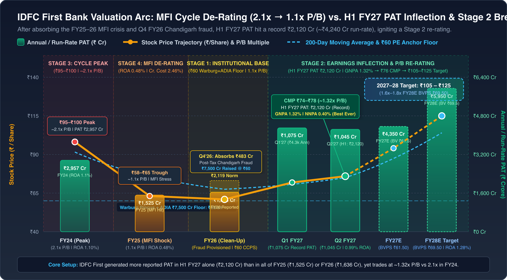
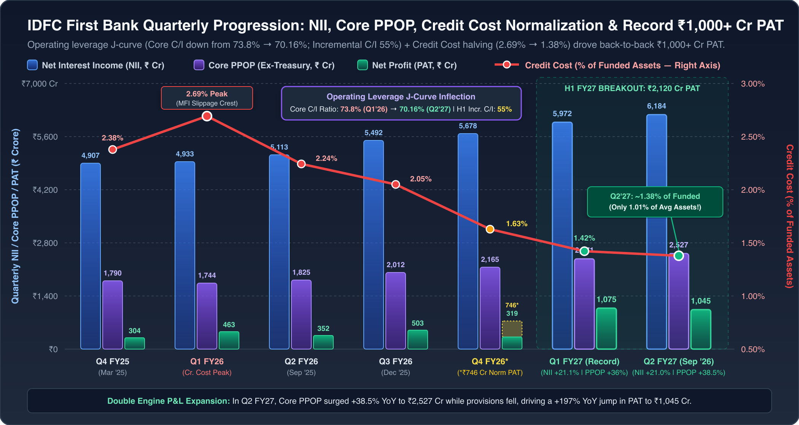
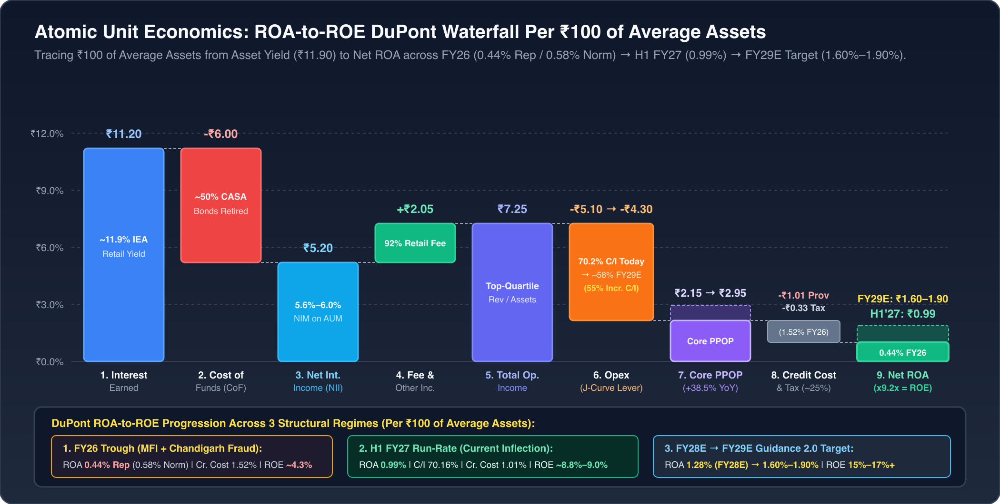
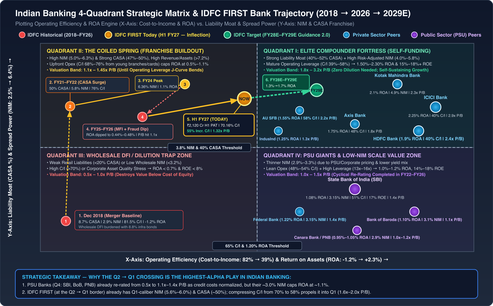
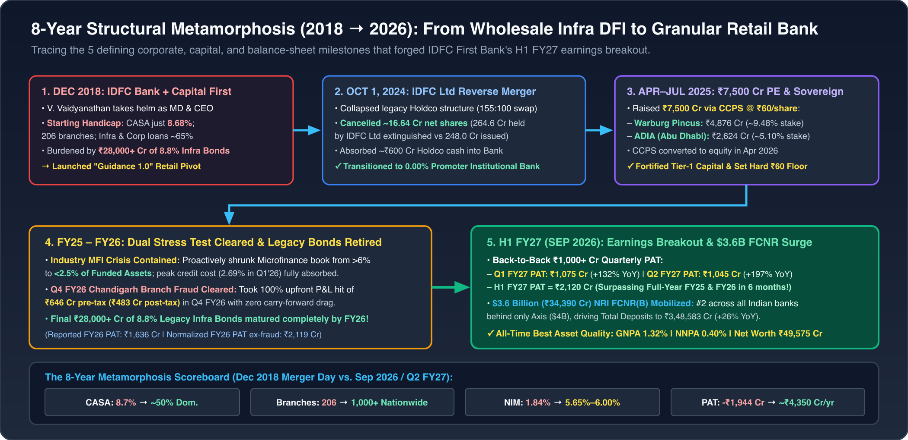
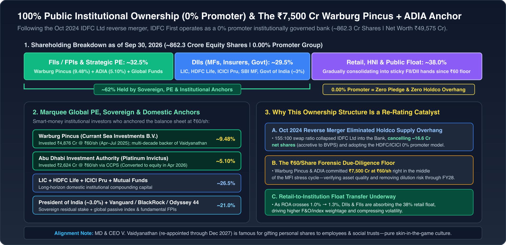
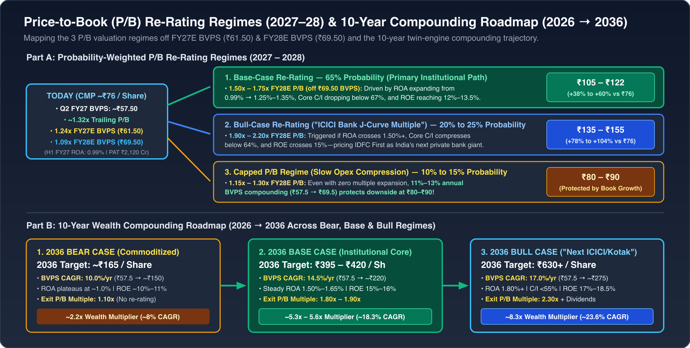
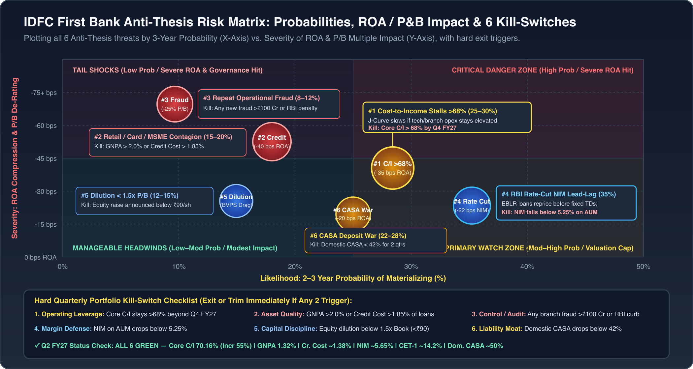

# Investment Memorandum: IDFC FIRST Bank Ltd (IDFCFIRSTB)

**Report Suite Navigation:**  
📍 **[1. Master Summary (You Are Here)](./Summary.md)** | 📊 **[2. Forensic, Valuation & Timing Upgrade](./Forensic-Valuation-And-Timing-Upgrade.md)** | ⚙️ **[3. Financial & Unit Economics Framework](./Financial%20Analysis%20Framework%20For%20IDFC%20First%20Bank.md)** | 🔗 **[4. Banking Value Chain & Liability Moat](./Banking%20Value%20Chain%20And%20Liability%20Moat%20Analysis.md)** | 🚀 **[5. Vision 2030 Strategy & Operating Leverage Roadmap](./Vision%202030%20Strategy%20And%20Operating%20Leverage%20Roadmap.md)**

> [!IMPORTANT]
> **Executive Verdict (Updated November 2026 — Post-Q2 & H1 FY27 Results):**  
>
> **IDFC FIRST Bank (`NSE: IDFCFIRSTB` | `BSE: 539437`)** has completed the most difficult structural turnaround in modern Indian banking—transforming from a wholesale infrastructure DFI (with **8.7% CASA** and ₹28,000+ Cr of 8.8% legacy bonds in Dec 2018) into a granular retail banking fortress boasting:

> - **~50% Domestic CASA Ratio** (48.4% overall average CASA in Q2 FY27; **₹3,48,583 Cr Total Deposits**, up +25.9% YoY)
> - **~80% Retail, Rural & MSME Granular Loan Book** (**₹3,46,913 Cr Total Funded Assets**, up +30.1% YoY; +22.2% organic ex-FCNR IBU)
> - **All-Time Best Asset Quality:** **1.32% GNPA** and **0.40% NNPA** in Q2 FY27 *(already achieving management's FY29 Guidance 2.0 asset-quality target three years early!)*
>
> After de-rating from a Sept 2023 peak of **~₹100 (~2.1x P/B)** down to **₹58–₹65 (~1.1x P/B)** during the FY25–FY26 Microfinance (MFI) industry crisis and the one-off Q4 FY26 Chandigarh branch manual cheque fraud (**₹483 Cr post-tax**, 100% written off), the bank has entered a decisive **Fundamental & Operating Leverage Inflection in H1 FY27**:

> - **Two Consecutive ₹1,000+ Cr PAT Quarters:** **₹1,075 Cr PAT in Q1 FY27 (+132.4% YoY)** and **₹1,045 Cr PAT in Q2 FY27 (+196.5% YoY)**—bringing **6-month H1 FY27 PAT to ₹2,120 Cr (+160% YoY)**, which *already surpasses full-year FY25 (₹1,525 Cr) and full-year FY26 (₹1,636 Cr)!*
> - **Operating Leverage J-Curve Confirmed:** Core Cost-to-Income dropped to **70.16% in Q2 FY27** (with **H1 FY27 Incremental Cost-to-Income at just 55%**, as Opex grew ~500 bps slower than Income), driving **Core PPOP up +38.5% YoY to ₹2,527 Cr**.
>
> Trading at **~₹74–₹78 (~1.30x–1.35x Q2 FY27 Book Value of ₹57.49; ~1.08x FY28E BVPS of ₹69.50)**—just 25% above Warburg Pincus and ADIA's **₹7,500 Cr preferential entry floor of ₹60/share**—IDFC FIRST Bank offers an asymmetric **ICICI-2019-style ROA & P/B re-rating** toward **₹105–₹125 in 2027–28** and **₹135–₹155+ in a Bull Case**.

---

## 1. Master Snapshot: Single Source of Truth

### A. Market, Capital & Valuation Snapshot (As of November 2026)

| Metric | Value | Context / Forensic Note |
| :--- | :--- | :--- |
| **Ticker & Equity Shares** | `NSE: IDFCFIRSTB` / `BSE: 539437` | **~862.3 Crore shares** (Face Value: ₹10.00) post-IDFC Ltd reverse merger & Warburg/ADIA CCPS conversion |
| **Current Market Price (CMP)** | **~₹74 – ₹78** | Up ~28%–34% from ₹58.08 52W low; ~25%–30% above Warburg Pincus & ADIA's **₹60/sh** preferential price |
| **52-Week High / Low** | **₹89.61 / ₹58.08** | Formed a multi-quarter Stage 1 accumulation base at ₹58–₹68; re-rating on back-to-back ₹1,000+ Cr PAT quarters |
| **Market Capitalization** | **~₹65,500 – ₹67,500 Cr** | Nifty Bank, Nifty Private Bank, Nifty Midcap 100 & Nifty 500 constituent |
| **Net Worth & Book Value (Sep '26)** | **₹49,575 Cr Net Worth** | **Book Value Per Share (BVPS): ₹57.49** \| FY27E BVPS: **~₹61.50** \| FY28E BVPS: **~₹69.50** |
| **Valuation Multiples (P/B & P/E)** | **~1.30x – 1.35x Trailing P/B** | **~1.22x FY27E P/B** \| **~1.08x FY28E P/B** \| **~14.8x FY27E EPS (₹5.10)** \| **~11.1x FY28E EPS (₹6.85)** |
| **Capital Adequacy & Liquidity** | **14.67% CRAR \| 13.00% CET-1** | **Domestic CD Ratio: 89.9%** (down from >130% in 2018) \| Mobilized **$3.6B (₹34,390 Cr) FCNR(B)** in Q2 FY27 |
| **Promoter Holding** | **0.00% (100% Public/Inst.)** | Post-Oct 2024 IDFC Ltd reverse merger: pure institutional governance mirroring *HDFC Bank, ICICI Bank & Axis Bank* |

---

### B. Financial Progression Table (FY24 $\rightarrow$ FY25 $\rightarrow$ FY26 $\rightarrow$ Q1 & Q2 FY27 $\rightarrow$ H1 FY27 $\rightarrow$ FY27E / FY28E)

*Note: Per **Module 8 (BFSI Forensic Rulebook)**, banks are evaluated on NII, NIM, Core PPOP, Cost-to-Income, Credit Cost, GNPA/NNPA, ROA, ROE, and Price-to-Book (P/B)—never EBITDA or D/E.*

| Metric | FY24 Actual | FY25 Actual (MFI Stress) | FY26 Actual (MFI Peak + Fraud) | Q1 FY27 (Jun '26 — Record) | **Q2 FY27 (Sep '26 — Record)** | **H1 FY27 (6M Cumulative)** | **FY27E (Projected)** | **FY28E (Projected)** |
| :--- | :---: | :---: | :---: | :---: | :---: | :---: | :---: | :---: |
| **Total Deposits** | ₹2,00,570 Cr | ₹2,52,065 Cr *(+25.7%)* | ₹2,94,475 Cr *(+16.8%)* | ₹3,11,892 Cr *(+18.0% YoY)* | **₹3,48,583 Cr** *(+25.9% YoY)* | **₹3,48,583 Cr** *(+18.4% YTD)* | **~₹3,75,000 Cr** | **~₹4,50,000 Cr** |
| **CASA Ratio (%)** | 47.27% | 46.90% | **49.80%** *(₹1.47L Cr)* | **50.80%** *(₹1.58L Cr)* | **48.4% Avg** *(~50% Dom.)* | **~49.5% – 50%** | **~49.5%** | **~50.0%** |
| **Funded Assets (Loans)** | ₹2,00,965 Cr | ₹2,41,926 Cr *(+20.4%)* | ₹2,90,278 Cr *(+20.0%)* | ₹3,05,370 Cr *(+21.0% YoY)* | **₹3,46,913 Cr** *(+30.1% / +22.2% org)* | **₹3,46,913 Cr** *(89.9% Dom. CD)* | **~₹3,60,000 Cr** | **~₹4,30,000 Cr** |
| **Net Interest Income (NII)** | ₹16,451 Cr | ₹19,292 Cr *(+17.3%)* | ₹21,216 Cr *(+10.0%)* | **₹5,972 Cr** *(+21.1% YoY)* | **₹6,184 Cr** *(+21.0% YoY)* | **₹12,156 Cr** *(+21.0% YoY)* | **~₹25,400 Cr** | **~₹30,500 Cr** |
| **Net Interest Margin (NIM)** | **6.36%** | **6.09%** | **5.72%** *(Q4: 5.93%)* | **5.96%** *(+25 bps YoY)* | **5.58%** *(FCNR deploy effect)* | **~5.77%** *(Q4E: ~5.80%)* | **~5.78%** | **~5.85%** |
| **Core PPOP (Ex-Trading)** | ₹6,030 Cr | ₹7,009 Cr *(+16.2%)* | ₹7,186 Cr *(₹7,830 Cr Norm)* | **₹2,371 Cr** *(+36.0% YoY)* | **₹2,527 Cr** *(+38.5% YoY)* | **₹4,898 Cr** *(+37.3% YoY)* | **~₹10,300 Cr** | **~₹13,400 Cr** |
| **Core Cost-to-Income (C/I)** | 72.90% | 72.80% | 73.0% Core *(75.2% Rep)* | **70.73%** *(-310 bps YoY)* | **70.16%** *(-57 bps QoQ)* | **70.44%** *(55% Incremental!)* | **~69.0%** | **~65.5%** |
| **Credit Cost (% Assets)** | ~1.32% *(Funded)* | ~1.73% *(Funded)* | 2.13% Funded *(1.52% Tot)* | ~1.25% *(₹515 Cr CGFMU buffer)* | **1.01% Avg Assets** *(~1.38% Funded)* | **~1.12% Avg Assets** | **~1.15% Avg Assets** | **~1.10% Avg Assets** |
| **Profit After Tax (PAT)** | **₹2,957 Cr** | **₹1,525 Cr** *(-48.4%)* | **₹1,636 Cr** *(₹2,119 Cr Norm)* | **₹1,075 Cr** *(+132.4% YoY)* | **₹1,045 Cr** *(+196.5% YoY)* | **₹2,120 Cr** *(+160% YoY)* | **~₹4,400 Cr** | **~₹5,900 Cr** |
| **ROA (%) / ROE (%)** | 1.10% / 10.3% | 0.48% / 4.3% | 0.44% *(0.58% Norm)* / 4.1% | **1.06% / ~9.0%** | **0.93% / ~8.5%** | **0.99% / ~8.8%** | **~1.08% / ~9.0%** | **~1.28% / ~11.2%** |
| **GNPA (%) / NNPA (%)** | 1.88% / 0.60% | 1.87% / 0.53% | 1.61% / 0.48% | 1.51% / 0.44% | **1.32% / 0.40%** *(Record Low)* | **1.32% / 0.40%** | **~1.30% / 0.38%** | **~1.25% / 0.35%** |
| **EPS (₹) / BVPS (₹)** | ₹4.30 / ₹45.5 | ₹2.08 / ₹51.8 | ₹1.87 / ₹55.1 | ₹1.25 / ₹56.3 | **₹1.21 / ₹57.49** | **₹2.46 (6M) / ₹57.49** | **~₹5.10 / ₹61.50** | **~₹6.85 / ₹69.50** |

> 🔗 **Deep Dive Links:** See **[Section 3 & 5 of Financial Analysis Framework](./Financial%20Analysis%20Framework%20For%20IDFC%20First%20Bank.md#3-the-growth-algorithm-deconstructing-the-banking-revenue--nii-equation)** for the NII & ROA-to-ROE DuPont tree and **[Section 1 of Forensic Upgrade](./Forensic-Valuation-And-Timing-Upgrade.md#1-the-real-world-lesson-why-idfc-first-bank-de-rated-from-21x-to-11x-pb-in-fy25fy26-then-inflected-to-2120-cr-pat-in-h1-fy27)** for the full cycle anatomy.

*📊 [Click to Open Crisp Vector SVG](./charts/01_valuation_de_rating_vs_earnings_inflection.svg)*

*📊 [Click to Open Crisp Vector SVG](./charts/02_quarterly_nii_ppop_pat_progression.svg)*

---

## 2. Business Model, ROA-to-ROE DuPont Tree & Three-Layer Moat

### A. Why 90% of DFI/NBFC-to-Bank Conversions Fail—And How IDFC First Succeeded

In Indian banking, **anyone can grow the Asset side (Loans) during a boom; the true moat is the Liability side (Low-Cost Granular CASA Deposits)**. When *Capital First* merged with *IDFC Bank* in December 2018, the combined entity inherited a broken wholesale balance sheet: **8.7% CASA**, **>130% Credit-to-Deposit ratio**, **₹28,000+ Cr of 8.5%–9.0% legacy infrastructure bonds**, and **19% infrastructure project loans**. Over the next 7.5 years (2018–2026), CEO V. Vaidyanathan executed a three-step structural overhaul:

1. **Built a ₹3.48 Lakh Crore Deposit Engine (~50% Domestic CASA):** Grew customer deposits at **>25% CAGR**, retired the last tranche of high-cost 8.8% legacy infrastructure bonds in **FY26**, and mobilized **US$3.6 Billion (~₹34,390 Cr) in FCNR(B) deposits in Q2 FY27**, bringing the domestic Credit-to-Deposit (CD) ratio down to **89.9%**.
2. **Granularized the Asset Book across 25+ Retail/Rural/MSME Engines:** Ran infrastructure loans down from **19% to <1%**, capped Microfinance (MFI) below **2.5%** after the FY25–26 industry storm, and drove **GNPA to 1.32% and NNPA to 0.40%**.
3. **Crossed the Operating Leverage J-Curve in H1 FY27:** Upfront investments in 1,000+ branches, 5M+ credit cards, and cloud IT kept Cost-to-Income stuck at **~72.8%–73.0%** in FY24–FY26. In H1 FY27, **Incremental Cost-to-Income dropped to 55%** (Opex growth lagged Income growth by ~500 bps YoY), reducing Core C/I to **70.16% in Q2 FY27** and driving **Core PPOP up +38.5% YoY**.

### B. Atomic Unit Economics (ROA-to-ROE DuPont Waterfall Per ₹100 of Average Assets)

*📊 [Click to Open Crisp Vector SVG](./charts/04_atomic_unit_economics_dupont_waterfall.svg)*

| DuPont Line Item (Per ₹100 of Avg Assets) | FY24 Actual | FY26 Trough (MFI + Fraud) | **H1 FY27 Actual Run-Rate** | **FY28E Projected** | **FY29E Guidance 2.0 Path** | Underlying Structural Lever |
| :--- | :---: | :---: | :---: | :---: | :---: | :--- |
| **1. Interest Earned (Yield on Avg Assets)** | ₹11.35 | ₹11.45 | **~₹11.20** *(~12.0% on Loans)* | ~₹11.35 | ~₹11.40 | Diversified ~80% retail/MSME book; MFI yield drag offset by consumer/SME mix. |
| **2. (-) Interest Expended (Cost of Funds)** | (₹5.75) | (₹6.15) | **~(₹5.85)** | ~(₹5.80) | ~(₹5.65) | ~50% Domestic CASA + FY26 retirement of 8.8% legacy infra bonds. |
| **(=) Net Interest Income (NII / Avg Assets)** | **₹5.60** *(6.36% NIM)* | **₹5.30** *(5.72% NIM)* | **₹5.35** *(5.77% H1 NIM)* | **~₹5.55** *(5.85% NIM)* | **~₹5.75** *(~5.9% NIM)* | Q2 FY27 NIM (5.58%) reflects temporary $3.6B FCNR liquidity deployment; Q4E ~5.80%. |
| **3. (+) Fee & Other Operating Income** | +₹1.97 | +₹1.91 | **+₹1.95** *(₹2,285 Cr in Q2)* | +₹2.05 | +₹2.15 | **92% Retail Fee:** Loan orig (34%), Cards/FASTag (23%), Gen Banking (20%), Wealth (13%). |
| **(=) Total Operating Income** | **₹7.57** | **₹7.21** | **₹7.30** | **~₹7.60** | **~₹7.90** | High-margin revenue engine (**7.3% of assets** vs. ~5.5% for peer private banks!). |
| **4. (-) Operating Expenses (Opex)** | (₹5.52) *(72.9% C/I)* | (₹5.42) *(73.0% Core C/I)* | **-(₹5.14)** *(70.16% Q2 C/I)* | **-(₹4.98)** *(65.5% C/I)* | **-(₹4.65)** *(~59% C/I)* | **The #1 Re-Rating Lever:** Incremental C/I is **55%** as branches & credit cards scale! |
| **(=) Core PPOP (Pre-Provision Profit)** | **₹2.05** | **₹1.79** | **₹2.16** *(₹4,898 Cr in H1)* | **~₹2.62** | **~₹3.25** | Core PPOP surged **+38.5% YoY in Q2 FY27** to ₹2,527 Cr. |
| **5. (-) Credit Cost & Extraordinary Items** | (₹0.81) | (₹1.24) *(MFI + Fraud)* | **-(₹0.84)** *(1.01% in Q2)* | -(₹0.90) | -(₹0.95) | MFI stress receded (99.5%+ collection); ₹515 Cr CGFMU buffer set aside in Q1 FY27. |
| **(=) Post-Tax ROA (Return on Assets)** | **1.10%** | **0.44% Rep** *(0.58% Norm)* | **0.99%** *(1.06% Q1 / 0.93% Q2)* | **~1.28%** | **~1.60% – 1.85%** | Already doubled from FY26 trough; each 300 bps C/I drop adds +17 bps to post-tax ROA. |
| **$\times$ Leverage ($\text{Avg Assets} / \text{Equity}$)** | $\times 9.36\text{x}$ | $\times 9.30\text{x}$ | **$\times 8.85\text{x}$** | $\times 8.75\text{x}$ | $\times 9.00\text{x}$ | Well-capitalized post ₹7,500 Cr Warburg/ADIA infusion (14.67% CRAR). |
| **(=) ROE (Return on Equity)** | **10.30%** | **4.10%** | **~8.8%** | **~11.2%** | **~14.5% – 16.5%+** | Crossing **12%–15% ROE** unlocks a P/B re-rating from 1.3x to 1.8x–2.2x Book! |

> [!NOTE]
> **Forensic Explanation — Why Did Q2 FY27 NIM Dip Sequentially from 5.96% (Q1) to 5.58% (Q2) While NII Grew +21% YoY to ₹6,184 Cr?**  
> During Q2 FY27, IDFC FIRST Bank seized a unique window to mobilize **US$3.6 Billion (~₹34,390 Crore) in multi-year FCNR(B) deposits**, lifting total deposits **+11.8% in a single quarter** to ₹3,48,583 Cr. Because these hedged foreign-currency funds were initially deployed into lower-yielding, ultra-safe International Banking Unit (IBU) and liquid assets, they expanded the average earning-asset denominator faster than high-yield retail deployment—optically compressing blended NIM by ~35 bps to 5.58% and Q2 ROA to 0.93% (vs. 1.06% in Q1). As this liquidity replaces higher-cost wholesale funding over Q3–Q4 FY27, management guides **NIM recovery back toward ~5.80% by Q4 FY27**.  
> 🔗 *See **[Financial Analysis Framework — Section 3.2](./Financial%20Analysis%20Framework%20For%20IDFC%20First%20Bank.md#32-net-interest-margin-nim--cost-of-funds-mechanics)**.*

### C. Private vs. Public Sector (PSU) Bank Comparative & The 4-Quadrant Trajectory Matrix

*📊 [Click to Open Crisp Vector SVG](./charts/09_four_quadrant_peer_trajectory_matrix.svg)*

| Dimension | **IDFC FIRST Bank (H1 FY27 — Q2$\rightarrow$Q1 Border)** | **IDFC FIRST (FY29E — Quadrant I Target)** | **Tier-1 Private (Quadrant I)** *(ICICI, HDFC, Kotak)* | **Private Challengers** *(Axis, IndusInd, Federal, AU)* | **PSU Bank Giants (Quadrant IV)** *(SBI, BoB, PNB, Canara)* |
| :--- | :---: | :---: | :---: | :---: | :---: |
| **CASA Ratio (%)** | **48.4% Avg** *(~50% Dom. / 50.8% Q1)* | **~48.5% – 50.0%** | **40% – 52%** | **30% – 42%** | **33% – 41%** |
| **Net Interest Margin (NIM)** | **5.77% H1** *(5.96% Q1 / 5.58% Q2)* | **~5.80% – 5.90%** | **3.5% – 4.9%** | **3.15% – 5.60%** | **2.90% – 3.20%** |
| **Cost-to-Income (C/I)** | **70.16% Q2** *(55% Incremental in H1!)* | **55.0% – 58.0%** | **39% – 46%** | **48% – 63%** | **48% – 54%** |
| **GNPA (%) / NNPA (%)** | **1.32% / 0.40%** *(All-Time Best)* | **<1.25% / <0.35%** | **1.2%–1.9% / 0.35%–0.45%** | **1.8%–2.2% / 0.55%–0.65%** | **2.1%–3.5% / 0.50%–0.75%** |
| **ROA (%)** | **0.99% H1** *(1.06% Q1 / 0.93% Q2)* | **1.60% – 1.90%** | **1.85% – 2.30%** | **1.20% – 1.75%** | **0.95% – 1.15%** |
| **Leverage ($\text{Assets}/\text{Eq}$) & ROE** | **8.85x** $\rightarrow$ **~8.8% ROE** | **9.0x** $\rightarrow$ **15.0% – 17.5% ROE** | **7.5x–8.5x** $\rightarrow$ **15%–18% ROE** | **8.5x–10.5x** $\rightarrow$ **13%–16% ROE** | **13.5x–16.5x** $\rightarrow$ **15%–18% ROE** |
| **Price-to-Book (P/B)** | **~1.32x Trailing** *(~1.08x FY28E)* | **1.65x – 2.20x P/B** | **2.3x – 3.1x P/B** | **1.3x – 2.2x P/B** | **1.0x – 1.45x P/B** |

> 🔗 **Deep Dive Link:** See **[Section 8 of Forensic Upgrade](./Forensic-Valuation-And-Timing-Upgrade.md#8-private-vs-public-sector-psu-bank-comparative--the-4-quadrant-strategic-trajectory-matrix)** for the full 10-row Private vs. PSU comparative audit and the **6-Step Historical Trajectory across Quadrants III $\rightarrow$ II $\rightarrow$ I**.

---

## 3. Forensic Audit: Corporate Restructuring, Capital Flows, Fraud Cleanup & Ownership

### A. Complete Corporate Transformation & Capital Flow Timeline (2018 $\rightarrow$ 2026)

*📊 [Click to Open Crisp Vector SVG](./charts/07_corporate_transformation_and_capital_flow.svg)*

| Date | Corporate Event / Capital Milestone | Transaction Scale | Accounting, Balance Sheet & Forensic Impact |
| :--- | :--- | :--- | :--- |
| **Dec 18, 2018** | **Merger of IDFC Bank & Capital First** | ₹1.03L Cr Loan Book | V. Vaidyanathan appointed MD & CEO. Inherited 8.7% CASA, ₹28,000+ Cr high-cost (8.8%) legacy infra bonds, and 19% infra loans. |
| **Oct 1, 2024** | **Reverse Merger of IDFC Ltd into IDFC FIRST Bank** | **155 : 100 Share Swap** | Collapses holding-company structure; **net reduction of ~16.64 Cr equity shares** (accretive to BVPS!); **Promoter holding drops to 0.00%**. |
| **Apr – Jul 2025** | **Preferential CCPS Issue to Warburg Pincus & ADIA** | **₹7,500 Cr @ ₹60/sh** | **Warburg Pincus (*Currant Sea Investments*): ₹4,876 Cr (~9.48%)** + **ADIA (*Platinum Invictus*): ₹2,624 Cr (~5.10%)**. Boosted Tier-1 capital ahead of growth wave. |
| **Feb / Mar 2026 (Q4 FY26)** | **Chandigarh Sector-32 Branch Fraud Write-Off & Legacy Bond Maturity** | **₹646 Cr Pre-Tax (₹483 Cr Post-Tax)** | Isolated manual physical-cheque collusion in Haryana Govt accounts; KPMG forensic audit ordered; **100% expensed in Q4 FY26**. Simultaneously retired final high-cost legacy IDFC infra bonds. |
| **Jun 30, 2026 (Q1 FY27)** | **Record ₹1,075 Cr PAT & ₹515 Cr CGFMU Claim Buffer** | **₹1,075 Cr PAT (+132% YoY)** | First quarter crossing ₹1,000 Cr PAT (ROA 1.06%); received **₹515 Cr CGFMU guarantee payout** on MFI loans and prudently parked **100% in a contingent provision buffer**. |
| **Sep 30, 2026 (Q2 FY27)** | **$3.6B FCNR(B) Mobilization & All-Time Best Asset Quality** | **₹34,390 Cr FCNR \| ₹1,045 Cr PAT** | Deposits hit **₹3,48,583 Cr (+25.9% YoY)**; Loans hit **₹3,46,913 Cr**; **GNPA fell to 1.32% and NNPA to 0.40%**; Core C/I improved to **70.16%** (H1 Incremental C/I: **55%**). |

> [!WARNING]
> **Two-Sided Forensic Audit: "Perpetual Equity Diluter with 70% Cost-to-Income" vs. "The Next ICICI Bank Operating Leverage Coiled Spring"**  
>
> - 🔴 **The Cynical / Bear Side (Why the Stock Stagnated Between ₹58 and ₹85 in 2024–2026):** Critics point out that between FY20 and FY25, IDFC FIRST Bank raised equity capital multiple times (diluting share count from ~478 Cr to ~862 Cr shares), kept Cost-to-Income above **70%** despite promising operating leverage, suffered a **-48% PAT drop in FY25 (₹1,525 Cr)** from the MFI crisis, and then got hit by a **₹646 Cr pre-tax (₹483 Cr post-tax) manual cheque fraud** at its Chandigarh branch in Q4 FY26—leaving FY25–FY26 ROE stuck at a sub-par **4.1%–4.3%** (well below cost of equity).  
> - 🟢 **The Institutional Counter-Side (Why Warburg Pincus & ADIA Put ₹7,500 Cr in at ₹60 and Why H1 FY27 Flipped the Math):**  
>   1. *Why Past Dilution Happened:* Building 1,000+ physical branches, top-tier digital banking, and a 5M+ credit card book from scratch while writing off ₹28,000 Cr of legacy wholesale DFI bad loans required upfront Opex and Tier-1 capital.  
>   2. *The J-Curve Inflection Is Now Mathematical Fact (H1 FY27):* In H1 FY27, **Operating Income grew ~500 bps faster than Opex**, pushing **Incremental Cost-to-Income down to 55%** and lifting **Core PPOP +37.3% YoY to ₹4,898 Cr**.  
>   3. *Clean Balance Sheet + ₹2,120 Cr 6-Month PAT:* With MFI shrunk below **2.5%** of loans (and 99.5%+ collection efficiency restored), the Chandigarh fraud 100% written off in Q4 FY26, and **H1 FY27 PAT hitting ₹2,120 Cr (+160% YoY)**, the bank is now compounding Book Value internally on a **₹49,575 Cr Net Worth** base without needing distress dilution!  
> 🔗 *See **[Section 2 & 3 of Forensic Upgrade](./Forensic-Valuation-And-Timing-Upgrade.md#2-module-8-bfsi-forensic-audit-the-idfc-reverse-merger-7500-cr-warburgadia-infusion--the-chandigarh-branch-fraud)** for the full side-by-side audit.*

### B. Shareholding Structure (Q2 FY27 / Sep 30, 2026) — 100% Public & Institutional Governance

*📊 [Click to Open Crisp Vector SVG](./charts/05_shareholding_warburg_adia_ownership.svg)*

| Shareholder Category | Shares (Cr) | % Holding (Sep '26) | Key Named Holders & Game-Theory Alignment |
| :--- | :---: | :---: | :--- |
| **Promoter & Promoter Group** | 0.00 Cr | **0.00%** | **Zero Promoter Overhang:** Post-Oct 2024 IDFC Ltd reverse merger, IDFC FIRST is 100% institutionally/publicly owned like *ICICI Bank* and *HDFC Bank*. |
| **Foreign Institutional Investors (FII / FPI & Strategic PE)** | ~276 Cr | **~32.0%** | Anchored by **Warburg Pincus (*Currant Sea Investments*: ~9.48% — ₹4,876 Cr at ₹60)**, **ADIA (*Platinum Invictus*: ~5.10% — ₹2,624 Cr at ₹60)**, Odyssey 44, Vanguard & BlackRock. |
| **Domestic Institutional Investors (DIIs + Govt of India)** | ~255 Cr | **~29.6%** | **LIC (~2.3%)**, **HDFC Life**, **ICICI Prudential**, **SBI & Kotak Mutual Funds**, plus **President of India (~3.0%)**. |
| **Total Institutional Ownership** | **~531 Cr** | **~61.6%** | **Nearly 62% of equity is anchored by long-horizon PE, Sovereign Wealth, Insurance & Mutual Funds.** |
| **Retail / HNI Public Float** | **~331 Cr** | **~38.4%** | Down from >44% in 2024 as Warburg Pincus, ADIA, and domestic institutions absorbed supply around the ₹60–₹75 base. |

---

## 4. Valuation Scenarios, P/B Re-Rating Probability & 2027–2036 Roadmap (Module 5 & Module 8)

### A. Why ₹105–₹125 in 2027–28 Is Mathematically Supported by Book Value + ROA Expansion

Per **Module 8 (BFSI Valuation Rulebook)**, a bank's stock price is the product of **Book Value Per Share (BVPS)** and its **Price-to-Book (P/B) Multiple**, which is governed by **ROA and ROE**:

- **Current Baseline (Q2 FY27 / Nov 2026):** CMP **~₹76** | BVPS **₹57.49** | Trailing P/B **1.32x** | H1 FY27 PAT **₹2,120 Cr (0.99% ROA)**.
- **Upgraded FY27E & FY28E Book Value Trajectory:** With full-year **FY27E PAT projected at ~₹4,400 Cr (EPS ~₹5.10; ROA ~1.08%)** and **FY28E PAT at ~₹5,900 Cr (EPS ~₹6.85; ROA ~1.28%)**, BVPS compounds to **~₹61.50 by Mar 2027 (FY27E)** and **~₹69.50 by Mar 2028 (FY28E)**.
- **Implied Valuation at ₹110/share:** $\frac{₹110}{₹69.50\text{ (FY28E BVPS)}} = \mathbf{1.58\text{x Forward P/B}}$ and $\frac{₹110}{₹6.85\text{ (FY28E EPS)}} = \mathbf{16.0\text{x Forward P/E}}$—a conservative multiple for a granular private bank growing loans at 20%+ with 1.32% GNPA and ~50% CASA!

### B. Price-to-Book (P/B) Re-Rating Regimes & 2027–2028 Price Targets

*📊 [Click to Open Crisp Vector SVG](./charts/08_pb_rerating_regimes_and_10yr_roadmap.svg)*

| Valuation Regime (2027–2028) | Target P/B Multiple (on ₹69.50 FY28E BVPS) | **Probability** | Key Fundamental Catalyst Required | **2027–28 Target Price (vs. ~₹76 CMP / ₹60 Warburg Floor)** |
| :--- | :---: | :---: | :--- | :---: |
| **1. Base-Case Re-Rating (ROA Crosses 1.20%–1.30%)** | **1.50x – 1.75x FY28E P/B** *(15x – 17.5x FY28E P/E)* | **65%** | Sustained **₹1,100–₹1,450 Cr quarterly PAT**, Core C/I dropping from **70.16% to ~65%–66%**, Credit Cost stabilizing at **1.0%–1.15% of assets**, and ROE crossing **11%–12%**. | **₹105 – ₹122** *(+38% to +60% from ₹76; +75% to +103% from ₹60 base)* |
| **2. Bull-Case Re-Rating ("The ICICI Bank 2020–23 J-Curve Multiple")** | **1.90x – 2.20x FY28E P/B** *(18.5x – 21x FY28E P/E)* | **20% – 25%** | Core C/I breaks below **63%**, ROA reaches **1.45%–1.60%**, ROE crosses **14%–15%**, and RBI rate cuts boost treasury + NIM toward **5.9%+**. | **₹135 – ₹155+** *(+78% to +104% from ₹76; >2.2x from ₹60 base)* |
| **3. Capped P/B Regime (C/I Sticky or Second Credit Wave)** | **1.15x – 1.30x FY28E P/B** *(11.5x – 13x FY28E P/E)* | **10% – 15%** | Opex stays sticky near 69%–70% or retail unsecured credit costs tick up, keeping ROE <10%—**yet 11%–13% annual BVPS compounding still lifts the floor**. | **₹80 – ₹90** *(+5% to +18% from ₹76 via pure Book Value growth)* |

### C. The 10-Year Compounding View (2026 $\rightarrow$ 2036) & The FY29 Guidance 2.0 Checkpoint

| 10-Year Scenario (2026 $\rightarrow$ 2036) | 10-Yr BVPS CAGR (off ₹57.49 Sep '26) | 2036E BVPS (2036E PAT) | 2036 Exit P/B (Steady ROA / ROE) | **2036 Target Price** | **10-Yr Cumulative Dividends/Sh** | **Total Wealth Multiplier (vs. ~₹76 CMP / ₹60 Floor)** |
| :--- | :---: | :---: | :---: | :---: | :---: | :---: |
| **1. Bear Case** *(C/I stuck at ~66%; ROE capped at 10%–11% with periodic dilution)* | 10.0% | ₹149.00 *(~₹13,500 Cr)* | 1.10x P/B *(1.0% ROA / 10% ROE)* | **~₹165** | + ₹12 | **~2.3x on ₹76 (~2.9x on ₹60)** |
| **2. Base Case ("Guidance 2.0" Compounder)** *(C/I reaches ~57%; self-funded growth)* | **14.5%** | **₹222.50** *(~₹28,500 Cr)* | **1.80x P/B** *(1.65% ROA / 15.5% ROE)* | **₹395 – ₹415** | **+ ₹28** | **~5.5x on ₹76 (~7.2x on ₹60)** |
| **3. Bull Case (Next-Gen Kotak / ICICI Franchise)** *(C/I <53%; Wealth + Cards boom)* | **17.0%** | **₹276.00** *(~₹42,000 Cr)* | **2.25x P/B** *(1.95% ROA / 18% ROE)* | **~₹620+** | **+ ₹40** | **~8.7x on ₹76 (~11.0x on ₹60)** |

> [!TIP]
> **Actionable Portfolio Triggers & The FY29 Checkpoint:**  
>
> - [x] **Trigger 1 (MFI & Fraud Cleanup + ₹1,000 Cr Quarterly PAT — ACHIEVED):** MFI book reduced below 2.5% (99.5%+ collection efficiency), ₹483 Cr post-tax Chandigarh fraud 100% written off in Q4 FY26, and back-to-back record PAT of **₹1,075 Cr (Q1 FY27)** and **₹1,045 Cr (Q2 FY27)**.  
> - [x] **Trigger 2 (Operating Leverage J-Curve Turn — ACHIEVED):** H1 FY27 Incremental Cost-to-Income fell to **55%**; Core C/I improved to **70.16%**; Core PPOP surged **+38.5% YoY**.  
> - [ ] **Trigger 3 (Sub-67% C/I & 1.20%+ ROA Breakout in H2 FY27 – FY28):** Watch for quarterly Core C/I to break below **67%** and quarterly PAT to cross **₹1,250–₹1,400 Cr** as the $3.6B FCNR liquidity is deployed into higher-yielding assets.  
> - [ ] **Trigger 4 (The FY29 Guidance 2.0 Checkpoint):** Verify in the FY29 Annual Report that **Cost-to-Income is $\le 60\%$**, **ROA is $\ge 1.50\%$**, and **ROE has crossed $\ge 14\%–15\%$** (making 18%–20% loan growth self-sustaining without further equity dilution).

---

## 5. Anti-Thesis Matrix: Probabilities, ROA/P&B Impact & Kill-Switches

*📊 [Click to Open Crisp Vector SVG](./charts/06_anti_thesis_risk_probability_matrix.svg)*

Because a bank operates at **~8.8x–9.3x leverage ($\text{Assets}/\text{Equity}$)**, a seemingly small **50 bps spike in Credit Cost** or **300 bps stall in Cost-to-Income** wipes out **~20%–35% of Net Profit (ROA/ROE)**. Track these **6 Quantitative Kill-Switches** every quarter (detailed in **[Section 7 of Forensic Upgrade](./Forensic-Valuation-And-Timing-Upgrade.md#7-the-anti-thesis-scenarios-probabilities-roapb-impact--kill-switches)**):

| # | Anti-Thesis Scenario | Probability (1–2Y / 3–5Y) | **PPOP / Credit Cost Impact** | **ROA, ROE & P/B Impact** | Current Status (Q2 / H1 FY27) | **Kill-Switch Threshold (Exit Trigger)** |
| :-: | :--- | :---: | :---: | :---: | :---: | :--- |
| **1** | **Operating Leverage Mirage** *(Core C/I stays stuck above 68%–70%)* | **20% (1–2Y)** **15% (3–5Y)** | **Core PPOP: -12% to -18%** vs. Guidance 2.0 path | **ROA capped at ~0.95%–1.05%** **ROE < 10% \| P/B stuck at 1.1x–1.3x** | **Core C/I 70.16% in Q2** *(55% Incremental C/I in H1)* | Core C/I **fails to drop below 68.0% by Q4 FY27** OR Opex growth exceeds Income growth for 2 quarters. |
| **2** | **Unsecured Retail / Credit Card / MSME Contagion** *(Second credit wave after MFI)* | **20–25% (1–2Y)** **25% (3–5Y)** | **Credit Cost spikes from 1.01% to >1.8% of Avg Assets** | **ROA drops to 0.50%–0.65%** **PAT: -35% to -45%** | **GNPA 1.32% \| NNPA 0.40%** **Credit Cost 1.01% Avg Assets** | **GNPA crosses > 1.85%** OR **Credit Cost > 1.60% of Avg Assets (>2.1% of Loans)** for 2 quarters. |
| **3** | **Branch Operational Control / Governance Breach** *(Repeat of ₹646 Cr Chandigarh fraud)* | **10% (1–2Y)** **10% (3–5Y)** | **One-off ₹300–600 Cr write-off** + RBI supervisory restrictions | **Immediate -15% to -25% stock de-rating** to 1.0x P/B | **₹483 Cr post-tax 100% expensed in Q4 FY26; KPMG audit done** | Any new material branch/digital fraud **> ₹100 Cr** OR RBI embargo on new branches/digital onboarding. |
| **4** | **Aggressive RBI Rate-Cut NIM Squeeze** *(Repo cuts reprice EBLR loans faster than 7% SA)* | **30–35% (1–2Y)** **25% (3–5Y)** | **NIM compresses 35–45 bps** to <5.25% | **NII: -6% to -8%** **ROA impact: -18 to -25 bps** | **Q2 NIM 5.58% (Q1: 5.96%)**; guided back to **~5.80% by Q4** | Blended NIM drops **< 5.30% for 2 consecutive quarters** without an offsetting SA deposit rate cut. |
| **5** | **Round-7 Equity Dilution Trap (CET-1 at 13.0%)** *(Loan growth >20% while ROE stays <11%)* | **35% (1–2Y)** **30% (3–5Y)** | **0% P&L hit**, but **dilutes EPS & BVPS growth by 8%–12%** | Caps per-share price ceiling every 18–24 months | **14.67% CRAR (13.00% CET-1)** post ₹7,500 Cr Warburg/ADIA raise | Equity raise announced at **< 1.35x P/B** OR **CET-1 drops < 11.8%** before ROE reaches 12%+. |
| **6** | **CASA Erosion & Retail Deposit War** *(CASA falls <44%, forcing high-cost wholesale debt)* | **15% (1–2Y)** **20% (3–5Y)** | **Cost of Funds +40–50 bps** **PPOP: -10% to -14%** | **ROA impact: -20 bps** Erodes core valuation moat | **48.4% Avg CASA (~50% Dom.)**; Deposits +25.9% YoY | **CASA Ratio drops < 44.0%** for 2 consecutive quarters OR **Domestic CD Ratio spikes > 96%**. |
| **7** | **"NBFC Asset + Bank Opex" Structural Floor** *(Retail collection/origination keeps C/I >63%)* | **25% (1–2Y)** **25% (3–5Y)** | **C/I floors out at ~63%–64%** instead of 55%–58% | **Steady-state ROA peaks at ~1.30%** instead of 1.80% | **H1 Incremental C/I at 55%** disproving floor so far | Incremental C/I rebounds **> 63%** for 3 consecutive quarters. |
| **8** | **Low CA Mix (~15% of CASA) & 7% SA Rate Stickiness** *(SA-heavy CASA keeps CoF elevated)* | **30% (1–2Y)** **25% (3–5Y)** | **Cost of Funds stays ~80 bps above Tier-1 peers** | Requires higher asset yield/risk to defend 5.7% NIM | **CA ~15% of CASA**; <₹5L SA slab already cut to 3.0% | Deposit growth drops **< 15% YoY** whenever peak SA slab is trimmed by 50 bps. |
| **9** | **CEO Dec 2027 RBI Re-Appointment Cliff** *(V. Vaidyanathan term ends Dec 18, 2027)* | **10% (1–2Y)** **15% (3–5Y)** | **Strategic pause** + institutional uncertainty | **-20% to -30% P/B multiple compression** if not extended | Term runs to **Dec 18, 2027** (eligible up to Dec 2033) | RBI grants <2-year extension or asks Board for external succession search in 2027. |
| **10** | **Credit Card (>5M) Low-Revolve / UPI Drag** *(Credit-on-UPI caps card revolver yields)* | **20% (1–2Y)** **25% (3–5Y)** | **Card C/I stays >75%** or card credit cost >4.5% | Delays ₹800 Cr+ fee/revolver profit bridge by 2 years | **>5M cards in force**; C/I down to mid-60s trajectory | Credit card division fails to turn **PBT-positive by FY28**. |

---

## 6. Complete Guide to the IDFC FIRST Bank Research Suite

| Document | Focus Area & Key Contents |
| :--- | :--- |
| 📊 **[Forensic-Valuation-And-Timing-Upgrade.md](./Forensic-Valuation-And-Timing-Upgrade.md)** | **Modules 2–6 & Module 8 Deep Dive:** The 2.1x $\rightarrow$ 1.1x P/B de-rating & H1 FY27 ₹2,120 Cr PAT inflection, Oct 2024 IDFC Ltd reverse merger math (155:100 swap), Warburg Pincus & ADIA ₹7,500 Cr (@ ₹60) game theory, Q4 FY26 Chandigarh branch fraud forensic audit, upgraded ₹105–₹125 target math, 10-year (2036) roadmap, and 6 Anti-Thesis kill-switches. |
| ⚙️ **[Financial Analysis Framework For IDFC First Bank.md](./Financial%20Analysis%20Framework%20For%20IDFC%20First%20Bank.md)** | **Module 1A (Financial Architecture):** Why non-financial ratios fail in BFSI, multi-variable NII & Fee growth algorithm, 5-level ROA-to-ROE DuPont Margin Tree, atomic unit economics per ₹100 of assets, branch & credit card J-curve cohort physics, sensitivity matrix, and 10-indicator Leading Watchlist. |
| 🔗 **[Banking Value Chain And Liability Moat Analysis.md](./Banking%20Value%20Chain%20And%20Liability%20Moat%20Analysis.md)** | **Module 1B (Value Chain & Liability Moat):** The Indian banking value chain ("DFI Valley of Death" vs. 50% CASA moat), money flows (Depositors $\rightarrow$ ALM Desk $\rightarrow$ 25+ Retail/MSME engines), player archetypes (Tier-1 Fortresses vs. NBFCs vs. Fintechs), switching costs, control points, and operational risk controls. |
| 🚀 **[Vision 2030 Strategy And Operating Leverage Roadmap.md](./Vision%202030%20Strategy%20And%20Operating%20Leverage%20Roadmap.md)** | **Module 1C (Guidance 2.0 & Operating Leverage Strategy):** Unit economics today (70.16% C/I, 0.99% ROA) vs. FY29/FY30 target (<58% C/I, 1.6%–1.9% ROA), Where to Play / How to Win matrix, 4 growth vectors (Branch vintage maturation, Wealth/Cards, Gold/SME, GIFT City/FCNR), capital self-funding math, and 12-quarter execution roadmap. |
