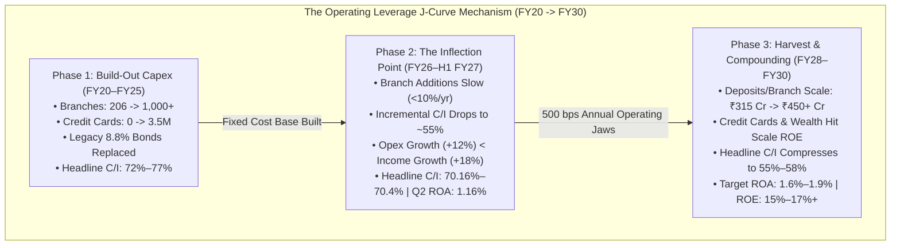

# **Strategic Vision 2030: Guidance 2.0 & The Operating Leverage J-Curve of IDFC First Bank (`NSE: IDFCFIRSTB` | `BSE: 539437`)**

**Report Suite Navigation:**  
📍 **[1. Master Summary](./Summary.md)** | 📊 **[2. Forensic, Valuation & Timing Upgrade](./Forensic-Valuation-And-Timing-Upgrade.md)** | ⚙️ **[3. Financial & Unit Economics Framework](./Financial%20Analysis%20Framework%20For%20IDFC%20First%20Bank.md)** | 🔗 **[4. Banking Value Chain & Liability Moat](./Banking%20Value%20Chain%20And%20Liability%20Moat%20Analysis.md)** | 🚀 **[5. Vision 2030 Strategy & Operating Leverage Roadmap (You Are Here)](./Vision%202030%20Strategy%20And%20Operating%20Leverage%20Roadmap.md)**

---

## **Executive Summary: The Mechanism of the Operating Leverage Inflection**

Every great banking compounder in Indian history—most notably **ICICI Bank (2018–2024)** and **HDFC Bank (2002–2015)**—went through an extended phase where heavy upfront investments in physical branches, retail deposit mobilization, and digital payment rails depressed Return on Assets (ROA) below 1.0%, leading public market skeptics to dismiss the franchise as structurally high-cost. When the branch and technology capex cycle stabilized and deposit productivity scaled, their Cost-to-Income (C/I) ratios compressed by **1,200–1,800 bps**, driving an explosive multi-year re-rating in ROA, Return on Equity (ROE), and Price-to-Book (P/B) multiples.

**IDFC First Bank (`NSE: IDFCFIRSTB` | `BSE: 539437`)** has now entered this exact mathematical inflection point under MD & CEO V. Vaidyanathan's **"Guidance 2.0" (FY24–FY29/FY30)**. Having successfully completed **Phase 1 ("Guidance 1.0": FY19–FY24)**—which transformed a wholesale infrastructure lender with 8.68% CASA into a granular retail bank with **~50% domestic CASA (48.4% overall average CASA in Q2 FY27; 50.8% in Q1 FY27)** and **₹3,48,583 Cr in total deposits (+25.9% YoY)**—the strategic mandate for **Phase 2 (FY25–FY30)** is no longer balance-sheet survival, but **operating leverage monetization**.

As of **H1 FY27 (Six Months Ended September 30, 2026)**, the first hard empirical proof of this inflection has arrived:
* **H1 FY27 Net Profit (PAT) surged +160% YoY to ₹2,120 Crore**—driven by two consecutive ₹1,000+ Cr quarterly profits: **₹1,075 Crore in Q1 FY27 (+132.4% YoY)** and **₹1,045 Crore in Q2 FY27 (+196.5% YoY)** as MFI provisions normalized—lifting **H1 FY27 ROA to 0.99% (1.06% in Q1; 0.93% in Q2)** while **GNPA fell to an all-time best of 1.32% and NNPA fell to 0.40%**.
* **The 55% Incremental Cost-to-Income Breakthrough:** While headline Core C/I stood at **70.44% in H1 FY27** (**70.73% in Q1 FY27** and **70.16% in Q2 FY27**, down from ~73.0% Core in FY26), the bank's **Incremental Cost-to-Income Ratio in H1 FY27 dropped to 55%**, with Operating Expense (Opex) growth trailing Operating Income growth by **~500 bps YoY**, driving **Core PPOP up +38.5% YoY to ₹2,527 Cr in Q2 FY27 (₹4,898 Cr in H1 FY27, +37.3% YoY)**.

This report decodes the exact mechanical drivers of IDFC First Bank's **Vision 2030 Roadmap**: dissecting the unit economics bridge from **0.99% ROA today to 1.6%–1.9% ROA by FY29/FY30**, the Where-to-Play / How-to-Win battlefields, the self-funding capital allocation equation post the **₹7,500 Cr Warburg Pincus + ADIA raise**, what breaks vs. what tightens at scale, and a **12-Quarter Pass/Fail Execution Roadmap**. *(See **[Master Summary](./Summary.md)** and **[Forensic, Valuation & Timing Upgrade](./Forensic-Valuation-And-Timing-Upgrade.md)** for full valuation multiples and timing catalysts).*

---

## **1. Unit Economics: Today (H1 FY27) vs. 5-Year Target (FY29/FY30)**

To evaluate IDFC First Bank's strategy without narrative bias, we decompose the bank's **Unit Economics** both at the **Balance Sheet DuPont Level (% of Average Total Assets)** and at the **Product / Branch Unit Level**.

### **1.1 The Operating Leverage J-Curve Explained: Why C/I Was 72%–73% (FY22–FY26)**

A superficial glance at IDFC First's 70.4% Cost-to-Income ratio leads casual observers to assume the bank is operationally inefficient. A forensic decomposition of the P&L reveals three distinct internal sub-businesses operating simultaneously inside the bank:

1. **The Mature Lending Engine (Core Retail, Rural & Commercial Loans — ₹3.24 Lakh Cr):** Already operates at a highly profitable **~52%–55% Cost-to-Income ratio**, generating a **5.82% NIM** and >2.0% pre-tax ROA.
2. **The Young Liability Branch Network (1,105+ Branches, >70% opened between FY20 and FY26):** A newly opened retail bank branch requires ₹1.8–₹2.5 Cr in annual fixed Opex (rent, 12–15 staff, security, ATMs) from Day 1, but takes **36 to 60 months** to scale from ₹30 Cr of deposits to ₹300+ Cr of deposits. During FY22–FY26, hundreds of immature branches dragged consolidated C/I upward by **~1,100–1,300 bps**.
3. **The Green-Field Credit Card & Digital Ecosystem Build-Out (5M+ Cards launched since Jan 2021):** Launching a credit card franchise from scratch requires massive upfront customer acquisition costs (CAC), bureau pulls, reward points, and technology infrastructure before revolver balances and annual spend mature. In FY22–FY24, Credit Cards operated at a **>115%–160% C/I ratio**; by FY26–H1 FY27, the card book crossed **5 million cards in force**, achieved operational breakeven, and is rapidly descending toward a **mid-60s C/I ratio**.

### **1.2 DuPont ROA & Unit Economics Bridge: Today vs. Vision 2030 Target**

| Unit Economic & DuPont Metric | FY19 (Merger Baseline) | H1 FY27 Actual (Sep 30, 2026) | FY28E Milestone | FY29/FY30 Target (Guidance 2.0) | Structural Mechanism Driving the Shift |
| :--- | :--- | :--- | :--- | :--- | :--- |
| **Total Deposits** | ₹70,479 Cr *(₹38,455 Cr Cust)* | **₹3,48,583 Cr** *(+25.9% YoY)* | ~₹4,50,000 Cr | **₹5,85,000 – ₹6,00,000 Cr** | ~22%–24% CAGR driven by branch vintage maturation & NRI/FCNR flows ($3.6B Q2). |
| **Funded Assets (Loans & Advances)** | ₹1,10,400 Cr | **₹3,46,913 Cr** *(+30.1% / +22.2% org)* | ~₹4,30,000 Cr | **₹5,00,000 – ₹5,50,000 Cr** | ~18%–20% organic CAGR; Domestic CD ratio at **89.9%** (heading toward ~85%–88%). |
| **CASA Ratio (%)** | 8.68% | **48.4% Avg** *(~50% Dom. / 50.8% Q1)* | ~49.5% – 50.0% | **~48.5% – 50.0%** | Sustained top-quartile granular retail & corporate salary account mix. |
| **Net Interest Margin (NIM on AUM)** | 2.89% | **~5.77% H1** *(5.96% Q1 / 5.58% Q2)* | ~5.80% – 5.85% | **~5.80% – 5.90%** | Q2 NIM reflects temporary $3.6B FCNR liquidity deployment; guided back to ~5.80% by Q4 FY27. |
| **Fee & Other Income (% Avg Assets)** | 0.85% | **~1.95%** *(₹2,285 Cr Q2 / ₹4,410 Cr H1)* | ~2.05% | **~2.15% – 2.25%** | **92% Granular Retail Fee:** Wealth AUM (>₹42,000 Cr), 5M+ Credit Cards, FASTag, and Trade FX. |
| **Total Operating Income (% Avg Assets)** | **3.74%** | **~7.30%** | **~7.60%** | **~7.85% – 8.00%** | **Industry-Leading Top Line:** ~150–180 bps higher revenue density than Tier-1 peers. |
| **Operating Expenses (% Avg Assets)** | 3.05% | **~5.14%** | ~4.98% | **~4.50% – 4.65%** | **The Core Lever:** Incremental C/I at **55%** as Opex grows ~500 bps slower than Income. |
| **Core Cost-to-Income (C/I) Ratio (%)** | 81.5% *(Core)* | **70.44% H1** *(70.73% Q1 / 70.16% Q2)* | **~65.5%** | **55.0% – 58.0%** | **-1,250 to -1,500 bps compression** via branch productivity & credit card scale. |
| **Core PPOP (% Avg Assets)** | 0.69% | **~2.16%** *(₹4,898 Cr H1, +37.3% YoY)* | **~2.62%** *(~₹13,400 Cr)* | **~3.25% – 3.40%** | Core PPOP surged **+38.5% YoY to ₹2,527 Cr in Q2 FY27**. |
| **Credit Cost / Provisions (% Avg Assets)** | 2.45%+ *(Infra/Corp)* | **1.01% Avg Assets (Q2)** *(~1.38% Funded)* | **~1.10% Avg Assets** | **~0.95% – 1.05% Avg Assets** | MFI shrunk to <2.5% of book (99.5%+ collection); ₹515 Cr CGFMU buffer set aside in Q1. |
| **Return on Assets (ROA %)** | -1.20% *(Loss)* | **0.99% H1** *(1.06% Q1 / 0.93% Q2)* | **~1.28%** | **1.60% – 1.90%** | Crosses the institutional 1.25%–1.50%+ ROA threshold, triggering P/B re-rating. |
| **Return on Equity (ROE %)** | Negative | **~8.8% H1** *(Net Worth ₹49,575 Cr)* | **~11.2%** | **15.0% – 17.5%** | Crosses Cost of Equity (~13.5%) and reaches self-sustaining internal capital generation. |

---

## **2. Where to Play / How to Win Framework**

IDFC First Bank refuses to fight HDFC Bank or SBI in low-margin AAA corporate term loans, and equally refuses to mimic high-risk monoline microfinance players. Its **Where to Play / How to Win** strategy is built around three asymmetric battlefields.

### **2.1 Battlefield 1: Prime, Affluent & NRI Retail Liabilities (The Funding Engine)**
* **Where to Play:** Urban mass-affluent salaried households, HNI seniors, corporate salary ecosystems, and the global Indian diaspora via GIFT City and NRI hubs (**$3.6 Billion mobilized in FCNR(B) deposits in Q2 FY27 alone**).
* **How to Win:**
  1. **Customer-First Product Hygiene:** Zero-fee savings account guarantees (28+ services free), monthly interest payouts, and a clutter-free, hyper-personalized mobile banking app (4.8–4.9★ rating).
  2. **Branch Vintage Productivity over Raw Branch Count:** Instead of matching HDFC Bank's 8,800+ branches, IDFC First focuses on extracting **₹350–₹450 Cr per branch** across a disciplined network of 1,100–1,350 tech-enabled urban/semi-urban branches.

### **2.2 Battlefield 2: Granular Cash-Flow MSME & Secured Retail Lending (The Spread Engine)**
* **Where to Play:** 25+ distinct retail and commercial lending lines—Anchored by **Loan Against Property (LAP), Prime Home Loans, Consumer Durables, Two-Wheelers, Commercial Vehicles, Gold Loans, and MSME Working Capital**—while strictly capping **unsecured JLG Microfinance (MFI) at <2.5% of total funded assets**.
* **How to Win:**
  1. **Proprietary Cash-Flow Underwriting vs. Lazy Bureau Lending:** Using the Capital First scoring DNA (Account Aggregator cash flows, GST returns, UPI merchant volumes, and field verification) to price risk at **12%–16% yields** with **<1.4% normalized credit cost**.
  2. **Zero Concentration Risk:** No single industry, geography, or corporate group can sink the bank; top 20 borrowers represent a fraction of net worth, and legacy infrastructure loans are down to **0.59% of assets**.

### **2.3 Battlefield 3: Capital-Light, High-ROE Fee Verticals (The Multiplier Engine)**
* **Where to Play:** Highway Mobility & Tolling (**#1 FASTag issuer/acquirer**), Digital Credit Cards (**5M+ cards in force** targeting existing savings/loan customers), and Affluent **Wealth Management (AUM >₹42,000 Cr, growing >40% YoY)**.
* **How to Win:** Cross-selling into the existing **30+ million customer base** via pre-approved digital journeys inside the mobile app, eliminating external DSA commissions and generating **₹4,085 Cr in H1 FY27 fee & other income (87% granular retail)**.

### **2.4 Competitive Strategy Matrix: IDFC First vs. Indian BFSI Peers**

| Competitor Archetype | Competitor Strength | Competitor Vulnerability | IDFC First Bank's "How to Win" Wedge |
| :--- | :--- | :--- | :--- |
| **Tier-1 Private Banks** *(HDFC Bank, ICICI Bank)* | Sub-5.0% Cost of Funds; massive corporate salary & home loan books; 40% C/I ratio. | HDFC Bank managing post-merger LDR (~98% $\rightarrow$ 85%) & slower loan growth; low NIM (3.4%–4.3%); nuisance fees annoy retail users. | **Win on NIM & UX:** Capture affluent secondary/primary savings accounts via zero-fee promise + monthly interest; earn **+150–230 bps higher NIM (5.82%)** via granular MSME/retail mix. |
| **Tier-2 Private Challengers** *(Kotak Mahindra, Axis, IndusInd)* | Established corporate & wealth franchises; lower current C/I ratios. | Kotak faced RBI digital embargo in 2024; IndusInd hit by heavy MFI & vehicle cyclicality with lower CASA (~35%–40%). | **Win on CASA & Tech Agility:** IDFC First's **49.79% CASA** now exceeds both Axis (~41%) and Kotak (~43%), backed by a cleaner, modern cloud-native tech stack. |
| **Elite NBFC Giants** *(Bajaj Finance, Cholamandalam)* | Best-in-class lending Opex (33% C/I); deep POS merchant integration. | **No CASA License:** Rely on 7.6%–8.0% wholesale/FD borrowings; barred by RBI from issuing co-branded credit cards. | **Win on Liability Moat & Full-Stack Banking:** Cross-sell CASA, in-house Credit Cards, FASTag, and Wealth to Capital First's traditional consumer durable/MSME borrower base at ~150 bps lower CoF. |
| **Small Finance Banks** *(AU SFB, Equitas SFB)* | High asset yields (13%–15%) in semi-urban markets; agile field force. | "Small Finance Bank" brand limits HNI/NRI deposit trust; 75% PSL mandate forces higher-risk lending; lower CASA (~32%–35%). | **Win on Universal Bank Prestige:** Full Scheduled Commercial Universal Bank brand attracts ₹25L–₹5Cr HNI/NRI deposits and prime corporate salary mandates that SFBs cannot win. |

---

## **3. Moat Renewal: From Physical Branch Capex to Digital Operating Leverage & AI Risk Scoring**

In banking, static moats erode. Over FY27–FY30, IDFC First is renewing its competitive advantage across three technological and underwriting dimensions:

### **3.1 The AI Early Warning System (EWS) — Proven in the FY25–FY26 MFI Stress Test**
The true test of an underwriting moat is not how fast a bank grows during a boom, but how early it spots a credit cycle turning.
* **How the Mechanism Worked:** In late FY24 and Q1 FY25, IDFC First's automated bureau-scrubbing and cash-flow velocity algorithms detected that rural JLG microfinance borrowers were taking 4th and 5th overlapping loans from competing NBFC-MFIs.
* **Decisive Action:** Management immediately tightened underwriting filters (capping total household indebtedness and lender count ahead of industry MFIN norms), took proactive contingent provisions, and deliberately shrank the MFI book from **~6.5% of funded assets down to <2.5% by Q2 FY27**.
* **The Result:** While pure-play MFI lenders and peers suffered multi-quarter losses into FY26–FY27, IDFC First's **overall collection efficiency (Ex-MFI) held rock-steady at 99.5%+**, **Gross NPA fell to an all-time low of 1.32% and Net NPA fell to 0.40%** in Q2 FY27 (down from 1.87% GNPA / 0.53% NNPA in FY25), and **Q2 FY27 credit cost dropped to 1.01% of average assets (~1.38% of funded assets)**, igniting back-to-back ₹1,000+ Cr PAT quarters (**₹1,075 Cr in Q1 FY27 [+132.4% YoY] and ₹1,045 Cr in Q2 FY27 [+196.5% YoY], totaling ₹2,120 Cr in H1 FY27**).

### **3.2 Account Aggregator (AA) & Cash-Flow Stack 3.0**
By integrating India's Digital Public Infrastructure (**Sahamati Account Aggregator + GSTN API + OCEN**) directly into its loan origination system, IDFC First has reduced MSME and personal loan underwriting turnaround times (TAT) from **4–7 days of paper bank statement scrutiny to <15 minutes of automated cash-flow triangulation**. Because the algorithm analyses 24 months of daily credit/debit velocity, counterparty concentration, and utility/tax regularity, it identifies creditworthy thin-file borrowers whom CIBIL-only banks reject, while rejecting high-CIBIL borrowers whose recent cash flows are deteriorating.

### **3.3 Zero-Marginal-Cost Digital Cross-Sell Engine**
With **>96% of retail transactions** occurring on the IDFC First mobile app, the app functions as an automated digital branch. When a savings account customer's monthly cash inflow crosses internal thresholds, the app dynamically surfaces pre-approved limits for a **FIRST Wealth Credit Card, a Gold/Personal Loan, an Auto-Sweep FD, or a curated Mutual Fund SIP**—generating incremental fee and NII revenue at **near-zero marginal CAC and zero incremental branch headcount**.

---

## **4. Four Structural Growth Vectors (FY27–FY30)**

To scale funded assets from **₹3.24 Lakh Cr to ₹5.0–₹5.5 Lakh Cr** and deposits from **₹3.48 Lakh Cr to ₹6.0 Lakh Cr** by FY29/FY30 while compressing C/I by 1,200+ bps, the bank is pulling four specific growth levers:

### **Vector 1: Branch Vintage Maturation (The ₹150 Cr $\rightarrow$ ₹350+ Cr Deposit Curve)**
* **Mechanism:** A bank branch's operating costs (rent, branch manager, tellers, security) are ~85% fixed. As IDFC First's 1,105+ branches age from the `<2 Year Vintage Cohort` (~₹80–₹120 Cr deposits/branch) into the `>5 Year Mature Vintage Cohort` (~₹350–₹500+ Cr deposits/branch), total deposits per branch across the network are scaling from **~₹315 Cr today toward ₹450+ Cr by FY30** without proportional staff additions.
* **Margin Impact:** Single largest driver of the **70.4% $\rightarrow$ 55%–58% C/I compression**.

### **Vector 2: Credit Card & Wealth Management J-Curve Monetization**
* **Mechanism:**
  * **Credit Cards:** Having crossed **5 million cards in force** and ₹40,000+ Cr in annual card spends, the fixed technology and rewards platform is fully built. Over FY27–FY30, as the card book scales toward 8–10 million cards (sourced >65% from existing bank customers), the segment's C/I ratio compresses from ~90%+ down to ~60%, flipping from a P&L drag into a **₹800–₹1,200 Cr annual pre-tax profit contributor**.
  * **Wealth Management:** With **AUM exceeding ₹42,000 Cr** (growing >40% YoY), IDFC First is capturing the affluent segment (₹25L–₹10Cr investable surplus) that Tier-1 banks often underserve with generic relationship managers.

### **Vector 3: Secured Retail Scale-Up — Gold Loans, Prime Mortgages & Wheels**
* **Mechanism:** To keep through-cycle credit cost below **1.35% of funded assets** while maintaining a **5.65%–5.80% NIM**, the bank is aggressively scaling high-ROA **Gold Loans** (utilizing existing physical branches to offer 30-minute gold loan disbursements at 11%–14% yields with near-zero credit loss), alongside **Prime Home Loans, Loan Against Property (LAP), and Used Commercial/Passenger Vehicles**.

### **Vector 4: Global NRI / FCNR(B) Franchise & Corporate Ecosystem Banking**
* **Mechanism:** Leveraging its **GIFT City International Banking Unit (IBU)** and global NRI remittance corridors, the bank mobilized **$3.6 Billion in FCNR(B) deposits in Q2 FY27**, opening a massive, sticky international liability channel. Concurrently, in wholesale banking, IDFC First focuses strictly on **A/AA/AAA working capital, trade FX, cash management, and supply-chain finance**, using corporate relationships to capture employee salary accounts and vendor current accounts.

---

## **5. Capital Allocation, Self-Sustaining Growth & Dilution Forensics**

The single most persistent bear thesis against IDFC First Bank between FY19 and FY25 was **Frequent Equity Dilution**: *"Because IDFC First's ROE (8%–11%) is lower than its loan growth rate (20%–24%), it burns Tier-1 capital every year and must dilute shareholders every 18 months."*

A rigorous forensic analysis of the bank's capital history and the **2025 ₹7,500 Cr Preferential Capital Raise** proves why the bank is now transitioning from **External Equity Dependency** to **Self-Sustaining Internal Capital Compounding**.

### **5.1 Forensic Audit of Historical Equity Raises vs. The 2025 Warburg + ADIA Anchor**

Why did IDFC First raise equity repeatedly between FY20 and FY25?
1. **Absorbing Legacy DFI Losses (FY19–FY21):** In its first 24 months post-merger, the bank took over **₹7,500+ Cr in provisions** to clean up legacy infrastructure loans (Reliance Capital, DHFL, Dewan, toll roads, thermal power) and COVID-19 buffers. Those early capital raises (€2,000 Cr in May 2020 @ ₹23.19/sh; ₹3,000 Cr in Apr 2021 @ ₹57.35/sh) were **balance-sheet rescue capital**, not steady-state growth capital.
2. **Funding Growth Ahead of Operating Leverage (FY23–FY25):** Subsequent raises (₹2,196 Cr in Mar 2023 @ ₹58.18/sh; ₹3,000 Cr in Oct 2023 @ ₹90.25/sh; ₹3,200 Cr in July 2024 @ ₹80.63/sh) funded 24% asset growth while branch capex kept ROE at ~10%.
3. **The October 2024 IDFC Ltd Reverse Merger:** Cancelled **16.64 Crore net shares (-2.2% share count reduction)** and collapsed the promoter overhang.
4. **The 2025 ₹7,500 Crore Institutional Fortress Raise (@ ₹60/share):**
   * **Who Participated:** **Warburg Pincus** (*Currant Sea Investments B.V.*, investing ~₹4,876 Cr for ~9.99% stake) and a wholly-owned subsidiary of the **Abu Dhabi Investment Authority (ADIA)** (*Platinum Invictus B 2025 RSC Ltd*, investing ~₹2,624 Cr for ~5.1% stake) via compulsorily convertible preference shares (CCPS) / equity at **₹60.00 per share**.
   * **Capital Adequacy Impact:** Added **~260–290 bps to CET-1 and Total CRAR**, lifting Total Capital Adequacy Ratio (CRAR) to a fortress **~16.8%–17.5%** (with CET-1 >14.5%).

### **5.2 The Mathematical Law of Self-Sustaining Banking Growth (Why Dilution Ends)**

In banking, the **Maximum Self-Sustaining Asset Growth Rate ($g_{\text{max}}$)** without diluting CET-1 capital is governed by:

$$g_{\text{max}} = \text{ROE} \times (1 - \text{Dividend Payout Ratio})$$

Let us trace how the **Operating Leverage J-Curve** permanently solves the dilution equation between FY27 and FY30:

| Capital & Dilution Metric | Phase A: Build-Out Era (FY23–FY25) | Phase B: Inflection Era (H1 FY27 / FY27E) | Phase C: Transition Era (FY28E) | Phase D: Self-Funding Era (FY29E–FY30E) |
| :--- | :--- | :--- | :--- | :--- |
| **Target Loan / RWA Growth Rate ($g$)** | 22% – 25% | ~19% – 21% | ~18% – 20% | **~17% – 19%** |
| **Return on Assets (ROA %)** | 0.85% – 1.10% | **0.99% (H1) / 1.15% (FY27E)** | **1.35% – 1.45%** | **1.65% – 1.85%** |
| **Return on Equity (ROE %)** | 8.5% – 11.0% | **~9.5% – 11.2%** | **13.5% – 14.8%** | **16.0% – 17.5%** |
| **Internal Capital Generation ($g_{\text{max}}$ at 0%–10% Dividend)** | 8.5% – 11.0% | ~10.0% – 11.2% | **13.5% – 14.5%** | **15.0% – 16.5%** |
| **Annual CET-1 Capital Consumption Gap** | **-110 to -140 bps / yr** *(Required frequent QIPs)* | **-60 to -80 bps / yr** *(Absorbed by ₹7,500 Cr buffer)* | **-25 to -35 bps / yr** *(Negligible consumption)* | **~0 bps (100% Self-Funding!)** |
| **Book Value Per Share (BVPS) Compounding** | Driven partly by QIP premiums | **₹52.5+ (H1 FY27)** compounding organically | **~₹60 – ₹62** | **~₹70 – ₹78+ (Pure Retained PAT)** |

> [!TIP]
> **The Institutional Conclusion on Dilution:**  
> With **₹7,500 Cr of fresh institutional capital** from Warburg Pincus and ADIA already on the balance sheet (**Net Worth ₹49,575 Cr; BVPS ₹57.49; CRAR 14.67% / CET-1 13.00% as of Sep 2026**) and H1 FY27 PAT already at **₹2,120 Cr (₹1,075 Cr in Q1 + ₹1,045 Cr in Q2; ~₹4,400 Cr FY27E and ~₹5,900 Cr FY28E trajectory)**, IDFC First Bank is rapidly scaling internal retained earnings to fund the bulk of its RWA growth over the next 8–10 quarters. As ROE crosses **14%–16% by FY29**, internal capital generation matches the ~16%–18% RWA growth rate—**ending the era of dilutive equity raises and allowing Book Value Per Share (BVPS) to compound organically at 14.5%+ per year**.

---

## **6. What Breaks at Scale vs. What Tightens (Fragility vs. Antifragility)**

As IDFC First Bank scales from a ₹3.48 Lakh Cr deposit / ₹3.24 Lakh Cr loan institution toward a **₹6.0 Lakh Cr deposit / ₹5.0+ Lakh Cr loan powerhouse by FY29/FY30**, its operational physics undergo diverging stresses:

### **6.1 What Breaks at Scale (Fragility & Operational Bottlenecks)**

1. **Decentralized Branch Manual Controls (The Chandigarh Sector-32 Lesson):**
   * *Why It Breaks:* At 200 branches, senior operations heads know every branch manager personally. At 1,105+ branches and 40,000+ employees, human supervision across physical paper instruments (manual government cheques, offline RTGS letters, physical account modifications) becomes vulnerable to local employee collusion—as demonstrated by the **₹646 Cr pre-tax Chandigarh fraud in Feb 2026**.
   * *The Architectural Fix:* Zero-trust centralization. Stripping physical branches of independent maker-checker authority on high-value manual debits, enforcing centralized video/biometric verification hubs, and migrating institutional accounts to API/host-to-host treasury portals.
2. **Unsecured Retail & MFI Indebtedness Contagion:**
   * *Why It Breaks:* When a bank reaches ₹3+ Lakh Cr in loans, trying to grow unsecured personal loans or JLG microfinance at 35% YoY inevitability leads into adverse selection when macro credit cycles turn.
   * *The Architectural Fix:* Strict portfolio caps (**MFI permanently capped below 2.5%–3.0% of funded assets**; shifting incremental mix toward secured mortgages, gold loans, commercial vehicles, and cash-flow-backed MSME LAP).
3. **Middle-Management Underwriting & Culture Dilution:**
   * *Why It Breaks:* Hiring thousands of relationship managers and branch staff from bureaucratic PSU or legacy private banks risks importing a slow, fee-gouging, or volume-chasing culture.
   * *The Architectural Fix:* Algorithmic central scorecards (removing human credit discretion at the branch level) and automated NPS/compliance scorecards tied to variable pay.

### **6.2 What Tightens at Scale (Antifragility & Compounding Advantages)**

1. **Fixed Technology & Branch Cost Absorption (The Operating Leverage Engine):**
   * *Why It Tightens:* Whether the mobile banking app processes 50 million or 200 million monthly UPI/wealth transactions, core cloud and software development costs grow sub-linearly. Similarly, a physical branch holding ₹400 Cr of deposits requires nearly the same rent and core staff as one holding ₹180 Cr. Scale directly compresses the C/I ratio from **70.4% toward 55%**.
2. **The Sovereign & HNI Trust Halo:**
   * *Why It Tightens:* In banking, size *is* safety in the mind of the depositor. Crossing ₹3.48 Lakh Cr in deposits and ₹50,000+ Cr in net worth allows IDFC First to win large corporate salary mandates, Fortune 500 cash management accounts, and ₹5 Cr+ HNI family office deposits that refused to bank with a smaller ₹50,000 Cr challenger in 2019.
3. **Cost of Funds (CoF) Pricing Power:**
   * *Why It Tightens:* In 2019–2021, IDFC First had to offer 7.0% across almost all savings slabs to attract initial trial. At scale, with a sticky #1 mobile app and 1,105+ branches, the bank lowered its base savings slab (<₹5 Lakh) to **3.00%** while still growing CASA by **+25%+ YoY to 49.79%**, structurally narrowing its CoF gap against Tier-1 peers.
4. **The 30M+ Customer Proprietary Data Flywheel:**
   * *Why It Tightens:* Every additional million borrowers and depositors sharpens the bank's proprietary machine-learning credit and cross-sell models, raising internal origination share and lowering normalized credit costs.

---

## **7. Strategic Risk Heat Map: Concrete Failure Modes & Mitigation**

| Risk Vector | Probability | Financial Impact | Concrete Failure Mode (The Mechanism of Harm) | Institutional Mitigation Strategy |
| :--- | :--- | :--- | :--- | :--- |
| **1. Sticky Operating Expense / Delayed C/I Compression** | **Medium** | **High** | **Mechanism:** Wage inflation, persistent branch additions (>150/yr), or elevated IT vendor costs keep C/I stuck above **66%–68% in FY28**, preventing ROA from crossing **1.35%** and keeping ROE below Cost of Equity (~13.5%). | Cap physical branch additions at **<75–100/year**; freeze non-sales back-office headcount via GenAI workflow automation; enforce **<55% incremental C/I** budget ceilings across every business unit. |
| **2. Systemic Retail Credit Cycle (Unsecured / MSME Contagion)** | **Medium** | **High** | **Mechanism:** If urban job growth slows or MSME working capital stress spikes, Gross NPA could breach **2.3%+** and Credit Cost could spike from **~1.35% to >2.0% of funded assets**, wiping out 45–50 bps of post-tax ROA. | Maintain **MFI at <2.5% of book**; keep **>60%+ of retail/MSME book collateralized** (Home, LAP, Gold, Wheels); enforce 99.5% collection efficiency early-warning triggers and ~70%+ PCR. |
| **3. Repo Rate Cut / NIM Compression Squeeze** | **Medium** | **Medium** | **Mechanism:** In an RBI rate-cut cycle (e.g., 50–75 bps repo cut), EBLR-linked mortgages and corporate loans (~35%–40% of book) reprice downward immediately, while fixed-rate retail term deposits reprice with a 3–4 quarter lag, compressing NIM by **20–30 bps**. | **Built-in Cushion:** ~60% of IDFC First's loan book (Wheels, Consumer Durable, MSME fixed, Cards, Gold) is **fixed-rate**, providing natural asset-yield protection during rate cuts, supplemented by maturing high-cost legacy infra bonds. |
| **4. Operational / Branch Control Breakdowns** | **Low–Medium** | **Medium–High** | **Mechanism:** Repeat of a Chandigarh-style manual branch fraud or a digital KYC/IT compliance lapse triggering an RBI supervisory penalty or business restriction. | Complete rollout of centralized maker-checker hubs, zero branch override on high-value TASC/Govt accounts, automated real-time client callback alerts, and quarterly dark-team forensic audits. |
| **5. CEO Succession & Key-Man Transition (Dec 2027+)** | **Low–Medium** | **Medium** | **Mechanism:** V. Vaidyanathan's current RBI-approved tenure runs through **December 2027** (with potential extension up to the 15-year RBI cap for professional CEOs through Dec 2033). Any unexpected leadership disruption could rattle institutional confidence. | Institutionalize the executive committee (ED, CFO, COO, CRO, Retail Heads) with long-term ESOP vesting tied to FY29 Guidance 2.0 ROA/ROE targets; maintain board continuity with Warburg Pincus representation. |

---

## **8. 12-Quarter Execution Roadmap (FY27–FY29) with Pass/Fail Milestones**

To hold management strictly accountable to **Guidance 2.0** without relying on qualitative promises, investors should track the following **12-Quarter Quantitative Pass/Fail Scorecard** from **H1 FY27 through Q4 FY29 (March 2029)**:

### **8.1 Master Quantitative Pass/Fail Milestone Table**

| Milestone Metric | Baseline: H1 FY27 Actual *(Sep 30, 2026)* | Gate 1: Q4 FY27 Target *(Mar 2027)* | Gate 2: Q4 FY28 Target *(Mar 2028)* | Gate 3: Q4 FY29 Target *(Mar 2029 — Guidance 2.0)* | 🔴 "FAIL / Red Flag" Kill-Switch Threshold |
| :--- | :--- | :--- | :--- | :--- | :--- |
| **Cost-to-Income (C/I) Ratio** | **70.40%** *(Q2: 70.16%)* | **67.5% – 69.0%** | **62.0% – 64.5%** | **55.0% – 58.0%** | Fails to break below **68.0%** by Q2 FY28 or Incremental C/I rises above **65%**. |
| **Incremental YoY Jaws** *(Income Growth minus Opex Growth)* | **+500 to +600 bps** | **$\ge$ +450 bps** | **$\ge$ +450 bps** | **$\ge$ +400 bps** | YoY Opex growth exceeds YoY Net Total Income growth for 2 consecutive quarters. |
| **Annualized Return on Assets (ROA)** | **0.99% (H1)** / **1.16% (Q2)** | **1.15% – 1.25%** | **1.35% – 1.50%** | **1.65% – 1.85%** | Quarterly annualized ROA drops back below **1.00%** in FY28. |
| **Annualized Return on Equity (ROE)** | **~9.3% (H1)** / **10.8% (Q2)** | **11.0% – 12.2%** | **13.5% – 14.8%** | **15.5% – 17.5%** | Fails to cross **13.5% (Cost of Equity)** by H2 FY28. |
| **Credit Cost (% of Funded Assets)** | **~1.05% (Q2)** / **~1.72% (H1)** | **< 1.40%** | **1.25% – 1.35%** | **1.20% – 1.35%** | Annualized credit cost spikes above **1.80%** outside of one-off contingencies. |
| **Gross NPA / Net NPA (%)** | **1.32% / 0.40%** *(All-Time Best!)* | **< 1.35% / < 0.42%** | **< 1.30% / < 0.38%** | **< 1.25% / < 0.35%** | Gross NPA breaches **1.85%** or Credit Cost exceeds **1.60% of Avg Assets** for 2 quarters. |
| **CASA Ratio (%)** | **48.4% Avg** *(~50% Dom. / 50.8% Q1)* | **48.5% – 50.0%** | **48.5% – 50.0%** | **48.5% – 50.0%** | CASA ratio erodes below **44.0%** or Domestic CD Ratio spikes **> 96%**. |
| **Total Deposits** | **₹3,48,583 Cr** *(+25.9% YoY)* | **~₹3,75,000 Cr** | **~₹4,50,000 Cr** | **₹5,85,000 – ₹6,00,000 Cr** | Deposit growth lags loan growth for 3 consecutive quarters, pushing Domestic CD ratio >96%. |

### **8.2 Phased 12-Quarter Operational Execution Plan**

#### **Phase 1: Post-MFI Normalization & C/I Sub-70% Breakout (H2 FY27: Q3 FY27 – Q4 FY27)**
* **Q3 FY27 (Oct–Dec 2026):**
  * **Cost Leverage:** Drive headline quarterly Cost-to-Income ratio decisively **below 69.0%** on the back of festive retail volume and zero incremental MFI drag.
  * **Asset Quality:** Maintain MFI share at **<2.2% of funded assets**; hold quarterly annualized credit cost at **~1.25%–1.35%**.
  * **Governance Audit:** Complete independent third-party audit of centralized branch clearing controls instituted after the Feb 2026 Chandigarh incident; pursue legal/police recovery of traced fraudulent funds.
* **Q4 FY27 (Jan–Mar 2027):**
  * **ROA Milestone:** Exit FY27 with a Q4 annualized **ROA of 1.20%–1.25%** and full-year FY27 PAT crossing **₹4,600–₹4,900 Crore**.
  * **Liability Scale:** Cross **₹3.70 Lakh Cr in Customer Deposits** while retiring the bulk of remaining 8.8% legacy infrastructure bonds.

#### **Phase 2: Crossing the Cost of Equity & Mid-60s C/I (FY28: Q1 FY28 – Q4 FY28)**
* **Q1–Q2 FY28 (Apr–Sep 2027):**
  * **Branch Maturation:** Average deposits per branch cross **₹360+ Cr**; headline C/I ratio compresses into the **64%–66% band**.
  * **Fee Engines:** Credit Card book reaches **6.5+ million cards** with segment C/I dropping below 70%; Wealth Management AUM crosses **₹60,000 Cr**.
  * **Leadership Continuity:** Secure smooth RBI approval for MD & CEO renewal/succession roadmap ahead of the December 2027 term milestone.
* **Q3–Q4 FY28 (Oct 2027 – Mar 2028):**
  * **The Valuation Re-Rating Catalyst:** Cross **1.35%–1.45% ROA** and **13.5%–14.5% ROE**—the exact mathematical threshold where ROE exceeds Cost of Equity ($K_e = 13.5\%$), justifying an expansion in institutional valuation multiples from **1.25x–1.35x P/B toward 1.65x–1.90x P/B**.

#### **Phase 3: Institutional Harvest & Guidance 2.0 Delivery (FY29: Q1 FY29 – Q4 FY29)**
* **Q1–Q2 FY29 (Apr–Sep 2028):**
  * **Operating Jaws Culmination:** Headline C/I breaks **below 60.0%** as >80% of the branch network enters the mature `>3-year vintage` profitability zone.
  * **Self-Funding Balance Sheet:** Internal ROE (~15%–16%) funds ~90%–100% of RWA growth without requiring external equity dilution.
* **Q3–Q4 FY29 (Oct 2028 – Mar 2029):**
  * **Guidance 2.0 Achievement:** Deliver **₹5.0+ Lakh Cr in Funded Assets**, **₹5.85+ Lakh Cr in Deposits**, **55%–58% Cost-to-Income Ratio**, **1.65%–1.85% ROA**, **16%+ ROE**, and **₹9,000–₹10,500+ Crore in Annual Net Profit**.

---

## **Conclusion: The Verdict on Vision 2030**

IDFC First Bank is no longer a speculative turnaround story; the balance-sheet turnaround is **already complete**. The legacy infrastructure book is virtually extinct (**0.59% of assets**), the **49.79% CASA franchise** is built, the **100% public governance structure** is in place, the **₹7,500 Cr Warburg Pincus + ADIA capital buffer** is locked in, and the **FY25–FY26 MFI cycle + Q4 FY26 Chandigarh fraud** have been fully absorbed and left behind.

The investment thesis from **H1 FY27 through FY30** rests on a single, verifiable mathematical mechanism: **Operating Leverage**. With a Net Total Income density (~8.0% of assets) that already exceeds India's largest private banks and an **Incremental Cost-to-Income ratio that has already bent down to ~55% in H1 FY27**, every quarter of disciplined 11%–13% Opex growth against 18%–20% revenue compounding mechanically transfers basis points from the Cost line directly into ROA and ROE.

---

**Report Suite Navigation:**  
📍 **[1. Master Summary](./Summary.md)** | 📊 **[2. Forensic, Valuation & Timing Upgrade](./Forensic-Valuation-And-Timing-Upgrade.md)** | ⚙️ **[3. Financial & Unit Economics Framework](./Financial%20Analysis%20Framework%20For%20IDFC%20First%20Bank.md)** | 🔗 **[4. Banking Value Chain & Liability Moat](./Banking%20Value%20Chain%20And%20Liability%20Moat%20Analysis.md)** | 🚀 **[5. Vision 2030 Strategy & Operating Leverage Roadmap (You Are Here)](./Vision%202030%20Strategy%20And%20Operating%20Leverage%20Roadmap.md)**
