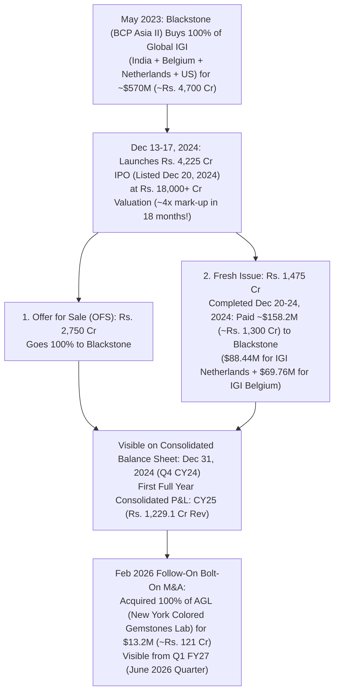
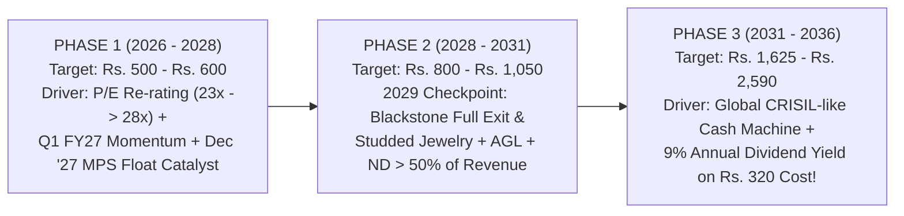

# Forensic, Valuation & Institutional Timing Upgrade: IGIL

> **Purpose of This Document:**  
> Our original three reports on **International Gemmological Institute (India) Ltd (IGIL)** mastered **Module 1 (Business Model, Value Chain & Unit Economics)**. However, they were written from the lens of a *Strategy Consultant* admiring the business, leaving blind spots in **Forensic Accounting (Module 2)**, **Related-Party Capital Allocation (Module 3)**, **Narrative Skepticism (Module 4)**, **Valuation & P/E Compression Math (Module 5)**, and **Private Equity Exit Mechanics (Module 6)**.  
>  
> This document upgrades the IGIL thesis into a complete, 360-degree **Public Market Investment Decision**.

---

## 1. The Real-World Lesson: Why IGIL's Business Grew +21%, Yet the Stock De-Rated by ~40%

Look at what happened to IGIL after its December 20, 2024 IPO (Issue Price: ₹417; Post-listing highs: ~₹550–590):

| Metric | At IPO / Post-Listing Hype (Dec 2024 – Early 2025) | Full Year CY25 Actual | Latest Quarter: Q1 FY27 (Ended June 30, 2026) | What Changed? |
| :--- | :--- | :--- | :--- | :--- |
| **Certification Volume** | 10.58M reports (CY24) | **12.81M reports (+21.1% YoY)** | **3.56M reports (+17% YoY)** | Strong secular volume growth |
| **Consolidated Revenue** | ~₹1,050 Cr | **₹1,229.1 Cr (+17% YoY)** | **₹370.8 Cr (+23% YoY)** | Accelerating in 2026 |
| **Consolidated EBITDA & Margin** | ~₹598 Cr (56.9%) | **₹736.7 Cr (59.94% Margin)** | **₹223.8 Cr (60.4% Margin, +270 bps YoY)** | Employee cost optimized from 25.2% to 22.7% |
| **Average Realized Price (ARP)** | ₹952 (CY24 avg) | **₹927 (-2.6% YoY)** | **₹1,010 (+5% YoY; up from ₹950 in Q4 CY25)** | **Major 2026 Positive Inflection!** (Jewelry mix + AGL colored stone consolidation) |
| **Valuation Multiple (P/E)** | **48x – 55x P/E** | ~28x – 35x P/E | **~22.5x – 23.2x P/E** | **Massive >50% P/E Compression (De-rating)!** |
| **Market Cap / Stock Price** | ₹18,000 Cr IPO $\rightarrow$ ₹24,000 Cr Peak | ~₹16,500 Cr | **~₹13,700 – ₹14,100 Cr (~₹320/sh)** | **Down ~23% from IPO price & ~45% from peak!** |

### Why Did This Happen? (Module 5 Twin-Engine Math in Action)
In our original report, we proved that IGIL is a high-ROCE toll-road business. **What we failed to calculate was what the 50x P/E at IPO/post-listing was already pricing in:**
1. At **50x P/E**, the market was pricing IGIL as a structural 30%+ compounder with zero pricing pressure.
2. When CY25 revenue growth came in at **17% YoY** (as 21.1% volume growth was partially offset by ARP sliding from ₹952 to ₹927 in CY25), the market de-rated the stock multiple from **50x down to ~23x**.
3. **The Exciting Setup Now (Mid-to-Late 2026):** While the stock price has been punished down to **~23x P/E**, look at the underlying operational numbers in **Q4 CY25** and **Q1 FY27 (June 2026)**:
   * **ARP has inflected upward:** From **₹927 (CY25) $\rightarrow$ ₹950 (Q4 CY25, +10.8% YoY) $\rightarrow$ ₹1,010 (Q1 FY27, +5% YoY)**!
   * **Revenue growth accelerated to +23% YoY and EBITDA grew +29% YoY (60.4% margin)** in Q1 FY27!

---

## 2. Module 6 Forensic Audit: Exact Acquisition Dates, Cash Flows & Currency Reality

In our earlier reports, we described the acquisition of IGI Belgium & IGI Netherlands as a *"reverse-inversion strategy where 63% of revenue is outside India in hard currencies."* Let's correct the exact dates, cash flows, and geographic split:

### Four Critical Realities to Keep in Mind:
1. **Exact Dates on Books:**
   * **IGI Belgium & IGI Netherlands:** Acquisition closed **December 20–24, 2024**; Balance Sheet consolidated from **December 31, 2024**; full P&L consolidated from **Q1 CY25** onward.
   * **American Gemological Laboratories (AGL, USA):** Acquisition closed **mid-February 2026** for **$13.2M (~₹121 Cr)**; consolidated from **Q1 FY27 (June 2026 quarter)**. Unlike the European buyout from Blackstone, AGL is a true third-party bolt-on acquisition (bought from Chris & Helene Smith) that adds high-ARP colored gemstone certification.
2. **Correction on "Falling Rupee Protection" (India vs. Overseas Split):**
   * Our earlier draft mistakenly stated 63.1% of revenue is outside India. In reality, **India accounts for ~75%–76% of consolidated revenue** (billed in INR in Surat/Mumbai) and ~84% of operating profits, while **Outside India (Belgium, Netherlands, USA) is only ~24%–25% of revenue**.
   * Furthermore, the 24%–25% overseas revenue earned in USD/EUR comes with local USD/EUR gemologist wages and lab rents (~20–25% EBITDA margin overseas vs. ~65–70% in India).
   * **Impact of a Falling Rupee:** Direct currency translation boost to consolidated EBITDA is modest (**~1%–1.5% for every 5% INR depreciation**). However, the **indirect competitive benefit is huge**: because 75%+ of IGIL's grading happens in India paid in INR while rival GIA is USD-heavy, a weaker Rupee continually widens IGIL's global cost advantage per stone!
3. **Disguised OFS inside the IPO "Fresh Issue":**
   * Combined with the ₹2,750 Cr OFS, the ₹1,300 Cr paid to Blackstone for Belgium and Netherlands meant **~96% of the ₹4,225 Cr IPO proceeds went to Blackstone**, while leaving Blackstone with a **~76.6% stake**.
4. **The 76.6% Supply Overhang Clock:**
   * Because BCP Asia II is a finite-life PE fund, Blackstone will eventually liquidate or sell control of this 76.6% stake over the next 3–5 years.

---

### Deep-Dive Expert Analysis: Was IGIL's Primary-OFS IPO a "Blackstone Dump on Retail"?

Retail investors often view any OFS negatively (*"Blackstone took 96% of the IPO cash, so they are dumping on retail!"*). An institutional forensic analysis looks at this through **Three Lenses**:

#### Lens 1: Why IGIL *Could Not* Do a Normal Fresh Issue (The 60%-ROCE Math)
* Ask a simple question: **What would IGIL have done if it kept ₹4,000 Crore of Fresh Issue cash inside the company?**
* IGIL is an ultra-asset-light business (~60% EBITDA margin, ~60% ROCE, zero debt) whose annual Capex is barely ₹30–50 Cr while generating ₹550–650 Cr of Free Cash Flow every year.
* Had IGIL kept ₹4,000 Cr of idle cash in 6% bank FDs, **its ROE would have crashed from 55% down to 14% overnight!** Just like BSE, MCX, or HDFC AMC, an asset-light cash machine *should* only do an OFS because it never needs external cash to fund organic growth.

#### Lens 2: Why Buying Belgium & Netherlands Fixed a Huge Corporate Governance Risk
* Yes, paying ₹1,300 Cr of the Fresh Issue to Blackstone for IGI Belgium and IGI Netherlands cashed out Blackstone and blended lower European margins (~20–25%) into India's 70% margins.
* **However, consider the alternative:** If Blackstone had listed *only* IGI India while keeping IGI Belgium (the 1975 brand owner) and IGI US privately owned by Blackstone offshore, Indian shareholders would have suffered permanent **Related-Party Governance Conflicts** (brand royalty siphoning from India to Belgium, transfer pricing disputes, and US contracts booked privately).
* By folding Belgium, Netherlands, and the US 100% under IGIL India during the IPO, **the Indian listed entity became the 100% Global Parent of the entire IGI brand worldwide** with zero royalty leakage.

#### Lens 3: Was Blackstone Dumping a Lemon, or Executing a Valuation Arbitrage?
* **How Blackstone made 4x in 18 months:** In May 2023, Blackstone bought IGI for $570M (~10x–11x EBITDA) from **Fosun International**—a distressed Chinese conglomerate forced into a fire-sale of global assets during China's property/debt crisis. Blackstone then unified the global structure and listed it in India's 2024 bull market at **$2.1B+ (~48x–55x P/E)**.
* **Proof It Was Not a "Window-Dressed Lemon":** When a PE firm dumps a lemon, earnings collapse 2 quarters post-IPO. Instead, IGIL grew volumes **+21.1% in CY25** and accelerated in **Q1 FY27 (June 2026)** to **+23% YoY revenue growth, +29% YoY EBITDA growth (60.4% margin), and ₹1,010 ARP (+5% YoY)**—and Blackstone still holds **76.6%** of the company.
* **The Verdict:** Blackstone sold a **genuinely high-quality business** at an **overpriced bull-market multiple (50x P/E)**. Now that the multiple has compressed to **~22.5x–23x P/E**, the IPO valuation froth has been washed out!

---

## 3. Module 2 & 4 Forensic Stress-Test: Reconciling the Contradictions

1. **Working Capital & Receivables (Module 2):**
   * Accounts receivable turnover is currently healthy at **5.2x–6.1x annually (~60–70 debtor days)**, down from the peak working-capital spike of ~113 days during the worst of the Surat liquidity crisis. Keep monitoring CFO-to-EBITDA conversion closely.
2. **The ARP Tug-of-War — Why Q1 FY27's Jump to ₹1,010 Matters (Module 4):**
   * In CY25, ARP slipped from ₹952 to ₹927 (-2.6% YoY), creating fear of an LGD fee death spiral.
   * However, in **Q4 CY25 (ARP ₹950, +10.8% YoY)** and **Q1 FY27 / June 2026 (ARP ₹1,010, +5% YoY)**, IGIL proved that rising share of **studded jewelry certification** and **AGL colored stone reports** can more than offset loose LGD fee pressure!

---

## 4. Module 5 & 6 Deep-Dive: Shareholding Float Squeeze, SEBI 75% MPS Rule & Testing the "₹500 by 2027" Hypothesis

### A. Exact Shareholding Math & The 90.81% Institutional Lock-Up
Why did some pre-IPO reports mention **100%** Blackstone ownership while current filings show **76.55%**?
* **Pre-IPO:** Blackstone (via *BCP Asia II TopCo Pte. Ltd.*) owned **100.00%** (39.68 Crore shares).
* **At IPO (Dec 20, 2024):** Blackstone sold 6.59 Cr shares in the OFS (₹2,750 Cr at ₹417) and IGIL issued 3.54 Cr new shares in the Fresh Issue (₹1,475 Cr), bringing total post-IPO equity to **43.21 Crore shares**.
* **Post-IPO Shareholding Structure:**

| Category | Shares (Cr) | Holding % | Game-Theory Behavior |
| :--- | :---: | :---: | :--- |
| **Promoter: Blackstone (BCP Asia II)** | 33.08 Cr | **76.55%** | Must drop to $\le 75\%$ by **Dec 19, 2027** (SEBI 3-yr MPS deadline). Wants a higher stock price (₹450–₹500+) before selling a 10%–15% institutional block. |
| **FIIs / FPIs** | ~3.80 Cr | **8.79%** | Dominated by ultra-long-term Sovereign Wealth Funds & US Endowments (see below); zero reason to sell at 23x P/E. |
| **DIIs (Mutual Funds & Insurance)** | ~2.36 Cr | **5.47%** | Anchored by contrarian domestic funds; buyers on dips and natural absorbers of future block deals. |
| **Total Promoter + Institutional Lock-Up** | **39.24 Cr** | **90.81%** | **Over 90.8% of the company is in sticky institutional hands!** |
| **Retail / Non-Institutional Float** | **3.97 Cr** | **9.19%** | **Ultra-tight free float**—once weak hands finish selling, very little supply exists on the way up. |

#### Who Are the Specific Marquee Institutions Holding >1% Stakes?
Inside that FII (8.79%) and DII (5.47%) bucket sits an A-list of the world's longest-horizon institutional capital:
1. **Government of Singapore (GIC) — 1.32%:** Sovereign Wealth Fund with a typical 5–10+ year holding horizon in Indian financial/monopoly infrastructure.
2. **Abu Dhabi Investment Authority (ADIA - Monsoon) — 1.11%:** Middle East Sovereign Wealth giant that frequently co-invests in Blackstone assets and absorbs secondary PE blocks.
3. **Massachusetts Institute of Technology (MIT Endowment) — 1.00%:** Famous in Indian equities for identifying high-ROCE midcap compounders early and holding for 7–12 years.
4. **ICICI Prudential Mutual Fund — 1.67%+** *(in Bharat Consumption Fund alone; higher across Flexi Cap / Large & Midcap schemes)*: India's premier valuation-conscious mutual fund house (alongside Anchor participants like **Norway's Government Pension Fund Global** and **Nomura**).

> **Forensic Implication of This Register:** Because **GIC + ADIA + MIT Endowment + ICICI Pru** alone lock up >5% of total equity (~22% of the entire non-promoter public float!), there is zero panic selling—and when Blackstone sells a 10%–15% block in 2027 to meet the 75% MPS rule, these exact funds are **built-in buyers** who can absorb the block cleanly!

### B. Impact of the SEBI 75% Minimum Public Shareholding (MPS) Rule
Under SEBI regulations, IGIL has until **December 19, 2027** (3 years from listing) to reduce promoter holding from **76.55% to $\le 75.00\%$**:
1. **10%–15% Block Deal Instead of 1.55%:** Unlike a family promoter who would sell only 1.55% (~₹215 Cr) to stop at 75.00%, Blackstone is a PE fund that will likely execute a **10%–15% Block Deal (~₹1,800–2,500 Cr)** in 2027 once the stock price has recovered significantly above the ₹417 IPO price.
2. **The Alignment Window (₹320 $\rightarrow$ ₹500):** Neither Blackstone nor existing FIIs/DIIs want to sell at ₹320 (~23x P/E) below the ₹417 IPO price. Between ₹320 and ₹450–₹500, **Blackstone's incentive is 100% aligned with yours**: maximize quarterly earnings, pay high dividends (since 76.55% of dividends go to Blackstone), and drive a stock re-rating so they can place a block deal at a premium valuation in 2027!
3. **The Passive Index Catalyst (MSCI / FTSE / Nifty):** The day Blackstone sells a 10%–15% block to drop below 75%, IGIL's **Free-Float Market Cap increases by >50%**, triggering automatic passive buying worth hundreds of crores from **MSCI, FTSE, and Nifty Midcap/Smallcap index funds**.

---

### C. Stress-Testing Your Hypothesis: "Can IGIL Reach ₹500 in 2027?"

**Your Hypothesis:** *FIIs and DIIs have no reason to sell as long as IGIL performs well; both Blackstone and institutions benefit from a higher share price, and the stock can reach ₹500 in 2027.*

Let's test this hypothesis with **hard forward earnings and P/E math**:

1. **Market Cap Required at ₹500/share:**
   $$\text{43.21 Crore shares} \times \text{₹500} = \mathbf{\text{₹21,605 Crore Market Cap}}$$
2. **Projected Earnings in 2027 (FY27 & Forward FY28 EPS):**
   * **CY25 Actual:** Revenue = ₹1,229.1 Cr | EBITDA = ₹736.7 Cr (59.94%) | PAT = ~₹531 Cr (EPS: ₹12.29).
   * **Q1 FY27 (June 2026) Annualized Run-Rate:** In Q1 FY27 alone, IGIL hit ₹370.8 Cr Revenue (+23% YoY) and ₹223.8 Cr EBITDA (+29% YoY, 60.4% margin). For full-year **FY27 (ending March 2027)**, IGIL is on track for **~₹1,460–1,500 Cr Revenue** and **~₹640–660 Cr PAT (FY27 EPS: ~₹15.00)**.
   * **Forward FY28 Earnings (What the Market in Mid/Late 2027 Prices the Stock On):** Assuming 17%–18% earnings growth into FY28, Forward PAT reaches **~₹750–775 Crore (Forward EPS: ~₹17.50 to ₹18.00)**.
3. **What P/E Multiple Does ₹500 Require in 2027?**
   * On trailing FY27 EPS (~₹15.00): $\frac{500}{15.00} = \mathbf{33.3\text{x Trailing P/E}}$.
   * On 1-year forward FY28 EPS (~₹17.75): $\frac{500}{17.75} = \mathbf{28.2\text{x Forward P/E}}$.

> **Forensic Verdict on Your ₹500 Target Hypothesis:**  
> **Your hypothesis is mathematically sound and high-probability.** To hit **₹500 in 2027 (+56% from ₹320)**, IGIL does *not* need to return to its euphoric 50x IPO P/E multiple! It simply needs to deliver its current ~17%–18% earnings trajectory and re-rate modestly from **22.5x P/E today to ~28x Forward P/E (33x trailing)**—which is a very reasonable multiple for a debt-free, 60%-ROCE, 60%-EBITDA-margin market leader with a tight 9.19% retail float.

#### The Only 2 Risks to Watch on the Way to ₹500:
1. **Supply Zone Around ₹440–₹470:** Once the stock crosses the ₹417 IPO price and reaches **₹440–₹470**, Blackstone may execute its first **10%–12% Block Deal** to satisfy the Dec 2027 SEBI 75% MPS rule. Expect temporary 1–2 month sideways digestion whenever that block deal is announced before passive index buying pushes it toward ₹500+.
2. **Quarterly Guardrail:** The thesis holds as long as quarterly **EBITDA growth stays >15% YoY** and **ARP holds above ₹930–₹950** (currently ₹1,010 in Q1 FY27).

---

## 5. Summary of 3-Year Valuation Scenarios & Actionable Triggers

1. **Bear Case (10% PAT CAGR, 18x Exit P/E):** ~0% to +5% return over 3 years (strong downside floor at 23x P/E).
2. **Base Case / 2027 Target Hypothesis (17–18% PAT CAGR, 28x Forward / 33x Trailing P/E):** **Reaches ~₹500 in 2027 (+56% upside from ₹320, plus ~2% annual dividend yield)**.
3. **Bull Case (20% PAT CAGR + Re-rating to 35x P/E after passive index inclusion):** **₹600+ over 24–36 months**.

### Actionable Entry & Monitoring Triggers:
- [x] **Trigger 1 (Fundamental Inflection — ACHIEVED in Q4 CY25 & Q1 FY27!):** ARP has rebounded from ₹927 to ₹950 (Q4 CY25) and **₹1,010 (Q1 FY27)**, with EBITDA margin hitting **60.4%** and revenue growing **+23% YoY**.
- [ ] **Trigger 2 (Technical Stage 2 Confirmation):** Confirm the stock is holding above its Stage 1 base and reclaiming its **200-Day Moving Average** on strong volume.
- [ ] **Trigger 3 (MPS Block Deal Watch Near ₹440–₹480):** Track when Blackstone announces its MPS-compliance block deal ahead of the Dec 2027 deadline.

---

## 6. The 10-Year Horizon (2026 $\rightarrow$ 2036): What to Expect & How to Play It

Over a **1-to-2-year horizon (to ₹500 in 2027)**, stock returns are driven by P/E re-rating (22.5x $\rightarrow$ 28x) and Blackstone/institutional game theory. Over a **10-year horizon (2026 $\rightarrow$ 2036)**, Blackstone will have fully exited, and **95% of your wealth will depend on whether IGIL crosses three structural bridges between 2028 and 2032**:

### A. The Three Structural Bridges IGIL Must Cross (2028–2032)
1. **Bridge 1: Crossing the "Swarovski Crystal" LGD Commoditization Cliff:**
   * If wholesale loose LGD prices fall to $15–$20/carat by 2031, manufacturers will stop paying ₹1,000 to certify loose LGD stones.
   * **How IGIL Wins:** By shifting >50%–60% of its revenue mix to:
     * **Finished Studded Gold/Platinum Jewelry Certification:** Even if the LGD inside a ring costs ₹10,000, the 18k Gold + Diamond ring sells at retail for ₹70,000–₹1,50,000, where buyers always demand third-party authentication.
     * **Colored Gemstones (AGL Acquisition):** High-value rubies, emeralds, and sapphires command premium provenance fees.
     * **Commercial Natural Diamonds:** Capturing share from slow, high-cost GIA using India's labor cost advantage.
2. **Bridge 2: Post-Blackstone Ownership Transition (2028–2030):**
   * By 2029–2031, Blackstone will exit its remaining stake.
   * **Ideal Outcome:** IGIL becomes a **100% institutionally held, professionally managed compounder** (like *BSE, CDSL, CRISIL, or ITC*), OR is acquired by a global testing giant (*SGS, Bureau Veritas, Intertek*). *(Guardrail: Exit if control is ever sold to a promoter group with poor governance).*
3. **Bridge 3: AI Hardware vs. "Third-Party Stamp of Trust":**
   * Even when AI grades stones in seconds, retailers and consumers pay IGIL for the **independent, legally trusted 3rd-party brand signature** (just as companies pay CRISIL/Moody's for ratings), while AI slashes IGIL's internal grading cost.

---

### B. 10-Year Stock Price & Total Wealth Projections (2026 $\rightarrow$ 2036)
* **Starting Baseline (2026):** Stock Price = **~₹320** | FY27E Run-Rate EPS = **~₹15.00** (PAT ~₹650 Cr) | Dividend Payout = **40%–50% of PAT**.

| 10-Year Scenario (2026 $\rightarrow$ 2036) | 10-Yr EPS CAGR | 2036 Projected EPS | 2036 Exit P/E | **2036 Expected Stock Price** | **10-Yr Cumulative Dividends/Share** | **Total Wealth Multiplier (2026 $\rightarrow$ 2036)** |
| :--- | :---: | :---: | :---: | :---: | :---: | :---: |
| **1. Bear Case** *(Loose LGD dies; Jewelry/AGL only offsets the fall)* | **8% CAGR** | ₹32.40 *(PAT ~₹1,400 Cr)* | 18x P/E | **~₹585** | + ₹120 | **~2.2x (~8% CAGR)** — *Stagnation after 2029* |
| **2. Base Case (The "CRISIL" Path)** *(Jewelry + AGL + Screening compound steadily)* | **14.5% CAGR** | **₹58.00** *(PAT ~₹2,500 Cr)* | **28x – 30x P/E** | **₹1,625 – ₹1,740** | **+ ₹165** | **~5.6x to 6.0x (~19% CAGR)** |
| **3. Bull Case (Global Hallmarking Monopoly)** *(Mandatory global jewelry & provenance standard)* | **18% CAGR** | **₹78.50** *(PAT ~₹3,400 Cr)* | **33x P/E** | **~₹2,590** | **+ ₹220** | **~8.8x (~24% CAGR)** |

> **The Hidden 10-Year Bonus — "Dividend Yield on Original Cost":**  
> In the **Base Case (₹1,625–₹1,740 stock price in 2036)**, IGIL earns **~₹58 EPS** in 2036. Because this asset-light business requires almost zero factory capex, paying out 50% of profits as dividends equals **~₹29/share per year in cash dividends**—meaning by 2036 you will earn a **~9% annual cash dividend yield on your original ₹320 purchase price**, on top of a **5.5x capital gain**!

---

### C. The 3-Phase Checkpoint Roadmap (Don't "Buy & Forget"—"Buy & Verify")

* **Your 2029 Checkpoint Rule:** Ride Phase 1 to ₹500–₹600. In **2029**, check one number in the Annual Report: *Has "Finished Studded Jewelry + Colored Gemstones (AGL) + Natural Diamonds" crossed 50%–60% of total revenue with stable ARP?* If **Yes**, hold all the way to **2036 (₹1,625–₹2,590)**. If **No** (if ARP falls below ₹800), take your 2x gains around ₹600–₹700 and redeploy.

