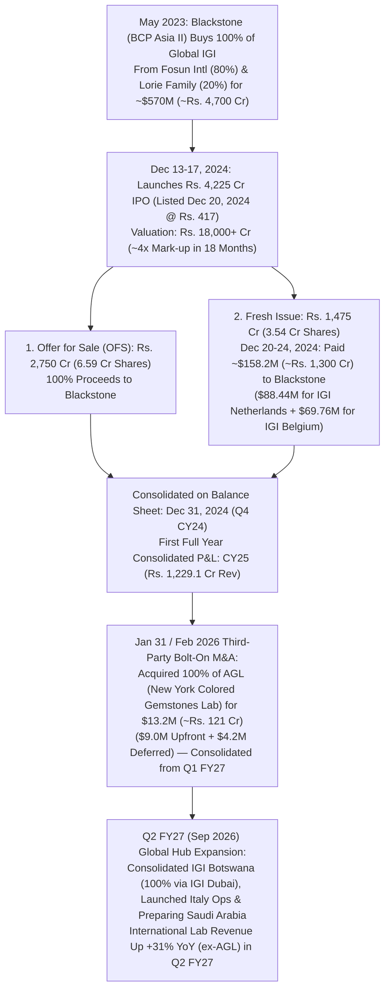
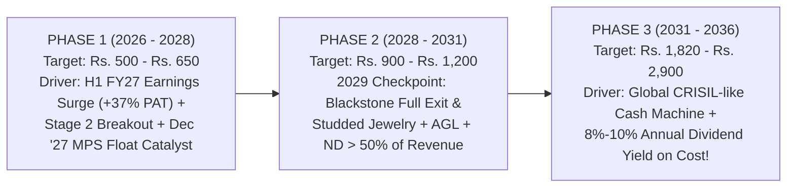
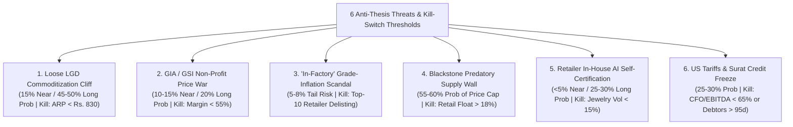
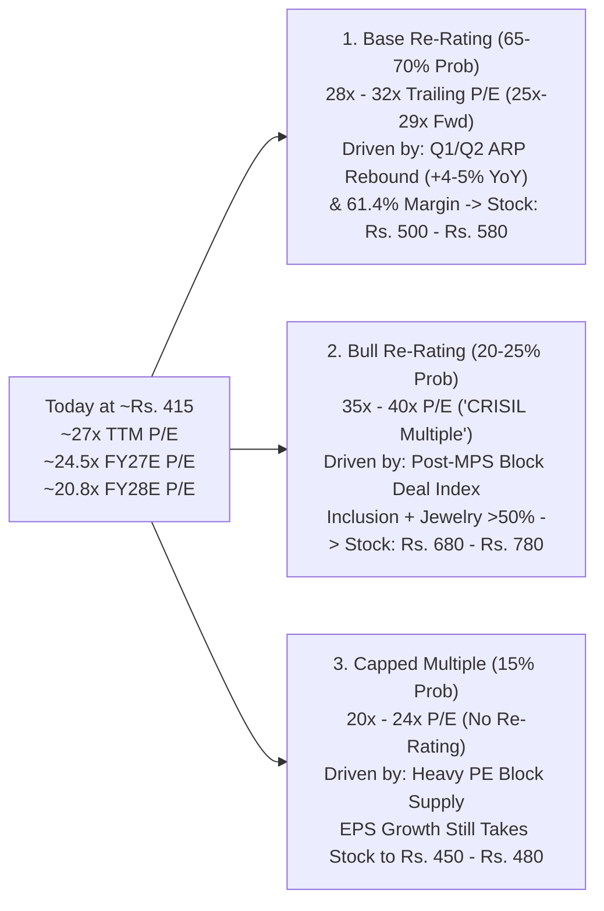

# Forensic, Valuation & Institutional Timing Upgrade: IGIL

**Report Suite Navigation:**  
📍 **[1. Master Summary](./Summary.md)** | 📊 **[2. Forensic, Valuation & Timing Upgrade (You Are Here)](./Forensic-Valuation-And-Timing-Upgrade.md)** | ⚙️ **[3. Financial & Unit Economics Framework](./Financial%20Analysis%20Framework%20For%20IGIL.md)** | 🔗 **[4. Value Chain & In-Factory Moat](./Gemmological%20Institute%20Value%20Chain%20Analysis.md)** | 🚀 **[5. Vision 2030 Strategy & AI Roadmap](./Gemmological%20Institute%20Strategy%20Report%20Creation.md)**

> [!NOTE]
> **Purpose of This Document (Modules 2–6):**  
> Our foundational reports—**[Financial Analysis Framework](./Financial%20Analysis%20Framework%20For%20IGIL.md)**, **[Value Chain Analysis](./Gemmological%20Institute%20Value%20Chain%20Analysis.md)**, and **[Vision 2030 Strategy](./Gemmological%20Institute%20Strategy%20Report%20Creation.md)**—mastered **Module 1 (Business Model, Value Chain & Unit Economics)**. This document completes the 360-degree institutional thesis by covering **Forensic Cash Flow Auditing (Module 2)**, **Related-Party M&A & Capital Allocation (Module 3)**, **ARP vs. Volume Skepticism (Module 4)**, **Valuation & P/E Re-Rating Math (Module 5)**, **PE Exit & Shareholding Game Theory (Module 6)**, and **Anti-Thesis Kill-Switches**.

---

## 1. The Real-World Lesson: How IGIL De-Rated from 50x to 22.5x P/E, Then Inflected on Record Q1 & Q2 FY27 Results

### A. Complete Post-IPO Performance & Valuation Arc (Dec 2024 $\rightarrow$ Nov 2026)

*Note: IGIL transitioned from a Calendar Year (Jan–Dec) to a Financial Year (Apr–Mar) reporting cycle in 2026.*

| Metric | At IPO / Post-Listing Hype (Dec '24 – Early '25) | Full Year CY25 Actual | Q1 FY27 (Ended Jun 30, 2026) | **Q2 FY27 (Ended Sep 30, 2026 — Record)** | **H1 FY27 Cumulative (Apr–Sep 2026)** | Key Structural Shift |
| :--- | :---: | :---: | :---: | :---: | :---: | :--- |
| **Certification Volume** | 10.58M (CY24) | **12.81M** *(+21.1% YoY)* | **3.56M** *(+17% YoY)* | **4.35M** *(+26% YoY, +22.2% QoQ)* | **7.91M** *(+22.1% YoY)* | **All-time high volume!** LGD Jewelry +47% YoY, Loose LGD +37% YoY |
| **Revenue from Ops** | ₹1,053.2 Cr (CY24) | **₹1,229.1 Cr** *(+16.7% YoY)* | **₹370.8 Cr** *(+23.2% YoY)* | **₹398.02 Cr** *(+31.0% YoY, +7.3% QoQ)* | **₹768.8 Cr** *(+27.1% YoY)* | Top-line growth accelerated from 17% (CY25) to 31% (Q2 FY27) |
| **Operating EBITDA** | ₹599.7 Cr (CY24) | **₹736.7 Cr** *(+22.8% YoY)* | **₹223.8 Cr** *(+29.0% YoY)* | **₹244.50 Cr** *(+38.8% YoY, +9.2% QoQ)* | **₹468.3 Cr** *(+33.9% YoY)* | Employee cost optimized from 25.2% (CY24) to ~21–22% |
| **EBITDA Margin (%)** | 56.94% | **59.94%** *(+300 bps)* | **60.4%** *(+270 bps YoY)* | **61.4%** *(+340 bps YoY, +100 bps QoQ)* | **60.9%** *(+310 bps YoY)* | **Record 61.4% margin** via operating leverage |
| **Profit After Tax (PAT)** | ₹427.3 Cr (40.6%) | **₹531.6 Cr** *(43.25%)* | **₹165.7 Cr** *(44.7%, +31% YoY)* | **₹185.84 Cr** *(46.7%, +43.2% YoY)* | **₹351.6 Cr** *(45.7%, +37.2% YoY)* | **Q2 EPS: ₹4.30 (+43.3% YoY) \| H1 EPS: ₹8.14 in 6 months!** |
| **Avg. Realized Price (ARP)** | ₹952 (CY24 avg) | **₹927** *(-2.6% YoY)* | **₹1,010** *(+5% YoY)* | **₹891 Cert / ₹915 Tot** *(+4% YoY)* | **₹972 Blended** *(+4.5% YoY)* | **Two consecutive quarters of YoY ARP growth (+5% Q1, +4% Q2)** |
| **Valuation Multiple (P/E)** | **48x – 55x P/E** | ~28x – 35x P/E | **~22.5x P/E** *(Trough)* | **~26.5x – 27.6x TTM P/E** | **~24.5x FY27E \| ~20.8x FY28E P/E** | Multiple compressed >50% to trough, now re-rating with earnings |
| **Stock Price / Market Cap** | ₹417 IPO $\rightarrow$ ₹550+ Peak | ~₹380 (~₹16,400 Cr) | **~₹320** *(52W Low: ₹287)* | **~₹407 – ₹425** *(52W High: ₹440)* | **M-Cap: ~₹17,600 – ₹18,377 Cr** | **Up +28%–33% from our ₹320 call; reclaimed ₹417 IPO price!** |

### B. Why Did This Happen? (The Twin-Engine Math of Earnings & Multiples)
1. **What 50x P/E Priced In at IPO:** At **50x–55x P/E**, the market priced IGIL as a 30%+ compounder with zero pricing friction.
2. **Why the Stock De-Rated to ~₹320 (22.5x P/E):** When CY25 revenue grew **+16.7% YoY** (as +21.1% volume growth was partially offset by ARP slipping -2.6% YoY from ₹952 to ₹927), the market compressed the P/E multiple by >50% down to ~22.5x.
3. **Why the Inflection Worked in Q1 & Q2 FY27:**
   * In **Q1 FY27** (+23.2% Revenue, ₹1,010 ARP) and **Q2 FY27** (+31.0% Revenue to ₹398.02 Cr, +38.8% EBITDA to ₹244.50 Cr at **61.4% margin**, and +43.2% PAT to ₹185.84 Cr), both **Volume (+26% YoY)** and **YoY Realization (+4% YoY)** expanded together.
   * The stock rallied from **~₹320 to ~₹407–₹425 (hitting a ₹440 52W high)**—yet because PAT grew +43.2% YoY, forward valuation remains highly attractive at **~24.5x FY27E EPS (₹16.80)** and **~20.8x FY28E EPS (₹19.80)**.

---

## 2. Module 6 Forensic Audit: Exact M&A Dates, Cash Flows & Currency Reality

### A. Visual Deal Flow: From Blackstone's 2023 Buyout to 2026 Global Expansion

### B. Four Critical Forensic Realities to Keep in Mind

| Forensic Topic | Cross-Validated Fact & Financial Reality |
| :--- | :--- |
| **1. Exact M&A Dates on Books** | • **IGI Belgium & IGI Netherlands ($158.2M / ~₹1,300 Cr):** Closed **Dec 20–24, 2024**; Balance Sheet consolidated from **Dec 31, 2024**; full P&L consolidated from **Q1 CY25** onward. • **American Gemological Laboratories — AGL, New York ($13.2M / ~₹121 Cr):** Board approved **Jan 31, 2026**, closed **mid-Feb 2026** ($9.0M paid at closing + $4.2M deferred). Bought from third-party owners (Chris & Helene Smith); consolidated from **Q1 FY27 (Jun 2026)**. • **Botswana, Italy & Saudi Arabia (Sep 2026):** Consolidated 100% of **IGI Botswana** (via IGI Dubai) and commenced **Italy** operations in Q2 FY27; preparing **Saudi Arabia** entry. |
| **2. India vs. Overseas Revenue & Rupee Protection** | • **Actual Geographic Split:** **India generates ~75%–76% of consolidated revenue** (billed in INR in Surat/Mumbai) and ~84% of operating profit. **Outside India (Belgium, Netherlands, USA, Dubai/Botswana, Italy) generates ~24%–25% of revenue** (growing **+31% YoY ex-AGL in Q2 FY27**). • **Direct vs. Indirect FX Impact:** Overseas labs earn USD/EUR but also pay local USD/EUR wages (~20–25% EBITDA margin overseas vs. ~65–70% in India). Thus, **direct P&L translation gain is modest (~1%–1.5% EBITDA boost per 5% INR depreciation)**, *but* **indirect competitive protection is massive** because IGIL's INR-paid gemologist workforce continually becomes cheaper in USD terms than US-based rival GIA. *(See **[Financial Framework — Section 3.4](./Financial%20Analysis%20Framework%20For%20IGIL.md#34-geographic--cost-structure-reality-india-vs-global-subsidiaries-botswana-italy-saudi-expansion)**).* |
| **3. Disguised OFS inside the IPO "Fresh Issue"** | • Combined with the ₹2,750 Cr OFS, paying ₹1,300 Cr ($158.2M) of the ₹1,475 Cr Fresh Issue to Blackstone for Belgium and Netherlands meant **~96% of the ₹4,225 Cr IPO proceeds went to Blackstone**. |
| **4. The 76.55% Supply Overhang Clock** | • Because *BCP Asia II TopCo Pte. Ltd.* is a finite-life PE fund, Blackstone must drop below 75% by **Dec 19, 2027** (SEBI MPS deadline) and will eventually monetize its **76.55% stake (33.08 Cr shares)** over 3–5 years. |

---

### C. 3-Lens Expert Verdict: Was IGIL's IPO a "Blackstone Dump on Retail"?

> [!TIP]
> **Why Institutional Investors View the IPO Structure as Valuation Arbitrage—Not a "Lemon Dump":**
> 1. **Lens 1 — The 69%-ROCE Capital-Light Math (Why an OFS Was Mandatory):**  
>    IGIL operates at **61.4% EBITDA margin, 69.2% ROCE, 55.8% ROE**, zero debt, and needs barely ₹30–50 Cr of annual capex while generating **₹415.7 Cr of Operating Cash Flow in H1 FY27 alone (~₹800+ Cr annualized)**. Had IGIL kept ₹4,000 Cr of Fresh Issue cash sitting in 6% bank FDs, **its ROE would have crashed from 55.8% down to 14% overnight!** Asset-light monopolies (like BSE, CDSL, or CAMS) *should* only do an OFS because they never need external equity to fund organic growth.
> 2. **Lens 2 — Eliminating Offshore Governance Conflicts:**  
>    Had Blackstone listed *only* IGI India while keeping IGI Belgium (the 1975 brand owner) and IGI USA privately owned offshore, Indian public shareholders would have faced permanent **related-party brand royalty leakage and transfer-pricing conflicts**. Making IGIL India the **100% Global Parent** aligned all global cash flows and IP under the Indian listed company.
> 3. **Lens 3 — Post-IPO Execution Proves Asset Quality:**  
>    Blackstone bought IGI in May 2023 for $570M (~10–11x EBITDA) during Chinese conglomerate **Fosun International's** debt-crisis fire sale, unified the global structure, and listed it in India at ~50x P/E. When a PE firm dumps a "window-dressed lemon," earnings collapse post-IPO. Instead, IGIL grew volumes **+21.1% in CY25**, accelerated in **Q1 FY27 (+23.2% revenue)**, and delivered an **all-time record Q2 FY27 (+31.0% revenue, +38.8% EBITDA, +43.2% PAT)**.

---

## 3. Module 2 & 4 Forensic Stress-Test: Cash Flows & ARP Resilience

### A. Working Capital & Cash Flow Validation (Module 2 — Resolved in H1 FY27)
* **The Historical Concern:** During the 2024 Surat midstream liquidity crunch, broader working capital days spiked toward ~113 days, raising fears that IGIL's P&L profits were getting trapped in uncollected B2B invoices.
* **The H1 FY27 Proof:** In **H1 FY27 (Apr–Sep 2026)**, IGIL generated **₹415.7 Crore in Net Cash from Operating Activities (CFO)** against **₹468.3 Crore of Operating EBITDA** and **₹351.6 Crore of PAT**:
  $$\text{Pre-Tax CFO / EBITDA Conversion} = \frac{₹415.7\text{ Cr}}{₹468.3\text{ Cr}} = \mathbf{88.8\%} \quad \Big| \quad \text{CFO / PAT Conversion} = \frac{₹415.7\text{ Cr}}{₹351.6\text{ Cr}} = \mathbf{118.2\%}$$
* **Debtor Days:** Trade receivable turnover remains healthy at **5.2x–6.1x annually (~60–70 debtor days)** on a virtually debt-free balance sheet. *(See **[Financial Framework — Section 5.3](./Financial%20Analysis%20Framework%20For%20IGIL.md#53-cash-flow--working-capital-validated-in-h1-fy27)**).*

### B. The Volume vs. ARP Dynamic: Why Q1 (₹1,010) & Q2 (₹891 Cert / ₹915 Total) Prove Pricing Resilience (Module 4)
* **The CY25 Dip:** In CY25, ARP slipped **-2.6% YoY** (from ₹952 to ₹927), sparking fears of an LGD fee death spiral.
* **The 2026 Rebound Across Three Consecutive Quarters:**
  1. **Q4 CY25 (Dec '25):** ARP rebounded to **₹950 (+10.8% YoY** vs. ₹859 in Q4 CY24).
  2. **Q1 FY27 (Jun '26):** Total ARP jumped to **₹1,010 (+5% YoY** vs. ₹963 YoY).
  3. **Q2 FY27 (Sep '26):** Pure Certification ARP rose **+4% YoY to ₹891** ($\text{₹387.5 Cr} / 4.35\text{M}$) and Total Operating Revenue per report rose **+4% YoY to ₹915** ($\text{₹398.02 Cr} / 4.35\text{M}$), bringing **H1 FY27 blended realization to ₹972 (+4.5% YoY)**.
* **Why Did Sequential Realization Move from ₹1,010 (Q1) to ₹891/₹915 (Q2) While Expanding +4% YoY and Lifting EBITDA Margin to 61.4%?**
  Because Q2 is the pre-festive/Christmas holiday manufacturing surge, where volume jumped **+22.2% QoQ** (from 3.56M to **4.35M reports**, +26% YoY), led by **+47% YoY growth in LGD Studded Jewelry** and **+37% YoY in Loose LGD**. Holiday jewelry batch runs carry smaller stone sizes than Q1's solitaire-heavy mix, lowering sequential ticket size—yet **like-for-like YoY realization still grew +4% YoY** and massive volume throughput pushed EBITDA margins up **+100 bps QoQ to 61.4%**!

---

## 4. Module 5 & 6 Deep-Dive: Shareholding Lock-Up, SEBI 75% MPS Rule & Upgraded "₹500–₹580" Target Math

### A. Exact Shareholding Split (Q2 FY27 / Sep 30, 2026) & The 90.82% Institutional Lock-Up

* **Pre-IPO vs. Post-IPO Shares:** Pre-IPO, Blackstone owned **100.00%** (39.68 Cr shares). At the Dec 2024 IPO, Blackstone sold 6.59 Cr shares (OFS) and IGIL issued 3.54 Cr new shares (Fresh Issue), bringing total post-IPO equity to **43.21 Crore shares**.

| Category | Shares (Cr) | Holding % (Sep '26) | Institutional Game-Theory Behavior |
| :--- | :---: | :---: | :--- |
| **Promoter: Blackstone (BCP Asia II)** | 33.08 Cr | **76.55%** *(0% Pledged)* | Must reduce stake to $\le 75\%$ by **Dec 19, 2027** (SEBI 3-yr MPS deadline). Incentivized to drive stock to **₹460–₹520+** before placing a 10%–15% institutional block. |
| **FIIs / FPIs** | ~3.80 Cr | **8.80%** | Anchored by 5–10 yr Sovereign Wealth Funds & US Endowments; zero reason to sell at ~20.8x FY28E P/E. |
| **DIIs (Mutual Funds 3.86% + Other 1.61%)** | ~2.36 Cr | **5.47%** | Anchored by contrarian domestic funds; natural buyers of future secondary blocks. |
| **Total Promoter + Institutional Lock-Up** | **39.24 Cr** | **90.82%** | **Over 90.8% of total equity is locked in sticky institutional hands.** |
| **Retail / Non-Institutional Float** | **3.97 Cr** | **9.18%** | **Ultra-tight free float**—explaining why the stock rapidly rallied +30% (₹320 $\rightarrow$ ₹420+) once Q1 & Q2 beats hit. |

#### Marquee Public Institutional Holders (>1% Disclosures)
1. **Government of Singapore (GIC) — 1.32%:** Sovereign Wealth Fund with a 5–10+ year holding horizon in Indian monopoly infrastructure.
2. **Abu Dhabi Investment Authority (ADIA - Monsoon) — 1.11%:** Sovereign wealth giant that frequently co-invests in Blackstone assets and absorbs secondary PE blocks.
3. **Massachusetts Institute of Technology (MIT Endowment) — 1.00%:** Long-horizon US endowment known for holding high-ROCE Indian midcap compounders for 7–12 years.
4. **ICICI Prudential Mutual Fund — 1.67%+** *(in Bharat Consumption Fund alone; higher across schemes)*: Alongside anchor investors **Norway's Government Pension Fund Global** and **Nomura**.

### B. The SEBI 75% Minimum Public Shareholding (MPS) Catalyst (Deadline: Dec 19, 2027)
1. **Why a 10%–15% Block Deal Is Likely Instead of 1.55%:** To drop from 76.55% to $\le 75.00\%$, Blackstone only legally needs to sell 1.55% (~₹280 Cr). However, as a PE fund, Blackstone will likely execute a **10%–15% institutional block deal (~₹2,000–3,000 Cr)** in 2027 once the stock is comfortably trading in the **₹460–₹520+ range**.
2. **The Passive Index Inclusion Catalyst (MSCI / FTSE / Nifty):** The day Blackstone sells a 10%–15% block to drop below 75%, IGIL's **Free-Float Market Cap jumps by >50%**, triggering automatic passive inflows worth hundreds of crores from **MSCI, FTSE, and Nifty Midcap/Smallcap index trackers**.

---

### C. Upgraded "₹500–₹580 in 2027" Target Math (Post-Q2 FY27 Beat)

When we initially modeled the **"₹500 in 2027"** hypothesis at **~₹320/share**, we estimated FY27E EPS of ~₹15.00 and FY28E EPS of ~₹17.75. **With H1 FY27 PAT already at ₹351.6 Cr (+37.2% YoY; H1 EPS ₹8.14), IGIL is beating those projections by ~12%!**

| Valuation Step | Exact Math & Upgraded Trajectory |
| :--- | :--- |
| **1. Market Cap at ₹500 / Share** | $43.21\text{ Crore shares} \times ₹500 = \mathbf{₹21,605\text{ Crore Market Cap}}$ *(vs. ~₹17,600–₹18,377 Cr today at ₹407–₹425)*. |
| **2. Upgraded FY27E Earnings** | **H1 FY27 Actual:** Revenue ₹768.8 Cr (+27.1% YoY) \| EBITDA ₹468.3 Cr (60.9% margin) \| PAT **₹351.6 Cr (EPS ₹8.14)**. **Full-Year FY27E (Mar '27):** On track for **~₹1,580 Cr Revenue** and **~₹715–740 Cr PAT (Upgraded FY27E EPS: ~₹16.80)**. |
| **3. Upgraded FY28E Earnings** | Assuming 18% earnings growth in FY28E (driven by LGD jewelry, AGL colored stones, and Botswana/Italy/Saudi scale-up), **FY28E PAT reaches ~₹845–875 Cr (Upgraded FY28E EPS: ~₹19.80)**. |
| **4. Implied P/E Multiple at ₹500** | • **On Trailing FY27E EPS (₹16.80):** $\frac{500}{16.80} = \mathbf{29.8\text{x Trailing P/E}}$ • **On Forward FY28E EPS (₹19.80):** $\frac{500}{19.80} = \mathbf{25.2\text{x Forward P/E}}$ |

> [!IMPORTANT]
> **Upgraded Verdict on the ₹500–₹580 Target:**  
> 1. **First Leg Achieved (+30% Gain So Far):** The stock has already rallied from **~₹320 to ~₹407–₹425 (52W High: ₹440)**, crossing its ₹417 IPO price.  
> 2. **₹500 Requires Zero Further P/E Expansion:** Because IGIL is *already* trading at **~26.5x–27.6x TTM P/E** today and **₹500/share is just 25.2x Forward FY28E EPS (₹19.80)**, **earnings growth alone now carries IGIL to ₹500+ in 2027**, while a 28x–29x forward multiple takes it to **₹550–₹580**!

---

## 5. Summary of 3-Year Valuation Scenarios & Actionable Triggers

| Scenario | Volume CAGR | ARP Trend | Revenue / PAT CAGR | Target P/E | **Target Price & Expected Return (vs. ₹415 CMP / ₹320 Base)** |
| :--- | :---: | :---: | :---: | :---: | :--- |
| **Bear Case** *(LGD commoditization accelerates)* | +12% | -3% | ~10% – 12% | 20x | **~₹385 – ₹400** *(~Flat from ₹415; +22% from ₹320 — protected by 69% ROCE)* |
| **Base Case (2027–28 Target)** | +18% – 20% | +2% to +3% | ~20% – 22% | **25x–29x Fwd (30x TTM)** | **₹500 – ₹580** *(+20% to +40% from ₹415; +56% to +81% from ₹320 + dividend)* |
| **Bull Case** *(Post-MPS block index inclusion)* | +22%+ | +3% to +4% | ~24%+ | 33x – 36x | **₹680 – ₹780+** *(+64% to +88% from ₹415; >2.2x from ₹320 over 24–30 months)* |

### Actionable Entry & Portfolio Management Checklist
- [x] **Trigger 1 (Fundamental Inflection — ACHIEVED):** Q1 FY27 (+23.2% Rev, ₹1,010 ARP, 60.4% EBITDA margin) followed by **record Q2 FY27 (+31.0% Rev to ₹398.02 Cr, +38.8% EBITDA to ₹244.50 Cr at 61.4% margin, +43.2% PAT to ₹185.84 Cr, 4.35M reports)**.
- [x] **Trigger 2 (Technical Stage 2 Breakout — ACHIEVED):** Stock broke out of its ₹287–₹320 Stage 1 base, reclaimed its 200-DMA, and crossed the **₹417 IPO price** (hitting a ₹440 52W high).
- [ ] **Trigger 3 (MPS Block Deal Supply Zone at ₹450–₹500):** Monitor Blackstone's 10%–15% MPS-compliance block deal ahead of the **Dec 19, 2027** deadline; institutional absorption + passive index inclusion will fuel the next leg.

---

## 6. The 10-Year Horizon (2026 $\rightarrow$ 2036): Three Structural Bridges & Wealth Projections

### A. The Three Structural Bridges IGIL Must Cross (2028–2032)
1. **Bridge 1 — Crossing the "Swarovski Crystal" LGD Commoditization Cliff:**
   * If wholesale sub-1ct loose LGD prices fall to $15–$25/ct by 2031, manufacturers will stop paying ₹900 to certify small loose stones.
   * **How IGIL Wins (Already Proven in Q2 FY27):** By shifting >50%–60% of revenue into **Finished Studded Gold/Platinum Jewelry (+47% YoY in Q2 FY27!)**, **Colored Gemstones (AGL — multi-fold growth)**, and **Commercial Natural Diamonds (+8% YoY in Q2 FY27)**. Even if the LGD inside an 18k gold ring costs ₹10,000, the finished ring retails for ₹75,000–₹1,50,000, where buyers always mandate third-party certification.
2. **Bridge 2 — Post-Blackstone Ownership Transition (2028–2030):**
   * By 2029–2031, Blackstone will fully exit. The ideal outcome is IGIL becoming a **100% institutionally owned compounder** (like *BSE, CDSL, CRISIL, or CAMS*) or being acquired by a global TIC leader (*SGS, Bureau Veritas, Intertek*).
3. **Bridge 3 — AI Hardware vs. "Independent Stamp of Trust":**
   * Even as AI ("SwiftCert") grades stones in seconds, retailers and consumers pay IGIL for the **independent, legally defensible 3rd-party signature** (just as debt issuers pay CRISIL/Moody's), while AI slashes internal grading costs. *(See **[Strategy Report — Section 1.2 & 3](./Gemmological%20Institute%20Strategy%20Report%20Creation.md#12-the-5-year-target-the-ai-amortization-model-cy-2030)**).*

### B. 10-Year Stock Price & Dividend Projections (2026 $\rightarrow$ 2036)
* **Baseline (Nov 2026):** Initial Call Base = **₹320** | Current Price = **~₹415** | Upgraded FY27E EPS = **~₹16.80** (PAT ~₹725 Cr) | Dividend Payout = **40%–50% of PAT**.

| 10-Year Scenario (2026 $\rightarrow$ 2036) | 10-Yr EPS CAGR (off ₹16.80 FY27E) | 2036 Projected EPS (PAT) | 2036 Exit P/E | **2036 Expected Stock Price** | **10-Yr Cumulative Dividends/Share** | **Total Wealth Multiplier (vs. ₹320 Base / ₹415 CMP)** |
| :--- | :---: | :---: | :---: | :---: | :---: | :---: |
| **1. Bear Case** *(Loose LGD dies; Jewelry only offsets fall)* | **8.0% CAGR** | ₹36.30 *(~₹1,570 Cr)* | 18x P/E | **~₹650** | + ₹135 | **~2.5x on ₹320 (~1.9x on ₹415)** — *Stagnation after 2029* |
| **2. Base Case (The "CRISIL" Path)** *(Jewelry + AGL + Screening compound)* | **14.5% CAGR** | **₹65.00** *(~₹2,800 Cr)* | **28x – 30x P/E** | **₹1,820 – ₹1,950** | **+ ₹185** *(~₹32.5/yr dividend by 2036)* | **~6.3x to 6.7x on ₹320 (~4.8x on ₹415)** |
| **3. Bull Case (Global Hallmarking Monopoly)** | **18.0% CAGR** | **₹88.00** *(~₹3,800 Cr)* | **33x P/E** | **~₹2,900** | **+ ₹245** | **~9.8x on ₹320 (~7.6x on ₹415)** |

### C. The 3-Phase Checkpoint Roadmap ("Buy & Verify")

---

## 7. The Anti-Thesis Scenarios: Probabilities, P&L Impact & Kill-Switches

To avoid confirmation bias after the rally from ₹320 to ~₹415, we track **Six Anti-Thesis Scenarios** that could break the thesis.

### A. Detailed Mechanism of Each Anti-Thesis

1. **Anti-Thesis 1 — Loose LGD Commoditization Cliff (Certification Abandonment on Sub-1ct Loose Stones):**
   * *Mechanism:* If Chinese HPHT and Indian CVD supply pushes wholesale loose LGD prices below **$25–$40/carat**, a ₹890–₹1,000 ($11–$12) IGI certificate exceeds 25%–40% of the stone's value. Manufacturers abandon individual certification on sub-1ct loose stones (~20%–25% of revenue) or shift to ₹50–₹150 batch screening.
   * *Q2 FY27 Nuance to Watch:* While Q2 ARP grew **+4% YoY**, sequential ARP moved from **₹1,010 (Q1) to ₹891 cert / ₹915 total (Q2)** due to holiday jewelry batch volume (+47% YoY). If ARP fails to bounce in Q3/Q4 and drops below **₹830 for 2 consecutive quarters**, structural fee erosion is underway.
2. **Anti-Thesis 2 — GIA / GSI Non-Profit Price War:**
   * *Mechanism:* Rival **GIA** is a non-profit backed by an endowment with no need for 60% EBITDA margins, though its US-heavy salary base makes a price war costly. If GIA or GSI cuts LGD/commercial dossier fees by 25%–30% to recapture US retail chains, IGIL must either lose volume or cut prices (where every 10% ARP cut reduces EBITDA by ~12%).
3. **Anti-Thesis 3 — "In-Factory" Integrity Scandal (Grade Inflation / Retailer Delisting):**
   * *Mechanism:* Placing IGI gemologists inside client factories in Surat is IGIL's biggest operational moat—and its biggest Single Point of Failure. A proven bribery, grade-inflation, or synthetic-mixing scandal that causes a major US retailer (e.g., Signet) to delist IGI reports would trigger an immediate **-25% to -40% revenue shock**. *(See **[Value Chain Analysis — Section 4.2 & 9.3](./Gemmological%20Institute%20Value%20Chain%20Analysis.md#42-deep-dive-the-in-factory-operational-model)**).*
4. **Anti-Thesis 4 — Blackstone's 76.55% Overhang Turns Into a Multi-Year Supply Wall (2027–2029):**
   * *Mechanism:* Clearing Blackstone's 33.08 Cr shares requires absorbing **~₹14,000–17,000 Cr of stock** over 3–4 years. If Blackstone sells 10%–12% blocks every time the stock reaches ₹450–₹500, or if FIIs/DIIs fail to absorb the supply and dump shares onto retail, the P/E multiple could stay capped at 20x–23x for years despite strong EPS growth.
5. **Anti-Thesis 5 — Retailer In-House AI Self-Certification ("Certified by Brand"):**
   * *Mechanism:* On <$300 LGD fashion rings, mega-brands (*Pandora, Swarovski, Tanishq, Signet*) could eventually use desktop AI grading boxes to issue in-house store guarantees rather than paying IGIL $10–$12 per piece. *(Low near-term risk since LGD Jewelry certification just grew **+47% YoY in Q2 FY27**).*
6. **Anti-Thesis 6 — US Tariff Shock & Surat Midstream Credit Freeze:**
   * *Mechanism:* With ~45% of Indian polished exports going to the US and ~75% of IGIL's revenue billed in Surat/Mumbai, steep US reciprocal tariffs or a midstream inventory default could trigger factory shutdowns and trap IGIL's profits in overdue receivables.

---

### B. Quantified Probability & P&L Impact Matrix (vs. FY27E Baseline: ₹1,580 Cr Rev | ₹965 Cr EBITDA | ₹725 Cr PAT)

Because **~75% of IGIL's operating costs (~₹615 Cr/yr) are fixed or semi-fixed**, any pure pricing (ARP) shock flows **~100% to EBITDA**, while any volume shock flows at a **~75% contribution margin**:

| # | Anti-Thesis Vector | Probability (1–2 Yrs) | Probability (3–5 Yrs) | **Revenue Impact (If Triggered)** | **EBITDA Margin & PAT Impact (If Triggered)** | Current Status (Q2 / H1 FY27 Actual) | **Kill-Switch / Red Flag (When to Exit)** |
| :-: | :--- | :---: | :---: | :---: | :---: | :---: | :--- |
| **1** | **Loose LGD Commoditization Cliff** | **Low (~15%)** | **Med-High (45%–50%)** | **-8% to -12%** *(or slows Rev CAGR from 22% to ~9%)* | **EBITDA Margin: 61.4% $\rightarrow$ 52%–54%** **PAT Impact: -18% to -22%** *(unless offset by +47% YoY Jewelry mix)* | **ARP ₹891 Cert / ₹915 Tot (+4% YoY); ₹972 H1** | ARP **< ₹830** for 2 quarters or Rev growth lags Vol by >600 bps |
| **2** | **GIA / GSI Non-Profit Price War** | **Low (10%–15%)** | **Low-Med (~20%)** | **-10% to -15%** *(Direct ARP hit)* | **EBITDA Margin: 61.4% $\rightarrow$ 50%–51%** **PAT Impact: -25% to -30%** *(100% negative flow-through)* | **61.4% EBITDA Margin in Q2 (+340 bps YoY)** | EBITDA Margin **< 55%** or Total Vol growth **< 12% YoY** |
| **3** | **"In-Factory" Integrity Scandal** | **Very Low (5%–8% Tail)** | **Very Low (5%–8% Tail)** | **-25% to -40%** *(Sudden demand shock)* | **EBITDA Margin: 61.4% $\rightarrow$ <40%** **PAT Impact: -45% to -55%** *(plus P/E crash to 12x–14x)* | **9 of Top 10 Chains; Zero Breaches** | Loss of any Top-10 retailer or FTC/grading integrity probe |
| **4** | **Blackstone (76.55%) Supply Ceiling** | **High (55%–60%)** | **High (60%+)** | **0% Impact** *(Business keeps growing 20%+)* | **0% P&L Impact** *(Blackstone wants peak EBITDA/dividends)*, **but caps Stock P/E at 20x–23x during block digestion** | **Retail Float 9.18%** *(90.82% Inst. Lock-up)* | Retail Float spikes **> 18%–20%** or control sold to weak promoter |
| **5** | **Retailer In-House AI Self-Cert** | **Very Low (<5%)** | **Medium (25%–30%)** | **-8% to -15%** *(Long-term drag on jewelry vol)* | **EBITDA Margin: 61.4% $\rightarrow$ 54%–56%** **PAT Impact: -10% to -18%** *(Gradual 2029+ erosion)* | **+47% YoY (LGD Jewelry in Q2 FY27)** | Jewelry Volume Growth drops **< 15% YoY** for 2 quarters |
| **6** | **US Tariffs & Surat Credit Freeze** | **Medium (25%–30%)** | **Medium (~25%)** | **-10% to -15%** *(1–2 quarter export destocking)* | **EBITDA Margin: 61.4% $\rightarrow$ 55%–57%** **PAT Impact: -12% to -18%** *(Working capital & debtor provisions)* | **88.8% CFO/EBITDA (₹415.7 Cr); ~65 Days** | CFO/EBITDA **< 65%** or Debtor Days **> 95–100 Days** |

---

## 8. The P/E Re-Rating Anatomy: Why IGIL De-Rated Post-IPO & The Probability of a Re-Rating Now

### A. Why Did the Post-IPO P/E De-Rating (50x $\rightarrow$ 22.5x) Happen?
1. **The "ARP Deflation" Panic (CY25):** When CY25 ARP slipped **-2.6% YoY (₹952 $\rightarrow$ ₹927)** and revenue growth came in at **+16.7% YoY**, investors feared crashing LGD wholesale prices would force IGIL into a permanent fee-cutting spiral.
2. **Optical Margin Dilution from Europe:** Consolidating IGI Belgium & IGI Netherlands (~20–25% EBITDA margins) into India's 70% EBITDA margin optically lowered consolidated margins to ~57–60%.
3. **The 76.55% PE Overhang & Low Free Float (<10%):** Excluded IGIL from major passive index weights while creating fear of PE supply.

---

### B. Peer Valuation Benchmark: Why ~20.8x FY28E P/E Is Still Discounted

| Peer Group | Examples | Typical EBITDA Margin | Typical ROCE | Earnings Growth | **Market P/E Multiple Range** |
| :--- | :--- | :---: | :---: | :---: | :---: |
| **Indian Rating Agencies** | CRISIL, ICRA, CARE | 26% – 32% | 30% – 45% | 12% – 16% | **35x – 52x P/E** |
| **Indian Market Infrastructure** | CDSL, CAMS, KFinTech, BSE | 45% – 60% | 40% – 55% | 18% – 25% | **40x – 60x P/E** |
| **Global TIC / Testing Giants** | SGS, Bureau Veritas, Intertek | 18% – 22% | 20% – 28% | 6% – 9% | **22x – 26x P/E** |
| **IGIL (At ~₹415 Today)** | **Global #1 LGD / #2 Overall Gem Lab** | **61.4% (Q2 FY27)** | **69.2%** | **+37.2% YoY (H1 FY27)** | **~27x TTM \| ~24.5x FY27E \| ~20.8x FY28E** |

* **Why Does IGIL Trade Below CRISIL/CAMS (40x–50x P/E)?** Due to **two valuation brakes**: (1) ~48–50% revenue exposure to loose LGD stones (terminal-value question), and (2) Blackstone's upcoming 10%–15% MPS block deal by Dec 2027.

---

### C. Probability Breakdown of the 3 P/E Re-Rating Regimes (2026 $\rightarrow$ 2028)

| P/E Scenario (2026–2028) | Target Trailing P/E (Forward P/E) | **Probability** | Exact Catalysts Required to Trigger This Regime | **Implied Stock Price in 2027–28 (on ₹16.80 FY27E / ₹19.80 FY28E EPS)** |
| :--- | :---: | :---: | :--- | :---: |
| **1. Base-Case Re-Rating (Gradual Normalization)** | **28x – 32x TTM** *(25x – 29x Fwd)* | **High (65% – 70%)** | • **Already in motion** (stock moved from 22.5x at ₹320 to ~27x TTM at ₹415). • **Q1 (+5% YoY) & Q2 (+4% YoY) ARP growth** + **61.4% EBITDA margin** have killed the "melting ice cube" narrative. • **LGD Studded Jewelry (+47% YoY in Q2)** & AGL colored stones shrinking the loose-LGD discount. | **₹500 – ₹580** *(+20% to +40% from ₹415; +56% to +81% from ₹320)* |
| **2. Bull-Case Re-Rating ("The CRISIL / Post-PE Overhang Multiple")** | **35x – 40x TTM** *(32x – 36x Fwd)* | **Medium (20% – 25%)** | • **Completion of Blackstone's 10%–15% MPS Block Deal (by Dec 2027):** In Indian equities (*Coforge, Mankind, Max Healthcare*), P/E multiples expand sharpest *after* the PE promoter drops below 75%, unlocking **>50% higher Free Float** and mandatory **MSCI / FTSE / Nifty Midcap passive inflows**. • **Jewelry + Natural + AGL crosses >50% of revenue.** | **₹680 – ₹780+** *(+64% to +88% from ₹415; >2.2x from ₹320)* |
| **3. No Re-Rating / PE Supply Capped** | **20x – 24x TTM** *(19x – 22x Fwd)* | **Low-Med (15%)** | • Blackstone sells repeated blocks every time the stock crosses ₹450–₹480, or loose LGD ARP dips negative again. • **Crucial Cushion:** Even if Forward P/E stays capped at 22x–24x, **20%+ EPS compounding alone pushes the stock to ₹450–₹480**! | **₹450 – ₹480** *(+8% to +16% from ₹415 via pure EPS growth)* |
