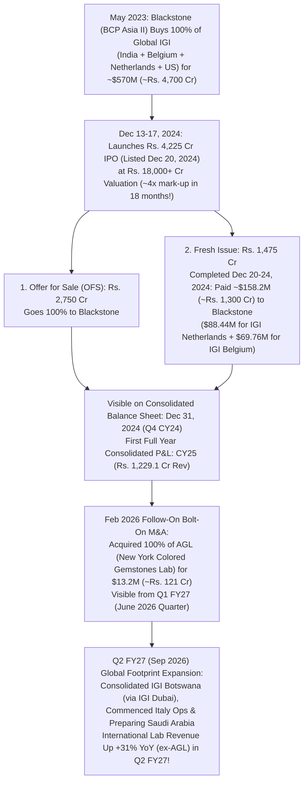
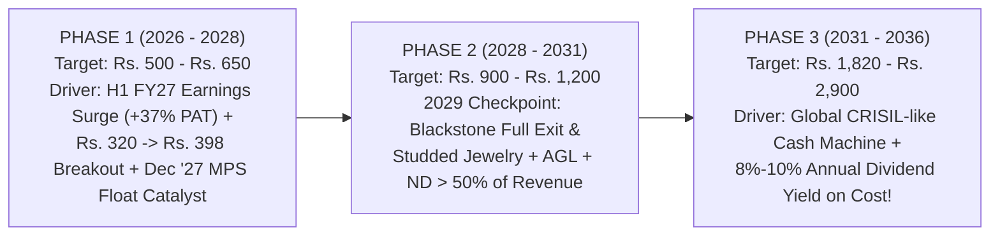
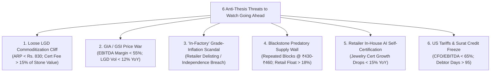
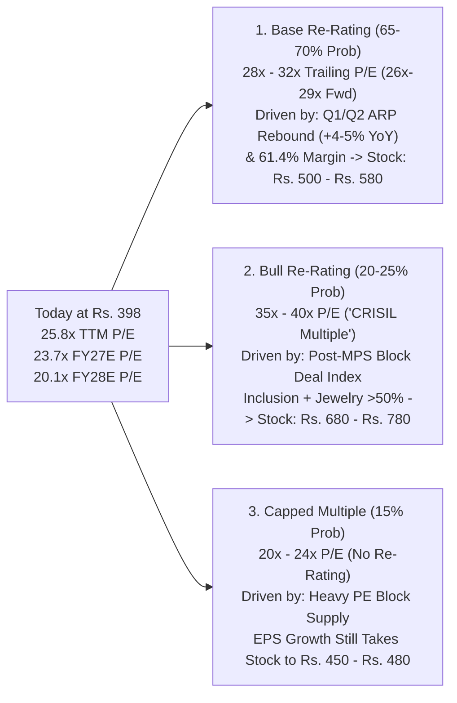

# Forensic, Valuation & Institutional Timing Upgrade: IGIL

> **Purpose of This Document:**  
> Our original three reports on **International Gemmological Institute (India) Ltd (IGIL)** mastered **Module 1 (Business Model, Value Chain & Unit Economics)**. However, they were written from the lens of a *Strategy Consultant* admiring the business, leaving blind spots in **Forensic Accounting (Module 2)**, **Related-Party Capital Allocation (Module 3)**, **Narrative Skepticism (Module 4)**, **Valuation & P/E Compression Math (Module 5)**, and **Private Equity Exit Mechanics (Module 6)**.  
>  
> This document upgrades the IGIL thesis into a complete, 360-degree **Public Market Investment Decision**.

---

## 1. The Real-World Lesson: How IGIL De-Rated from 50x to 23x P/E, Then Inflected on Record Q1 & Q2 FY27 Results

Look at the complete arc of IGIL from its December 20, 2024 IPO (Issue Price: ₹417; Post-listing highs: ~₹550–590) through the trough at ~₹320 (~22.5x P/E) and its latest **Q2 FY27 (Quarter ended September 30, 2026, announced October 21, 2026)** results—the **strongest quarter in the company's history**:

| Metric | At IPO / Post-Listing Hype (Dec 2024 – Early 2025) | Full Year CY25 Actual | Q1 FY27 (Ended June 30, 2026) | **Latest Quarter: Q2 FY27 (Ended Sep 30, 2026)** | **H1 FY27 Cumulative (Apr–Sep 2026)** | What Changed? |
| :--- | :--- | :--- | :--- | :--- | :--- | :--- |
| **Certification Volume** | 10.58M reports (CY24) | **12.81M (+21.1% YoY)** | **3.56M (+17% YoY)** | **4.35M reports (+26% YoY, +22.2% QoQ)** | **7.91M reports (+22% YoY)** | **Record quarterly volume!** LGD Jewelry +47% YoY, Loose LGD +37% YoY |
| **Revenue from Operations** | ~₹1,050 Cr | **₹1,229.1 Cr (+17% YoY)** | **₹370.8 Cr (+23% YoY)** | **₹398.02 Cr (+31.0% YoY, +7.3% QoQ)** | **₹768.8 Cr (+27% YoY)** | Sharp top-line acceleration in Q2 FY27 |
| **Operating EBITDA & Margin** | ~₹598 Cr (56.9%) | **₹736.7 Cr (59.94%)** | **₹223.8 Cr (60.4%, +270 bps YoY)** | **₹244.50 Cr (+38.8% YoY, 61.4% Margin, +340 bps YoY)** | **₹468.3 Cr (+34% YoY, 60.9% Margin)** | **All-time high 61.4% EBITDA margin** via operating leverage |
| **Profit After Tax (PAT) & Margin** | ~₹426 Cr (40.6%) | **₹531.0 Cr (43.2%)** | **₹165.8 Cr (44.7%)** | **₹185.84 Cr (+43.2% YoY, 46.7% Margin)** | **₹351.6 Cr (+37% YoY, 45.7% Margin)** | **Quarterly EPS ₹4.30 (+43.3% YoY); H1 EPS ₹8.14!** |
| **Average Realized Price (ARP)** | ₹952 (CY24 avg) | **₹927 (-2.6% YoY)** | **₹1,010 (+5% YoY)** | **₹891 Cert / ₹915 Total (+4% YoY)** | **₹972 Blended H1 (+4.5% YoY)** | **Two consecutive quarters of YoY ARP growth (+5% in Q1, +4% in Q2)!** |
| **Valuation Multiple (P/E)** | **48x – 55x P/E** | ~28x – 35x P/E | **~22.5x – 23.2x P/E** | **~25.8x TTM P/E (~23.7x FY27E P/E)** | **ROCE: 69.2% \| ROE: 55.8%** | **Re-rating underway as earnings outpace stock price!** |
| **Market Cap / Stock Price** | ₹18,000 Cr IPO $\rightarrow$ ₹24,000 Cr Peak | ~₹16,500 Cr | **~₹13,800 Cr (~₹320/sh)** | **~₹17,189 Cr (~₹398/sh; 52W High ₹421)** | **CFO: ₹415.7 Cr in H1 (88.8% of EBITDA)** | **Up +24% from our ~₹320 call; testing ₹417 IPO price!** |

### Why Did This Happen? (Module 5 Twin-Engine Math in Action)
In our original report, we proved that IGIL is a high-ROCE toll-road business. **What we initially missed was what the 50x P/E at IPO/post-listing was already pricing in—and how the subsequent de-rating to 22.5x created a textbook entry:**
1. At **50x P/E**, the market was pricing IGIL as a structural 30%+ compounder with zero pricing pressure.
2. When CY25 revenue growth came in at **17% YoY** (as 21.1% volume growth was partially offset by ARP sliding from ₹952 to ₹927 in CY25), the market de-rated the stock multiple from **50x down to ~22.5x (~₹320/share)**.
3. **How the Inflection Played Out in Q1 & Q2 FY27 (And Why There Is Still Upside from ~₹398):**
   * **Both Engines Fired Together in Q2 FY27 (Ended Sep 30, 2026):** Volume surged **+26% YoY to 4.35 million reports** (with **LGD Jewelry up +47% YoY**, **Loose LGD up +37% YoY**, **Natural Loose Diamonds up +8% YoY**, and **Colored Gemstones up multi-fold**), while YoY ARP expanded **+4% YoY**—driving **+31% YoY Revenue (₹398.02 Cr)**, **+38.8% YoY EBITDA (₹244.50 Cr at 61.4% margin)**, and **+43.2% YoY PAT (₹185.84 Cr)**!
   * **Stock Response:** The stock re-rated **+24% from ~₹320 to ~₹398**, yet because trailing and forward EPS jumped so sharply (+43.2% YoY PAT in Q2), the TTM P/E only moved from 22.5x to **25.8x** (and forward FY27E P/E is just **~23.7x**)!

---

## 2. Module 6 Forensic Audit: Exact Acquisition Dates, Cash Flows & Currency Reality

In our earlier reports, we described the acquisition of IGI Belgium & IGI Netherlands as a *"reverse-inversion strategy where 63% of revenue is outside India in hard currencies."* Let's maintain the exact dates, cash flows, and updated global expansion footprint:

### Four Critical Realities to Keep in Mind:
1. **Exact Dates on Books:**
   * **IGI Belgium & IGI Netherlands:** Acquisition closed **December 20–24, 2024**; Balance Sheet consolidated from **December 31, 2024**; full P&L consolidated from **Q1 CY25** onward.
   * **American Gemological Laboratories (AGL, USA):** Acquisition closed **mid-February 2026** for **$13.2M (~₹121 Cr)**; consolidated from **Q1 FY27 (June 2026 quarter)**. Unlike the European buyout from Blackstone, AGL is a true third-party bolt-on acquisition (bought from Chris & Helene Smith) that adds high-ARP colored gemstone certification (which grew multi-fold in Q2 FY27).
   * **Q2 FY27 Global Lab Expansion (Botswana, Italy, Saudi Arabia):** In September 2026, IGIL finalized the consolidation of **IGI Botswana** as a wholly-owned step-down subsidiary (via IGI Dubai), commenced operations in **Italy** (a high-jewelry hub), and is preparing entry into **Saudi Arabia**. International lab revenues (excluding AGL) grew a standout **+31% YoY in Q2 FY27**.
2. **Correction on "Falling Rupee Protection" (India vs. Overseas Split):**
   * Our earlier draft mistakenly stated 63.1% of revenue is outside India. In reality, **India accounts for ~75%–76% of consolidated revenue** (billed in INR in Surat/Mumbai) and ~84% of operating profits, while **Outside India (Belgium, Netherlands, USA, Dubai/Botswana, Italy) is ~24%–25% of revenue**.
   * Furthermore, the 24%–25% overseas revenue earned in USD/EUR comes with local USD/EUR gemologist wages and lab rents (~20–25% EBITDA margin overseas vs. ~65–70% in India).
   * **Impact of a Falling Rupee:** Direct currency translation boost to consolidated EBITDA is modest (**~1%–1.5% for every 5% INR depreciation**). However, the **indirect competitive benefit is huge**: because 75%+ of IGIL's grading happens in India paid in INR while rival GIA is USD-heavy, a weaker Rupee continually widens IGIL's global cost advantage per stone!
3. **Disguised OFS inside the IPO "Fresh Issue":**
   * Combined with the ₹2,750 Cr OFS, the ₹1,300 Cr paid to Blackstone for Belgium and Netherlands meant **~96% of the ₹4,225 Cr IPO proceeds went to Blackstone**, while leaving Blackstone with a **76.55% stake**.
4. **The 76.55% Supply Overhang Clock:**
   * Because BCP Asia II is a finite-life PE fund, Blackstone will eventually liquidate or sell control of this 76.55% stake over the next 3–5 years.

---

### Deep-Dive Expert Analysis: Was IGIL's Primary-OFS IPO a "Blackstone Dump on Retail"?

Retail investors often view any OFS negatively (*"Blackstone took 96% of the IPO cash, so they are dumping on retail!"*). An institutional forensic analysis looks at this through **Three Lenses**:

#### Lens 1: Why IGIL *Could Not* Do a Normal Fresh Issue (The 69%-ROCE Math)
* Ask a simple question: **What would IGIL have done if it kept ₹4,000 Crore of Fresh Issue cash inside the company?**
* IGIL is an ultra-asset-light business (**61.4% EBITDA margin in Q2 FY27, 69.2% ROCE, 55.8% ROE**, zero debt) whose annual Capex is barely ₹30–50 Cr while generating **₹415.7 Cr of Operating Cash Flow in H1 FY27 alone (~₹800+ Cr annualized)**.
* Had IGIL kept ₹4,000 Cr of idle cash in 6% bank FDs, **its ROE would have crashed from 55.8% down to 14% overnight!** Just like BSE, MCX, or HDFC AMC, an asset-light cash machine *should* only do an OFS because it never needs external cash to fund organic growth.

#### Lens 2: Why Buying Belgium & Netherlands Fixed a Huge Corporate Governance Risk
* Yes, paying ₹1,300 Cr of the Fresh Issue to Blackstone for IGI Belgium and IGI Netherlands cashed out Blackstone and blended lower European margins (~20–25%) into India's 70% margins.
* **However, consider the alternative:** If Blackstone had listed *only* IGI India while keeping IGI Belgium (the 1975 brand owner) and IGI US privately owned by Blackstone offshore, Indian shareholders would have suffered permanent **Related-Party Governance Conflicts** (brand royalty siphoning from India to Belgium, transfer pricing disputes, and US/European contracts booked privately).
* By folding Belgium, Netherlands, and the US 100% under IGIL India during the IPO (where international labs just grew **+31% YoY in Q2 FY27**), **the Indian listed entity became the 100% Global Parent of the entire IGI brand worldwide** with zero royalty leakage.

#### Lens 3: Was Blackstone Dumping a Lemon, or Executing a Valuation Arbitrage?
* **How Blackstone made 4x in 18 months:** In May 2023, Blackstone bought IGI for $570M (~10x–11x EBITDA) from **Fosun International**—a distressed Chinese conglomerate forced into a fire-sale of global assets during China's property/debt crisis. Blackstone then unified the global structure and listed it in India's 2024 bull market at **$2.1B+ (~48x–55x P/E)**.
* **Proof It Was Not a "Window-Dressed Lemon":** When a PE firm dumps a lemon, earnings collapse 2 quarters post-IPO. Instead, IGIL grew volumes **+21.1% in CY25**, accelerated in **Q1 FY27 (+23% YoY revenue)**, and just delivered its **strongest quarter in history in Q2 FY27 (+31% YoY revenue, +38.8% YoY EBITDA at 61.4% margin, +43.2% YoY PAT)**—and Blackstone still holds **76.55%** of the company.
* **The Verdict:** Blackstone sold a **genuinely high-quality business** at an **overpriced bull-market multiple (50x P/E)**. Now that earnings have compounded into the multiple (~25.8x TTM P/E / ~23.7x FY27E P/E at ₹398), the IPO valuation froth has been digested by real earnings growth!

---

## 3. Module 2 & 4 Forensic Stress-Test: Reconciling the Contradictions (Updated for Q2 & H1 FY27)

1. **Working Capital & Cash Flow Conversion (Module 2 — Validated in H1 FY27!):**
   * Earlier, our primary forensic monitorable was whether midstream stress in Surat would bloat receivables and trap cash.
   * **H1 FY27 Cash Flow Proof:** In H1 FY27 (Apr–Sep 2026), IGIL reported **₹415.7 Crore in Net Cash from Operating Activities (CFO)** against **₹468.3 Crore of Operating EBITDA**—an exceptional **88.8% pre-tax CFO-to-EBITDA conversion** (and **118% of ₹351.6 Cr PAT**!). Accounts receivable turnover remains healthy at **5.2x–6.1x (~60–70 debtor days)** on a near debt-free balance sheet, proving that IGIL's B2B invoices are converting cleanly into hard cash.
2. **The ARP Tug-of-War — Why Q1 (₹1,010) & Q2 (₹891 Cert / ₹915 Total, +4% YoY) Prove Pricing Resilience (Module 4):**
   * In CY25, ARP slipped from ₹952 to ₹927 (-2.6% YoY), creating fear of an LGD fee death spiral.
   * However, across **H1 FY27**, IGIL has now posted **two consecutive quarters of positive YoY ARP growth**:
     * **Q1 FY27:** Total ARP jumped to **₹1,010 (+5% YoY)**.
     * **Q2 FY27:** Pure Certification ARP grew **+4% YoY to ₹891** (and Total Operating Revenue per report grew **+4% YoY to ₹915**, bringing **H1 FY27 blended realization to ₹972**).
     * *Why was Q2 ARP ₹891–₹915 vs. ₹1,010 in Q1?* Because Q2 saw a massive **+22.2% sequential volume surge** (from 3.56M to **4.35M reports**, +26% YoY) ahead of the Diwali/Christmas holiday season, led by **+47% YoY growth in LGD studded jewelry** and **+37% YoY in loose LGD**. High-volume jewelry and seasonal batch runs carry a slightly lower per-unit ticket than Q1's solitaire/AGL-heavy mix, yet still achieved **+4% YoY pricing expansion** and drove EBITDA margin up **+100 bps QoQ to 61.4%**!

---

## 4. Module 5 & 6 Deep-Dive: Shareholding Float Squeeze, SEBI 75% MPS Rule & Upgraded "₹500 by 2027" Math

### A. Exact Shareholding Math & The 90.82% Institutional Lock-Up (Updated to Sep 2026 / Q2 FY27 Filing)
* **Pre-IPO:** Blackstone (via *BCP Asia II TopCo Pte. Ltd.*) owned **100.00%** (39.68 Crore shares).
* **At IPO (Dec 20, 2024):** Blackstone sold 6.59 Cr shares in the OFS (₹2,750 Cr at ₹417) and IGIL issued 3.54 Cr new shares in the Fresh Issue (₹1,475 Cr), bringing total post-IPO equity to **43.21 Crore shares**.
* **Latest Shareholding Structure (Quarter Ended September 30, 2026 / Q2 FY27):**

| Category | Shares (Cr) | Holding % (Sep 2026) | Game-Theory Behavior |
| :--- | :---: | :---: | :--- |
| **Promoter: Blackstone (BCP Asia II)** | 33.08 Cr | **76.55%** *(0% Pledged)* | Must drop to $\le 75\%$ by **Dec 19, 2027** (SEBI 3-yr MPS deadline). Wants a higher stock price (₹450–₹500+) before selling a 10%–15% institutional block. |
| **FIIs / FPIs** | ~3.80 Cr | **8.80%** | Dominated by ultra-long-term Sovereign Wealth Funds & US Endowments (see below); zero reason to sell at ~23.7x FY27E P/E. |
| **DIIs (Mutual Funds 3.86% + Other DIIs 1.61%)** | ~2.36 Cr | **5.47%** | Anchored by contrarian domestic funds; buyers on dips and natural absorbers of future block deals. |
| **Total Promoter + Institutional Lock-Up** | **39.24 Cr** | **90.82%** | **Over 90.8% of the company is in sticky institutional hands!** |
| **Retail / Non-Institutional Float** | **3.97 Cr** | **9.18%** | **Ultra-tight free float**—which is why the stock jumped +24% (₹320 $\rightarrow$ ₹398) rapidly once Q1 & Q2 beats arrived! |

#### Who Are the Specific Marquee Institutions Holding >1% Stakes?
Inside that FII (8.80%) and DII (5.47%) bucket sits an A-list of the world's longest-horizon institutional capital:
1. **Government of Singapore (GIC) — 1.32%:** Sovereign Wealth Fund with a typical 5–10+ year holding horizon in Indian financial/monopoly infrastructure.
2. **Abu Dhabi Investment Authority (ADIA - Monsoon) — 1.11%:** Middle East Sovereign Wealth giant that frequently co-invests in Blackstone assets and absorbs secondary PE blocks.
3. **Massachusetts Institute of Technology (MIT Endowment) — 1.00%:** Famous in Indian equities for identifying high-ROCE midcap compounders early and holding for 7–12 years.
4. **ICICI Prudential Mutual Fund — 1.67%+** *(in Bharat Consumption Fund alone; higher across schemes)*: India's premier valuation-conscious mutual fund house (alongside Anchor participants like **Norway's Government Pension Fund Global** and **Nomura**).

> **Forensic Implication of This Register:** Because **GIC + ADIA + MIT Endowment + ICICI Pru** alone lock up >5% of total equity (~22% of the entire non-promoter public float!), there is minimal overhead supply—and when Blackstone sells a 10%–15% block in 2027 to meet the 75% MPS rule, these exact funds are **built-in buyers** who can absorb the block cleanly!

### B. Impact of the SEBI 75% Minimum Public Shareholding (MPS) Rule
Under SEBI regulations, IGIL has until **December 19, 2027** (3 years from listing) to reduce promoter holding from **76.55% to $\le 75.00\%$**:
1. **10%–15% Block Deal Instead of 1.55%:** Unlike a family promoter who would sell only 1.55% (~₹265 Cr) to stop at 75.00%, Blackstone is a PE fund that will likely execute a **10%–15% Block Deal (~₹2,000–3,000 Cr)** in 2027 once the stock price is comfortably in the **₹450–₹520+ zone** above its ₹417 IPO price.
2. **The Alignment Window (₹398 $\rightarrow$ ₹500+):** At ~₹398, IGIL is just 4.5% below its ₹417 IPO price. Blackstone's incentive remains **100% aligned with public shareholders**: sustain 25%+ earnings growth, pay high dividends (such as the ₹2.55/share / 127.5% interim dividend), and push the stock cleanly into the ₹450–₹550 range so they can place an institutional block deal at a premium valuation in 2027.
3. **The Passive Index Catalyst (MSCI / FTSE / Nifty):** The day Blackstone sells a 10%–15% block to drop below 75%, IGIL's **Free-Float Market Cap increases by >50%**, triggering automatic passive buying worth hundreds of crores from **MSCI, FTSE, and Nifty Midcap/Smallcap index funds**.

---

### C. Upgrading Our "₹500 in 2027" Hypothesis After the Q2 FY27 Beat

When we first formulated the **"₹500 in 2027"** hypothesis at **~₹320/share**, we projected FY27E PAT of ₹640–660 Cr (EPS ~₹15.00) and FY28E PAT of ₹750–775 Cr (EPS ~₹17.75). **After Q2 FY27's blowout ₹185.84 Cr PAT (+43.2% YoY), IGIL is running significantly ahead of those projections!**

Let's re-run the exact math with **H1 FY27 Actuals**:
1. **Market Cap Required at ₹500/share:**
   $$\text{43.21 Crore shares} \times \text{₹500} = \mathbf{\text{₹21,605 Crore Market Cap}}$$
   *(vs. ~₹17,189 Crore Market Cap today at ₹398/share).*
2. **Upgraded Earnings Trajectory in FY27E & FY28E:**
   * **CY25 Actual:** Revenue = ₹1,229.1 Cr | EBITDA = ₹736.7 Cr (59.94%) | PAT = ₹531.0 Cr (EPS: ₹12.29).
   * **H1 FY27 Actual (Apr–Sep 2026):** Revenue = **₹768.8 Cr (+27% YoY)** | EBITDA = **₹468.3 Cr (+34% YoY, 60.9% margin)** | PAT = **₹351.6 Cr (+37% YoY, H1 EPS = ₹8.14 in 6 months)**.
   * **Upgraded Full-Year FY27E (Ending March 2027):** Even assuming a conservative H2 (matching Q2's run-rate of ~₹185 Cr/quarter), full-year **FY27E Revenue is on track for ~₹1,560–1,600 Cr (+27% YoY)** and **FY27E PAT reaches ~₹715–740 Cr (Upgraded FY27E EPS: ~₹16.55 to ₹17.10; midpoint ₹16.80)**—beating our prior ₹15.00 EPS estimate by **+12%**!
   * **Upgraded Forward FY28E Earnings:** Assuming 18% earnings growth in FY28E (driven by LGD jewelry, AGL colored stones, and Botswana/Italy/Saudi expansion), **FY28E PAT reaches ~₹845–875 Crore (Forward FY28E EPS: ~₹19.55 to ₹20.25; midpoint ₹19.80)**.
3. **What P/E Multiple Does ₹500 Require Now?**
   * On Upgraded Trailing FY27E EPS (~₹16.80): $\frac{500}{16.80} = \mathbf{29.8\text{x Trailing P/E}}$ *(down from 33.3x previously!)*.
   * On Upgraded Forward FY28E EPS (~₹19.80): $\frac{500}{19.80} = \mathbf{25.2\text{x Forward P/E}}$ *(down from 28.2x previously!)*.

> **Upgraded Forensic Verdict on the ₹500–₹550 Target in 2027:**  
> 1. **First Leg Validated (+24% Gain So Far):** The stock has already rallied from **~₹320 to ~₹398** as Q1 and Q2 FY27 results proved the growth acceleration.  
> 2. **₹500 No Longer Needs Any P/E Expansion:** Because IGIL is *already* trading at **25.8x TTM P/E** at ₹398 and upgraded FY28E EPS is **~₹19.80**, **₹500/share is just 25.2x FY28E EPS**—meaning pure earnings compounding carries the stock to **₹500 (+26% from ₹398; +56% from ₹320)**, while a modest 28x forward multiple supports **₹550+ in 2027**!

#### The 2 Key Levels & Risks to Watch From ₹398 to ₹500+:
1. **Near-Term Overhead Resistance at ₹417–₹421 & Block Deal Supply Zone at ₹450–₹480:**
   * **₹417–₹421 Zone:** ₹417 is the Dec 2024 IPO issue price and ₹421 is the 52-week high. Expect brief technical digestion around ₹415–₹425 as IPO-era trapped retail holders break even.
   * **₹450–₹480 Zone:** Once the stock clears ₹421 and reaches ₹450–₹480, watch for Blackstone's **10%–15% MPS Block Deal** ahead of the Dec 2027 deadline. Treat any 5%–8% block-deal discount dip as an institutional liquidity event ahead of passive MSCI/FTSE/Nifty index inclusion.
2. **Quarterly Guardrail:** The thesis holds as long as quarterly **EBITDA growth stays >15% YoY** (currently +38.8% YoY in Q2!) and **blended ARP holds in the ₹890–₹1,000+ range** with **EBITDA margins $\ge 58\%$** (currently 61.4%).

---

## 5. Summary of 3-Year Valuation Scenarios & Actionable Triggers (Updated at ₹398 CMP)

1. **Bear Case (10–12% PAT CAGR, 20x Exit P/E):** **~₹380–₹395** (roughly flat from ₹398, or +20% above our ₹320 initial call; strong fundamental floor from 69.2% ROCE and 88.8% CFO/EBITDA conversion).
2. **Base Case / 2027 Target Hypothesis (20–22% PAT CAGR, 25x–28x Forward / 30x Trailing P/E):** **Reaches ₹500–₹550 in 2027 (+26% to +38% upside from ₹398; +56% to +72% from ₹320, plus dividend yield)**.
3. **Bull Case (24%+ PAT CAGR + Re-rating to 33x–35x P/E after passive index inclusion):** **₹650+ over 24–30 months (+63% from ₹398; >2x from ₹320)**.

### Actionable Entry & Monitoring Triggers:
- [x] **Trigger 1 (Fundamental Inflection — ACHIEVED in Q4 CY25, Q1 FY27 & Q2 FY27!):** Q1 FY27 (+23% YoY Rev, ₹1,010 ARP, 60.4% EBITDA margin) followed by **all-time record Q2 FY27 (+31% YoY Rev to ₹398.02 Cr, +38.8% YoY EBITDA to ₹244.50 Cr at 61.4% margin, +43.2% YoY PAT to ₹185.84 Cr, 4.35M reports)**.
- [x] **Trigger 2 (Technical Stage 2 Breakout — ACHIEVED!):** Stock broke out from its ₹287–₹320 Stage 1 base to **~₹398**, reclaiming its 200-Day Moving Average on strong institutional volume.
- [ ] **Trigger 3 (Breakout Above ₹421 52W High & MPS Block Deal Watch Near ₹450–₹480):** Monitor a clean breakout above the ₹417 IPO price / ₹421 52W high, and track when Blackstone announces its MPS-compliance block deal ahead of the Dec 2027 deadline.

---

## 6. The 10-Year Horizon (2026 $\rightarrow$ 2036): What to Expect & How to Play It

Over a **1-to-2-year horizon (to ₹500–₹550 in 2027)**, stock returns are driven by H1 FY27's earnings surge (+37% YoY PAT) and Blackstone/institutional game theory. Over a **10-year horizon (2026 $\rightarrow$ 2036)**, Blackstone will have fully exited, and **95% of your wealth will depend on whether IGIL crosses three structural bridges between 2028 and 2032**:

### A. The Three Structural Bridges IGIL Must Cross (2028–2032)
1. **Bridge 1: Crossing the "Swarovski Crystal" LGD Commoditization Cliff (Already Showing Strong Traction in Q2 FY27!):**
   * If wholesale loose LGD prices fall to $15–$20/carat by 2031, manufacturers will stop paying ₹900–₹1,000 to certify small loose LGD stones.
   * **How IGIL Wins (And Q2 FY27 Proof):** By shifting >50%–60% of its revenue mix to:
     * **Finished Studded Gold/Platinum Jewelry Certification (+47% YoY in Q2 FY27!):** Even if the LGD inside a ring costs ₹10,000, the 18k Gold + Diamond ring sells at retail for ₹70,000–₹1,50,000, where buyers always demand third-party authentication. Q2 FY27's **+47% YoY surge in LGD jewelry certification** proves this exact pivot is accelerating!
     * **Colored Gemstones (AGL Acquisition — Multi-Fold Growth in Q2 FY27):** High-value rubies, emeralds, and sapphires command premium provenance fees.
     * **Commercial Natural Diamonds (+8% YoY in Q2 FY27):** Capturing share from slow, high-cost GIA using India's labor cost advantage and new hubs in Botswana, Italy, and Saudi Arabia.
2. **Bridge 2: Post-Blackstone Ownership Transition (2028–2030):**
   * By 2029–2031, Blackstone will exit its remaining stake.
   * **Ideal Outcome:** IGIL becomes a **100% institutionally held, professionally managed compounder** (like *BSE, CDSL, CRISIL, or ITC*), OR is acquired by a global testing giant (*SGS, Bureau Veritas, Intertek*). *(Guardrail: Exit if control is ever sold to a promoter group with poor governance).*
3. **Bridge 3: AI Hardware vs. "Third-Party Stamp of Trust":**
   * Even when AI grades stones in seconds, retailers and consumers pay IGIL for the **independent, legally trusted 3rd-party brand signature** (just as companies pay CRISIL/Moody's for ratings), while AI slashes IGIL's internal grading cost.

---

### B. Upgraded 10-Year Stock Price & Total Wealth Projections (2026 $\rightarrow$ 2036)
* **Starting Baseline (Oct 2026):** Current Price = **~₹398** (Initial Call Base = **~₹320**) | Upgraded FY27E Run-Rate EPS = **~₹16.80** (PAT ~₹725 Cr) | Dividend Payout = **40%–50% of PAT**.

| 10-Year Scenario (2026 $\rightarrow$ 2036) | 10-Yr EPS CAGR (off ₹16.80 FY27E) | 2036 Projected EPS | 2036 Exit P/E | **2036 Expected Stock Price** | **10-Yr Cumulative Dividends/Share** | **Total Wealth Multiplier (vs ₹320 Base / ₹398 CMP)** |
| :--- | :---: | :---: | :---: | :---: | :---: | :---: |
| **1. Bear Case** *(Loose LGD dies; Jewelry/AGL only offsets the fall)* | **8% CAGR** | ₹36.30 *(PAT ~₹1,570 Cr)* | 18x P/E | **~₹650** | + ₹135 | **~2.5x on ₹320 (~2.0x on ₹398)** — *Stagnation after 2029* |
| **2. Base Case (The "CRISIL" Path)** *(Jewelry + AGL + Screening compound steadily)* | **14.5% CAGR** | **₹65.00** *(PAT ~₹2,800 Cr)* | **28x – 30x P/E** | **₹1,820 – ₹1,950** | **+ ₹185** | **~6.3x to 6.7x on ₹320 (~5.0x on ₹398)** |
| **3. Bull Case (Global Hallmarking Monopoly)** *(Mandatory global jewelry & provenance standard)* | **18% CAGR** | **₹88.00** *(PAT ~₹3,800 Cr)* | **33x P/E** | **~₹2,900** | **+ ₹245** | **~9.8x on ₹320 (~7.9x on ₹398)** |

> **The Hidden 10-Year Bonus — "Dividend Yield on Original Cost":**  
> In the **Base Case (₹1,820–₹1,950 stock price in 2036)**, IGIL earns **~₹65 EPS** in 2036. Because this asset-light business (69.2% ROCE) requires almost zero factory capex, paying out 50% of profits as dividends equals **~₹32.50/share per year in cash dividends**—meaning by 2036 you will earn a **~10.1% annual cash dividend yield on a ₹320 cost basis (~8.2% on ₹398 CMP)**, on top of a **5x–6x capital gain**!

---

### C. The 3-Phase Checkpoint Roadmap (Don't "Buy & Forget"—"Buy & Verify")

* **Your 2029 Checkpoint Rule:** Ride Phase 1 to ₹500–₹650. In **2029**, check one number in the Annual Report: *Has "Finished Studded Jewelry + Colored Gemstones (AGL) + Natural Diamonds" crossed 50%–60% of total revenue with stable ARP?* If **Yes**, hold all the way to **2036 (₹1,820–₹2,900)**. If **No** (if ARP falls below ₹800), take your 2x gains around ₹600–₹700 and redeploy.

---

## 7. The Anti-Thesis Scenarios: What Can Break the Compounder & What to Watch Going Ahead

To avoid confirmation bias—especially after Q1 & Q2 FY27's strong results and the +24% rally from ₹320 to ₹398—we must explicitly map the **Six Anti-Thesis Scenarios** that could invalidate our bullish case, along with the **exact quarterly red-flag metrics (Kill-Switches)** that will warn us early.

### Anti-Thesis 1: The "Swarovski Crystal" LGD Commoditization Cliff (Certification Abandonment)
* **How the Thesis Breaks:** IGIL's core bull case assumes that falling LGD prices expand unit volumes while IGIL's per-report fee holds near ₹900–₹1,000. However, as Chinese HPHT and Indian CVD reactor capacity floods the market, if wholesale loose LGD prices fall below **$25–$40 per carat**, paying ₹890–₹1,000 ($10.50–$12) for an individual certificate becomes **25%–40% of the stone's wholesale value**. At that point, the elasticity breaks: manufacturers simply **stop certifying sub-1-carat loose LGDs altogether** or shift to ₹50–₹100 batch screening.
* **The Early Warning Nuance in Q2 FY27:** Notice that while Q2 FY27 volume jumped +22.2% QoQ to 4.35M reports and ARP grew +4% YoY, **sequential ARP dipped from ₹1,010 (Q1) to ₹891 cert / ₹915 total (Q2)**. Right now, that is explained by pre-holiday jewelry batch mix (+47% YoY). *But if ARP fails to rebound in Q3/Q4 and keeps sliding sequentially even as volume rises, it means lower-priced "mini-certs" are cannibalizing full reports.*
* **What to Watch / Kill-Switch:**
  * **Yellow Flag:** Blended ARP drops below **₹860** in a non-festive quarter.
  * **Red Flag (Exit Trigger):** Blended ARP drops below **₹820–₹830 for 2 consecutive quarters** OR **Revenue growth lags Volume growth by >600 bps for 2 consecutive quarters**.

### Anti-Thesis 2: GIA's Non-Profit Counter-Attack & Margin-Crushing Price War
* **How the Thesis Breaks:** IGIL currently enjoys an extraordinary **61.4% EBITDA margin and 69.2% ROCE**—numbers that naturally invite competitive retaliation. Its chief global rival, **GIA**, is a **non-profit institution** backed by a massive endowment that does not need to report 60% EBITDA margins to Wall Street or Dalal Street. Meanwhile, **GSI** aggressively targets US retail chain programs. If GIA slashes fees by 25%–30% on LGD and commercial natural dossiers—or bundles free digital origin verification to win back US retail mandates—IGIL will face a brutal choice: **lose volume share or cut prices** (where every 10% cut in ARP directly wipes out ~12% of EBITDA).
* **What to Watch / Kill-Switch:**
  * **Yellow Flag:** Gross/EBITDA margin compression of **>250 bps YoY** despite double-digit volume growth.
  * **Red Flag (Exit Trigger):** **Consolidated EBITDA Margin falls below 55%** (from 61.4% today) OR **Loose LGD + Jewelry volume growth decelerates below +12% YoY**.

### Anti-Thesis 3: The "Fox in the Henhouse" In-Factory Integrity Scandal
* **How the Thesis Breaks:** IGIL's "In-Factory" model (placing IGI gemologists inside cordoned-off rooms within major Surat diamond factories) is the secret behind its 24–48 hour turnaround time and 61.4% margins. However, it is also a **Single Point of Failure (SPOF)**. Because IGIL graders work daily inside the client's own premises, if a whistleblower, US investigative report, or FTC/retail audit uncovers systemic **grade inflation** (e.g., an in-factory lab consistently grading H-color stones as F/G-color for a major client) or **undisclosed synthetic mixing**, a single major US retailer (like Signet or Walmart/Pandora) pulling its IGI mandate would trigger a domino effect across Surat manufacturers.
* **What to Watch / Kill-Switch:**
  * **Red Flag (Immediate Exit Trigger):** Any credible regulatory/lawsuit action regarding grading integrity, a sudden widening of the price discount on IGI-certified stones vs. GIA on RapNet, or the loss of a top-10 global retail partner.

### Anti-Thesis 4: Blackstone's 76.55% Overhang Turns Into a Perpetual Supply Ceiling (2027–2029)
* **How the Thesis Breaks:** Our base case assumes Blackstone acts rationally to let the stock re-rate to ₹450–₹550 before placing a clean 10%–15% institutional block to meet the Dec 2027 SEBI 75% MPS rule. **How could this go wrong?**
  1. **Relentless Tranche Selling ("The PE Treadmill"):** Because Blackstone holds **76.55% (33.08 Cr shares)**, clearing the entire stake requires absorbing **~₹13,000–16,000 Crore of stock** over 3–4 years. If Blackstone sells a 10%–12% block every time the stock touches ₹430–₹460, the constant supply overhang could pin the stock in a **₹380–₹460 range for years**—even as EPS grows 20% annually—compressing the P/E from 25.8x down to 18x–20x.
  2. **Distribution to Weak Hands:** If FIIs and DIIs refuse to absorb future blocks at ₹450+, and the shares trickle into retail hands, the tight-float squeeze thesis breaks.
* **What to Watch / Kill-Switch:**
  * **Yellow Flag:** Block deals priced at **>8% discount** to market price, or stock failing to reclaim the block-deal price within 60 days.
  * **Red Flag (Exit Trigger):** **Retail/Non-Institutional shareholding rising from 9.18% today to >18%–20%** (meaning institutions are net sellers into Blackstone's exit, dumping float onto retail), OR Blackstone selling control to a promoter group with poor corporate governance.

### Anti-Thesis 5: Retailer In-House "Brand Self-Certification" & AI Disintermediation
* **How the Thesis Breaks:** Why does a consumer need an independent lab certificate? When buying a $10,000 natural diamond, the buyer fears fraud and demands a 3rd-party certificate. But when buying a **$400 LGD fashion ring** from a trusted brand like **Pandora, Swarovski, Tanishq, or Signet**, does the consumer need an IGI certificate, or do they simply trust the **retailer's brand hallmark**? As automated AI grading boxes (Sarine, proprietary spectroscopy) become cheap enough to sit inside jewelry factories and retail distribution centers, mega-retailers may decide to **self-certify LGD jewelry in-house** ("Certified by Tanishq / Signet Lab") to save $10–$15 per piece in IGI fees.
* **What to Watch / Kill-Switch:**
  * **Yellow Flag:** Major global retail chains announcing in-house LGD certification programs for stones under 1–2 carats.
  * **Red Flag (Exit Trigger):** **LGD Studded Jewelry certification growth** (which was **+47% YoY in Q2 FY27**) decelerating sharply below **+15% YoY** for two consecutive quarters.

### Anti-Thesis 6: US Tariff Shock & Surat Midstream Credit Freeze
* **How the Thesis Breaks:** Roughly **45%+ of India's polished diamond and jewelry exports go to the United States**, while **75%–76% of IGIL's revenue is billed to Indian midstream manufacturers in Surat/Mumbai**. Two macro shocks could hit this corridor simultaneously:
  1. **US Reciprocal Tariffs / Trade Barriers:** Any steep US import tariff on Indian cut-and-polished diamonds or studded jewelry would immediately throttle Surat export volumes and trigger "polishing holidays" (factory shutdowns).
  2. **Midstream Liquidity & Bad-Debt Spike:** While H1 FY27 CFO-to-EBITDA conversion was stellar at **88.8% (₹415.7 Cr CFO)**, a sharp crash in polished inventory prices could push leveraged Surat manufacturers into insolvency, stretching IGIL's receivables beyond 100–120 days and forcing bad-debt provisions.
* **What to Watch / Kill-Switch:**
  * **Yellow Flag:** GJEPC monthly Indian polished diamond + LGD export volumes contracting **>15% YoY** for 3 consecutive months.
  * **Red Flag (Exit Trigger):** **H1 or Full-Year CFO-to-EBITDA conversion dropping below 65%** (vs. 88.8% in H1 FY27) OR **Trade Receivable Days crossing 95–100 days**.

---

### Summary: Probability, Revenue/Profit Impact & Kill-Switch Scorecard

Because **~75% of IGIL's operating costs are fixed/semi-fixed** in the short run (salaried gemologists + lab infrastructure), **any pure pricing (ARP) shock flows ~100% to EBITDA**, while **any volume shock carries a ~75% incremental margin impact**. Below is the exact probability (Near-Term 1–2 Years vs. Long-Term 3–5 Years) and quantified P&L impact against our **FY27E Baseline (~₹1,580 Cr Revenue | ~₹965 Cr EBITDA [61.0%] | ~₹725 Cr PAT)**:

| # | Anti-Thesis Vector | Probability (1–2 Yrs) | Probability (3–5 Yrs) | **Revenue Impact (If Triggered)** | **EBITDA Margin & PAT Impact (If Triggered)** | Current Status (Q2 / H1 FY27 Actual) | **Kill-Switch / Red Flag (When to Exit)** |
| :-: | :--- | :---: | :---: | :---: | :---: | :---: | :--- |
| **1** | **Loose LGD Commoditization Cliff** *(Sub-1ct loose stones stop certifying / shift to mini-certs)* | **Low (~15%)** | **Med-High (45%–50%)** | **-8% to -12%** *(or slows Rev CAGR from 22% to ~9%)* | **EBITDA Margin: 61.4% $\rightarrow$ 52%–54%** **PAT Impact: -18% to -22%** *(unless offset by +47% YoY Jewelry mix)* | **ARP ₹891 Cert / ₹915 Total (+4% YoY); ₹972 H1** | ARP **< ₹830** for 2 quarters or Rev growth lags Vol by >600 bps |
| **2** | **GIA / GSI Non-Profit Price War** *(12%–15% fee cut to defend US retail share)* | **Low (10%–15%)** | **Low-Med (~20%)** | **-10% to -15%** *(Direct ARP hit)* | **EBITDA Margin: 61.4% $\rightarrow$ 50%–51%** **PAT Impact: -25% to -30%** *(100% negative flow-through)* | **61.4% EBITDA Margin in Q2 (+340 bps YoY)** | EBITDA Margin **< 55%** or Total Vol growth **< 12% YoY** |
| **3** | **"In-Factory" Integrity Scandal** *(Grade inflation exposé $\rightarrow$ US retailer delisting)* | **Very Low (5%–8% Tail Risk)** | **Very Low (5%–8% Tail Risk)** | **-25% to -40%** *(Sudden demand shock)* | **EBITDA Margin: 61.4% $\rightarrow$ <40%** **PAT Impact: -45% to -55%** *(plus P/E crash to 12x–14x)* | **9 of Top 10 Chains; Zero Breaches** | Loss of any Top-10 retailer or FTC/grading integrity probe |
| **4** | **Blackstone (76.55%) Supply Ceiling** *(Repeated ₹2,500 Cr blocks cap stock price)* | **High (55%–60%)** | **High (60%+)** | **0% Impact** *(Business keeps growing 20%+)* | **0% P&L Impact** *(Blackstone wants peak EBITDA/dividends)*, **but caps Stock P/E at 20x–23x during block digestion** | **Retail Float 9.18%** *(90.82% Inst. Lock-up)* | Retail Float spikes **> 18%–20%** or control sold to weak promoter |
| **5** | **Retailer In-House AI Self-Cert** *(Chains self-certify <$300 LGD fashion rings)* | **Very Low (<5%)** | **Medium (25%–30%)** | **-8% to -15%** *(Long-term drag on jewelry vol)* | **EBITDA Margin: 61.4% $\rightarrow$ 54%–56%** **PAT Impact: -10% to -18%** *(Gradual 2029+ erosion)* | **+47% YoY (LGD Jewelry in Q2 FY27)** | Jewelry Volume Growth drops **< 15% YoY** for 2 quarters |
| **6** | **US Tariffs & Surat Credit Freeze** *(Tariff on Indian gems + midstream bad debts)* | **Medium (25%–30%)** | **Medium (~25%)** | **-10% to -15%** *(1–2 quarter export destocking)* | **EBITDA Margin: 61.4% $\rightarrow$ 55%–57%** **PAT Impact: -12% to -18%** *(Working capital & debtor provisions)* | **88.8% CFO/EBITDA (₹415.7 Cr); ~65 Days** | CFO/EBITDA **< 65%** or Debtor Days **> 95–100 Days** |

### Key Takeaway From the Probability-Impact Matrix:
1. **Over the Next 12–24 Months (2026–2028):** The highest-probability risks are **not** operational collapse, but **(a) Blackstone's secondary block supply (#4 — 55%–60% probability)** causing temporary 1–2 month stock price ceilings around ₹450–₹500, and **(b) Macro/Tariff volatility in Surat exports (#6 — 25%–30% probability)**. Neither destroys the core business moat.
2. **Over the 3–5 Year Horizon (2028–2031):** The #1 fundamental risk with real P&L teeth is **Anti-Thesis #1 (Sub-1ct Loose LGD Commoditization — 45%–50% probability)**, which could shave **18%–22% off projected PAT** if IGIL fails to offset loose LGD fee erosion. That is why **LGD Studded Jewelry (+47% YoY in Q2 FY27)** and **AGL Colored Gemstones** are the single most important fundamental numbers to track every quarter.

---

## 8. The P/E Re-Rating Anatomy: Why IGIL De-Rated Post-IPO & The Probability of a P/E Re-Rating Now

A central question for any investor looking at IGIL today (at **~₹398/share**, **~25.8x TTM P/E**, **~23.7x FY27E P/E**, and **~20.1x FY28E P/E**) is:
> *"We saw a massive P/E de-rating after the IPO from 50x–55x down to 22.5x. What is the realistic probability of a P/E re-rating upward from here, and what could hold it back?"*

### A. Why Did the Post-IPO P/E De-Rating (50x $\rightarrow$ 22.5x) Happen in the First Place?
Understanding *why* the multiple compressed in 2025 tells us *what* has to reverse for the multiple to expand in 2026–2028:
1. **The "ARP Deflation" Panic (CY25):** At 50x P/E post-IPO, the market priced IGIL as a flawless 30%+ compounder. When CY25 ARP slipped **-2.6% YoY (₹952 $\rightarrow$ ₹927)** and revenue growth slowed to **+17% YoY**, investors feared that crashing LGD wholesale prices would force IGIL into a permanent fee-cutting death spiral ("The Melting Ice Cube Fear").
2. **Optical Margin Dilution from Europe:** Consolidating IGI Belgium & IGI Netherlands (~20–25% EBITDA margins) into India's 70% EBITDA margin optically lowered consolidated margins to ~57–60%, which surface-level screens misread as margin deterioration.
3. **The 76.55% PE Overhang & Low Free Float (<10%):** With 90.82% locked in Promoter + FII/DII hands and promoter holding above 75%, IGIL was excluded from major passive index weights while carrying a known SEBI MPS supply overhang.

---

### B. Why a 50x P/E Won't Return Soon—But Why 20.1x FY28E P/E Is Too Cheap
Let's benchmark IGIL (**61.4% EBITDA Margin | 69.2% ROCE | 55.8% ROE | +37% YoY H1 PAT Growth | Debt-Free**) against comparable asset-light Indian & global "Toll-Road / Rating / Verification" monopolies:

| Peer Group | Examples | Typical EBITDA Margin | Typical ROCE | Earnings Growth | **Market P/E Multiple Range** |
| :--- | :--- | :---: | :---: | :---: | :---: |
| **Indian Rating Agencies** | CRISIL, ICRA, CARE | 26% – 32% | 30% – 45% | 12% – 16% | **35x – 52x P/E** |
| **Indian Market Infrastructure** | CDSL, CAMS, KFinTech, BSE | 45% – 60% | 40% – 55% | 18% – 25% | **40x – 60x P/E** |
| **Global TIC / Testing Giants** | SGS, Bureau Veritas, Intertek | 18% – 22% | 20% – 28% | 6% – 9% | **22x – 26x P/E** |
| **IGIL (At ₹398 Today)** | **Global #1 LGD / #2 Overall Gem Lab** | **61.4% (Q2 FY27)** | **69.2%** | **+37% YoY (H1 FY27)** | **25.8x TTM \| 23.7x FY27E \| 20.1x FY28E** |

**Why is IGIL trading at just ~20.1x FY28E P/E when CRISIL and CAMS trade at 40x–50x P/E?**
Because the market applies **Two Valuation Brakes** to IGIL:
* **Brake 1 (The Loose LGD Terminal-Value Haircut):** ~48–50% of IGIL's revenue comes from loose LGD stones, where investors worry about what happens in 2030 when sub-1ct loose LGD prices hit $20/ct.
* **Brake 2 (Blackstone's 76.55% Supply Overhang):** Institutional buyers know Blackstone must sell a 10%–15% block (~₹2,000–3,000 Cr) by Dec 2027 to comply with the SEBI 75% MPS rule, which caps runaway P/E expansion above 30x until that block is cleared.

---

### C. Probability Breakdown of the 3 P/E Re-Rating Scenarios (2026 $\rightarrow$ 2028)

| P/E Scenario (2026–2028) | Target Trailing P/E (Forward P/E) | **Probability** | Exact Catalysts Required to Trigger This Regime | **Implied Stock Price in 2027–28 (on ₹16.80 FY27E / ₹19.80 FY28E EPS)** |
| :--- | :---: | :---: | :--- | :---: |
| **1. Base-Case Re-Rating (Gradual Normalization)** | **28x – 32x TTM** *(25x – 29x Fwd)* | **High (65% – 70%)** | • **Already in motion** (stock moved from 22.5x at ₹320 to 25.8x at ₹398). • **2 more quarters of positive YoY ARP** (proving CY25's -2.6% ARP dip is over). • **LGD Studded Jewelry (+47% YoY in Q2)** & AGL colored stones continuing to outgrow loose stones, shrinking the terminal-value discount. | **₹500 – ₹580** *(+26% to +46% from ₹398)* |
| **2. Bull-Case Re-Rating ("The CRISIL / Post-PE Overhang Multiple")** | **35x – 40x TTM** *(32x – 36x Fwd)* | **Medium (20% – 25%)** | • **Completion of Blackstone's 10%–15% MPS Block Deal (by Dec 2027):** In Indian equities (*Coforge, Mankind, Max Healthcare*), P/E multiples expand sharpest *after* the PE promoter drops below 75%, unlocking **>50% higher Free Float** and mandatory **MSCI / FTSE / Nifty Midcap passive inflows**. • **Jewelry + Natural + AGL crosses >50% of revenue.** | **₹680 – ₹780+** *(+70% to +95% from ₹398)* |
| **3. No Re-Rating / PE Supply Capped** | **20x – 24x TTM** *(19x – 22x Fwd)* | **Low-Med (15%)** | • Blackstone sells repeated blocks every time the stock crosses ₹440–₹460, or loose LGD ARP dips back into negative territory (-3% YoY). • **Crucial Cushion:** Even with *zero* P/E expansion from today's 23.7x FY27E multiple, **20%+ EPS compounding alone pushes the stock to ₹450–₹480**! | **₹450 – ₹480** *(+13% to +20% from ₹398 via pure EPS growth)* |

### Summary Verdict on P/E Re-Rating:
1. **The First Re-Rating Leg Has Already Started:** IGIL has already re-rated from **22.5x P/E (at ₹320) to 25.8x TTM P/E (at ₹398)** because Q1 & Q2 FY27 killed the "falling ARP + shrinking margin" bear narrative.
2. **Because Earnings Jumped So Fast (+43.2% YoY PAT in Q2), Forward P/E Actually Got Cheaper:** Even at ₹398, IGIL trades at just **~23.7x FY27E EPS (₹16.80)** and **~20.1x FY28E EPS (₹19.80)**.
3. **High (65%–70%) Probability of Reaching 28x–32x Trailing P/E (₹500–₹580):** You do **not** need a return to the 50x IPO bubble. Simply holding **26x–29x Forward P/E** (28x–32x trailing) as H2 FY27 earnings roll in carries the stock to **₹500–₹580**, while a true **35x–40x re-rating** becomes possible in **late 2027 / 2028** once Blackstone executes its 75% MPS block deal and triggers passive MSCI/FTSE index inclusion.

