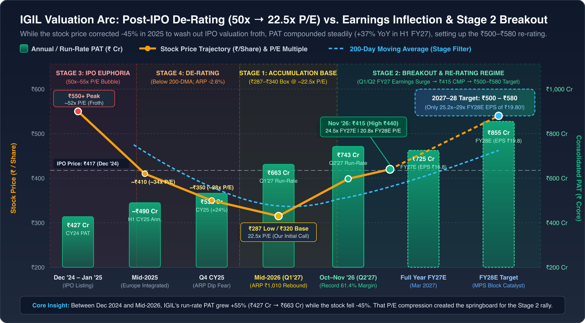
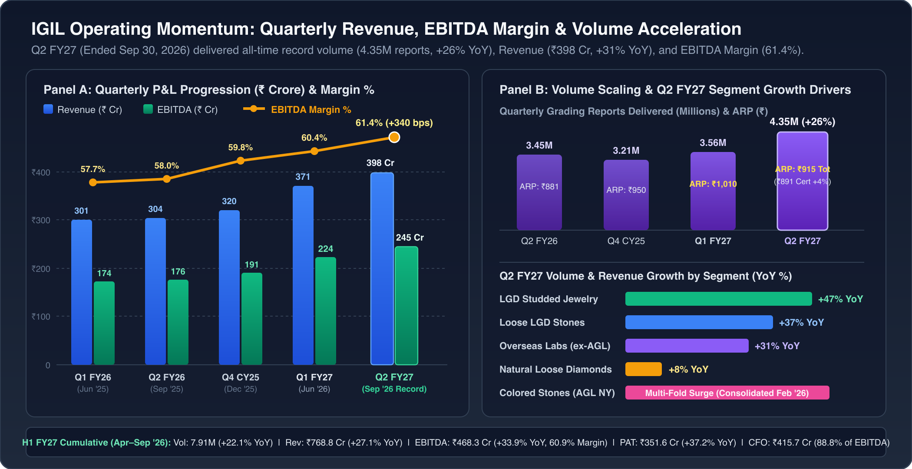
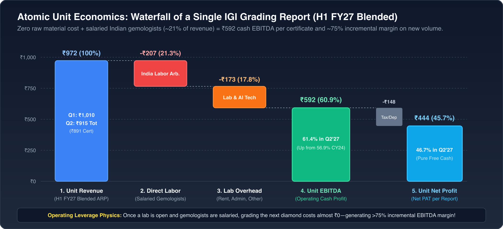
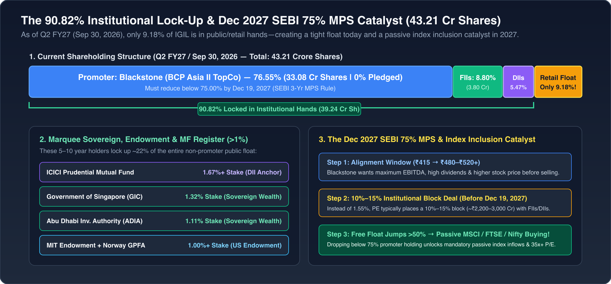
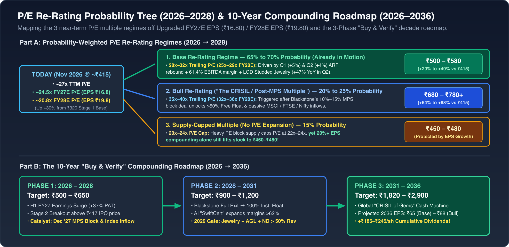
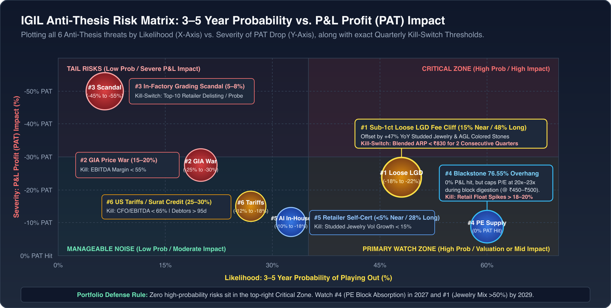

# Investment Memorandum: International Gemmological Institute (India) Ltd (IGIL)

**Report Suite Navigation:**  
📍 **[1. Master Summary (You Are Here)](./Summary.md)** | 📊 **[2. Forensic, Valuation & Timing Upgrade](./Forensic-Valuation-And-Timing-Upgrade.md)** | ⚙️ **[3. Financial & Unit Economics Framework](./Financial%20Analysis%20Framework%20For%20IGIL.md)** | 🔗 **[4. Value Chain & In-Factory Moat](./Gemmological%20Institute%20Value%20Chain%20Analysis.md)** | 🚀 **[5. Vision 2030 Strategy & AI Roadmap](./Gemmological%20Institute%20Strategy%20Report%20Creation.md)**

> [!IMPORTANT]
> **Executive Verdict (Updated November 2026 — Post-Q2 & H1 FY27 Results):**  

> **IGIL (`NSE: IGIL` | `BSE: 544311`)** is a debt-free, capital-light "Gatekeeper of Trust" commanding

- **~65% global share in Lab-Grown Diamond (LGD) certification**
- **~33% overall share**

After de-rating from a post-IPO bubble of **50x+ P/E (₹550+)** down to **~22.5x P/E (~₹320)**, the stock has inflected upward into **~₹407–₹425 (52W High: ₹440)** on the back of **record Q2 FY27 results (+31% YoY Revenue, +38.8% YoY EBITDA at 61.4% margin, +43.2% YoY PAT)**.

Trading at **~24.5x FY27E EPS (₹16.80)** and **~20.8x FY28E EPS (₹19.80)**, IGIL remains on a high-conviction trajectory toward **₹500–₹580 in 2027**.

---

## 1. Master Snapshot: Single Source of Truth

### A. Market & Valuation Snapshot (As of November 2026)

| Metric | Value | Context / Forensic Note |
| :--- | :--- | :--- |
| **Ticker & Shares** | `NSE: IGIL` / `BSE: 544311` | **43.21 Crore shares** (Face Value: ₹2.00) |
| **Current Market Price (CMP)** | **~₹407 – ₹425** | Reclaimed **₹417 IPO issue price**; up **~28%–33%** from our ₹320 upgrade base |
| **52-Week High / Low** | **₹440 / ₹287** | Stage 1 base bottomed at ₹287; broke out into Stage 2 uptrend in Oct–Nov 2026 |
| **Market Capitalization** | **~₹17,600 – ₹18,377 Cr** | Part of Nifty 500, Nifty Smallcap 250 & BSE 400 MidSmallCap |
| **Valuation Multiples (P/E)** | **~26.5x – 27.6x TTM P/E** | **~24.5x FY27E P/E** (on ₹16.80 EPS) \| **~20.8x FY28E P/E** (on ₹19.80 EPS) |
| **Return Ratios & Balance Sheet** | **69.2% ROCE \| 55.8% ROE** | **Virtually Debt-Free** \| Book Value: **₹40.5/sh** \| H1 CFO/EBITDA: **88.8%** |
| **Dividends Declared** | **₹2.44/sh** (Feb '25) & **₹2.55/sh** (2026) | 127.5% interim payout; target policy of 30%–50% of PAT |

---

### B. Financial Progression Table (CY24 $\rightarrow$ CY25 $\rightarrow$ Q1 & Q2 FY27 $\rightarrow$ FY27E/FY28E)

*Note: IGIL transitioned from a Calendar Year (Jan–Dec) to a Financial Year (Apr–Mar) reporting cycle in 2026.*

| Metric | CY24 Actual | CY25 Actual | Q1 FY27 (Jun '26) | **Q2 FY27 (Sep '26 — Record)** | **H1 FY27 (Apr–Sep '26)** | **FY27E (Projected)** | **FY28E (Projected)** |
| :--- | :---: | :---: | :---: | :---: | :---: | :---: | :---: |
| **Grading Volume (Reports)** | 10.58M | **12.81M** *(+21.1%)* | **3.56M** *(+17%)* | **4.35M** *(+26% YoY)* | **7.91M** *(+22.1% YoY)* | **~16.0M** | **~18.8M** |
| **Avg. Realization (ARP)** | ₹952 | **₹927** *(-2.6%)* | **₹1,010** *(+5% YoY)* | **₹891 Cert / ₹915 Tot** *(+4% YoY)* | **₹972 Blended** *(+4.5% YoY)* | **~₹985** | **~₹1,000** |
| **Revenue from Operations** | ₹1,053.2 Cr | **₹1,229.1 Cr** *(+16.7%)* | **₹370.8 Cr** *(+23.2%)* | **₹398.02 Cr** *(+31.0% YoY)* | **₹768.8 Cr** *(+27.1% YoY)* | **~₹1,580 Cr** | **~₹1,880 Cr** |
| **Operating EBITDA** | ₹599.7 Cr | **₹736.7 Cr** *(+22.8%)* | **₹223.8 Cr** *(+29.0%)* | **₹244.50 Cr** *(+38.8% YoY)* | **₹468.3 Cr** *(+33.9% YoY)* | **~₹965 Cr** | **~₹1,150 Cr** |
| **EBITDA Margin (%)** | 56.94% | **59.94%** *(+300 bps)* | **60.4%** *(+270 bps)* | **61.4%** *(+340 bps YoY)* | **60.9%** *(+310 bps YoY)* | **~61.0%** | **~61.2%** |
| **Profit After Tax (PAT)** | ₹427.3 Cr | **₹531.6 Cr** *(+24.4%)* | **₹165.7 Cr** *(+31.0%)* | **₹185.84 Cr** *(+43.2% YoY)* | **₹351.6 Cr** *(+37.2% YoY)* | **~₹725 Cr** | **~₹855 Cr** |
| **PAT Margin (%)** | 40.57% | **43.25%** | **44.7%** | **46.7%** *(+396 bps YoY)* | **45.7%** | **~45.9%** | **~45.5%** |
| **EPS (₹ / Share)** | ₹10.77 | **₹12.30** | **₹3.83** | **₹4.30** *(+43.3% YoY)* | **₹8.14** *(6 Months)* | **~₹16.80** | **~₹19.80** |

> 🔗 **Deep Dive Links:** See **[Section 3 of Financial Analysis Framework](./Financial%20Analysis%20Framework%20For%20IGIL.md#3-the-growth-algorithm-deconstructing-the-revenue-equation)** for the revenue equation and **[Section 1 of Forensic Upgrade](./Forensic-Valuation-And-Timing-Upgrade.md#1-the-real-world-lesson-how-igil-de-rated-from-50x-to-225x-pe-then-inflected-on-record-q1--q2-fy27-results)** for the post-IPO valuation arc.

*📊 [Click to Open Crisp Vector SVG](./charts/01_valuation_de_rating_vs_earnings_inflection.svg)*

*📊 [Click to Open Crisp Vector SVG](./charts/02_quarterly_revenue_ebitda_volume_progression.svg)*

---

## 2. Business Model, Unit Economics & Three-Layer Moat

### A. Why Midstream Manufacturers Are "Hostage Payers"

Unlike miners (16–20% EBITDA margins) or Surat diamond polishers (2–5% EBITDA margins), IGIL takes **zero inventory risk** and levies a mandatory toll on trade:

1. **Retailers ("The Kingmakers")** mandate third-party certificates (IGI/GIA) for consumer trust and legal liability protection.

2. **Manufacturers ("The Hostage Payers")** must pay IGIL ₹900–₹1,000 per stone to make their polished inventory liquid.

### B. Atomic Unit P&L of a Single Grading Report

*📊 [Click to Open Crisp Vector SVG](./charts/04_atomic_unit_economics_waterfall.svg)*

| Unit P&L Line Item | CY24 | CY25 | Q1 FY27 (Jun '26) | Q2 FY27 (Sep '26) | H1 FY27 Blended | Underlying Mechanism |
| :--- | :---: | :---: | :---: | :---: | :---: | :--- |
| **Unit Revenue (ARP)** | ₹952 | ₹927 | **₹1,010** *(+5% YoY)* | **₹915 Tot / ₹891 Cert** *(+4% YoY)* | **₹972** | Q2 sequential dip reflects holiday batch surge (+47% YoY in LGD Jewelry), yet still up +4% YoY. |
| **(-) Unit Direct Labor** | (₹240) | (₹210) | ~(₹220) | ~(₹195) | ~(₹207) | Salaried India gemologists (~21–22.7% of revenue; down from 25.2% in CY24). |
| **(-) Unit Lab Overhead** | (₹170) | (₹162) | ~(₹180) | ~(₹158) | ~(₹173) | Spectroscopy hardware, rent & IT amortized over 4.35M quarterly reports. |
| **(=) Unit EBITDA** | **₹542** | **₹555** | **₹610** | **₹562** | **₹592** | **61.4% EBITDA margin in Q2 FY27** (~75% incremental margin on new volume). |

> [!NOTE]
> **Currency & Geography Reality Check (Does IGIL Protect Against a Falling Rupee?):**

> - **75%–76% of consolidated revenue is billed in India (in INR)** in Surat/Mumbai, where 90%+ of global diamonds are cut and certified.  

> - **24%–25% of revenue is Outside India** (Belgium, Netherlands, USA, Dubai/Botswana, Italy in USD/EUR—which grew **+31% YoY ex-AGL in Q2 FY27**), carrying local USD/EUR staff costs (~20–25% EBITDA margin overseas vs. ~65–70% in India).  

> - **Takeaway:** Direct currency translation gain is modest (**+1% to +1.5% EBITDA per 5% INR depreciation**), *but* indirect competitive protection is massive because IGIL's INR-paid workforce continually gets cheaper in USD terms than US-based rival **GIA**.  
> 🔗 *See **[Value Chain Analysis — Section 4 & 5](./Gemmological%20Institute%20Value%20Chain%20Analysis.md#4-operational-models-and-value-creation)** and **[Strategy Report — Section 1](./Gemmological%20Institute%20Strategy%20Report%20Creation.md#1-unit-economics-today-vs-5-year-target)**.*

### C. The Three-Layer Moat

1. **In-Factory Lock-In:** Co-locating IGI labs inside client factories in Surat cuts Turnaround Time (TAT) from 2–3 weeks to **24–48 hours**, creating high operational switching costs.
2. **Retailer Mandate Network Effect:** Serving 9 of the top 10 global jewelry chains locks midstream suppliers into the IGI standard (**LGD Jewelry certification grew +47% YoY and Loose LGD grew +37% YoY in Q2 FY27**).
3. **Data Flywheel & AI ("SwiftCert"):** Grading **~16M annualized stones** trains proprietary AI grading algorithms faster than hardware startups.

---

## 3. Forensic Audit: M&A Timeline, Cash Flows & Shareholding Lock-Up

### A. Exact M&A Timeline & Cash Flow Audit

| Date | Corporate Event / Acquisition | Transaction Value | Accounting & Forensic Impact |
| :--- | :--- | :--- | :--- |
| **May 2023** | **Blackstone (BCP Asia II) Acquires Global IGI** | **~$570M (~₹4,700 Cr)** | Bought 100% of global group from distressed Chinese seller **Fosun International** (80%) & Lorie family (20%) at ~10–11x EBITDA. |
| **Dec 20, 2024** | **IGIL India IPO Listing** (Issue Price: ₹417) | **₹4,225 Cr Total** *(₹2,750 Cr OFS + ₹1,475 Cr Fresh)* | Listed at ~₹18,000+ Cr valuation (~4x mark-up in 18 months). Post-IPO equity: **43.21 Cr shares**. |
| **Dec 20–24, 2024** | **Acquisition of IGI Netherlands & IGI Belgium** | **~$158.2M (~₹1,300 Cr)** *($88.44M NL + $69.76M BE)* | Paid to Blackstone from Fresh Issue proceeds (**~96% of total IPO cash went to Blackstone**). Consolidated on Balance Sheet from **Dec 31, 2024** and P&L across **CY25**. Eliminated offshore royalty/transfer-pricing conflicts. |
| **Jan 31 / Feb 2026** | **Acquisition of AGL (New York Colored Stones Lab)** | **$13.2M (~₹121 Cr)** *($9.0M upfront + $4.2M deferred)* | Genuine third-party bolt-on M&A (from Chris & Helene Smith). Consolidated from **Q1 FY27 (June 2026)**; drove multi-fold colored gemstone growth in Q2 FY27. |
| **Sep 2026 (Q2 FY27)** | **Global Hub Expansion: Botswana, Italy & Saudi** | Internal Accruals | Consolidated **IGI Botswana** (100% via IGI Dubai), launched **Italy** lab ops, and preparing **Saudi Arabia** entry. |

> [!WARNING]

> **Two-Sided Forensic Audit: The "₹4,700 Cr Buyout $\rightarrow$ ₹22,000 Cr IPO Flip" Debate (Both Sides of the Narrative)**  

> - 🔴 **The Cynical / Bear Side (Where Retail Got Burned at Listing):** In May 2023, Blackstone (*BCP Asia II*) bought 100% of Global IGI for **~$570M (~₹4,700 Cr)**. Just 19 months later (Dec 2024), it listed IGIL at **~₹18,020 Cr** (which hit **₹22,000+ Cr / ₹550+ in listing euphoria**—a **4.5x flip**). By taking **₹2,750 Cr via OFS** plus **~₹1,300 Cr ($158.2M) out of the ₹1,475 Cr Fresh Issue** (to sell IGI Belgium & Netherlands to IGIL India), Blackstone recovered **~₹4,050 Cr (86% of its buyout cost!) on Day 1** while still keeping **76.55% ownership**. Retail investors who chased the 52x P/E IPO hype at ₹500–₹550 suffered a **-45% drawdown to ₹287**.  

> - 🟢 **The Institutional Counter-Side (Why the Asset Is Real & Why Timing Flipped the Math):**

> 1. *Distressed Entry:* Blackstone got IGI cheap in 2023 only because previous 80% owner **Fosun International (China)** faced a **$30B+ debt crisis** and was forced into a ~10x EBITDA fire-sale.  

> 1. *Governance Alignment:* Putting Belgium (1975 IP owner) and Netherlands 100% under IGIL India prevented permanent offshore brand-royalty siphoning, while taking cash out preserved IGIL's **55.8% ROE / 69.2% ROCE** (since H1 FY27 CFO alone is **₹415.7 Cr = 88.8% of EBITDA**).  

> 1. *Post-IPO Earnings Doubled:* Unlike "window-dressed PE lemons" whose profits collapse post-IPO, IGIL's annual PAT has more than doubled since the buyout (**~₹331 Cr CY23 $\rightarrow$ ₹427 Cr CY24 $\rightarrow$ ₹532 Cr CY25 $\rightarrow$ ~₹725 Cr FY27E / ₹855 Cr FY28E**). Buying after the de-rating (~20.8x FY28E P/E) lets you ride *with* Blackstone's incentive to drive the stock to **₹500–₹580** ahead of its mandatory **Dec 2027 SEBI 75% MPS institutional block deal**.  

> 🔗 *See **[Section 2C of Forensic Upgrade](./Forensic-Valuation-And-Timing-Upgrade.md#c-the-two-sided-narrative-did-blackstone-make-retail-the-fool-by-flipping-a-4700-cr-buyout-into-a-22000-cr-ipo)** for the full side-by-side comparison.*

### B. Shareholding Structure (Q2 FY27 / Sep 30, 2026) & The 90.82% Institutional Lock-Up

*📊 [Click to Open Crisp Vector SVG](./charts/05_shareholding_lockup_and_mps_catalyst.svg)*

| Shareholder Category | Shares (Cr) | % Holding (Sep '26) | Key Named Holders & Game-Theory Alignment |
| :--- | :---: | :---: | :--- |
| **Promoter: Blackstone (BCP Asia II)** | 33.08 Cr | **76.55%** *(0% Pledged)* | Must drop to $\le 75\%$ by **Dec 19, 2027** (SEBI 3-yr MPS rule). Aligned to drive earnings & stock price to **₹460–₹520+** before placing a 10%–15% institutional block. |
| **FIIs / FPIs** | 3.80 Cr | **8.80%** | **GIC Singapore (1.32%)**, **ADIA Abu Dhabi (1.11%)**, **MIT Endowment (1.00%)**, Norway GPFA, Nomura. 5–10 yr sovereign/endowment holders. |
| **DIIs (Mutual Funds + Inst.)** | 2.36 Cr | **5.47%** | Mutual Funds hold **3.86%** (led by **ICICI Prudential MF at 1.67%+**) + Insurance/Institutions **1.61%**. |
| **Total Institutional Lock-Up** | **39.24 Cr** | **90.82%** | **Over 90.8% of equity is held by sticky institutional hands.** |
| **Public / Retail Float** | **3.97 Cr** | **9.18%** | Ultra-tight retail float; explains the rapid +30% re-rating from ₹320 to ₹420+ on Q1/Q2 beats. |

> 🔗 **Deep Dive Link:** See **[Sections 2, 3 & 4 of Forensic Upgrade](./Forensic-Valuation-And-Timing-Upgrade.md#2-module-6-forensic-audit-exact-acquisition-dates-cash-flows--currency-reality)** for the 3-Lens Audit of Blackstone's IPO and H1 FY27 cash flow conversion (**₹415.7 Cr CFO = 88.8% of EBITDA**).

---

## 4. Valuation Scenarios, P/E Re-Rating Probability & 2027–2036 Roadmap (Module 5)

### A. Why ₹500–₹580 in 2027 Is Mathematically Supported (Even After the Rally to ~₹415)

At **₹500/share** (Market Cap: ₹21,605 Cr), against upgraded **FY27E EPS of ₹16.80** and **FY28E EPS of ₹19.80**:

- **Implied FY27E Trailing P/E at ₹500:** **29.8x**
- **Implied FY28E Forward P/E at ₹500:** **25.2x** *(slightly below today's ~26.5x–27.6x TTM P/E—meaning **earnings growth alone now carries the stock to ₹500+ with zero additional multiple expansion!**)*

### B. P/E Re-Rating Regimes & 2027–2028 Price Targets

*📊 [Click to Open Crisp Vector SVG](./charts/08_pe_rerating_regimes_and_10yr_roadmap.svg)*

| Valuation Regime | Target Trailing P/E (Forward P/E) | **Probability** | Key Catalyst / Driver | **2027–28 Target Price (vs. ₹415 CMP / ₹320 Base)** |
| :--- | :---: | :---: | :--- | :---: |
| **1. Base-Case Re-Rating** | **28x – 32x TTM** *(25x – 29x Fwd)* | **65% – 70%** | Sustained 20%+ earnings growth, positive YoY ARP (+4%–5%), 61%+ EBITDA margin, and +47% YoY LGD Jewelry growth. | **₹500 – ₹580** *(+20% to +40% from ₹415; +56% to +81% from ₹320)* |
| **2. Bull-Case Re-Rating ("CRISIL Multiple")** | **35x – 40x TTM** *(32x – 36x Fwd)* | **20% – 25%** | Triggered *after* Blackstone's 10%–15% MPS block deal (by Dec 2027) boosts Free Float by >50% and unlocks **MSCI / FTSE / Nifty passive buying**. | **₹680 – ₹780+** *(+64% to +88% from ₹415; >2.2x from ₹320)* |
| **3. Capped Multiple (PE Supply Wall)** | **20x – 24x TTM** *(19x – 22x Fwd)* | **15%** | Repeated Blackstone block sales cap the P/E multiple, **but 20% EPS growth alone still lifts the stock price**. | **₹450 – ₹480** *(+8% to +16% from ₹415; +40% to +50% from ₹320)* |

### C. The 10-Year Compounding View (2026 $\rightarrow$ 2036) & The 2029 Checkpoint

| 10-Year Scenario (2026 $\rightarrow$ 2036) | 10-Yr EPS CAGR (off ₹16.80 FY27E) | 2036E EPS (PAT) | 2036 Exit P/E | **2036 Target Price** | **10-Yr Cumulative Dividends/Sh** | **Total Wealth Multiplier (vs. ₹320 Base / ₹415 CMP)** |
| :--- | :---: | :---: | :---: | :---: | :---: | :---: |
| **1. Bear Case** *(Loose LGD dies; Jewelry only offsets)* | 8.0% | ₹36.30 *(~₹1,570 Cr)* | 18x | **~₹650** | + ₹135 | **~2.5x on ₹320 (~1.9x on ₹415)** |
| **2. Base Case ("CRISIL" Path)** | **14.5%** | **₹65.00** *(~₹2,800 Cr)* | **28x – 30x** | **₹1,820 – ₹1,950** | **+ ₹185** *(~₹32.5/yr div by 2036)* | **~6.3x–6.7x on ₹320 (~4.8x on ₹415)** |
| **3. Bull Case (Global Monopoly)** | **18.0%** | **₹88.00** *(~₹3,800 Cr)* | **33x** | **~₹2,900** | **+ ₹245** | **~9.8x on ₹320 (~7.6x on ₹415)** |

> [!TIP]
> **Actionable Portfolio Triggers & The 2029 Checkpoint:**  
>
> - [x] **Trigger 1 (Fundamental Inflection — ACHIEVED):** Q1 (+23% Rev) & Q2 FY27 (+31% Rev, 61.4% EBITDA margin, +4% YoY ARP).  
> - [x] **Trigger 2 (Stage 2 Breakout — ACHIEVED):** Stock rallied from ₹287–₹320 base past the ₹417 IPO price to a ₹440 52-week high.  
> - [ ] **Trigger 3 (MPS Block Deal Watch at ₹450–₹500):** Watch for Blackstone's 10%–15% block deal ahead of the **Dec 19, 2027** SEBI MPS deadline.  
> - [ ] **Trigger 4 (The 2029 Checkpoint):** Verify in the 2029 Annual Report that **Studded Jewelry + AGL Colored Stones + Natural Diamonds exceed 50%–60% of total revenue** before holding for the 2031–2036 leg.

---

## 5. Anti-Thesis Matrix: Probabilities, P&L Impact & Kill-Switches

*📊 [Click to Open Crisp Vector SVG](./charts/06_anti_thesis_risk_probability_matrix.svg)*

Because **~75% of IGIL's operating costs are fixed/semi-fixed**, a pure pricing (ARP) shock flows ~100% to EBITDA, while a volume shock carries a ~75% incremental margin impact. Track these **6 Kill-Switches** every quarter (detailed in **[Section 7 of Forensic Upgrade](./Forensic-Valuation-And-Timing-Upgrade.md#7-the-anti-thesis-scenarios-probabilities-pl-impact--kill-switches)**):

| # | Anti-Thesis Scenario | Probability (1–2Y / 3–5Y) | **Revenue Impact** | **EBITDA Margin & PAT Impact** | Current Status (Q2 / H1 FY27) | **Kill-Switch Threshold (Exit Trigger)** |
| :-: | :--- | :---: | :---: | :---: | :---: | :--- |
| **1** | **Loose LGD Commoditization Cliff** *(Sub-1ct loose stones stop certifying)* | **15% (1–2Y)** **45–50% (3–5Y)** | **-8% to -12%** | **Margin: 61.4% $\rightarrow$ 52–54%** **PAT: -18% to -22%** | **ARP ₹891 Cert / ₹915 Tot (+4% YoY); ₹972 H1** | Blended ARP **< ₹830 for 2 quarters** OR Rev growth lags Vol growth by **>600 bps**. |
| **2** | **GIA / GSI Non-Profit Price War** *(12–15% fee cut across dossiers)* | **10–15% (1–2Y)** **20% (3–5Y)** | **-10% to -15%** | **Margin: 61.4% $\rightarrow$ 50–51%** **PAT: -25% to -30%** | **61.4% Margin in Q2 (+340 bps YoY)** | Consolidated EBITDA Margin **< 55%** OR total volume growth **< 12% YoY**. |
| **3** | **"In-Factory" Integrity Scandal** *(Grade inflation exposé $\rightarrow$ delisting)* | **5–8% (1–2Y)** **5–8% (3–5Y)** | **-25% to -40%** | **Margin: 61.4% $\rightarrow$ <40%** **PAT: -45% to -55%** | **Zero breaches; 9 of Top 10 chains** | Loss of any Top-10 retail chain mandate, FTC probe, or RapNet discount widening. |
| **4** | **Blackstone Supply Wall (2027–29)** *(Repeated blocks cap stock multiple)* | **55–60% (1–2Y)** **60%+ (3–5Y)** | **0% Impact** | **0% P&L Impact**, *but caps Stock P/E at 20x–23x during blocks* | **Retail Float 9.18%** *(90.82% Inst. Lock-up)* | **Retail Float spikes > 18%–20%** (institutions dumping on retail) OR bad promoter sale. |
| **5** | **Retailer In-House AI Self-Cert** *(Chains self-certify <$300 LGD rings)* | **<5% (1–2Y)** **25–30% (3–5Y)** | **-8% to -15%** | **Margin: 61.4% $\rightarrow$ 54–56%** **PAT: -10% to -18%** | **LGD Jewelry Vol +47% YoY in Q2 FY27** | Studded Jewelry certification volume growth drops **< 15% YoY** for 2 quarters. |
| **6** | **US Tariffs & Surat Credit Freeze** *(Export tariff + debtor stretch)* | **25–30% (1–2Y)** **25% (3–5Y)** | **-10% to -15%** | **Margin: 61.4% $\rightarrow$ 55–57%** **PAT: -12% to -18%** | **88.8% CFO/EBITDA (₹415.7 Cr); ~65 Days** | **CFO/EBITDA drops < 65%** in any half-year OR **Debtor Days cross 95–100 days**. |

---

## 6. Complete Guide to the IGIL Research Suite

| Document | Focus Area & Key Contents |
| :--- | :--- |
| 📊 **[Forensic-Valuation-And-Timing-Upgrade.md](./Forensic-Valuation-And-Timing-Upgrade.md)** | **Modules 2–6 Deep Dive:** Post-IPO 50x $\rightarrow$ 22.5x P/E compression lesson, Blackstone's ₹4,225 Cr IPO & M&A mechanics, 90.82% institutional lock-up, upgraded ₹500–₹580 target math, 10-year (2036) roadmap, 6 Anti-Thesis scenarios, and P/E re-rating probabilities. |
| ⚙️ **[Financial Analysis Framework For IGIL.md](./Financial%20Analysis%20Framework%20For%20IGIL.md)** | **Module 1A (Financial Architecture):** ND vs. LGD supply-chain bifurcation, multi-variable revenue growth algorithm (updated to Q2/H1 FY27), 5-level Margin Tree (61.4% EBITDA margin), atomic unit economics, sensitivity matrix, and 8-indicator Leading Watchlist. |
| 🔗 **[Gemmological Institute Value Chain Analysis.md](./Gemmological%20Institute%20Value%20Chain%20Analysis.md)** | **Module 1B (Value Chain & Moats):** Global diamond value chain ("Smile Curve" defiance), "India Node" (Surat/Mumbai), "In-Factory" lab operational lock-in, player archetypes (Hostage Payers vs. Kingmakers), and G7 sanction dynamics. |
| 🚀 **[Gemmological Institute Strategy Report Creation.md](./Gemmological%20Institute%20Strategy%20Report%20Creation.md)** | **Module 1C (Vision 2030 & AI Strategy):** 5-year AI amortization model ("SwiftCert"), competitive matrix vs. GIA/HRD/Sarine, 4 growth vectors (LGD fashion, ND commercial capture, School of Gemology funnel, M&A roll-ups), and 12-quarter execution roadmap. |
