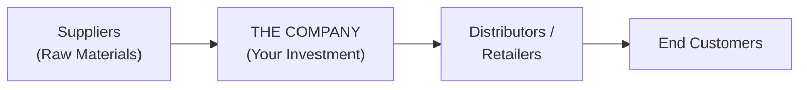
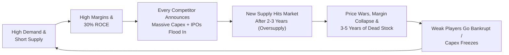

# Module 1: Decoding the Business Model, Unit Economics & Moat

> **Core Philosophy:** Never look at a stock's P/E ratio or profit growth before understanding *how* the business actually makes money, *why* customers buy from it instead of someone else, and *what* happens to its profits when sales grow by 20% or fall by 10%.

---

## 1. Unit Economics & Value Proposition (The Atomic Unit of a Business)

Every giant corporation is simply a single "atomic transaction" repeated millions of times. **Unit Economics** strips away the billion-dollar revenue numbers and asks: *Does this business make sense at the level of a single unit?*

### A. Defining the "Unit"
Depending on the industry, the core unit changes:
* **Retail / Restaurant (e.g., DMart, Trent, Jubilant FoodWorks):** 1 Store (or 1 square foot of retail space).
* **Hospitality / Healthcare (e.g., Indian Hotels, Apollo Hospitals):** 1 Room Night or 1 Occupied Hospital Bed (ARPOB - Average Revenue Per Occupied Bed).
* **Manufacturing / Cement / Steel (e.g., UltraTech, Tata Steel):** 1 Tonne of cement/steel (EBITDA per tonne).
* **SaaS / Telecom / Subscription (e.g., Airtel, Zomato Gold):** 1 User/Subscriber (ARPU - Average Revenue Per User).
* **Banking / NBFC (e.g., HDFC Bank, Bajaj Finance):** Rs. 100 of Loan Book (NIM - Net Interest Margin, Credit Cost).

### B. The Contribution Margin Waterfall
To know if growth is healthy or destructive, trace the unit waterfall:

$$\text{Unit Selling Price} - \text{Variable Cost to Make (COGS)} = \textbf{Gross Margin}$$

$$\text{Gross Margin} - \text{Variable Selling/Delivery/Commission Costs} = \textbf{Contribution Margin}$$

* **Rule of Thumb:**
  * If **Contribution Margin is negative** (e.g., selling a Rs. 100 item that costs Rs. 80 to source and Rs. 30 to deliver), **the more the company grows, the more money it loses.** This is common in VC-funded startups before an IPO.
  * If **Contribution Margin is strongly positive**, growth will eventually cover fixed corporate costs (rent, head office salaries, R&D) and lead to an explosion in net profit.

### C. Store/Plant Unit Economics & Payback Period (Crucial for Capex/Retail Businesses)
Suppose a retail company opens a new store:
* **Capex + Initial Inventory per store:** Rs. 5 Crore
* **Store-level Annual Revenue:** Rs. 15 Crore
* **Store-level EBITDA Margin:** 10% $\rightarrow$ Rs. 1.5 Crore profit per year
* **Store-level ROIC:** $\frac{1.5\text{ Cr}}{5\text{ Cr}} = 30\%$
* **Payback Period:** $\frac{5\text{ Cr}}{1.5\text{ Cr}} \approx 3.3\text{ years}$

> **What to Look For:** When a company has a **< 3-year payback period** on a new store or factory line, and the country can absorb 500 more stores, you are looking at a **compounding machine**. Conversely, if old stores are slowing down and new stores take 7 years to break even, growth will destroy shareholder value.

---

## 2. Revenue Quality & Predictability (Not All Rs. 100 of Revenue Are Equal)

The stock market pays a huge valuation multiple (P/E) for **predictability** and a very low multiple for **lumpiness**. You can classify any company's revenue into 4 tiers:

| Tier | Revenue Type | Characteristics | Examples | Typical Valuation (P/E) |
| :--- | :--- | :--- | :--- | :--- |
| **Tier 1 (Best)** | **Contractual Recurring / Subscription** | Customers pay automatically every month/year; high switching cost. Next year's revenue is 90% visible on Jan 1st. | Enterprise SaaS, Mission-critical IT, Stock Exchanges, Credit Rating Agencies, AMC fees | High (35x – 60x+) |
| **Tier 2** | **Repeat / Habitual Consumption** | No legal contract, but habit, brand, or replacement cycle forces repeat purchase every week/month/year. | FMCG (Nestle, ITC), Paints (Asian Paints), Replacement Auto Parts, Pharma (Chronic therapies like diabetes/cardiac) | Med-High (30x – 55x) |
| **Tier 3** | **Transactional / Discretionary** | Depends on consumer mood, interest rates, and economic boom. Easily postponed in bad times. | Cars, Real Estate, Luxury Hotels, Apparel, Durables | Moderate / Cyclical (15x – 30x) |
| **Tier 4 (Lowest)** | **EPC / Project / Tender-Based (Lumpy)** | Every year the company starts at zero and must bid for new government/B2B tenders. Lowest bidder wins (low margins). | Construction/Infra EPC, Heavy Engineering, Commodity Trading | Low (8x – 18x) |

### Key Insight for Your Portfolio:
Many investors get trapped buying a **Tier 4 (Lumpy Project)** company at a **35x P/E** during a bull market because its order book looks huge for the next 2 years. The moment order inflows slow down even slightly, the P/E crashes from 35x back to 12x—wiping out 3 years of earnings growth!

---

## 3. The Value Chain & Bargaining Power (Who Captures the Profit Pool?)

In any industry supply chain, money flows from raw material $\rightarrow$ component maker $\rightarrow$ manufacturer/brand $\rightarrow$ distributor $\rightarrow$ end consumer. **Never invest without asking: Who holds the gun in this relationship?**

### Test 1: Pricing Power Over Customers
**The Ultimate Test of a Great Business:** *If raw material costs jump by 15% tomorrow, can the company raise prices by 15% within 1–2 quarters without losing sales volume?*
* **Strong Pricing Power:** B2C monopoly brands, or **B2B "Low Cost, High Consequence" providers**.
  * *What is "Low Cost, High Consequence"?* Imagine a specialty chemical, industrial valve, or aircraft fastener that makes up only **1% of the customer's total product cost**, but if it fails, the customer's Rs. 500 Crore factory shuts down or their drug fails FDA approval. The customer will *never* switch to a cheap Chinese competitor just to save 10% on a component that is only 1% of their cost!
* **Weak Pricing Power:** Auto ancillary company selling commoditized sheet metal parts to Maruti Suzuki. Maruti accounts for 60% of their revenue and squeezes their margins every year.

### Test 2: Bargaining Power Over Suppliers & Working Capital Clues
You don't need management to tell you if they have bargaining power—**the Balance Sheet tells you the truth**:
* **High Receivable Days (90–180 days):** Customers are delaying payment. The company is begging customers to buy its product by giving free credit (Weak position—common in B2G/government contracts or weak B2B).
* **Negative Working Capital (Collect cash in 5 days, pay suppliers in 60 days):** The company is the boss. Customers pay upfront in cash, while suppliers fund the company's inventory for free (e.g., DMart, Maruti, Nestle, IndiGo).

---

## 4. Economic Moats (Competitive Advantage) & Moat Erosion

If a business earns a 30% Return on Capital (ROCE), basic capitalism says 10 competitors will enter the industry, undercut prices, and drive everyone's ROCE down to 10%. An **Economic Moat** is the structural barrier that stops competitors from stealing those profits.

### The 4 Real Moats (and 1 Fake Moat)
1. **High Switching Costs (The Sticky Moat):**
   * Once a bank installs a core banking software (e.g., Finacle) or a pharma company registers a specific API supplier in its USFDA filing, changing the vendor takes 2 years, costs millions, and risks operational disaster.
2. **Network Effects (Winner-Takes-All):**
   * Each new user makes the platform more valuable for every existing user.
   * *Examples:* Stock/Commodity Exchanges (NSE, MCX—traders go where liquidity is), Classifieds/Platforms (InfoEdge/Naukri, Zomato/Swiggy).
3. **Structural Cost Advantage (Scale, Process, or Location):**
   * Producing or distributing at a cost no competitor can match.
   * *Example:* **DMart** buys land/stores outright, pays suppliers in 7 days (getting a 2–3% cash discount), runs zero fancy interiors, and passes the savings to customers via lower prices, which drives higher footfalls, which drives even bigger bulk buying discounts (The Flywheel).
   * *Location Moat:* A cement plant sitting right next to a limestone mine (since cement is bulky and expensive to transport beyond 300 km).
4. **Intangible Assets (Brands, Patents, Regulatory Licenses):**
   * **True Brand Moat:** Only counts as a moat if it gives **pricing power** or **lower customer acquisition cost**. (e.g., Titan/Tanishq in jewelry where trust is paramount; Asian Paints where dealers have tinting machines installed in small shops).
   * **Regulatory Moat:** Hazardous chemical handling licenses, defense clearances, or airport monopolies that take 7–10 years for a new entrant to get.

> **[!WARNING] The Fake Moat Trap:**
> **"High Market Share" or "Great Management" or "Riding a Hot Sector (EV/Solar/AI)" is NOT a moat.**
> Airline companies and solar panel assemblers are in growing industries, require huge capital, and have famous brands—yet they have zero moat because a customer will switch airlines on MakeMyTrip to save Rs. 300, and solar panels are pure commodities.

### Moat Direction: Widening vs. Eroding
Stock returns don't come from a static moat; they come from the **direction** of the moat:
* **Eroding Moat Example:** Legacy media/newspapers, or FMCG brands losing shelf power to D2C brands and quick-commerce private labels. Even if current ROCE is 40%, the stock will de-rate if the moat is shrinking.
* **Widening Moat Example:** A B2B manufacturer moving up the value chain from simple contract manufacturing to co-designing patented molecules/components with the client.

---

## 5. Operating Leverage vs. Financial Leverage (How Profits Explode)

Understanding **Operating Leverage** is one of the biggest secrets to catching multi-baggers right before their earnings explode—and exiting before their earnings collapse.

### A. Variable-Cost vs. Fixed-Cost Businesses
Compare two companies, both earning Rs. 100 Crore in Revenue and Rs. 10 Crore in Operating Profit (10% margin):

| Metric | Company A (Asset-Light / High Variable Cost) | Company B (High Fixed Cost / High Operating Leverage) |
| :--- | :--- | :--- |
| **Revenue** | **Rs. 100 Cr** | **Rs. 100 Cr** |
| Variable Costs (Raw Material, Commission) | Rs. 75 Cr (75% of sales) | Rs. 30 Cr (30% of sales) |
| **Contribution Margin** | **Rs. 25 Cr (25%)** | **Rs. 70 Cr (70%)** |
| Fixed Costs (Factory depreciation, Staff, Rent) | Rs. 15 Cr | Rs. 60 Cr |
| **Operating Profit (EBIT)** | **Rs. 10 Cr (10% Margin)** | **Rs. 10 Cr (10% Margin)** |

Now, watch what happens next year when **Revenue grows by just 20% (to Rs. 120 Cr)** for both companies (assuming fixed costs stay roughly the same):

| Metric (At +20% Revenue Growth) | Company A | Company B |
| :--- | :--- | :--- |
| **New Revenue** | **Rs. 120 Cr (+20%)** | **Rs. 120 Cr (+20%)** |
| Variable Costs | Rs. 90 Cr (75% of 120) | Rs. 36 Cr (30% of 120) |
| **Contribution Margin** | **Rs. 30 Cr** | **Rs. 84 Cr** |
| Fixed Costs (Unchanged) | Rs. 15 Cr | Rs. 60 Cr |
| **New Operating Profit (EBIT)** | **Rs. 15 Cr (+50% Profit Growth)** | **Rs. 24 Cr (+140% Profit Growth!)** |
| **New Operating Margin** | **12.5%** | **20.0% (Margin Doubled!)** |

### Why This Matters for Your Investing:
* **Industries with High Operating Leverage:** Hospitals, Hotels, Airlines, Multiplexes, Telecom, SaaS/Platforms, Specialty Manufacturing (when a new plant moves from 40% capacity utilization to 85% capacity utilization).
* **The Sweet Spot to Buy:** When a company has just finished building a new hospital or factory. Initially, depreciation and staff costs (fixed costs) hit the P&L while utilization is only 30%, making the P&L look terrible and the P/E look artificially high. As utilization crosses the break-even point (say 50% $\rightarrow$ 80%), almost 70% of every new rupee of revenue flows straight into profit!
* **The Danger Zone:** Operating leverage is a double-edged sword. If Company B's revenue drops by 20% (to Rs. 80 Cr), its Contribution Margin falls to Rs. 56 Cr against Fixed Costs of Rs. 60 Cr—plunging it into a **Rs. 4 Cr loss** overnight!

### B. Financial Leverage (The Amplifier)
* **Operating Leverage** is fixed costs in the operations (Factory, Employees, Rent).
* **Financial Leverage** is fixed interest cost on the Balance Sheet (Debt).
* **The Golden Combo (De-leveraging + Operating Leverage):** When a company finishes a major capex cycle, its factory utilization rises (Operating Leverage boosts EBIT) *and* it uses that cash flow to pay down debt (Financial De-leveraging cuts interest cost). When EBIT rises and Interest falls simultaneously, **Net Profit (PAT) can grow 3x–4x while revenue only grows 40%.**

---

## 6. Industry Structure & The Capital Cycle

Even the best driver cannot win a race if the road is washed out. Before buying a stock, map the **Industry Structure**:

### A. Three Profitable Industry Structures
1. **Rational Oligopoly (2 to 4 Dominant Players):**
   * When an industry consolidates to 2–4 major players (e.g., Telecom in India today vs. 12 players in 2012; Paints historically; Airline duopoly), price wars usually stop and everyone raises prices rationally.
2. **Unorganized-to-Organized Shift (Formalization):**
   * When 60% of an industry is controlled by tiny regional, tax-evading local players, and GST/regulation/branding forces customers toward organized players (e.g., Jewelry, Diagnostics, Footwear, Plywood, Logistics). Here, the organized leader can grow at **20% per year** even if the total industry is only growing at **7% per year**.
3. **Picks and Shovels (Selling to the Gold Miners):**
   * In a gold rush, 90% of gold miners go broke competing with each other, but the guy selling Jeans (Levi's) and Shovels makes a guaranteed fortune.
   * *Modern Example:* Instead of guessing which EV car brand or Solar developer will win a brutal price war, look at the company making the specialized EV motor laminations, power transmission transformers, or critical chemical inputs that *every* player must buy.

### B. The Capital Cycle (How Booms Create Busts)
Most investors look at **Demand** ("India needs more chemicals/steel/rooms!"). Smart investors look at **Supply**.

> **[!IMPORTANT] Solving Your Opportunity Cost Problem via the Capital Cycle:**
> Whenever you see every company in a sector (e.g., Specialty Chemicals in 2021, Diagnostics after COVID, or Solar/EMS at peak hype) announcing 3x capacity expansion and launching IPOs at 60x P/E, **you are at Stage C of the Capital Cycle.** Even if the company is great, all that new factory supply will hit the market in 18–24 months and crush margins, leaving the stock flat or down for 3 years!

---

## 7. Practical Checklist: 10 Questions to Ask Before Moving to Module 2

Whenever you pick up a company to study, write down a 1-page answers sheet to these 10 questions:

1. **The 1-Sentence Pitch:** What exact product/service does it sell, to whom, and why do they buy it?
2. **Unit Economics:** What is the core unit (Store, Tonne, User, Bed), what is the contribution margin, and how many years does it take for a new unit (store/plant) to pay back its capex?
3. **Revenue Tier:** Is revenue Tier 1 (Recurring), Tier 2 (Habitual Repeat), Tier 3 (Discretionary), or Tier 4 (Lumpy Tender/EPC)?
4. **Customer Concentration & Bargaining Power:** Does any single customer account for >15% of sales? Are receivable days rising?
5. **Pricing Power Test:** When raw material costs spiked in the past (e.g., 2022 inflation), did Gross Margins stay stable (strong pricing power) or collapse (weak pricing power)?
6. **The Moat:** Which of the 4 moats does it actually have (Switching Cost, Network Effect, Cost Advantage, Intangible/Regulatory), and is it widening or eroding?
7. **Operating Leverage:** Is it a high fixed-cost business? What is its current capacity utilization, and when does new capacity come online?
8. **Industry Tail/Headwinds:** Is it gaining share from the unorganized sector? Is it a "Picks and Shovels" play?
9. **Where Are We in the Capital Cycle?** Are competitors starving for capital (Great time to buy) or is everyone raising QIPs/IPOs to double capacity (Dangerous time to buy)?
10. **What Can Kill This Business?** (Single point of failure: regulatory price cap, Chinese dumping, technological obsolescence, patent expiry).
