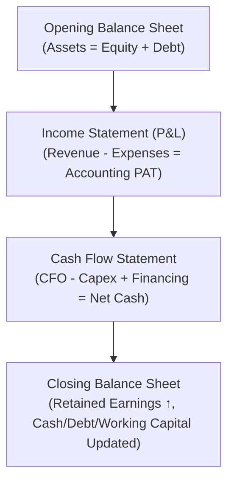

# Module 2: Financial Statement Forensics (Balance Sheet, P&L, and Cash Flow)

> **Core Philosophy:** *"Revenue is vanity, Profit is opinion, Cash is reality."*  
> Anyone can read the top line (Revenue) and bottom line (Net Profit) on Screener.in. True edge comes from reading the **Balance Sheet** and **Cash Flow Statement** to verify if those profits are real, sustainable, and turning into hard cash.

---

## 1. The 3-Statement Inter-Linkage (How Money Actually Flows)

Never read the Income Statement (P&L), Balance Sheet, or Cash Flow Statement in isolation. They are three cameras filming the exact same business from different angles:

### Why a "Profitable" Company Goes Bankrupt (The Accrual Accounting Trap)
The P&L uses **Accrual Accounting**—meaning the moment a company ships goods and prints an invoice for Rs. 100 Crore, it records **Rs. 100 Crore of Revenue** and say **Rs. 20 Crore of Profit**, *even if the customer hasn't paid a single rupee in cash!*
* Where does that unpaid Rs. 100 Crore sit? It hides on the **Balance Sheet** under **Trade Receivables (Debtors)**.
* Meanwhile, the company still has to pay GST, Income Tax on that Rs. 20 Cr "profit", employee salaries, and raw material suppliers in **real cash**.
* To pay them, the company borrows **Short-Term Debt** on the Balance Sheet.
* **Result:** On the P&L, the company looks like a fast-growing superstar (Revenue +30%, Profit +30%). On the Balance Sheet and Cash Flow Statement, Receivables and Debt are exploding, and Operating Cash Flow (CFO) is negative!

---

## 2. Balance Sheet Deep-Dive (Line-by-Line Forensic Analysis)

The Balance Sheet obeys one fundamental equation:
$$\text{Total Assets (Where money is deployed)} = \text{Equity (Shareholders' Money)} + \text{Liabilities (Borrowed Money)}$$

Let's dissect the critical items on the **Asset Side** first, then the **Liability Side**.

### A. Non-Current (Fixed) Assets: The Engine Room
1. **Property, Plant & Equipment (PP&E / Gross Block & Net Block):**
   * **Gross Block:** Total historical cost of all factories, machines, and buildings.
   * **Net Block:** Gross Block minus Accumulated Depreciation.
   * **Fixed Asset Turnover Ratio:**
     $$\text{Fixed Asset Turnover} = \frac{\text{Annual Revenue}}{\text{Gross Block (or Net Block)}}$$
     * If a company invests Rs. 100 Cr in a new plant and Fixed Asset Turnover is **2.5x**, that plant can generate **Rs. 250 Cr** of peak revenue.
     * **Forensic Check:** Compare Fixed Asset Turnover across competitors in the same industry. If all chemical peers have a 1.5x–2.0x asset turnover, and Company X claims only 0.6x asset turnover (massive Gross Block for very little revenue), **the promoter may have inflated the cost of machinery via fake invoices to siphon cash out of the company!**

2. **Capital Work in Progress (CWIP):**
   * Factories or stores currently under construction that haven't started commercial production yet.
   * **Bullish Signal:** A company with a 100% utilized factory has CWIP equal to 50% of its existing Gross Block, set to commission next quarter. Once commissioned, CWIP moves to Gross Block and revenue jumps!
   * **Forensic Red Flag ("Zombie CWIP"):** If CWIP sits on the Balance Sheet for **3 to 5 years** without turning into a working factory, either the project is stuck/dead, or the company is hiding fake assets/expenses inside CWIP so it doesn't have to charge depreciation on the P&L.

3. **Goodwill & Intangible Assets:**
   * Created when a company buys another company for more than its net asset value (Book Value).
   * Suppose Company A pays Rs. 500 Cr to acquire a startup whose actual net assets are only Rs. 50 Cr. The extra **Rs. 450 Cr** is recorded on the Balance Sheet as **Goodwill**.
   * **The Trap:** If Goodwill + Intangibles make up **>30–40% of Net Worth (Equity)**, the company's book value is "hollow" (air). One bad year in the acquired subsidiary will force a massive **Goodwill Impairment (Write-off)**, wiping out years of reported profits overnight.

### B. Working Capital & The Cash Conversion Cycle (CCC)
Working Capital is the oxygen trapped inside daily operations. Measure it in **Days**, never in absolute rupees:

1. **Inventory Days (How long goods sit in the factory/warehouse):**
   $$\text{Inventory Days} = \left(\frac{\text{Inventory}}{\text{COGS (or Sales)}}\right) \times 365$$
   * *Rising Inventory Days* means products aren't selling (obsolescence risk) or management is speculating on raw materials.

2. **Receivable / Debtor Days (How long customers take to pay bills):**
   $$\text{Receivable Days} = \left(\frac{\text{Trade Receivables}}{\text{Revenue}}\right) \times 365$$
   * **The Golden Rule:** If Revenue grows by 20%, but Trade Receivables grow by 50% (Receivable Days jumping from 60 days to 110 days), **90% of the time the company is "Channel Stuffing"**—dumping unwanted inventory onto dealers on credit just to hit quarterly revenue targets for the stock market.
   * Always check the **Receivables Ageing Schedule** in the Annual Report footnotes: Any substantial receivables stuck for **> 6 months (180 days)** are likely bad debts that will never be recovered.

3. **Payable / Creditor Days (How long the company takes to pay its suppliers):**
   $$\text{Payable Days} = \left(\frac{\text{Trade Payables}}{\text{COGS (or Purchases)}}\right) \times 365$$
   * *High Payable Days* can mean two opposite things:
     * **Strength (if Cash is high):** The company is a giant (like DMart or Maruti) that dictates terms to suppliers.
     * **Distress (if Cash is zero and Debt is high):** The company is broke and unable to pay its vendors on time!

4. **The Cash Conversion Cycle (CCC):**
   $$\text{CCC} = \text{Inventory Days} + \text{Receivable Days} - \text{Payable Days}$$
   * **CCC = 120 Days:** For every Rs. 100 of sales, the company's cash is locked up for 4 months. Fast growth will **consume cash** and force the company to borrow debt.
   * **CCC = 0 or Negative (e.g., -15 Days):** Customers pay in cash before the company has to pay suppliers. **Growth generates free cash automatically!**

### C. Liabilities, Debt & Solvency
1. **Debt-to-Equity Ratio:** $\frac{\text{Total Debt}}{\text{Shareholder Equity}}$. For non-financial companies, keep it **< 0.5x** (and definitely < 1.0x unless it's a regulated utility).
2. **Interest Coverage Ratio:** $\frac{\text{EBIT}}{\text{Interest Expense}}$. Must be **> 4x–5x** even in a bad cycle. If it drops below 2x, the company is working for the bank, not for shareholders.
3. **The "Cash + High Debt" Paradox (Major Fraud Red Flag):**
   * Why would a company have **Rs. 500 Cr of Cash** sitting in bank deposits earning 5% interest, while simultaneously carrying **Rs. 600 Cr of High-Cost Debt** at 11% interest?
   * **Forensic Reality:** Often, either the Cash is fake/restricted/siphoned off (the Satyam/Cox & Kings pattern), or the debt peak happens during the year and the year-end March 31st cash balance is artificially window-dressed for a single day!
   * *How to catch it:* Check **Interest Income divided by Average Cash** (if yield is 1%, the cash wasn't really there all year) and **Interest Expense divided by Average Debt** (if cost of debt looks like 18%, actual debt during the year was much higher than the March 31st number!).
4. **Contingent Liabilities (Off-Balance-Sheet Bombs):**
   * Found in the footnotes, *not* on the face of the Balance Sheet. Includes tax disputes, lawsuits, and **Corporate Guarantees** given by the listed company for loans taken by promoter's private subsidiaries.
   * **Rule:** If Contingent Liabilities are **> 20–30% of Net Worth**, treat it as a potential landmine.

---

## 3. Cash Flow Statement Truths (Where the Rubber Meets the Road)

A Cash Flow Statement has three sections:
1. **Cash Flow from Operations (CFO):** Cash generated from running the core business.
2. **Cash Flow from Investing (CFI):** Cash spent on Capex (new factories/machines), acquisitions, or financial investments.
3. **Cash Flow from Financing (CFF):** Cash raised from or paid to debt holders and shareholders (loans, interest, dividends, equity dilution).

### Test 1: The Cumulative CFO-to-EBITDA Ratio (The Ultimate Lie Detector)
Never look at just 1 year of CFO (inventory buildup before a peak season can distort 1 year). Sum up the **last 5 years of CFO** and compare it to the **last 5 years of EBITDA** (or PAT):

$$\text{Cash Conversion Ratio} = \frac{\sum_{5\text{ yrs}} \text{CFO}}{\sum_{5\text{ yrs}} \text{EBITDA}}$$

* **Healthy Business:** Ratio should be **> 65%–70%** (since tax is ~25%, around 70–75% of EBITDA should turn into operating cash flow).
* **Red Flag:** If 5-year cumulative EBITDA is Rs. 1,000 Cr, but 5-year cumulative CFO is only Rs. 150 Cr (or negative), the company's "profits" are entirely stuck in bloated Receivables and Inventory. **Avoid or investigate deeply.**

### Test 2: Free Cash Flow (FCF) & Maintenance vs. Growth Capex
$$\text{Free Cash Flow (FCF)} = \text{CFO} - \text{Capex}$$

> **[!IMPORTANT] Don't Punish a Company for High Growth Capex!**
> Many beginners reject a great growing manufacturer because its **FCF is negative**. You must split Capex into two buckets:
> 1. **Maintenance Capex:** Spending just to replace worn-out machines to keep existing revenue alive (usually roughly equal to annual Depreciation).
> 2. **Growth Capex:** Building a brand-new factory to double capacity over the next 3 years.
> * **Bad Negative FCF:** CFO is Rs. 50 Cr, and Maintenance Capex alone is Rs. 70 Cr (a capital-guzzling treadmill).
> * **Great Negative FCF:** Existing business generates Rs. 100 Cr CFO, Maintenance Capex is Rs. 20 Cr (**True FCF from existing operations = Rs. 80 Cr**), and the company invests Rs. 120 Cr in Growth Capex to build a new plant at 25% ROIC!

---

## 4. Return Ratios & DuPont Analysis (Deconstructing Quality)

A bank FD gives you ~7% risk-free return. Equity has risk, so a company must earn at least **15%+ Return on Capital** to create real wealth.

### A. ROE vs. ROCE vs. ROIC (Which One to Use?)
1. **ROE (Return on Equity):**
   $$\text{ROE} = \frac{\text{Net Profit (PAT)}}{\text{Shareholder Equity (Net Worth)}}$$
   * *Best for:* Banks, NBFCs, and debt-free companies.
   * *Flaw:* Can be artificially inflated by taking huge Debt (since Debt shrinks the Equity denominator).
2. **ROCE (Return on Capital Employed):**
   $$\text{ROCE} = \frac{\text{EBIT (Operating Profit)}}{\text{Total Capital Employed (Equity + Total Debt)}}$$
   * *Best for:* Comparing companies across varying debt levels.
3. **ROIC (Return on Invested Capital) — The Gold Standard:**
   $$\text{ROIC} = \frac{\text{NOPAT (EBIT} \times (1 - \text{Tax Rate}))}{\text{Equity} + \text{Debt} - \text{Excess Cash \& Treasury Investments}}$$
   * *Why ROIC is superior to ROCE:* Suppose a debt-free IT or FMCG company has Rs. 2,000 Cr of idle cash sitting in mutual funds earning 6%, while its actual factory/operations only use Rs. 500 Cr of capital and generate Rs. 250 Cr of profit. Standard ROCE looks like $\frac{250 + 120}{2500} = 14.8\%$ (mediocre!). **ROIC strips out the idle cash** and reveals that the actual core business earns $\frac{250 \times 0.75}{500} = \mathbf{37.5\%}$!

### B. The 3-Step DuPont Analysis (How Does the Company Earn Its ROE?)
Two companies can both have a **20% ROE**, yet one is a fortress and the other is a ticking time bomb. DuPont breaks ROE into three drivers:

$$\text{ROE} = \underbrace{\left(\frac{\text{Net Profit}}{\text{Sales}}\right)}_{\text{1. Net Profit Margin (Pricing Power)}} \times \underbrace{\left(\frac{\text{Sales}}{\text{Total Assets}}\right)}_{\text{2. Asset Turnover (Efficiency/Velocity)}} \times \underbrace{\left(\frac{\text{Total Assets}}{\text{Equity}}\right)}_{\text{3. Financial Leverage (Debt)}}$$

* **Archetype 1: High Margin, Low Turnover (Luxury / Pharma / Software):** 20% Margin $\times$ 1.0x Turnover $\times$ 1.0x Leverage = **20% ROE**. (Driven by Moat/Pricing Power).
* **Archetype 2: Low Margin, High Velocity (DMart / FMCG Distribution):** 4% Margin $\times$ 5.0x Turnover $\times$ 1.0x Leverage = **20% ROE**. (Driven by Extreme Execution Efficiency).
* **Archetype 3: Low Margin, Low Turnover, High Debt (Infra / Weak Commodity):** 5% Margin $\times$ 0.8x Turnover $\times$ 5.0x Leverage = **20% ROE**. (**Danger!** Driven purely by heavy debt).

---

## 5. Accounting Red Flags & Shenanigans (How Numbers Are Manipulated)

When promoters want to pump the stock price (or prepare for an IPO/QIP), here are the 6 most common ways they cook the books:

| Shenanigan | How They Do It | How You Catch It on the Statements |
| :--- | :--- | :--- |
| **1. Capitalizing Operating Expenses** | Normal daily expenses (employee salaries, software maintenance, marketing, interest) are recorded as "Intangible Assets under Development" or "CWIP" on the Balance Sheet instead of expenses on the P&L. | **EBITDA jumps miraculously**, while "Intangibles under development" or "CWIP" balloons every year without generating cash flow. |
| **2. Channel Stuffing / Fake Sales** | Booking bogus sales at quarter-end to friendly distributors or shell companies. | **Receivable Days spike**; CFO is stagnant or negative while PAT grows 40%. |
| **3. Extending Useful Life of Assets** | Changing depreciation policy (e.g., claiming machines last 20 years instead of 10 years) to halve annual depreciation expense and boost PAT. | Check **Depreciation as a % of Gross Block**. If it suddenly drops from 8% to 4%, read the Accounting Policy footnote. |
| **4. Skipping Provisioning for Bad Debts** | Refusing to write off 2-year-old unpaid customer bills or damaged inventory so P&L profit doesn't take a hit. | Check **Receivables > 6 months** in footnotes vs. "Allowance for Expected Credit Loss". |
| **5. Routing Expenses to Associates/JVs** | Pushing loss-making operations or marketing costs into an unlisted promoter entity or 49% associate so it doesn't consolidate fully into EBITDA. | Check Related Party Transactions and subsidiary summary table (**Form AOC-1**) in the Annual Report. |
| **6. Other Income Padding** | Selling land, booking forex gains, or writing back old provisions and presenting it in media headlines as "Profit Up 60% YoY!". | Always check **PBT before Other Income & Exceptional Items**. If Other Income > 15% of PBT, strip it out. |

---

## 6. Module 2 Forensic Checklist (Before Approving Any Stock's Financials)

- [ ] **5-Year CFO / EBITDA Ratio:** Is cumulative 5-year Operating Cash Flow at least **70%** of cumulative 5-year EBITDA?
- [ ] **Receivable & Inventory Growth vs. Sales Growth:** Over the last 3 years, have Receivables and Inventory grown *slower* than or in line with Revenue?
- [ ] **Core ROIC:** Is core Return on Invested Capital (excluding excess cash) consistently **> 15%–18%** (or clearly inflecting upward from a completed capex cycle)?
- [ ] **DuPont Check:** Is ROE coming from **Margin** and **Asset Turnover**, rather than **Leverage**?
- [ ] **Balance Sheet Cleanliness:** Is Goodwill < 20% of Net Worth? Is Debt-to-Equity < 0.5x? Are Contingent Liabilities < 15% of Net Worth?
- [ ] **Yield & Cost Sanity Check:** Does Cash earn a realistic interest rate (4–7%) and does Debt pay a realistic interest rate (7–11%)?
