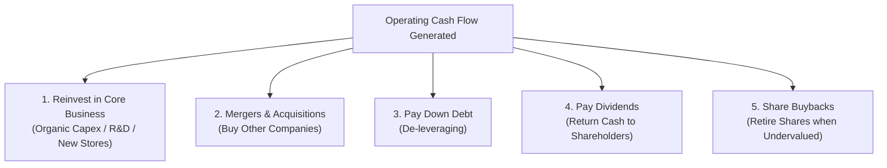
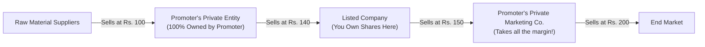

# Module 3: Management Quality, Capital Allocation & Corporate Governance

> **Core Philosophy:** *"In the short run, the business model drives the stock. In the long run (5–10 years), management's capital allocation and integrity determine 100% of your wealth."*  
> A dishonest promoter in a 30% ROCE business will find a way to steal that 30% so minority shareholders get zero. A brilliant capital allocator in a modest 15% ROCE business can compound your wealth at 25% CAGR.

---

## 1. Capital Allocation Track Record (The CEO's #1 Job)

Every year, a profitable business generates a pile of cash (Operating Cash Flow). Management has **only 5 ways** to deploy this cash:

### How to Grade Management's Capital Allocation:

1. **The Golden Rule of Reinvestment:**
   * If the core business earns **25% ROIC** and has a long runway to grow, management should reinvest **as much cash as possible** back into the core business (Choice #1).
   * If the core business is mature and can no longer absorb more capital at high returns (like ITC's cigarette business or mature IT companies), management **must return 70–80% of cash via Dividends or Buybacks** (Choices #4 & #5)—*not* waste it on low-return pet projects!

2. **Spotting "Diworsification" (Peter Lynch's Term):**
   * What bad promoters do when their core business generates huge cash: Instead of paying dividends, their ego makes them buy a luxury hotel in London, enter an unrelated capital-heavy commodity business, or acquire an overpriced foreign company that has 5% ROCE.
   * **The Foreign Acquisition Curse:** Historically in Indian markets, whenever a cash-rich domestic mid-cap acquires a larger or equal-sized European/US company using debt "for global scale and technology," **80% of the time ROCE collapses, debt explodes, and the stock underperforms for 5 years.**
   * *Good M&A:* "Bolt-on" acquisitions—buying small niche companies (5–10% of the acquirer's size) using internal cash flows to plug a specific technology, product, or geographic gap.

3. **Incremental Return on Invested Capital (ROIIC) — The Ultimate Metric:**
   * Don't just look at historical ROCE (which might be high because of a factory built 20 years ago on cheap land). Look at what return management earned on the **new capital invested over the last 3–5 years**:
   $$\text{ROIIC} = \frac{\text{Change in NOPAT (Year 5} - \text{Year 1)}}{\text{Change in Invested Capital (Year 5} - \text{Year 1)}}$$
   * If Invested Capital increased by Rs. 500 Cr over the last 5 years, and Operating Profit after tax (NOPAT) increased by Rs. 125 Cr, **ROIIC = 25%**. Management is allocating new capital brilliantly!
   * If Invested Capital increased by Rs. 500 Cr, and NOPAT increased by only Rs. 20 Cr (**ROIIC = 4%**), management is destroying value on new projects.

---

## 2. Skin in the Game, Incentives & Alignment

Never listen to what management says; look at how they get rich. **Do they get rich WITH minority shareholders (through stock price appreciation and dividends) or OFF minority shareholders (through massive salaries, royalties, and private side-businesses)?**

### A. Promoter Shareholding & Pledging
* **Healthy Skin in the Game:** Promoters holding **40% to 75%** of the company (or professionally managed companies where the CEO holds substantial ESOPs/shares vesting on 5-year ROIC/EPS targets).
* **Creeping Acquisition (Bullish):** Promoters buying shares from the open market using their own cash, or subscribing to preferential warrants above market price.
* **Promoter Share Pledging (Major Warning Sign):**
  * When promoters pledge their company shares to banks/NBFCs to borrow money for personal or private real estate ventures.
  * **Why it kills stocks:** If the market corrects by 20%, the value of the pledged collateral falls. Lenders issue a margin call and **forcibly dump millions of promoter shares on the open market at any price**, causing the stock to crash 50–70% in days regardless of fundamentals.
  * **Rule:** Avoid companies where Promoter Pledging is **> 10–15%** (unless it is a strict project-finance pledge to banks for the listed company's own factory, and decreasing every quarter).

### B. Executive Remuneration (Salary vs. Profit Check)
Open the Annual Report $\rightarrow$ *Corporate Governance Report / MGT-7 / Remuneration of Key Managerial Personnel (KMP)*:
* Calculate **Total Promoter Family Remuneration as a % of Net Profit (PAT)**.
* By Indian Companies Act law, total managerial remuneration is normally capped at **10%–11% of Net Profit**.
* **Red Flag:** In a Rs. 50 Cr PAT company, if the promoter, his wife, and two 24-year-old children are collectively taking home **Rs. 6 Crore (12% of PAT)** in fixed salaries and commissions—and even increasing their salaries in a year when PAT dropped by 20%—they treat the listed company as their personal ATM.
* **Green Flag:** Promoters taking a modest salary (1%–3% of PAT) or taking zero salary in a tough year, making the bulk of their wealth from dividends (which every retail shareholder gets equally!).

### C. Succession Planning & Professionalization
* Many founder-led companies hit a ceiling around Rs. 1,000–3,000 Cr market cap because the founder micro-manages everything and refuses to hire top-tier professional CXOs.
* **Bullish Inflection Point:** Watch when a sleepy, conservative 2nd-generation family business hands over the reins to a hungry, foreign-educated 3rd-generation successor *or* brings in an ex-MNC professional CEO with performance-linked ESOPs. Many of the biggest 10-baggers start right at this management transition!

---

## 3. Corporate Governance & Related Party Transactions (RPTs)

In emerging markets (especially India), **Related Party Transactions (RPTs)** are the #1 weapon used to siphon profits away from public shareholders into the promoter's 100%-owned private entities.

### The Classic RPT Siphoning Playbook:

In the diagram above, the Listed Company bears all the factory capex, debt, and risk, makes a pathetic 6% margin, while the promoter's private shell companies on both sides capture 40% risk-free margin!

### 5 RPT Red Flags to Check in Every Annual Report Footnote:
1. **Buying/Selling Goods to Promoter Entities:** If >5–10% of purchases or sales happen with private companies owned by the promoter's family, ask *why* those private companies aren't merged into the listed company.
2. **Real Estate / Rent Leakage:** The listed company's head office or warehouses are owned personally by the promoter's wife/trust, and the listed company pays inflated rent and Rs. 50 Cr "interest-free security deposits" to them.
3. **Brand Royalty Fees:** The brand trademark is actually owned by a private promoter family trust (not the listed company!), and the listed company pays **2% to 5% of total revenue** as "Brand Royalty" to the promoter every year before shareholders see a rupee of profit.
4. **Loans & Advances to Related Parties:** The listed company takes loans from banks at 9% and gives "Inter-Corporate Deposits (ICDs)" or loans to promoter group companies that never get repaid (and eventually get written off!).
5. **Competing Private Entities:** The promoter owns a 52% stake in the listed company making Product A, and simultaneously owns 100% of an unlisted private company making Product B in the **exact same industry**. Guess which company gets the most profitable customer orders?

---

## 4. The "Say vs. Do" Audit (Walking the Talk)

How do you know if a CEO is an honest realist or a smooth-talking salesman? Do a **3-Year Time Machine Test** (takes 30 minutes and puts you ahead of 99% of investors):

1. Download the company's **Annual Report from 4 years ago** (say FY22) and **2 years ago** (FY24), along with the **current Annual Report** (FY26).
2. Read only the **Chairman's Letter** and **Management Discussion & Analysis (MD&A)** from 4 years ago:
   * What revenue/margin guidance did they give? *"We aim to reach Rs. 2,000 Cr revenue with 18% EBITDA margin by FY25."*
   * When did they promise the new Dahej/Pune plant would start commercial production? *"Q2 FY24."*
   * What new product launch was supposed to be a "game-changer"?
3. Now look at what actually happened over the next 4 years:
   * **Category A (Under-Promise, Over-Deliver — Gold Mine):** Management is conservative on concalls, warns about risks upfront, and quietly beats their own timeline and numbers. The market rewards these companies with a permanent P/E re-rating.
   * **Category B (Honest Delay with Clear Explanation):** The plant was delayed by 6 months due to an industry-wide issue, management openly admitted the mistake, explained what they fixed, and then delivered.
   * **Category C (Chronic Over-Promiser / Storyteller — Wealth Destroyer):** Every year they promise *"Next year will be our breakout year with 25% margins."* Every year they miss by 50%, never mention their old missed target, and invent a brand-new buzzword (EV, Green Hydrogen, AI, Data Centers, Defense) to excite retail investors again.

---

## 5. Module 3 Management Scorecard Checklist

Score any management team from 1 to 5 on these parameters before investing:
- [ ] **ROIIC:** Is Incremental Return on Invested Capital over the last 5 years **> 15%–20%**?
- [ ] **Focus:** Are 100% of the promoters' time and business interests inside this single listed entity (no competing private group companies)?
- [ ] **Pledging:** Is promoter share pledging **0%**?
- [ ] **Remuneration:** Is total promoter family pay reasonable (< 5–8% of PAT) and linked to profit growth?
- [ ] **RPT Cleanliness:** Zero loans to promoter entities, zero brand royalties to private trusts, and minimal operational RPTs?
- [ ] **Say vs. Do Track Record:** Did they deliver at least 80–90% of what they promised in the Annual Report 3–4 years ago?
