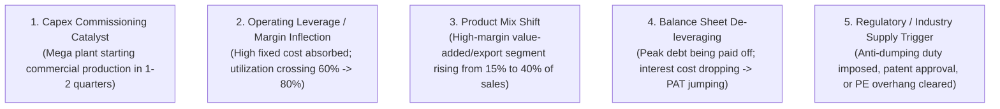
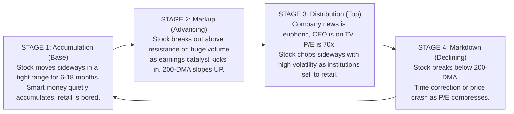

# Module 5: Valuation, Market Cycles & Solving the "Opportunity Cost" Problem

> **Core Philosophy:** *"A great business is NOT automatically a great stock at any price. If you buy a wonderful company when 5 years of future growth are already priced into today's P/E multiple, your money will sit dead for 3–5 years while the business catches up to its stock price."*

This module directly solves the exact problem you described: **Why you buy a good, growing company, yet the stock refuses to move for years (Time Correction / Opportunity Cost), and how to time your entry.**

---

## 1. The Twin Engines of Stock Returns (Why Growing Companies Don't Move)

Over any 3-to-5-year period, a stock's price return is governed by one mathematical identity:

$$\text{Stock Price} = \text{EPS (Earnings Per Share)} \times \text{P/E Multiple (Sentiment / Expectations)}$$

$$\implies \text{Total Return} \approx \text{Earnings Growth Rate} \times \text{Change in Valuation Multiple (Re-rating or De-rating)}$$

Let's look at three real-world scenarios over a **3-Year Holding Period** to see why "buying a good growing company" often fails:

### Scenario A: The "Good Company, Wrong Entry Price" Trap (Time Correction)
* You buy a famous, high-quality growth company after reading great news in the media.
* **At Entry (Year 0):** EPS = Rs. 10, Stock Price = Rs. 700 (**P/E = 70x**).
* Over the next 3 years, the company performs well! Earnings grow at a solid **20% CAGR** (1.728x over 3 years).
* **At Year 3:** EPS has grown from Rs. 10 to **Rs. 17.30**.
* *However*, as growth normalizes from 35% to 20%, the market is no longer willing to pay 70x P/E. The valuation multiple compresses (de-rates) to a still-respectable **40x P/E**.
* **Stock Price at Year 3:** $\text{Rs. } 17.30 \times 40 = \mathbf{\text{Rs. } 692}$.
* **Result:** The company grew profits by **+73%**, management executed well, yet **your 3-year stock return is -1%!** You suffered massive opportunity cost because **P/E De-rating (70x $\rightarrow$ 40x) completely ate up 100% of the Earnings Growth!**

### Scenario B: The Steady Compounder at Fair Price (Single Engine)
* **At Entry (Year 0):** EPS = Rs. 10, Stock Price = Rs. 250 (**P/E = 25x**).
* Earnings grow at **20% CAGR** over 3 years $\rightarrow$ Year 3 EPS = **Rs. 17.30**.
* P/E stays unchanged at **25x**.
* **Stock Price at Year 3:** $\text{Rs. } 17.30 \times 25 = \mathbf{\text{Rs. } 432}$ (**+73% return, or 20% CAGR**). Here, your return equals the company's earnings growth.

### Scenario C: The Inflection Point / Twin-Engine Multi-Bagger (How Big Money Is Made)
* You find a good business emerging from a temporary capex phase or neglected sector before media hype begins.
* **At Entry (Year 0):** EPS = Rs. 10, Stock Price = Rs. 150 (**P/E = 15x**).
* New capacity kicks in with operating leverage $\rightarrow$ Earnings grow at **28% CAGR** over 3 years $\rightarrow$ Year 3 EPS = **Rs. 21.00**.
* As ROCE improves from 14% to 24% and institutions discover the stock, the market **re-rates** the P/E from **15x to 35x**.
* **Stock Price at Year 3:** $\text{Rs. } 21.00 \times 35 = \mathbf{\text{Rs. } 735}$.
* **Result:** Earnings grew **2.1x**, Multiple expanded **2.33x** $\rightarrow$ Stock goes up **4.9x (+390% return, or ~70% CAGR)**!

> **[!IMPORTANT] The Golden Law of Opportunity Cost:**
> **Never buy a stock where P/E is at the top of its historical band AND margins are at the top of their historical band.** Even if earnings grow, mean-reversion in the P/E multiple will freeze the stock price for years.

---

## 2. Expectations Investing (What Is Already Priced In?)

Beginners ask: *"Will this company grow at 20%?"*  
Pros ask: ***"How much growth is the current stock price ALREADY assuming?"***

Stocks do not move on "Good News" or "Bad News." Stocks move on the **Delta (Difference)** between **Actual Results** and **Market Expectations**:
* If the market expects **35% growth** (hence pricing the stock at 65x P/E) and the company delivers **25% growth** (which is objectively great!), **the stock will crash 20%!**
* If the market expects **5% growth** (hence pricing the stock at 12x P/E) and the company delivers **18% growth**, **the stock will surge 50%!**

### How to Reverse-Engineer What Is Priced In (The 3-Minute Reverse DCF Mental Check)
Before buying a stock at a high P/E (say 50x–80x):
1. Look at the company's current Market Cap (say Rs. 20,000 Cr) and current Net Profit (say Rs. 250 Cr $\rightarrow$ **80x P/E**).
2. Suppose 5 years from now, when the company is bigger and more mature, its reasonable exit P/E will be **30x**.
3. For you to simply double your money in 5 years (a ~15% CAGR), the Market Cap in Year 5 must reach **Rs. 40,000 Cr**.
4. At a 30x exit P/E, a Rs. 40,000 Cr Market Cap requires **Rs. 1,333 Cr of Net Profit** in Year 5.
5. Growing Net Profit from Rs. 250 Cr to Rs. 1,333 Cr in 5 years requires **40% CAGR in profit every single year for 5 years straight** *just for you to make a 15% return!*
6. Now ask yourself: *Can this business realistically compound profits at 40% a year for 5 years without a single hiccup?* If the answer is no (e.g., it can only grow at 20%), **buying at 80x P/E guarantees mediocrity or time correction.**

---

## 3. Business & Sector Cycles (The Cyclical P/E Paradox)

Companies fall into two broad categories, and their valuation rules are **completely opposite**:

### A. Structural Compounders vs. Cyclicals
1. **Structural Compounders (Consumer, Pharma, IT, Niche Industrial, Private Banks):**
   * Earnings grow steadily over 10 years with mild fluctuations.
   * **Rule:** Buy when P/E is near or below its 5-to-10-year median P/E during a temporary market correction or temporary 2-quarter headwind.
2. **Cyclicals (Metals, Commodities, Bulk Chemicals, Shipping, Sugar, Cement, Corporate Banks, Infra):**
   * Profits swing wildly with global commodity prices, interest rates, or capex cycles.

### B. The Deadly Cyclical P/E Trap (Peter Lynch's Rule)
* **For a Cyclical Stock:**
  * **High P/E (or negative P/E) = Bottom of the Cycle (CHEAP / Time to Buy):** Why? Because at the bottom of a steel or chemical bust, profits collapse from Rs. 1,000 Cr to Rs. 50 Cr. Even after the stock has crashed 60% to Rs. 2,000 Cr market cap, $\frac{2000}{50} = \mathbf{40\text{x P/E}}$! Beginners see "40x P/E" and think it's expensive, missing the exact bottom.
  * **Low P/E (5x–8x P/E) = Peak of the Cycle (EXPENSIVE / Time to Sell):** At the peak of a commodity boom, windfall profits hit Rs. 2,000 Cr while Market Cap is Rs. 12,000 Cr $\rightarrow$ **P/E looks like a mouth-watering 6x!** Retail investors rush in thinking *"Wow, growing at 100% and available at 6x P/E!"* Six months later, commodity prices normalize, profits fall by 70%, and the stock drops 50% and stays dead for 5 years.
* **What to use instead of P/E for Cyclicals & Financials:**
  * Use **Price-to-Book (P/B)**, **Price-to-Sales (P/S)**, or **EV / Replacement Cost** (e.g., EV per Tonne for Cement/Steel). Buy when Price-to-Book or Price-to-Sales is near historical trough levels and industry supply is tight.

---

## 4. Catalysts & Inflection Points (How to Eliminate Waiting Time)

Why did your stock sit flat for 18 months even though it was a good company? **Because there was no immediate Catalyst (Trigger) to force the market to re-price it.**

Institutional fund managers are judged every quarter. They will not buy and push up a stock today if the actual earnings jump is 2.5 years away. To avoid opportunity cost, look for **Imminent Inflection Points (3 to 6 months away)**:

### Deep Dive into the #1 Multi-Bagger Catalyst: "Product Mix Shift"
Suppose a company makes Rs. 1,000 Cr revenue:
* **Segment A (Old Commodity Business):** Rs. 850 Cr revenue at **8% EBITDA margin** = Rs. 68 Cr profit.
* **Segment B (New High-Margin Specialty/Export Business):** Rs. 150 Cr revenue at **28% EBITDA margin** = Rs. 42 Cr profit.
* **Blended Company Today:** Rs. 1,000 Cr revenue, Rs. 110 Cr EBITDA (**11% blended margin**). The market sees an "11% margin commodity company" and gives it a boring **14x P/E**.
* **What happens over the next 2 years?** Segment A grows 0%, while Segment B grows at 50% a year (reaching Rs. 340 Cr).
* Total Revenue only grows by 19% (from 1,000 Cr to 1,190 Cr)—looking unexciting on the surface. **But Segment B now drives nearly 60% of total profits!** Blended margin jumps from 11% to 15%+, ROCE jumps, and the market suddenly re-rates the company from a "14x P/E commodity player" to a "30x P/E specialty player."
* **Lesson:** Always read the **Segment Reporting** footnote in quarterly results to spot a small, fast-growing, high-margin division hiding inside a boring company!

---

## 5. Combining Fundamentals with Price-Volume Action (Stage Analysis)

Even after doing 100% of the fundamental work, **never fight the tape.** Stan Weinstein's **4-Stage Market Cycle** explains how institutional money moves a stock and how you can avoid dead money:

### How to Use Stage Analysis to Fix Your Entry Timing:
1. **Why you suffered Opportunity Cost:** You likely bought either in **late Stage 2 / Stage 3** (when recent returns looked great and media stories were glowing, right before the stock entered a 2-year sideways/downward digestion phase) OR too early in **Stage 1 / Stage 4** (while an institution or PE fund was still dumping millions of shares).
2. **The Ideal Entry Point (Late Stage 1 $\rightarrow$ Early Stage 2 Transition):**
   * **Step 1 (Fundamental Filter):** Identify a company where a real catalyst (new plant commissioning, margin expansion, product mix shift) is happening over the next 1–2 quarters, and valuation is reasonable.
   * **Step 2 (Technical Confirmation):** Wait for the stock to stop making lower lows, form a solid base for several months, and **break out above its 200-Day Moving Average (or multi-month consolidation zone) with strong volume**.
   * Why does this work? Because it proves that the institutional seller is finished selling, and big institutional buyers have started accumulating right ahead of the earnings inflection!

---

## 6. Portfolio Construction & Selling Rules (When to Exit)

Knowing when to sell is just as important for avoiding opportunity cost as knowing when to buy. There are **only 4 valid reasons to sell a stock**:

1. **Thesis Broken (Fundamental Exit):**
   * You bought because the new plant was supposed to ramp up at 22% margins, or receivable days were supposed to fall. Two quarters pass, margins drop to 10%, and receivables spike. **Don't hope and pray—admit the thesis was wrong and exit immediately.**
2. **Governance / Forensic Red Flag:**
   * Promoter pledges shares, announces a terrible unrelated acquisition, or the auditor resigns. Sell on Day 1.
3. **Extreme Valuation Euphoria (Stage 3 Exit):**
   * The business is still good, *but* the stock has run up 4x in 18 months, P/E has expanded from 20x to 85x (pricing in the next 5 years of perfection), and the stock is stalling on high volume (Stage 3 Distribution). Trim or exit to protect yourself from 3 years of zero-return time correction.
4. **Superior Opportunity Cost Switch:**
   * Stock A in your portfolio has a realistic expected return of 10–12% CAGR from current valuations, while you just discovered Stock B entering Stage 2 with a 25%+ expected CAGR. Switch capital to where it works hardest.

---

## 7. Module 5 Entry-Timing Checklist (Before Pressing the "BUY" Button)

- [ ] **P/E vs. Historical Band:** Where is current P/E (or EV/EBITDA, P/B) relative to its 5-year median? Are both P/E AND Operating Margins at an all-time peak simultaneously? (If yes, high risk of time correction!).
- [ ] **Reverse Expectations Check:** To earn a 15–20% annual return over the next 3 years assuming a conservative exit P/E, what earnings growth rate is required? Is that easily achievable?
- [ ] **Catalyst Within 1–2 Quarters:** What specific event in the next 3–6 months will force earnings or return ratios to inflect upward?
- [ ] **Price-Volume Stage Check:** Is the stock in a Stage 4 downtrend (avoid catching a falling knife), a Stage 3 euphoric top (avoid), or emerging from a Stage 1 base into a Stage 2 uptrend above its 200-DMA?
