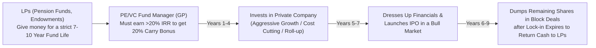
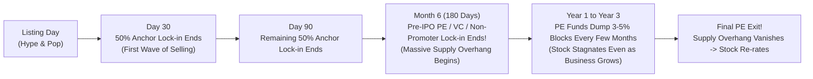

# Module 6: The PE/VC Playbook, IPO Mechanics, Supply Overhangs & Institutional Exit Games

> **Core Philosophy:** *"An IPO is rarely a charity event to share future wealth with retail investors. It is the most carefullychoreographed exit ceremony in capitalism—where insiders with complete information sell their shares to outsiders with partial information at the exact moment of maximum sector optimism."*

Understanding how Private Equity (PE), Venture Capital (VC), Investment Bankers, and Promoters play the capital markets will save you from buying overpriced IPOs and sitting through 3 years of relentless institutional selling ("Supply Overhang"). Even better, it will teach you how to **buy right when the PE fund's forced selling ends!**

---

## 1. Understanding the PE/VC Lifecycle & Incentives (Why They Must Sell)

Most modern companies coming to the public market have **Private Equity (PE)** or **Venture Capital (VC)** funds owning 20% to 70% of the company. To predict what the stock will do, you must understand how a PE fund works:

### Two Crucial Realities About PE Funds:
1. **The ticking clock (Fund Life Mandate):** A standard PE fund has a **7-to-10-year lifespan**. If "Fund III" bought a stake in a company in 2019, the PE fund manager *legally has to liquidate* that investment by 2026–2027 to return cash to their global investors (LPs).
2. **Why this matters to you:**
   * Before the IPO, the PE fund's #1 incentive is to make the company's trailing 12-month numbers look as spectacular as humanly possible so they can list at a 50x–80x P/E.
   * After the IPO, the PE fund still holds 15%–40% of the company. For the next **1 to 3 years after listing**, regardless of how well the company performs, that PE fund will dump 3%–5% blocks of stock every few months whenever the stock rallies by 10–15%. **This creates an invisible ceiling (Supply Overhang) that traps retail investors in zero-return frustration!**

---

## 2. Pre-IPO "Window Dressing" (How They Dress Up the Bride)

Investment bankers know that public market investors project the last 2 years of growth in the DRHP (Draft Red Herring Prospectus) straight into the future. Here are the **5 classic tricks** used in the 12–18 months before an IPO to artificially inflate profits:

### 1. Starving the Future (Unsustainable Cost-Cutting)
* For 4–6 quarters before filing the IPO prospectus, the PE-backed management slashes **Brand Marketing/Ad Spend**, freezes new hiring, delays factory maintenance, and cuts R&D.
* Suddenly, EBITDA margins jump from **10% in FY23 $\rightarrow$ 13% in FY24 $\rightarrow$ 19% in FY25 (IPO Year)!**
* Bankers pitch the IPO at 60x P/E saying *"Look at the massive operating leverage and margin expansion!"*
* **What happens 2 quarters after the IPO?** The company can no longer starve its brand or delay maintenance. Ad spend and salaries return to normal, margins crash back from 19% to 12%, and the stock drops 40%.
* **How to catch it in the DRHP:** Check **Advertising/Marketing as a % of Sales** and **Employee Cost as a % of Sales** over the last 3 years in the Restated Financials. If marketing dropped from 12% of sales to 5% of sales right in the pre-IPO year while revenue barely grew, margins are artificially juiced!

### 2. Channel Stuffing & Pre-IPO Revenue Pull-Forward
* In the 6 months before the IPO, sales teams are given aggressive targets to dump 6 months of extra inventory onto distributors using heavy credit terms (90–120 days instead of 30 days).
* Revenue shows a sudden 45% jump in the pre-IPO period.
* **How to catch it:** Check if **Receivable Days** jumped sharply in the latest 6-month stub period of the DRHP, and check if **CFO / EBITDA** dropped below 50% in the pre-IPO year.

### 3. The "Pre-IPO Placement" Valuation Ratchet Game
* Have you ever seen headlines like: *"Marquee Sovereign/VC Fund buys 1% stake in Company X at Rs. 20,000 Cr valuation just 3 months before IPO"*?
* Often, a tiny pre-IPO round (just Rs. 50–100 Cr) is done with friendly funds at an artificially sky-high valuation (sometimes with downside protection side-letters!) simply to establish a "benchmark valuation" in the media so retail investors think the IPO at Rs. 19,500 Cr is giving them a "discount"!

### 4. Fake Profitability Metrics ("Adjusted EBITDA" & Capitalized Costs)
* In tech/consumer/platform IPOs, companies invent metrics like **"Adjusted EBITDA before ESOP cost"** or **"Contribution Profit."**
* **Remember:** ESOPs (Employee Stock Options) are **real dilution**—paying employees in stock instead of cash still steals ownership from you! Always deduct ESOP expense as a real cash cost when calculating true profit.

### 5. LBO Debt & Special Dividends Before IPO
* In mature markets (and increasingly in buyout deals), a PE firm buys a company, loads it up with debt to pay themselves a huge "Special Dividend" *before* the IPO, and then launches an IPO where the public's money is used simply to pay off the bank debt that funded the PE firm's dividend!

### 6. The "Disguised OFS" Inside a Fresh Issue (Related-Party Foreign Consolidation)
* **How the trick works (The IGIL / Blackstone Playbook):**
  * Retail investors have become smart enough to dislike a "100% Offer for Sale (OFS)" IPO.
  * So investment bankers structure the IPO as say **₹2,750 Cr OFS + ₹1,475 Cr Fresh Issue**, claiming the Fresh Issue will "consolidate global operations by acquiring the European/US sister subsidiaries."
  * **Look closer at who owns those sister subsidiaries:** The exact same PE fund / Promoter!
  * That means the listed Indian company takes ₹1,300 Cr of the "Fresh Issue" cash from public investors and **wires it straight into the PE fund's offshore bank account** to buy the PE fund's slow-growing, low-margin foreign subsidiaries at a hefty valuation!
  * **Double Whammy for Retail:** (1) 96% of the total IPO money actually went into the PE fund's pocket (a disguised OFS), and (2) merging the low-margin (15–20% EBITDA) foreign subsidiaries into the high-margin (70% EBITDA) Indian company dilutes the company's future growth rate and return ratios!

---

## 3. Reading the DRHP / RHP (IPO Prospectus) Like a Forensic Pro

You don't need to read all 500 pages of a DRHP. You only need to read **5 specific sections** (takes 45 minutes):

### Step 1: The Offer Structure — OFS (Offer for Sale) vs. Fresh Issue (The 3-Lens Expert Framework)
Look at the cover page of the RHP:
* **Fresh Issue:** New shares are created, and the cash goes **inside the company's bank account** to build factories, open stores, or reduce debt.
* **Offer for Sale (OFS):** Existing shareholders (PE funds, VCs, or Promoters) sell their personal shares to the public. **100% of the OFS money goes into the bank accounts of the exiting sellers; Rs. 0 goes to the company.**

> **[!IMPORTANT] Don't Fall for the Binary "OFS = Bad" Trap!**  
> Retail investors often think every OFS is a scam where insiders are dumping a bad company. An institutional investor evaluates an OFS through **Three Lenses**:

#### Lens 1: The Capital Intensity Test (Could the Company Even Use Fresh Issue Cash?)
* **When a 100% OFS is GOOD / NATURAL (Asset-Light Cash Cows):**
  * Think of Stock Exchanges (BSE, MCX), Asset Management Companies (HDFC AMC), Credit Rating Agencies (CRISIL), or Certification Monopolies (IGIL).
  * These businesses have **50%–60% ROCE, zero debt, and near-zero capex requirements**, and already generate huge Free Cash Flow every year.
  * If a 60%-ROCE company raised ₹3,000 Cr of "Fresh Issue" cash it didn't need, that cash would sit in a bank Fixed Deposit earning 6%, **crashing the company's ROE from 55% down to 14%!** Therefore, an asset-light cash cow *must* do an OFS.
* **When an OFS is a MAJOR RED FLAG (Capital-Starved Debtors):**
  * When a capital-heavy manufacturer, retailer, or EPC company with **high Debt-to-Equity (>1x), weak CFO, and 11% ROCE** (which desperately needs money for factories or debt repayment) does an **85%–100% OFS** so the promoter/PE can cash out at 60x P/E while leaving the company starved for capital.

#### Lens 2: The Corporate Governance Unification Test (Why "Disguised OFS" Sometimes Fixes Governance)
* Sometimes, as in IGIL's IPO, the Fresh Issue (₹1,475 Cr) is used to buy out the PE promoter's foreign sister entities (IGI Belgium & IGI Netherlands for ~₹1,300 Cr).
* While financially this means 96% of the IPO cash went to the PE promoter (Blackstone), look at the **structural alternative**:
  * Had the PE firm listed *only* the Indian subsidiary while keeping the European/US brand-owning entities private offshore, it would have created a **permanent Corporate Governance nightmare** (royalty siphoning, transfer-pricing fights, and shifting profitable global contracts away from India).
  * Folding 100% of the global subsidiaries underneath the Indian listed entity via the IPO made the Indian company the **100% global parent**, eliminating offshore conflicts forever (even though it blended lower European margins into India's high margins).

#### Lens 3: "Dumping a Lemon" vs. "Geographic Valuation Arbitrage"
How do you distinguish a PE firm dumping a dying, window-dressed business from a PE firm taking a partial mark-up on a genuine compounder?
1. **Check Where the PE Bought It:** In IGIL, Blackstone bought the global company in May 2023 for ~$570M (~10x–11x EBITDA) from **Fosun International** (a distressed Chinese conglomerate forced into a fire-sale during China's debt crisis) and listed it 18 months later in India's bull market at **$2.1B+ (~45x–50x P/E)**. That was a **Geographic & Distressed-Seller Valuation Arbitrage**, not a fake business.
2. **Check Post-IPO Execution & Remaining Skin in the Game:** If a PE firm still holds **60%–76% of the company post-IPO** and the company delivers +20% volume growth and 60% EBITDA margins 6 quarters after listing, the business is real—**the only mistake retail investors made at the IPO was paying 50x P/E instead of waiting for the multiple to compress to 23x!**

### Step 2: "Objects of the Issue" (Where Is the Fresh Issue Money Going?)
* **Green Flag:** Specific, measurable capacity expansion with clear timelines (e.g., *"Rs. 300 Cr to set up Unit-4 specialty chemical plant at Dahej, commissioning by Q3 FY27"*).
* **Yellow Flag:** Paying off old high-cost debt (improves PAT immediately via lower interest cost, though doesn't add new capacity).
* **Red Flag:** Vague **"General Corporate Purposes"**, **"Unidentified Inorganic Acquisitions"**, or **"Brand Building & Working Capital"** without unit-economic backing.

### Step 3: Capital History & Weighted Average Cost of Acquisition (WACA)
* Every RHP is legally required to publish a table showing the **Weighted Average Cost per Share** for Promoters and Selling PE Investors, and every share transaction in the last 12–36 months.
* If a PE investor bought shares 14 months ago at **Rs. 120 per share**, and is now selling them to you in the IPO at **Rs. 650 per share** (5.4x in 14 months!) while the company's profit only grew 25% in those 14 months—ask yourself: *Why should you pay 5.4x for the exact same business 14 months later?*

### Step 4: Peer Comparison Table Tricks
* In the RHP, investment bankers must include a "Comparison with Listed Industry Peers" table.
* **The Banker's Trick:** If a normal auto-ancillary or contract manufacturer wants to command a 65x P/E, the bankers won't compare it to peer auto-ancillaries trading at 18x P/E. Instead, they will put Dixon Technologies, Kaynes, or Honeywell in the "Peer Table" to make their 55x P/E look "cheaper than peers"! Always compare with **true business-model peers**, not aspirational narrative peers.

### Step 5: The Anchor Book & ">1% Marquee Institutional Register" Audit
* One day before the IPO opens to retail, media screams: *"Anchor Book Oversubscribed 10x! Top Mutual Funds & FIIs Invest Rs. 1,000 Cr!"*
* **Reality Check:** Not all institutional money is equal. Always check the **>1% Public Shareholders list** on Screener/BSE and classify institutions into two tiers:

| Tier | Investor Type | Typical Holding Horizon | Behavioral Signal |
| :--- | :--- | :---: | :--- |
| **Tier 1 (Gold Standard / Sticky Capital)** | **Sovereign Wealth Funds** (*GIC Singapore, ADIA Abu Dhabi, Norway Govt Pension*), **US University Endowments** (*MIT Endowment*), **Contrarian Flagship Domestic MFs** (*ICICI Pru, HDFC, SBI*) | **5 to 12+ Years** | Zero retail redemption pressure; they do deep forensic due diligence, sit tight through post-IPO corrections, and **act as natural buyers when the PE promoter sells secondary blocks!** |
| **Tier 2 (Fast Money / Flippers)** | **Offshore P-Note / Mauritius / Cayman Hedge Funds**, Tier-3 Momentum MFs, NBFC Treasuries | **30 to 90 Days** | Enter the Anchor Book purely for a 15% listing pop and dump everything on Day 31 or Day 91 when lock-in expires. |

---

## 4. The Post-IPO Lifecycle, Lock-In Expiries & Supply Overhangs

Even if you never apply for an IPO, understanding the **Post-IPO Timeline** is one of the best ways to avoid traps and find multi-baggers in stocks listed over the last 1–3 years:

### The "Supply Overhang" Math (Why Growing Recent IPOs Don't Move)
Suppose a great company listed 8 months ago:
* Earnings are growing at 25% a year.
* You buy the stock thinking it's a winner.
* Yet for the next 18 months, every time the stock goes from Rs. 500 to Rs. 580, a sudden **Block Deal** happens at Rs. 540 (a 7% discount) where Private Equity Fund A sells 4% of the company, knocking the stock right back down to Rs. 500!
* **How to check Supply Overhang in 2 minutes:**
  1. Go to **Shareholding Pattern** on Screener.in or BSE/NSE.
  2. Click on **Public Shareholding** or **FII/DII/Foreign Promoter** breakdown.
  3. Look for names like *Peak XV, ChrysCapital, Carlyle, Warburg Pincus, Blackstone, Advent, Baring, KKR, Elevation Capital, Tiger Global, SoftBank, etc.*
  4. If 2 or 3 PE/VC funds are still sitting on **15% to 35% of the company** after the 6-month lock-in has expired, **know that they are sellers on every rally.** Unless demand from mutual funds is massive enough to absorb all 25% in one go, that stock has a heavy supply ceiling over its head.

### Case Study: The SEBI 75% MPS Rule, Marquee Sovereign Register & Tight Float Squeeze (IGIL)
In India, **SEBI's Minimum Public Shareholding (MPS)** rule mandates that a listed company must have at least **25% public float** (capping Promoter holding at **75.00%**) within **3 years of listing**.

Look at how this creates a fascinating game-theory setup in **IGIL (listed Dec 20, 2024; MPS deadline Dec 19, 2027)**:
1. **The 90.81% Institutional Lock-Up & Marquee Register:**
   * Post-IPO, **Blackstone (Promoter)** holds **76.55%** (33.08 Cr shares out of 43.21 Cr total shares).
   * **FIIs** hold **~8.79%** and **DIIs** hold **~5.47%** (**Total Promoter + Institutional = 90.81%**, leaving only **~9.19% retail float**).
   * Even more importantly, look at *who* sits inside that FII/DII bucket with **>1% stakes**:
     * **Government of Singapore (GIC):** **1.32%** (Sovereign Wealth Fund)
     * **Abu Dhabi Investment Authority (ADIA):** **1.11%** (Sovereign Wealth Fund)
     * **Massachusetts Institute of Technology (MIT Endowment):** **1.00%** (Legendary 10-year US University Endowment)
     * **ICICI Prudential Mutual Fund:** **1.67%+** (Contrarian domestic MF giant, plus Norway's Government Pension Fund & Nomura in the anchor book).
   * **Why this matters:** Nearly half of the FII stake is locked up in **GIC, ADIA, and MIT Endowment**—the most patient 10-year capital on earth. Furthermore, when Blackstone eventually sells a **10%–15% block** in 2027 to comply with SEBI's 75% MPS rule, GIC, ADIA, MIT, and ICICI Pru are **built-in institutional buyers** who already own and understand the stock!
2. **Family Promoter vs. PE Promoter at >75%:**
   * A family promoter holding 76.55% would sell just **1.55%** to hit 75.00% and stop.
   * A PE promoter (Blackstone) wants to eventually exit 100%, so when they move to satisfy the SEBI 75% rule, they typically sell a **10%–15% tranche** via a mega Block Deal to institutions.
3. **The "Alignment Window" When the Stock Is Below IPO Price:**
   * When IGIL corrected from ₹550+ (50x P/E) down to ₹320 (~23x P/E, below its ₹417 IPO price) despite growing EBITDA +29% YoY, **neither Blackstone nor GIC/ADIA/MIT/ICICI Pru have any incentive to sell at ₹320!**
   * Instead, between ₹320 and ₹450–₹500, **Blackstone, FIIs, DIIs, and retail shareholders are 100% aligned**: Blackstone pushes management for strong earnings growth, dividends, and bolt-on M&A (like AGL) to re-rate the stock back toward ₹450–₹500+ before executing its 10%–15% block deal ahead of the Dec 2027 MPS deadline.
   * And because retail float is only **9.19%**, once weak hands finish selling, any institutional buying triggers a rapid upward re-rating due to the lack of sellers!
4. **The Hidden Passive Index Catalyst (MSCI / FTSE / Nifty):**
   * Currently, IGIL's free float is only 23.45% and it is above the 75% promoter cap. The day Blackstone sells a 10%–15% block (bringing promoter stake down to ~62%–66%), IGIL becomes MPS-compliant and its **Free-Float Market Cap jumps by >50%**, triggering automatic formula-based buying from **MSCI, FTSE, and Nifty passive index funds!**

---

## 5. Secondary Market Games in Already-Listed Stocks

It isn't just IPOs. Already-listed companies and PE funds run a predictable playbook in the secondary market:

### Game 1: The "Brokerage Report + Media Blitz + Block Deal" Routine
Watch this exact sequence happen dozens of times a year:
1. **Week 1:** Two big brokerages suddenly initiate coverage on a mid-cap stock with a "Strong Buy" and a target price 35% higher.
2. **Week 2:** The CEO gives an upbeat interview on CNBC/ET Now talking about "strong export order visibility and new AI/Defense/EV verticals." The stock rallies 15% as retail investors pile in.
3. **Week 3 (Friday Morning at 9:00 AM):** A **Block Deal** flashes on the screen—a PE fund or the Promoter themselves just sold a **5% stake (Rs. 600 Crore)** at an 8% discount to yesterday's close!
4. **Week 4:** The stock drops 15% below the block deal price and goes into hibernation for 9 months because all institutional appetite was exhausted in that block deal.

### Game 2: QIPs at Market Tops vs. Preferential Warrants at Market Bottoms
* **Opportunistic QIP at 70x P/E:** When a sector is red-hot, 15 companies in that sector raise QIPs (Qualified Institutional Placements) within 3 months of each other. Historically, a wave of QIPs in a single sector almost always marks the **12-to-24-month top** for that sector!
* **Promoter Preferential Warrants (High-Conviction Bullish Signal):**
  * Conversely, when a stock has been beaten down or consolidating in Stage 1, and the **Promoter issues Preferential Warrants to themselves** (putting 25% upfront cash out of their own pocket, with the remaining 75% due within 18 months at a fixed conversion price):
  * *Why is this huge?* If the stock price falls below the warrant conversion price over the next 18 months, the promoter loses their 25% upfront deposit! Therefore, promoters almost only subscribe to hefty preferential warrants when they have massive visibility that earnings (and the stock price) are going to surge over the next 12–18 months.

---

## 6. Turning the Tables: How You Can Profit massively from PE Behavior

PE involvement is not always the enemy! In fact, **two of the highest-probability multi-bagger setups in the stock market come directly from Private Equity**:

### Setup 1: Buying the "Final Tranche" Forced PE Exit (Clearing the Overhang)
* Imagine a high-quality company (20%+ ROCE, growing 20% a year).
* For the last 18 months, its stock price has gone nowhere (say stuck at Rs. 800) because a PE fund that originally owned 22% has been selling 5% every 4 months as its 8-year fund life reached expiry.
* Because the stock hasn't moved for 18 months while earnings grew 40%, its P/E has quietly compressed from **45x down to a very attractive 25x!**
* Now, the PE fund holds only **3.5% left**. One morning, the PE fund sells its **entire final 3.5% stake** in a clean-out block deal to long-only domestic mutual funds.
* **What happens next?** The artificial seller who was capping the stock for 18 months is **100% gone (Zero Overhang Left!)**, valuation is compressed, and earnings are still compounding at 20%. Almost immediately, the stock breaks out into Stage 2 and re-rates 50–100% in short order!

### Setup 2: Backing a PE "Control Buyout" Turnaround
* There is a huge difference between a **PE fund exiting at an IPO** vs. a **Buyout PE fund (like Blackstone, Brookfield, Advent, Baring, True North, PAG) BUYING a controlling 51%+ stake in a sleepy, mismanaged listed company.**
* When a top buyout PE fund buys control of a listed family company:
  1. They kick out the lazy family relatives and related-party leakage.
  2. They hire a hungry, world-class CEO and give them a Rs. 50–100 Cr ESOP package tied to tripling the company's EBITDA in 5 years.
  3. Because the PE fund itself wants to exit at 3x–4x in 5 years, **for the first 3–4 years after a PE buyout, your incentives as a retail shareholder are 100% aligned with the PE giant!** (Examples in history: Mphasis, JB Chemicals, Suven Pharma, Essel Propack, etc.).

---

## 7. Module 6 Pre-Investment Institutional & PE Checklist

Before buying any IPO or any company listed in the last 3–4 years:
- [ ] **Remaining PE/VC Overhang:** Check the Shareholding Pattern—how much % stake is still held by pre-IPO PE/VC funds? Are their lock-ins expiring in the next 30/90/180 days?
- [ ] **Pre-IPO Margin Sustainability:** Did Marketing, R&D, or Employee costs as a % of sales mysteriously drop in the 12 months before the IPO?
- [ ] **OFS vs. Fresh Issue & WACA:** At what price did the selling shareholders acquire their shares in the last 24 months compared to the current market price?
- [ ] **Recent Block Deals / Insider Actions:** Have promoters/PE funds been dumping via block deals after media blitzes (Bearish), OR has aPE fund just completed its *final clean-out exit* / have promoters subscribed to preferential warrants (Bullish)?
