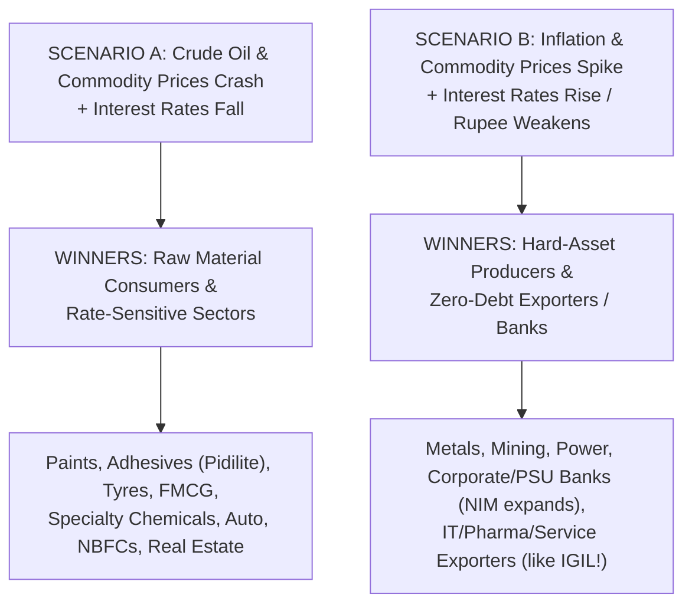

# Module 9: Macro, Government Policy Traps & Special Situations (Demergers, Buybacks & Turnarounds)

> **Core Philosophy:** *"Even a 10/10 company can lose 50% of its value overnight if its profits depend on a politician's signature. Conversely, corporate actions like Demergers and Buybacks create forced institutional mispricings with fixed legal timelines—eliminating opportunity cost."*

---

## 1. Government Policy & Regulatory Traps ("Stroke of the Pen" Risk)

In emerging markets, the government is both the biggest customer and the biggest regulator. Before paying a high P/E multiple (>30x) for any stock, check if it suffers from **"Stroke of the Pen" Risk**—where a single government notification can wipe out 40% of its EBITDA overnight.

### The 4 Classic Government Policy Traps to Avoid (or Price at Low Multiples):

1. **The B2G (Business-to-Government) Working Capital Trap:**
   * Companies whose primary customer is State Governments, Municipal Corporations, or State Electricity Boards (e.g., Water Treatment EPC, Smart Metering EPC, State Road Contractors).
   * **What happens:** For 2 years before an election, order books triple and revenues boom. Then elections happen, state budgets get diverted to welfare schemes, and **state governments stop paying bills for 9 to 18 months!**
   * Receivable days balloon from 90 days to 280 days, the company takes high-interest bank debt just to survive, and the stock crashes 60%.
   * **Rule:** Never pay >15x–18x P/E for a B2G business, and exit whenever Debtor Days cross 150 days.

2. **The Subsidy / Policy-Arbitrage Trap:**
   * When a company's high ROCE comes entirely from a temporary government subsidy (e.g., FAME-II EV subsidies, state ethanol blending pricing, or export incentives).
   * The moment the government reduces the subsidy or investigates subsidy claims, margins vanish. True moats come from customers willingly paying for a product, not taxpayers subsidizing it.

3. **Regulatory Price Caps & Export Bans:**
   * **Commodities & Agri (Sugar, Rice, Wheat, Steel, Cement, Fertilizers):** Whenever domestic food or construction inflation spikes before elections, the government immediately slaps an **Export Ban** or **Export Duty**, crushing domestic realizations at the exact peak of the global cycle!
   * **Regulated Monopolies (City Gas Distribution like IGL/MGL, Exchanges, Hospitals, Domestic Pharma NLEM):** If a regulated utility earns *too* much profit (say 30% ROCE), the regulator inevitably cuts their cheap domestic gas quota or caps their fees/stent/drug prices.

4. **When Government Policy Is a REAL Tailwind (Picks & Shovels):**
   * Instead of buying the EPC contractor bidding directly for government tenders at 8% margins, buy the **component supplier** selling critical equipment (transformers, cables, bearings, defense electronics, railway brakes) to the private sector and EPC players with 30-day cash terms!

---

## 2. Macro Cycles: Interest Rates, Inflation & Raw Material Deflation

You don't need to be a macro-economist, but you must know which way the macro wind is blowing for your company's margins:

### The "Raw Material Deflation + Pricing Power" Super-Setup
One of the easiest ways to catch a 12-month earnings surprise in consumer/industrial companies:
1. During high crude/commodity inflation (Year 1), a strong brand (like Asian Paints, Pidilite, Britannia, or a niche industrial player) raises its selling prices by 15% to protect its margins.
2. In Year 2, crude oil or chemical raw material prices crash by 30%.
3. Because the company has **strong pricing power (Module 1)**, it **does not reduce its MRP** (or only passes back 5% to customers and keeps 25%)!
4. **Result:** Gross Margins expand by 400–600 bps over the next 3 quarters, causing EBITDA to jump 40% even if sales volume only grows 10%!

---

## 3. Special Situations & Corporate Actions (Zero-Opportunity-Cost Catalysts)

Why do legend investors like Joel Greenblatt (*"You Can Be a Stock Market Genius"*) love **Special Situations**? Because unlike normal stocks—where you might wait 2 years for the market to recognize value—**Corporate Actions have fixed legal/NCLT calendar dates and forced institutional buying/selling!**

### A. Demergers / Spin-Offs (The #1 Multi-Bagger Factory)
What is a Demerger? Suppose **Company AB** has Market Cap of ₹10,000 Cr and runs two businesses under one roof:
* **Business A (Legacy Textile/Commodity):** ₹800 Cr EBITDA, 8% ROCE, grows at 4%/year. Market gives the whole company a boring **10x P/E**.
* **Business B (Fast-Growing Branded Retail / Engineering / Chemical Division):** ₹200 Cr EBITDA, **35% ROCE**, growing at **30%/year**—completely hidden inside the boring parent!

Now, the Promoter announces an **NCLT Demerger**: For every 1 share of Company AB, shareholders get 1 free share of newly listed **Company B Ltd**.

#### Watch What Happens in the First 30 Days After Company B Lists (The Forced-Selling Goldmine):
1. Large-cap/Mid-cap Mutual Funds that owned ₹10,000 Cr Company AB suddenly receive shares of tiny ₹2,000 Cr **Company B Ltd**.
2. Because Company B is either too small for their fund mandate or not in their benchmark index, **those Mutual Funds dump Company B shares mindlessly in the first 2–3 weeks of listing regardless of price!**
3. The stock of Company B crashes 20%–30% in the first 15 days after listing, trading at a ridiculous **12x P/E** despite having 35% ROCE and 30% growth!
4. **Your Move:** Step in right as the forced institutional selling finishes (Week 3–6 post-listing). Over the next 12–18 months, growth investors discover the pure-play 35%-ROCE gem, and **Company B re-rates from 12x P/E to 35x P/E while earnings grow 30%—delivering a 3x–4x return!**

### B. Share Buybacks: Genuine Signal vs. Fake PR Stunt
Not all buybacks are equal. In India, there are two types:
1. **Tender Offer Buyback at a Premium (Especially When Promoters DO NOT Participate):**
   * The company announces it will buy back 5% of shares at ₹1,200 (when market price is ₹950) via Tender Offer, **and the Promoter announces they will NOT tender their shares!**
   * **Why this is ultra-bullish:** The promoter is using company cash to retire public shares and *increase* their own ownership stake because they believe the stock is deeply undervalued.
2. **Open Market Buyback ("Up to ₹X Price") — Often a Trap:**
   * Management announces on TV: *"Board approves buyback at up to ₹1,500/share (current price ₹1,000)!"*
   * Retail investors rush in thinking ₹1,500 is guaranteed. In reality, "up to ₹1,500" means the company can buy a few shares at ₹980 in the open market and stop after spending just the minimum statutory amount! Always prefer **Tender Route** over Open Market route.

### C. Management Takeovers & Open Offers (SEBI SAST Regulations)
* Whenever a new Promoter, Strategic Giant, or top Buyout PE Fund (like Blackstone, Advent, PAG, or a strong industrial group like Tube Investments / Cholamandalam) signs a deal to acquire **>25% or Control** of a listed company:
* Under SEBI law, they must make an **Open Offer** to buy an additional **26% from public shareholders** at the deal price.
* **How to play it:** Often, the biggest money isn't made in the 26% Open Offer arbitrage itself—it is made by **buying alongside the new owner right after the Open Offer completes**, because the new owner brings in a new CEO, cleans up working capital, and injects new business verticals to grow the company 3x–5x over the next 4 years!

---

## 4. Module 9 Checklist: Policy, Macro & Special Situations

- [ ] **B2G & Subsidy Check:** Does >20% of revenue come from government tenders or government subsidies? (If yes, cap target P/E at 15x and monitor Receivable Days strictly).
- [ ] **Regulatory Price-Cap Risk:** Is the company earning super-normal margins in a politically sensitive sector (Healthcare, Agri/Food, Regulated Gas/Power)?
- [ ] **Raw Material Cycle:** Are key raw material prices (Crude derivatives, Metals, Chemicals) at multi-year highs (margin headwind) or multi-year lows (margin tailwind)?
- [ ] **Special Situation Catalyst:** Is there an upcoming Demerger, Promoter-Excluded Tender Buyback, or Change in Control / Management Takeover that creates a time-bound catalyst?
