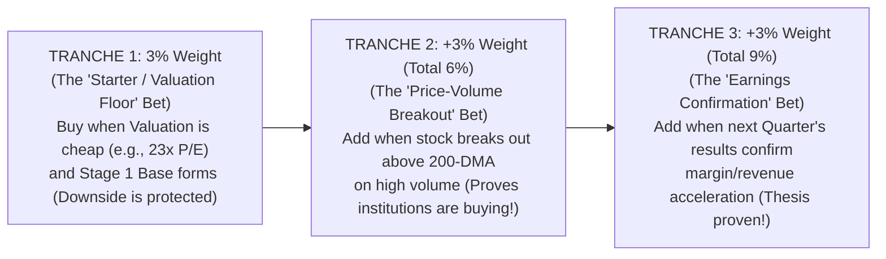

# Module 10: Portfolio Construction, Position Sizing, Pyramiding & Behavioral Psychology

> **Core Philosophy:** *"In investing, it's not about whether you are right or wrong—it's about how much money you make when you are right, and how little you lose when you are wrong."* — George Soros  
>  
> Even with a 10/10 stock selection process, poor **Position Sizing**, buying 100% on Day 1, or succumbing to **Behavioral Biases** will ruin your returns and create massive opportunity cost.

---

## 1. Portfolio Construction: How Many Stocks & How Much Weight?

### A. The "Diworsification" Trap vs. Concentrated Conviction
* **Owning 40–50 Stocks (Closet Indexing):** If you own 45 stocks with 2% in each, and your best stock doubles (+100%), your total portfolio only goes up by **2%!** You are doing hundreds of hours of research just to get a mutual fund return.
* **Owning Only 3–4 Stocks (Russian Roulette):** One unexpected regulatory ban, factory fire, or global sanction can wipe out 30% of your net worth.
* **The Sweet Spot for a Serious Individual Investor: 12 to 18 Stocks** across no more than 5–6 uncorrelated industries.

### B. The 3-Bucket Portfolio Architecture

| Bucket | Role in Portfolio | Target Portfolio Weight | Position Size Per Stock | Examples of Setup |
| :--- | :--- | :---: | :---: | :--- |
| **Bucket 1: Core Structural Compounders** | Steady 18%–22% CAGR wealth builders; high ROIC (>25%), debt-free, strong moat, predictable cash flows. | **50% – 60%** of Portfolio | **8% to 12%** per stock *(5–6 stocks)* | IGIL (at 23x P/E), Elite Consumer/Healthcare/Financial/Niche B2B leaders |
| **Bucket 2: Inflection & Operating Leverage Plays** | 25%–35% CAGR over 2–3 years; new capex commissioning, product mix shift, or PE overhang clearing. | **25% – 35%** of Portfolio | **5% to 7%** per stock *(4–6 stocks)* | Post-capex specialty manufacturers, hospitals ramping occupancy |
| **Bucket 3: Special Situations & Cyclicals** | Time-bound 12–18 month catalysts (Demergers, Turnarounds, Commodity Troughs). | **10% – 20%** of Portfolio | **3% to 5%** per stock *(3–4 stocks)* | Spin-offs, management change, deep-value cyclical troughs |

> **Hard Risk-Management Rules:**
> 1. **Max Single-Stock Allocation at Cost:** Never put more than **10%–12%** of your cost capital into a single stock (let it grow to 18%–20% through price appreciation, not by putting all your cash into one bet at the start).
> 2. **Max Single-Sector Exposure:** Never put more than **25%** of your portfolio into stocks driven by the exact same macro factor (e.g., owning 4 different chemical exporters or 4 different railway EPC companies is really ONE giant 25% bet!).

---

## 2. The 3-Tranche Entry ("Pyramiding") System — Solving the Entry Timing Fear

One of the hardest problems in investing is:
* If you buy 100% of your target position on Day 1, the stock might sit flat for 4 months or dip 15% in a market correction, locking up your capital.
* If you wait for everything to be 100% certain, the stock might gap up 25% after great results and you miss it!

**The Solution: Never buy in a single lump sum. Use the 3-Tranche Pyramiding System.**

Suppose your target allocation for **Stock X (say IGIL)** is **9% of your portfolio**:

### Why This 3-Tranche System Eliminates Opportunity Cost:
1. **If the stock stays in a Stage 1 base for 6 months:** Only **3%** of your capital is waiting (earning dividends), while your other 6% cash is free to work in stocks that are already moving!
2. **If the market crashes 15% due to a global panic (while company fundamentals remain intact):** Because you only bought Tranche 1 (3%), you still have **6% dry powder** and complete emotional calm to buy Tranche 2 at a bargain price!
3. **If the stock breaks out and earnings accelerate immediately:** You scale up to your full **9% weight** right as the stock enters its fastest Stage 2 markup phase!

---

## 3. The Golden Law of Averaging: When to Average UP vs. Average DOWN

Retail investors love **Averaging Down** (*"I bought at ₹500, now it's ₹350, let me buy more to lower my average price to ₹425"*). In 70% of cases, averaging down turns a small mistake into a portfolio-killing disaster!

### Memorize This Strict Rule:
* **NEVER Average Down in:**
  1. **Leveraged Companies** (Debt-to-Equity > 0.7x) — a falling stock price in a high-debt company often predicts a solvency crisis.
  2. **Cyclicals, Commodities, or B2G EPC Stocks** — when a commodity cycle turns down, a stock that fell 40% will routinely fall another 60% and stay dead for 4 years.
  3. **Any Stock Where the Fundamental Thesis Broke** (margins collapsed, receivable days spiked, or promoter pledged shares).
* **ONLY Average Down in:**
  * **Debt-Free, High-ROIC (>25%) Structural Compounders (Bucket 1)** where the **business is still growing (+15% to +25% YoY)**, and the stock dropped purely due to P/E compression from post-IPO hype or a broad market correction (like IGIL correcting from 50x P/E to 23x P/E while Q1 FY27 EBITDA grew +29%!).
* **Learn to Average UP (Pyramiding):**
  * When a stock goes from ₹320 to ₹370 **because its quarterly profits jumped +30% and it broke above its 200-DMA**, the stock at ₹370 is actually *less risky and cheaper on forward earnings* than it was at ₹320! Adding Tranche 2 and Tranche 3 on the way up is how pros build 10% positions in their biggest winners.

---

## 4. Behavioral Psychology: Mastering Your Own Mind

Even with Modules 1 to 9 mastered, **your own brain will try to sabotage you** using five subconscious biases:

### 1. Anchoring Bias (The #1 Cause of Missed Multi-Baggers & Held Losers)
* **How it hurts you on Buying:** *"I looked at Stock A when it was ₹200 six months ago. Now it is ₹280 (+40%) after commissioning its new factory and reporting blockbuster numbers. I refuse to buy at ₹280 because I missed ₹200!"* $\rightarrow$ The stock goes from ₹280 to ₹1,200 over the next 3 years while you sit anchored to an irrelevant historical price!
* **How it hurts you on Selling:** *"I bought Stock B at ₹600. The company's moat broke and profits fell, and the stock is now ₹420. I will just wait for it to come back to my ₹600 buy price so I can exit at breakeven."* $\rightarrow$ **The stock market does not know or care what your buy price is!**
* **The Antidote:** Every quarter, cover up your Buy Price column and ask: *"If I had ₹10 Lakhs in fresh cash today and owned zero shares of this stock, would I buy it today at its current price and current fundamentals?"* If the answer is no, sell it today.

### 2. Sunk Cost & Effort Bias (Falling in Love with Your Own Research)
* Notice what happened when you wrote 4 detailed reports (1,000+ lines) on IGIL: When we spend 20 hours researching a company, our brain forms an **emotional attachment** to it (*"I worked so hard on this thesis, it HAS to be right!"*).
* **The Antidote:** Always write a **"Pre-Mortem / Kill Criteria" Box** at the bottom of your note *before* you buy: *"I will admit I am wrong and sell 100% of this stock if Metric X falls below Y for 2 consecutive quarters."*

### 3. Confirmation Bias
* After buying a stock, investors spend hours on Twitter, ValuePickr, and YouTube searching only for bullish posts that agree with them, and get angry at anyone pointing out a risk.
* **The Antidote:** Actively seek out the smartest bear on your stock. If you can answer the bear's best argument with hard data from the Balance Sheet, your conviction is earned.

### 4. Action Bias & Boredom Selling (The Stage 1 Trap)
* Often, you do great work, buy a wonderful stock at 22x P/E near the end of its Stage 1 base, and for the next 10 weeks the stock just sits quietly between ₹315 and ₹335 while some junk stock on TV goes up 40%.
* Out of sheer boredom and FOMO, you sell your quiet 22x P/E compounder to chase the hot TV stock—and 3 weeks later, your original stock breaks out to ₹500 while the TV stock crashes!
* **The Antidote:** Understand that **wealth in the stock market is created non-linearly (80% of a stock's 3-year move happens in just 4 to 6 months of bursts; the other 30 months are quiet digestion).** As long as quarterly earnings are compounding at 20% and valuation is fair, sitting still is active work!

---

## 5. Module 10 Portfolio & Sizing Checklist

- [ ] **Bucket Classification:** Is this stock a Bucket 1 Core Compounder (8–12% target weight), Bucket 2 Inflection Play (5–7%), or Bucket 3 Special Situation/Cyclical (3–5%)?
- [ ] **3-Tranche Plan Written Down:** What is my exact price/condition for Tranche 1 (3%), Tranche 2 (+3%), and Tranche 3 (+3%)?
- [ ] **Sector Correlation Check:** Does adding this stock push my total portfolio exposure to a single sector/theme above 25%?
- [ ] **Kill Criteria Defined Upfront:** What exact 2-quarter fundamental deterioration will trigger an automatic exit regardless of my buy price?
