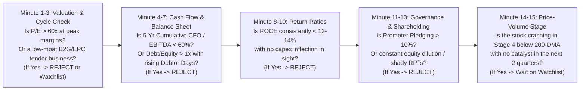

# Module 11: The Practical Idea-Generation Workflow (Screener Formulas, 15-Minute Filter & Quarterly Ritual)

> **Core Philosophy:** *"There are 5,000+ listed companies in India, and 90% of them are uninvestable wealth destroyers. You don't need to read 500-page reports on 100 companies—you need a ruthless 15-minute filter that eliminates 90% of stocks instantly so you spend 100% of your deep-dive energy on the top 5%."*

This final module ties **Modules 1 through 10** together into a repeatable, step-by-step **Weekly & Quarterly Workflow**.

---

## 1. Where to Find Great Stock Ideas (5 Proven Hunting Grounds)

Never get your stock ideas from business TV channels, newspaper headlines, or Telegram groups (by the time a stock is there, it is in Stage 3 Distribution). Use these **5 High-Signal Sources**:

### Source 1: Custom Screener.in Queries (Copy-Paste Ready!)
Run these 4 quantitative screens on **Screener.in** once a month to surface high-probability candidates:

#### Screen A: "High-ROCE Compounders at Reasonable Valuation & Low Debt" (Bucket 1 Core Ideas)
```text
Market Capitalization > 1000 AND
Return on capital employed > 20 AND
Average return on capital employed 5Years > 18 AND
Debt to equity < 0.4 AND
Sales growth 3Years > 14 AND
Profit growth 3Years > 15 AND
Cash from operations last year > 0 AND
Price to Earning < 32 AND
Promoter holding > 45 AND
Pledged percentage = 0
```

#### Screen B: "The Capex Commissioning Inflection Screen" (Bucket 2 Operating Leverage Ideas)
*Finds companies whose Gross Block (Fixed Assets) just jumped massively (new factory finished!) or who have huge CWIP about to commission, while still debt-controlled:*
```text
Market Capitalization > 500 AND
Net block > 1.4 * Net block preceding year AND
Return on capital employed > 14 AND
Debt to equity < 0.8 AND
OPM > 12 AND
YOY Quarterly sales growth > 15
```

#### Screen C: "Quarterly Operating Leverage Breakout" (Immediate Catalyst Screen)
*Finds companies where latest quarterly sales grew >18% YoY and Operating Profit grew >30% YoY (margins expanding!):*
```text
Market Capitalization > 500 AND
YOY Quarterly sales growth > 18 AND
YOY Quarterly profit growth > 30 AND
OPM latest quarter > OPM preceding year quarter AND
Debt to equity < 0.6 AND
Return on capital employed > 16
```

#### Screen D: "Post-IPO De-Rated Gems" (The IGIL Setup!)
*Finds high-ROCE companies listed in recent years where the business is growing, but the stock has corrected from post-IPO highs to a reasonable P/E:*
```text
Market Capitalization > 1500 AND
Return on capital employed > 22 AND
Debt to equity < 0.3 AND
YOY Quarterly sales growth > 15 AND
Price to Earning < 28 AND
Current price < 0.8 * High price all time
```

---

### Source 2: Tracking "52-Week High Volume Breakouts After a 1-Year Base"
* Every weekend, scan stocks breaking out of a **6-to-18-month sideways base** on **3x–5x average weekly volume**.
* Ask: *Why did institutions suddenly buy ₹200 Crore of this sleepy company this week?* Go read its latest Investor Presentation and Concall—half the time you will discover a brand-new product mix shift, a PE overhang clean-out, or a new plant commissioning!

### Source 3: Cloning & Tracking "Tier-1 Smart Money" (>1% Shareholding Filings)
* Track what ultra-long-term Sovereign/Endowment funds (**MIT Endowment, GIC, Nalanda Capital, Steadview, Malabar, ValueQuest, ICICI Pru Contrarian schemes**) are buying for the first time in quarterly shareholding disclosures.

### Source 4: Promoter Insider Buying & Preferential Warrants
* On Screener / BSE *Insider Trading & SAST Regulations* tab, filter for companies where the **Promoter is buying shares from the open market** using personal cash or subscribing to Preferential Warrants.

### Source 5: Competitor & Value-Chain Scuttlebutt
* Whenever one sector leader reports blowout numbers, check the **suppliers** and **smaller niche peers** in the same value chain before the market notices them.

---

## 2. The "15-Minute Fast-Reject Filter" (Eliminate 90% of Stocks in 15 Minutes)

When you find a new stock name from one of the 5 sources above, **DO NOT spend 10 hours writing a 30-page report on it yet!**
Open the stock on Screener.in and run this **15-Minute Fast-Reject Filter**. If it fails any of these 5 checks, **close the tab in 15 minutes and move on:**



---

## 3. The 3-Hour Deep-Dive Sequence (Only for the 10% That Pass the 15-Minute Filter!)

Once a stock passes the 15-Minute Filter, spend **3 focused hours** in this exact order (instead of reading random broker blogs):

1. **Hour 1: Read the Latest 2 Investor Presentations & Latest 2 Concall Transcripts (Module 1 & 4)**
   * Understand the exact revenue split, unit economics, customer segments, capacity utilization, and management's guidance for the next 4–8 quarters.
   * Pay special attention to the **Q&A section of the Concall**—what tough questions are institutional analysts asking, and how clearly is the CFO answering?
2. **Hour 2: Read the Latest Annual Report & Credit Rating Report (Module 2 & 3)**
   * Don't read the glossy marketing pages! Press `Ctrl+F` / `Cmd+F` inside the Annual Report PDF for these 6 keywords:
     1. `"Related Party"` (Check for cash siphoning, royalties, promoter entities)
     2. `"Contingent Liabilities"` (Check off-balance-sheet guarantees/disputes)
     3. `"Segment"` (Check which division has the highest margin and growth)
     4. `"Remuneration"` (Check promoter salary as % of PAT)
     5. `"Trade Receivables"` (Check the >6 months ageing schedule)
     6. `"Capital Work"` (Check CWIP ageing and commissioning schedule)
   * Read the 4-page **CRISIL / ICRA / CARE Credit Rating Rationale Report** (linked at the bottom of Screener) to see the unvarnished risks.
3. **Hour 3: Fill Out the 1-Page Gatekeeper Scorecard (Module 5, 6, 7 & 10)**
   * Fill out the **[360-Degree Gatekeeper Scorecard](./07-Bridging-Your-Gaps-Consultant-To-Investor.md)** (Reverse DCF valuation math, Bear/Base/Bull 3-year target price, PE overhang check, and your 3-Tranche Entry prices).

---

## 4. The Quarterly Portfolio Maintenance Ritual (How to Track Your Stocks in 1 Hour per Quarter)

Once you own 12–15 stocks, you only need **1 hour per stock every 3 months** (during quarterly earnings season: May, August, November, February):

### The 5-Point Quarterly Earnings Scorecard (Grade Each Stock: 🟢 Green / 🟡 Yellow / 🔴 Red):
1. **Volume vs. Realization (ARP/Price) Growth:** Did revenue grow because of real volume growth and mix upgrade (like IGIL's Q1 FY27 +17% volume and ₹1,010 ARP 🟢), or did volumes stall?
2. **Margin Trajectory:** Did Gross Margin and EBITDA Margin hold or expand as expected by our operating-leverage thesis?
3. **Half-Yearly Balance Sheet & Cash Flow Check (Every September Q2 & March Q4):**
   * Indian companies release a full Balance Sheet and Cash Flow Statement every 6 months (September and March).
   * Immediately check: **Did Receivable Days, Inventory Days, or Short-Term Debt spike compared to Revenue growth? Did CFO convert at >70% of EBITDA?**
4. **Concall "Say vs. Do" Check:** Did management deliver on the timeline they promised 2 quarters ago, or are they making excuses and shifting goalposts?
5. **Shareholding & Stage Check:** Did marquee institutions (FIIs/DIIs) hold/add, or was there a promoter/PE block dump? Is the stock holding above its 200-DMA?

* **Action Rule:**
  * **🟢 Green:** Hold tight (or add Tranche 2 / Tranche 3).
  * **🟡 Yellow (1 soft quarter due to temporary macro/weather, moat intact):** Hold current size; do not add new money until next quarter confirms recovery.
  * **🔴 Red (2 consecutive quarters of thesis breakdown, margin collapse, or balance sheet bloat):** Execute a disciplined exit and redeploy into your highest-conviction 🟢 Green idea!

---

## Navigation
* **Back to Master Index:** [00-Master-Curriculum.md](file:///Users/ashishgarg/Desktop/work/LearningStuff/docs/finance/stockInvesting/00-Master-Curriculum.md)
* **Previous Module:** [10-Portfolio-Sizing-Pyramiding-And-Psychology.md](file:///Users/ashishgarg/Desktop/work/LearningStuff/docs/finance/stockInvesting/10-Portfolio-Sizing-Pyramiding-And-Psychology.md)
* **Next Module:** [12-Master-Financial-Ratios-Encyclopedia.md](file:///Users/ashishgarg/Desktop/work/LearningStuff/docs/finance/stockInvesting/12-Master-Financial-Ratios-Encyclopedia.md)
